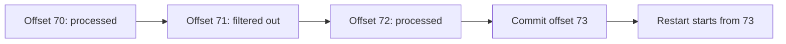

# ackDiscarded and Offsets of Filtered Records

Spring Kafka lets you filter records before invoking a `@KafkaListener` method using `RecordFilterStrategy`. When the strategy returns `true`, the record is excluded from the listener invocation flow. However, the record still exists in Kafka; what must be decided is whether the consumer acknowledges having processed the excluded record.

`ackDiscarded` controls the acknowledgment of filtered records. This property is especially important when using manual acknowledgment: if the adapter excludes a record without invoking the listener, the listener has no chance to call `Acknowledgment.acknowledge()`. Enabling `ackDiscarded` allows the adapter to acknowledge excluded records according to the container's policy.

## 1. Where does record filtering happen?

`RecordFilterStrategy.filter(record)` returns `true` to exclude the record and `false` to forward the record to the listener. Spring Kafka wraps the listener in a filtering adapter; for record listeners this is `FilteringMessageListenerAdapter`, while batch listeners use the corresponding adapter to filter the list of records.

```java
@Bean
public ConcurrentKafkaListenerContainerFactory<String, OrderEvent>
        kafkaListenerContainerFactory(
            ConsumerFactory<String, OrderEvent> consumerFactory) {
    var factory =
        new ConcurrentKafkaListenerContainerFactory<String, OrderEvent>();
    factory.setConsumerFactory(consumerFactory);
    factory.setRecordFilterStrategy(record ->
        record.value() != null && record.value().isDuplicate());
    factory.setAckDiscarded(true);
    return factory;
}
```

In this example, records marked as duplicate do not enter the listener method. `setAckDiscarded(true)` tells the adapter to acknowledge filtered records. A listener using this factory:

```java
@KafkaListener(
    topics = "order-events",
    groupId = "order-projection",
    containerFactory = "kafkaListenerContainerFactory")
public void consume(OrderEvent event) {
    orderProjection.apply(event);
}
```

Filter only when the decision to skip is intentional. If a payload is malformed, missing required data, or encounters a transient error during evaluation, you should usually route the error through an error handler or DLT for investigation instead of returning `true` and silently dropping the record.

## 2. What does ackDiscarded change?

`ackDiscarded` does not delete records from Kafka, nor does it alter the record's offset on the broker. It determines whether the adapter acknowledges the discarded record. The default value is `false`.

| Configuration | Filtering adapter behavior |
| --- | --- |
| `ackDiscarded = false` | Excludes the record from listener invocation without proactively acknowledging it via `Acknowledgment`. |
| `ackDiscarded = true` | Excludes the record from listener invocation and acknowledges the discarded record. |

With container-managed `AckMode`s such as `RECORD` or `BATCH`, the container still controls commits after the adapter returns normally according to the chosen mode. `ackDiscarded` becomes especially useful with `MANUAL` and `MANUAL_IMMEDIATE`, because the listener is not invoked for a filtered record and therefore cannot acknowledge it itself.

If you use manual acknowledgment and leave `ackDiscarded` as `false`, the filtered record may remain unacknowledged. When the offset has not advanced past that record, the consumer may read it again after a restart or rebalance. Enabling `ackDiscarded` explicitly expresses that excluding the record is an accepted processing outcome.

## 3. How is the offset of a filtered record committed?

Kafka stores offsets per partition. The committed offset is the position of the next record the consumer group will read, not the count of records processed. When a record is filtered out and progress is committed past its offset, on the next startup the consumer continues from the next offset; the filtered record is not redelivered to that group.

For example, partition `order-events-0` has three records:

| Offset | Filter decision | Outcome |
| ---: | --- | --- |
| 70 | Keep | Listener processes |
| 71 | Discard | Listener not invoked |
| 72 | Keep | Listener processes |

If the container commits offset `73` for the partition, the consumer group has confirmed progress past offset 72. Upon restart, the consumer starts from offset 73; record 71 is not read again. If the committed offset remains `71`, the consumer restarts from the record at offset 71 and the filter may run again.



Kafka offsets may have gaps due to compaction or other log characteristics. Therefore, do not calculate the next offset by counting records seen in the listener; understand the committed offset as the resume-read position per partition.

## 4. Impact of AckMode

`AckMode` determines when the container commits offsets. Filtering records does not create an independent commit mechanism; discarded records still participate in poll progress according to the acknowledgment policy.

| AckMode | Meaning for filtered records |
| --- | --- |
| `RECORD` | Container commits after processing each record; the adapter returns normally after filtering. |
| `BATCH` | Container commits partition offsets after finishing processing the batch from a `poll()`. |
| `TIME`, `COUNT`, `COUNT_TIME` | Commits when the time or processed-record threshold is reached. |
| `MANUAL` | Listener proactively acknowledges; filtered records need the adapter to acknowledge them if they should be confirmed individually. |
| `MANUAL_IMMEDIATE` | Acknowledgment can commit immediately on the consumer thread; `ackDiscarded` helps confirm discarded records even though the listener does not run. |

With `MANUAL`, acknowledgments are batched according to container semantics; an offset acknowledged at a later position can advance committed progress past an earlier record in the same partition. Because Kafka commits offsets as the next position to read, do not infer that each record has an independent commit flag. If you need to confirm exclusions explicitly, enable `ackDiscarded` and test with the exact `AckMode` in use.

Example manual acknowledgment configuration:

```java
factory.getContainerProperties()
    .setAckMode(ContainerProperties.AckMode.MANUAL_IMMEDIATE);
factory.setAckDiscarded(true);
```

In the listener, only acknowledge records that the listener actually receives and processes:

```java
@KafkaListener(topics = "order-events",
               containerFactory = "kafkaListenerContainerFactory")
public void consume(OrderEvent event, Acknowledgment acknowledgment) {
    orderProjection.apply(event);
    acknowledgment.acknowledge();
}
```

Filtered records are excluded before entering the method; the filtering adapter is responsible for acknowledging them when `ackDiscarded` is enabled.

## 5. When using a batch listener

With a batch listener, the filtering adapter removes filtered records from the list before invoking the listener. The listener receives the filtered list, so the batch size seen by the listener may be smaller than the number of records fetched from Kafka.

If all records in a batch are filtered out, the listener may not be invoked. With manual acknowledgment, check `ackDiscarded` so the adapter acknowledges the discarded batch as intended. With a container-managed AckMode, the container handles offsets by batch and the configured commit mode.

Do not assume an index in the filtered list corresponds to the offset or original position in the batch. If you need to audit individual discarded records, record metadata such as topic, partition, offset, and filter reason before excluding the record. When processing batches, test both partial batch filtering and full batch filtering.

## 6. Filtering combined with Kafka transactions

If the listener container uses Kafka transactions, consumer offsets are included in the transaction according to the container's configuration. Filtered records do not invoke the listener method, yet the filter decision still happens within the current poll processing cycle. When the transaction commits, the corresponding offsets can be confirmed with the transaction; if the transaction rolls back, uncommitted progress may be read again.

Do not treat `ackDiscarded` as an independent transaction or as proof that external side effects have completed. It only controls acknowledging discarded records through the adapter. If a filter needs to write an audit record or update a database, that operation has its own transaction boundary and requires idempotency if records may be redelivered.

## 7. Distinguishing intentional exclusion from recoverable errors

Filtering fits cases with clear skip rules:

- Duplicate events already processed that have a durable inbox/dedup marker.
- Snapshots older than the current version that no longer have effect.
- Events not belonging to the types this consumer group cares about.
- Events cancelled by business state where the rule permits skipping.

Do not use filters to hide system errors or data errors requiring investigation. For instance, if duplicate checking requires calling a database and the database times out, do not treat a timeout as a duplicate. Let the exception go through the error handler for retry or recovery. If a payload is invalid, consider sending it to a DLT with a reason rather than dropping it.

For duplicate detection, recording that an event was processed and updating business data should be within the same database transaction. If you only read a flag in a cache, two concurrent consumers or two redeliveries could both decide the record does not exist yet and produce duplicate side effects.

## 8. Auditing and observing filtered records

An excluded record does not enter the business listener, so logs and metrics are essential to explain why offsets continue advancing. You can record topic, partition, offset, key or event ID, filter rule, and exclusion reason. Avoid logging full sensitive payloads.

Track filtered record counts by rule, filter ratio over total records, filter error counts, consumer lag, and records re-read after restarts. If the filter rate spikes suddenly, the producer may be emitting malformed events, the filter rule may have changed, or the consumer may be mistakenly dropping valid data.

Do not perform a slow HTTP call inside a filter to decide whether to drop a record. Filters run on the consumer thread; slow operations reduce throughput and affect poll timing. If filtering decisions need external information, prefer data already present in the event or a local data store with predictable access times.

## 9. Testing ackDiscarded and offsets

An integration test should send one filtered record and one retained record to the same partition. Use `MANUAL_IMMEDIATE` to verify that the retained record is acknowledged only by the listener, while the discarded record is acknowledged by the adapter when `ackDiscarded=true`. Then restart the consumer group or create a new consumer with the same group ID to verify committed offsets and confirm the filtered record is not redelivered.

Also test these scenarios:

- `ackDiscarded=false` in manual mode when the filtered record is the last polled record.
- `ackDiscarded=true` with `MANUAL` and `MANUAL_IMMEDIATE`.
- `BATCH` mode when part or all of a batch is filtered.
- Transaction commit and rollback after a record is excluded by a filter.
- Filter throwing an exception due to a dependency error; verify the record goes through the error handler.
- Duplicate events being filtered without losing uncommitted business updates.

Use Embedded Kafka or Testcontainers to test real offsets instead of merely checking whether the filter returns `true` or `false`. When testing commits, inspect committed offsets per partition; do not use listener invocation count as the sole proxy for Kafka progress.

## Conclusion

`ackDiscarded` determines whether the filtering adapter acknowledges excluded records. The records remain in Kafka; once the partition's offset is committed past them, the consumer group resumes from the next offset and does not re-read those records. Combine `ackDiscarded` with the appropriate `AckMode`, test both record and batch listeners, and audit exclusion decisions so offset advancement is always explainable.
