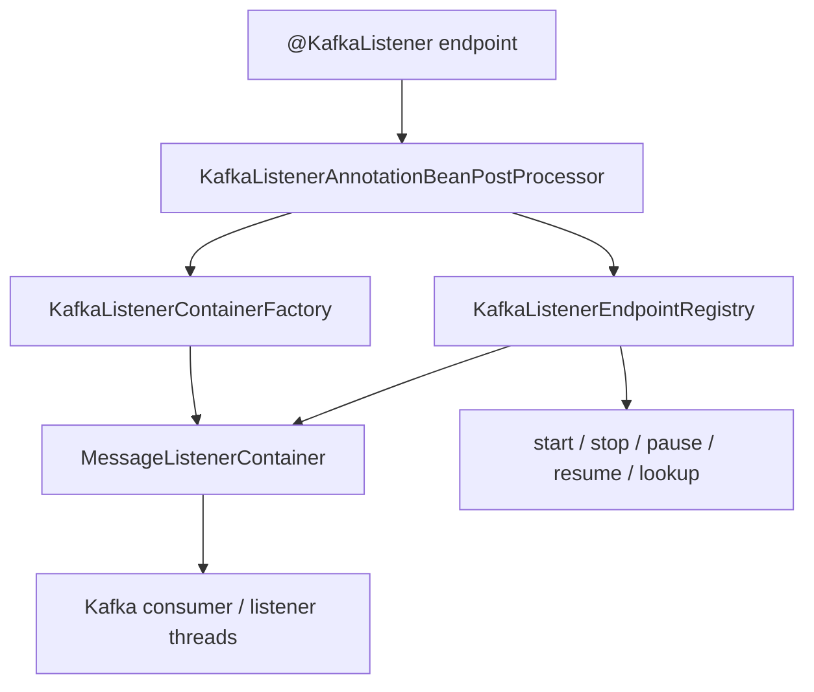

# KafkaListenerEndpointRegistry in Spring Kafka

`KafkaListenerEndpointRegistry` is the Spring Kafka infrastructure component that manages the lifecycle of listener containers created from `@KafkaListener` or registered as listener endpoints. Through the registry, an application can look up a container by ID, start/stop listeners, pause/resume consumers, list managed containers, and create dynamic listeners when needed.

One point to understand accurately: a method annotated with `@KafkaListener` is not directly a Kafka consumer, and the listener container created for the annotation is not a regular bean in the Spring `ApplicationContext`. Spring Kafka registers that container with `KafkaListenerEndpointRegistry` for lifecycle management. A container declared directly as a bean is a different case and is not part of the set of containers managed by the registry.

## 1. Where Does the Registry Fit in the Listener Architecture?

When an application enables the Kafka listener infrastructure, Spring Kafka processes `@KafkaListener` annotations, creates endpoints, and uses `KafkaListenerContainerFactory` to create listener containers. The registry holds these containers and coordinates their lifecycle.



Each component has a distinct role:

| Component | Role |
|---|---|
| `@KafkaListener` | Declares the message-receiving method and endpoint metadata such as ID, topic, and group |
| `KafkaListenerContainerFactory` | Creates containers and configures the consumer factory, concurrency, converter, error handler, and container properties |
| `MessageListenerContainer` | Manages consumers, the poll loop, listener invocation, and lifecycle |
| `KafkaListenerEndpointRegistry` | Holds references to registered containers and provides lifecycle operations |
| `ConsumerFactory` | Creates Kafka consumers according to client configuration |

The registry does not replace the container factory, consumer factory, or Kafka broker. It is the management point for containers after endpoints have been turned into containers.

## 2. The Registry Is Created Automatically by Spring Kafka

In an application using `@EnableKafka` or the appropriate Spring Boot auto-configuration, Spring Kafka registers a `KafkaListenerEndpointRegistry` bean. You can inject this bean into a listener management service:

```java
@Service
public class ListenerLifecycleService {

    private final KafkaListenerEndpointRegistry registry;

    public ListenerLifecycleService(KafkaListenerEndpointRegistry registry) {
        this.registry = registry;
    }
}
```

You do not need to create a second registry yourself to manage annotated listeners. Inject the infrastructure registry provided by Spring Kafka so that endpoints registered by the annotation processor reside in the same place.

A listener needs a stable ID if the application wants to look up its container via the registry:

```java
@Component
public class OrderListener {

    @KafkaListener(
            id = "orders-listener",
            topics = "orders",
            groupId = "orders-service"
    )
    public void onOrder(OrderCreated event) {
        // Process order event.
    }
}
```

The `id` value is the listener container's ID in the registry. If no explicit ID is declared, the framework may generate one using default conventions; in lifecycle management code, an explicit ID improves readability and reduces dependence on implementation details.

## 3. Looking Up a Container by ID

Use `getListenerContainer(String id)` to retrieve a container:

```java
public void startOrdersListener() {
    MessageListenerContainer container =
            registry.getListenerContainer("orders-listener");

    if (container == null) {
        throw new IllegalArgumentException(
                "Unknown listener: orders-listener");
    }

    if (!container.isRunning()) {
        container.start();
    }
}
```

The method returns `null` if the ID does not exist. Therefore, always check for `null` before calling `start()`, `stop()`, `pause()`, or `resume()`.

You can inspect its state:

```java
MessageListenerContainer container =
        registry.getListenerContainer("orders-listener");

if (container != null) {
    boolean running = container.isRunning();
    boolean pauseRequested = container.isPauseRequested();
    boolean containerPaused = container.isContainerPaused();
}
```

`isRunning()` indicates whether the container is running according to its lifecycle. `isPauseRequested()` indicates that a pause has been requested; the consumer may not actually be paused yet. `isContainerPaused()` reflects the actual pause state; for a concurrent container, it is `true` only when all child consumers have paused.

## 4. Listing Containers Managed by the Registry

`getListenerContainers()` returns the containers managed by the registry. `getListenerContainerIds()` returns the corresponding set of IDs:

```java
Set<String> listenerIds = registry.getListenerContainerIds();
Collection<MessageListenerContainer> containers =
        registry.getListenerContainers();

for (MessageListenerContainer container : containers) {
    log.info("listener running={}", container.isRunning());
}
```

If you need to select listeners by ID, you can filter the ID list:

```java
Set<String> orderListenerIds = registry.getListenerContainerIds()
        .stream()
        .filter(id -> id.startsWith("orders-"))
        .collect(Collectors.toSet());
```

Since Spring Kafka 3.2, the registry provides two `getListenerContainersMatching` overloads:

```java
Collection<MessageListenerContainer> retryContainers =
        registry.getListenerContainersMatching(
                id -> id.startsWith("orders-retry-"));

Collection<MessageListenerContainer> runningContainers =
        registry.getListenerContainersMatching(
                (id, container) ->
                        id.startsWith("orders-") && container.isRunning());
```

The first overload takes a `Predicate<String>` to filter by ID. The second overload takes a `BiPredicate<String, MessageListenerContainer>` to combine the ID with container state or properties. If your project uses Spring Kafka earlier than 3.2, filter from `getListenerContainers()` and `getListenerContainerIds()` instead of using this API.

## 5. Difference Between getListenerContainers and getAllListenerContainers

Not every listener container in the `ApplicationContext` is managed by the registry:

| API | Scope |
|---|---|
| `getListenerContainers()` | Containers managed by the registry, primarily created from `@KafkaListener` or registered via the registry |
| `getAllListenerContainers()` | Containers managed by the registry plus containers declared as beans in the `ApplicationContext` |
| `getListenerContainer(id)` | Looks up a container by ID in the registry |

`getAllListenerContainers()` was added in Spring Kafka 2.2.5. This collection includes already-initialized prototype containers, but does not initialize lazy beans that have not yet been created.

Containers declared directly via `@Bean` do not automatically belong to the registry's lifecycle. You can obtain container beans from the `ApplicationContext` or use `getAllListenerContainers()` to observe all of them. Do not assume `registry.stop()` will stop every container object in the context if some are not managed by the registry.

## 6. Starting and Stopping a Single Listener

You can start or stop an individual container:

```java
public void enableOrders() {
    MessageListenerContainer container =
            requireContainer("orders-listener");
    container.start();
}

public void disableOrders() {
    MessageListenerContainer container =
            requireContainer("orders-listener");
    container.stop();
}

private MessageListenerContainer requireContainer(String id) {
    MessageListenerContainer container = registry.getListenerContainer(id);
    if (container == null) {
        throw new IllegalArgumentException("Listener not found: " + id);
    }
    return container;
}
```

`start()` starts the container and its consumers join the consumer group. `stop()` stops the container, closes the consumers, and may trigger a group rebalance so partitions are reassigned to the remaining consumers.

If you need to know when the container finishes stopping, use the callback overload:

```java
container.stop(() ->
        log.info("Listener {} stopped", container.getListenerId()));
```

The callback is useful when you need to run a follow-up step after the listener has stopped. You should not assume the stop call always completes synchronously at the moment it returns.

## 7. Starting and Stopping All Containers via the Registry

The registry implements Spring's lifecycle. You can start or stop all containers managed by the registry:

```java
registry.start();
registry.stop();
```

You can pass a callback when stopping:

```java
registry.stop(() -> log.info("Registered Kafka listeners stopped"));
```

This is a broad operation. Before calling `registry.stop()`, determine whether any listener is processing tasks that must finish and whether draining or backpressure is needed prior to shutdown. When you only need to maintain a single stream, look up the container by ID and stop only that container.

All containers created by listener container factories within the same registry should use the same lifecycle phase. When using multiple custom factories, check their phases to ensure consistent startup/shutdown ordering.

## 8. Controlling autoStartup

By default, listener containers may start automatically when the `ApplicationContext` initializes. You can disable auto startup for a specific listener:

```java
@KafkaListener(
        id = "orders-listener",
        topics = "orders",
        groupId = "orders-service",
        autoStartup = "false"
)
public void onOrder(OrderCreated event) {
    orderService.process(event);
}
```

After the application finishes dependency checks or loads tenant configuration, you can start the listener:

```java
@Component
public class KafkaStartupCoordinator implements ApplicationRunner {

    private final KafkaListenerEndpointRegistry registry;

    public KafkaStartupCoordinator(KafkaListenerEndpointRegistry registry) {
        this.registry = registry;
    }

    @Override
    public void run(ApplicationArguments args) {
        // Check dependencies and readiness first.
        registry.getListenerContainer("orders-listener").start();
    }
}
```

`autoStartup` on the annotation overrides the container factory's default for that endpoint. This is useful when the application must wait for databases, schemas, secrets, or tenant configurations to become ready before consuming messages.

## 9. Registering Listeners After the ApplicationContext Has Refreshed

Endpoints registered after the `ApplicationContext` has refreshed usually start immediately, regardless of the endpoint's `autoStartup` attribute. This behavior follows the `SmartLifecycle` contract, where auto startup is evaluated during context initialization.

Since Spring Kafka 2.8.7, the registry has an `alwaysStartAfterRefresh` property. Set it to `false` so that the container's `autoStartup` controls starting for late-registered endpoints:

```java
@Component
public class RegistryStartupPolicy implements SmartInitializingSingleton {

    private final KafkaListenerEndpointRegistry registry;

    public RegistryStartupPolicy(KafkaListenerEndpointRegistry registry) {
        this.registry = registry;
    }

    @Override
    public void afterSingletonsInstantiated() {
        registry.setAlwaysStartAfterRefresh(false);
    }
}
```

This example uses a callback after singletons are instantiated to configure the existing infrastructure registry before the application registers late endpoints. Import `org.springframework.beans.factory.SmartInitializingSingleton` and do not declare a second `KafkaListenerEndpointRegistry` bean.

If you do not change the default behavior, assume listeners created after context refresh will start immediately. Do not use `autoStartup=false` as a guarantee of deferred startup for all dynamic registrations.

## 10. Pause and Resume vs. Stop and Start

Pause is appropriate when you want to temporarily stop receiving records while keeping the consumer in the group. Stop is appropriate when you want to terminate the consumer container.

| Operation | Consumer | Group Membership | When to Use |
|---|---|---|---|
| `pause()` | Temporarily stops fetching records; continues polling | Retains membership | Backpressure, brief maintenance, downstream temporary overload |
| `resume()` | Resumes fetching records | Retains membership | Processing conditions have recovered |
| `stop()` | Closes consumer | Leaves group, may rebalance | Disabling listener, changing configuration, or shutdown |
| `start()` | Creates/runs consumer per container | Rejoins group | Starting a stopped listener |

Invoking via the registry:

```java
public void pauseOrders() {
    requireContainer("orders-listener").pause();
}

public void resumeOrders() {
    requireContainer("orders-listener").resume();
}
```

`pause()` takes effect before the next poll; `resume()` takes effect after the current poll returns. While paused, the container continues polling the consumer to maintain group membership and avoid rebalances, without pulling additional records for the listener to process.

Since Spring Kafka 2.9, the `pauseImmediate` property can make pause take effect after the current record is processed, instead of waiting to finish all records received in the previous poll. Evaluate batch/record listeners and the version in use before enabling it.

## 11. Pause State and Lifecycle Events

Two states are commonly confused:

- `isPauseRequested()` returns `true` when a pause has been requested, even if the consumer may not actually be paused yet.
- `isContainerPaused()` returns `true` when all consumers of the container have paused.

Spring Kafka publishes `ConsumerPausedEvent` and `ConsumerResumedEvent` events when consumer state changes:

```java
@Component
public class ListenerPauseEventLogger {

    @EventListener
    public void onConsumerPaused(ConsumerPausedEvent event) {
        log.info("Paused partitions: {}", event.getPartitions());
    }

    @EventListener
    public void onConsumerResumed(ConsumerResumedEvent event) {
        log.info("Resumed partitions: {}", event.getPartitions());
    }
}
```

The event has the container as its source and includes the relevant partitions. You can use these events to update operational status or metrics. Do not rely on a self-managed boolean flag while ignoring the container's actual state.

## 12. Creating Dynamic Listeners with Prototype Beans

A convenient way to create listeners per tenant or runtime configuration is to declare a `@KafkaListener`-annotated class with prototype scope. Each instance has its own ID and topic:

```java
public class TenantEventListener {

    private final String id;
    private final String topic;

    public TenantEventListener(String id, String topic) {
        this.id = id;
        this.topic = topic;
    }

    public String getId() {
        return id;
    }

    public String getTopic() {
        return topic;
    }

    @KafkaListener(
            id = "#{__listener.id}",
            topics = "#{__listener.topic}"
    )
    public void listen(String payload) {
        // Process tenant message.
    }
}
```

Registering the prototype bean:

```java
@Configuration
public class TenantListenerConfiguration {

    @Bean
    @Scope(ConfigurableBeanFactory.SCOPE_PROTOTYPE)
    TenantEventListener tenantEventListener(String id, String topic) {
        return new TenantEventListener(id, topic);
    }
}
```

Creating an instance from runtime configuration:

```java
TenantEventListener listener = applicationContext.getBean(
        TenantEventListener.class,
        "tenant-a-listener",
        "tenant-a-events");
```

When a prototype instance is created, Spring Kafka processes the annotation and registers the corresponding container in the registry. The ID must be unique. If two instances use the same ID, registration will conflict.

A prototype bean created after context refresh is a late registration; by default, the container may start immediately. If deferral is needed, configure `alwaysStartAfterRefresh` as shown earlier and explicitly define when the container starts.

## 13. Registering Endpoints Directly via the Registry

Beyond prototype beans, the `registerListenerContainer(endpoint, factory, startImmediately)` API lets you register a `KafkaListenerEndpoint` directly. This fits when the application builds endpoints programmatically or maintains its own configuration registry.

General workflow:

1. Create an endpoint with a unique ID, group ID, topic/pattern/partition, and listener method or listener adapter.
2. Choose the appropriate `KafkaListenerContainerFactory`.
3. Call `registry.registerListenerContainer(endpoint, factory, true)` if you want to start immediately.
4. Use the endpoint ID to look up, pause, resume, or stop the container later.

For method-based endpoints, Spring Kafka provides `MethodKafkaListenerEndpoint` to bind the bean and handler method. The endpoint also needs a compatible message handler method factory configured for how the listener receives payloads and headers. This is a lower-level API than prototype `@KafkaListener`; use it only when you need control over endpoint construction.

Do not register an endpoint with an ID matching an existing container. Before reusing a previously used ID, stop and unregister the old container in the proper sequence.

## 14. Unregistering Containers and Releasing Resources

Since Spring Kafka 2.8.9, the registry provides `unregisterListenerContainer(String id)`. This method only removes the container from the registry; it does not automatically invoke the container's lifecycle or destroy callbacks.

Basic sequence:

```java
public void removeListener(String id) {
    MessageListenerContainer container =
            registry.getListenerContainer(id);

    if (container == null) {
        return;
    }

    container.stop(() -> {
        MessageListenerContainer removed =
                registry.unregisterListenerContainer(id);

        if (removed != null) {
            log.info("Listener {} stopped and unregistered", id);
        }
    });
}
```

The example above waits for the container to stop before unregistering. If the container implementation holds resources requiring separate destruction, the application must handle them according to that container's lifecycle contract; do not assume unregistering automatically frees all resources.

Unregistering without stopping can leave the consumer running even though the registry no longer manages that container. This operational bug easily creates orphaned listeners and prevents the application from shutting down cleanly.

## 15. Dynamic Listeners per Tenant: Managing IDs and Resource Limits

When each tenant has a listener, you need to manage endpoint lifecycle and count:

- Create namespaced IDs, for example `tenant-a-orders`.
- Store the tenant → listener ID/topic/group mapping.
- Check whether the ID already exists before creating.
- Stop and unregister when the tenant is disabled.
- Limit listener count and concurrency based on JVM resources, partition counts, and downstream capacity.
- Handle deleted topics, ACL changes, or tenant configurations that become invalid.

You should not create a listener per request or per message. Each container creates consumers, threads, network connections, and metadata state; an unbounded number of listeners can exhaust resources. With many tenants, consider one listener subscribing to multiple topics or an in-application routing model rather than a separate container per tenant.

## 16. The Registry Is Not a Tool for Arbitrary Consumer Config Changes

The registry primarily manages lifecycle and container retrieval. It does not automatically rewrite every Kafka consumer property when the application changes runtime configuration.

For example, changing the group ID, deserializers, or security settings typically requires creating a new container with a reconfigured factory/endpoint. Do not assume calling `start()` again will reload all properties from configuration files.

When changing topic subscriptions or concurrency:

1. Identify the container to change.
2. Stop the container safely.
3. Create a new endpoint/factory or update supported properties.
4. Unregister the old container if no longer needed.
5. Register and start the new container.
6. Monitor rebalances, offsets, and consumer lag after the change.

Changing concurrency or subscriptions can trigger a group rebalance. Account for the pause in receiving records, handling of in-flight records, and potential redeliveries.

## 17. Securing Listener Management APIs

If you expose REST endpoints to start/stop/pause/resume listeners, those are administrative operations that directly affect message flows. Never expose the registry arbitrarily on public endpoints.

Apply the following:

- Operator/admin authentication and authorization.
- An allowlist of listener IDs permitted to be controlled.
- Auditing of who paused/stopped/started and when.
- Blocking conflicting operations such as unregistering before the container has stopped.
- Returning the container's actual state rather than just "request accepted".
- Timeouts and alerts when stop callbacks do not complete.

Do not directly accept bean names, class names, arbitrary topics, or SpEL from external requests to create endpoints. Topic subscriptions and listener IDs must be controlled by trusted configuration.

## 18. Monitoring Listener Containers

The registry provides the list of containers and lifecycle states; combine it with Kafka consumer metrics and application metrics:

| Data | Source |
|---|---|
| Listener ID | `getListenerContainerIds()` |
| Container running | `isRunning()` |
| Pause requested/actual | `isPauseRequested()`, `isContainerPaused()` |
| Consumer group, assignment, lag | Kafka client/broker monitoring |
| Processing rate and latency | Listener instrumentation/application metrics |
| Pause/resume transitions | `ConsumerPausedEvent`, `ConsumerResumedEvent` |
| Rebalances and consumer errors | Kafka client logs/events/metrics |

The registry does not directly provide consumer lag. To track lag, use Kafka metrics, exporters, or appropriate broker monitoring tools.

A useful listener administration page should display ID, group, topic, running/paused state, concurrency, partition assignment, lag, and last lifecycle change timestamp.

## 19. Testing KafkaListenerEndpointRegistry

You can test lifecycle behavior with a Spring context and Embedded Kafka or Testcontainers:

- Containers with IDs are registered after context initialization.
- `getListenerContainer(id)` returns the right container.
- `autoStartup=false` keeps the listener from running during context initialization.
- Calling `start()` makes the listener join the group and receive messages.
- Calling `pause()` stops receiving new records while the consumer retains membership.
- Calling `resume()` resumes processing records.
- Calling `stop()` stops the container and releases the consumer.
- `unregisterListenerContainer` only removes the registry entry; tests verify the container was stopped beforehand.
- Dynamic prototype listeners have distinct IDs and do not conflict.
- `getListenerContainersMatching` is only tested when using Spring Kafka 3.2 or later.

Do not merely mock the registry and assert methods were called. Integration tests should verify that the listener actually receives messages, pause/resume affects record consumption, and stop causes the consumer to leave the group. Use distinct event IDs/topics per test and wait for conditions via polling with timeouts.

## 20. Common Pitfalls

**`getListenerContainer` returns null:** Wrong ID, endpoint not created yet, or container does not belong to the registry. Check `getListenerContainerIds()` and timing relative to context refresh.

**Container bean declared via `@Bean` is missing:** `getListenerContainers()` returns only registry-managed containers. Use `getAllListenerContainers()` or retrieve the bean directly from `ApplicationContext`.

**`registry.stop()` does not stop a standalone container bean:** That container is not managed by the registry. Stop it via its bean lifecycle or direct container reference.

**`autoStartup=false` yet dynamic listener still starts:** The endpoint was registered after context refresh and the registry starts it immediately by default. Check `alwaysStartAfterRefresh` available since Spring Kafka 2.8.7.

**Pause was requested but consumer is not paused yet:** `isPauseRequested()` is not the actual state. Check `isContainerPaused()` or wait for `ConsumerPausedEvent`.

**Using stop when only backpressure is needed:** Stop makes the consumer leave the group and can cause a rebalance. Use `pause`/`resume` if you want to keep membership.

**Unregistered yet listener still consumes:** Unregister does not call stop. Stop the container before removing it from the registry.

**Duplicate listener IDs:** Endpoints must have unique IDs. Generate deterministic IDs per tenant/topic and check before registering.

**Calling filtering API on an older version:** `getListenerContainersMatching` was added in 3.2. Iterate over the container collection on earlier versions.

**Creating too many dynamic containers:** Each container has its own consumers and resources. Limit the count and consider alternative routing architectures.

## 21. Production Checklist

- Every listener has a clear and unique ID.
- Registry-managed containers are distinguished from standalone container beans.
- `getListenerContainer(id)` calls include null checks.
- Correct listing API chosen: `getListenerContainers()` vs. `getAllListenerContainers()`.
- `autoStartup` and readiness policy established before starting listeners.
- Late registration behavior and `alwaysStartAfterRefresh` understood.
- `pause`/`resume` used for short-term backpressure; `stop`/`start` used for real lifecycle changes.
- Actual pause state checked, not just requested state.
- Unregister performed only after the container has stopped and required resources are handled.
- Dynamic listeners have controlled IDs, topics, groups, and concurrency.
- Rebalances, offsets, and redeliveries accounted for during start/stop.
- Listener management APIs are authenticated, authorized, and audited.
- Metrics exist for consumer lag, processing latency, rebalances, and lifecycle events.
- Integration tests cover lookup, start/stop, pause/resume, and dynamic registration.

`KafkaListenerEndpointRegistry` is the central lifecycle manager for listener containers registered by Spring Kafka. Use stable IDs to look up containers, choose `pause`/`resume` when you need to keep consumers in the group, and `stop`/`unregister` in the proper order when retiring dynamic listeners. Distinguishing registry-managed containers from ordinary container beans prevents orphaned listeners, improper shutdowns, and blind spots in consumption observability.

## References

- [Spring Kafka – @KafkaListener Lifecycle Management](https://docs.spring.io/spring-kafka/reference/kafka/receiving-messages/kafkalistener-lifecycle.html)
- [Spring Kafka – Pausing and Resuming Listener Containers](https://docs.spring.io/spring-kafka/reference/kafka/pause-resume.html)
- [Spring Kafka – Dynamically Creating Containers](https://docs.spring.io/spring-kafka/reference/kafka/dynamic-containers.html)
- [KafkaListenerEndpointRegistry API](https://docs.spring.io/spring-kafka/docs/current/api/org/springframework/kafka/config/KafkaListenerEndpointRegistry.html)
