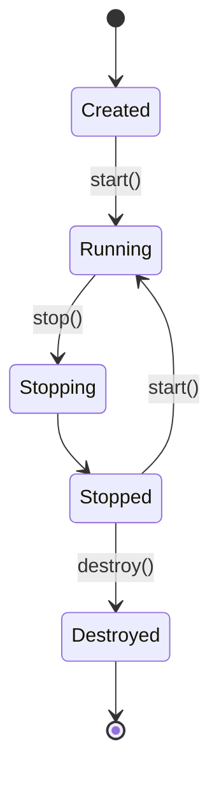

# Starting Dynamic Containers

In a Spring Kafka application, listener containers are typically created when the Spring `ApplicationContext` starts. However, some systems need to turn a consumption stream on or off based on runtime configuration: a tenant has just been activated, a new topic is brought into processing, a maintenance task temporarily pauses a consumer, or a feature only needs to run for a limited period.

Spring Kafka supports managing listener container lifecycles through `KafkaListenerEndpointRegistry` and allows creating `ConcurrentMessageListenerContainer` directly when needed. These two approaches serve different scenarios: controlling containers already declared with `@KafkaListener`, versus creating new containers whose topics and groups are determined at runtime.

Starting dynamic containers must be paired with managing state, group IDs, partitions, concurrency, and resource cleanup. Simply calling `start()` is not enough for safe operations if the application does not know which containers are running or who is responsible for stopping them.

## 1. Listener Containers and Lifecycle

`@KafkaListener` is a declarative way to define a message-handling method. When the application starts, Spring Kafka creates a listener endpoint and a corresponding listener container. The container manages the Kafka consumer, polls records, invokes the listener, handles acks/offsets, and closes the consumer when stopped.

Basic lifecycle:



Meaningful states:

- **Created:** the container has been created and configured but is not yet consuming records.
- **Running:** the container has started and is managing consumers.
- **Stopping:** the container is stopping consumers according to the lifecycle process.
- **Stopped:** the container has stopped; it can be restarted if not yet destroyed.
- **Destroyed:** the container's resources have been released; that instance should not be reused.

When a container starts, the consumer must connect to the broker, join the consumer group, and receive partition assignments. Therefore, calling `start()` does not mean records are processed immediately; joining the group and rebalancing happen asynchronously.

## 2. Starting @KafkaListener on Demand

If a listener already knows its topic and group from configuration, yet should only be enabled on demand, set `autoStartup = "false"`:

```java
@Component
public class OrderListener {

    @KafkaListener(
            id = "orders-listener",
            topics = "${app.kafka.orders-topic}",
            groupId = "orders-service",
            autoStartup = "false"
    )
    public void consume(OrderEvent event) {
        orderService.process(event);
    }
}
```

When the `ApplicationContext` starts, the endpoint is still registered, while the container does not auto-start. The application can retrieve the container by ID from `KafkaListenerEndpointRegistry`.

```java
@Service
public class ListenerLifecycleService {

    private final KafkaListenerEndpointRegistry registry;

    public ListenerLifecycleService(
            KafkaListenerEndpointRegistry registry) {
        this.registry = registry;
    }

    public void startOrdersListener() {
        MessageListenerContainer container =
                registry.getListenerContainer("orders-listener");

        if (container == null) {
            throw new IllegalArgumentException(
                    "Unknown listener id: orders-listener");
        }

        if (!container.isRunning()) {
            container.start();
        }
    }

    public void stopOrdersListener() {
        MessageListenerContainer container =
                registry.getListenerContainer("orders-listener");

        if (container != null && container.isRunning()) {
            container.stop();
        }
    }
}
```

The `id` of `@KafkaListener` is the key to look up the container in the registry. Assign a clear and unique ID within the application context. Omitting the ID causes the framework to generate a default ID, making name-based control harder to predict.

`KafkaListenerEndpointRegistry` manages containers created from listener endpoints such as `@KafkaListener`. It does not automatically manage containers that the application instantiates itself with `new ConcurrentMessageListenerContainer(...)`; manually created containers must be stored and have their lifecycle managed separately.

## 3. Listing and Inspecting Containers in the Registry

The registry provides APIs to look up a container by ID and list registered IDs:

```java
public Collection<String> listenerIds(
        KafkaListenerEndpointRegistry registry) {

    return registry.getListenerContainerIds();
}
```

You can use the registry to check which containers are running:

```java
public Map<String, Boolean> listenerStates(
        KafkaListenerEndpointRegistry registry) {

    Map<String, Boolean> states = new LinkedHashMap<>();

    for (String id : registry.getListenerContainerIds()) {
        MessageListenerContainer container =
                registry.getListenerContainer(id);

        states.put(id, container != null && container.isRunning());
    }

    return states;
}
```

The `isRunning()` state reflects the container lifecycle. It does not prove that the consumer has received partition assignments or successfully processed records. If more accurate readiness is needed, observe container/consumer events, partition assignments, consumer lag, and application health indicators.

You should not use the running state as the sole condition for announcing that a tenant is ready to receive messages.

## 4. Creating ConcurrentMessageListenerContainer at Runtime

When the topic or group ID is only known while the application is running, you can create a container directly using `ConsumerFactory` and `ContainerProperties`.

The example below creates a container for a tenant:

```java
ContainerProperties properties =
        new ContainerProperties("tenant-42-orders");

properties.setGroupId("tenant-42-order-worker");

ConcurrentMessageListenerContainer<String, OrderEvent> container =
        new ConcurrentMessageListenerContainer<>(
                consumerFactory,
                properties
        );

container.setConcurrency(2);

container.setupMessageListener(
        (MessageListener<String, OrderEvent>) record ->
                orderService.process(record.value())
);

container.start();
```

The components:

- `ConsumerFactory` creates Kafka consumers configured with bootstrap servers, deserializers, security, and other properties.
- `ContainerProperties` declares the topics or partitions, group ID, and processing options.
- `ConcurrentMessageListenerContainer` manages one or more child consumers according to concurrency.
- `setupMessageListener(...)` attaches the record-processing logic.
- `start()` starts the container and consumers.

In this example, the group ID is tenant-scoped. If multiple application instances create containers for that tenant with the same group ID, Kafka distributes partitions across those instances. If each tenant needs to receive all records independently, each tenant's group ID must differ.

This snippet only illustrates how to create a container; in a real application, retain a reference to the container so it can be stopped and its resources released later.

## 5. Managing Dynamic Containers with a Service

Do not create a container and discard its reference. A manager can store containers by business key and expose clear start/stop APIs.

```java
@Service
public class DynamicOrderContainerManager {

    private final ConsumerFactory<String, OrderEvent> consumerFactory;
    private final OrderService orderService;

    private final Map<String,
            ConcurrentMessageListenerContainer<String, OrderEvent>>
            containers = new HashMap<>();

    public DynamicOrderContainerManager(
            ConsumerFactory<String, OrderEvent> consumerFactory,
            OrderService orderService) {
        this.consumerFactory = consumerFactory;
        this.orderService = orderService;
    }

    public synchronized void startTenant(
            String tenantId,
            String topic) {

        var existing = containers.get(tenantId);

        if (existing != null) {
            if (!existing.isRunning()) {
                existing.start();
            }
            return;
        }

        ContainerProperties properties =
                new ContainerProperties(topic);

        properties.setGroupId("tenant-orders-" + tenantId);

        var container =
                new ConcurrentMessageListenerContainer<>(
                        consumerFactory,
                        properties
                );

        container.setConcurrency(2);
        container.setupMessageListener(
                (MessageListener<String, OrderEvent>) record ->
                        orderService.process(record.value())
        );

        containers.put(tenantId, container);
        try {
            container.start();
        }
        catch (RuntimeException ex) {
            containers.remove(tenantId);
            container.destroy();
            throw ex;
        }
    }

    public synchronized void stopTenant(String tenantId) {
        var container = containers.remove(tenantId);

        if (container != null) {
            container.stop();
            container.destroy();
        }
    }

    @PreDestroy
    public synchronized void stopAll() {
        for (var container : containers.values()) {
            container.stop();
            container.destroy();
        }

        containers.clear();
    }
}
```

The manager keeps one container per tenant. The `synchronized` keyword prevents two concurrent start requests for the same tenant from creating two containers within the same application instance. If the system must scale the manager or control it from multiple nodes, distributed coordination must be added; `synchronized` only protects within a single JVM.

`stopTenant` removes the container from the map, stops the consumer, and releases resources. `stopAll` runs when the Spring bean is destroyed so consumer threads do not remain alive after application shutdown.

In production, add lifecycle states, stop timeouts, exception handling during start/stop, and logging with tenant/topic/group identifiers. The snippet removes the container and releases resources if `start()` throws a synchronous error. Consumer creation and partition assignment also occur asynchronously; monitor application events and health to detect failures occurring after `start()` returns.

## 6. Choosing Between Registry and Manually Created Containers

| Requirement | Appropriate Approach |
|---|---|
| Listener already declared by annotation, only needs toggling | `KafkaListenerEndpointRegistry` |
| Topic and group known at build/deploy time | `@KafkaListener` with `autoStartup` |
| Topic selected at runtime | Create `ConcurrentMessageListenerContainer` manually |
| Need to change subscriptions across a runtime topic set | Manual container or pattern-based subscription |
| Need to manage multiple pre-declared listener endpoints | Registry with explicit IDs |
| Need per-tenant independent container lifecycle management | Manager storing manual containers |

If the listener is already in code and only needs start/stop, the registry is the simpler choice. If new subscriptions must be created while the application is running, a manual container offers clearer control over topics and group IDs.

## 7. Dynamic Containers vs. Pause/Resume

Not every situation requiring a temporary halt in consumption needs stopping the container.

- `stop()` stops the container and closes the consumer; when restarted, the consumer rejoins the group and may trigger a rebalance.
- `pause()` temporarily stops fetching records from partitions while keeping the consumer active in the group.
- `resume()` resumes fetching records after being paused.

For short-term backpressure, such as a downstream queue filling up, `pause`/`resume` may be a better fit. If a tenant is disabled or a subscription is no longer needed for an extended period, stopping the container releases the consumer and associated resources.

Pausing does not remove the subscription and does not mean the consumer has left the group. Stopping also does not delete committed offsets. When the container runs again, the consumer continues from offsets according to the configured commit and reset policies.

## 8. Concurrency and Partition Assignment

`ConcurrentMessageListenerContainer` can run multiple child consumers. `setConcurrency(n)` sets the maximum number of consumers the container creates for the listener.

Example for a topic with 4 partitions:

| Concurrency | Maximum Active Consumers That Can Be Assigned Partitions |
|---:|---:|
| 1 | 1 |
| 2 | 2 |
| 4 | 4 |
| 6 | At most 4 receive partitions; remaining consumers may stay idle |

How many consumers actually have work depends on partition assignment and the number of consumers in the same group. Increasing concurrency beyond the partition count does not allow multiple consumers in the same group to process a single partition in parallel.

For containers consuming multiple topics, partition counts and the assignor strategy can affect distribution. Measure throughput, lag, CPU, connections, and downstream load instead of guessing concurrency values.

If every tenant has its own container and its own group ID, each tenant may consume all partitions of its corresponding topic. Consumer counts and broker connections can grow rapidly with tenant count. Evaluate resource limits before adopting a one-container-per-tenant model.

## 9. Topic Subscription and Topic Patterns

A container can subscribe to one or more known topics:

```java
ContainerProperties properties =
        new ContainerProperties("orders", "payments");
```

If you want to subscribe to dynamically created topics following a naming convention, you can use a topic pattern:

```java
ContainerProperties properties =
        new ContainerProperties(
                Pattern.compile("tenant-[0-9]+-events")
        );
```

With pattern subscription, the consumer can discover matching topics via Kafka's metadata refresh mechanism. This lets a single container follow a changing set of topics without creating a separate container per topic.

The pattern must be narrow enough to avoid accidentally subscribing to out-of-scope topics. New topics must still exist and the Kafka principal must have read permissions. Verify discovery behavior and metadata refresh intervals for your Kafka client configuration.

## 10. Managing Group IDs and Offsets

The group ID determines independent consumption progress. Decide clearly whether a dynamic container represents a logical consumer or a load-sharing worker.

- If instances are replicas of the same worker, they share the same group ID to divide partitions.
- If each tenant needs to receive the same event stream independently, each tenant needs its own group ID.
- If one tenant has multiple workers sharing load, that tenant's workers use the same group ID.
- Do not generate a random group ID on every start if you want to resume from previously committed offsets.

When a new group ID is created, Kafka has no committed offsets for that group yet. The starting position depends on `auto.offset.reset` and topic state. With `earliest`, the consumer may re-read retained historical data; with `latest`, the consumer starts from the end of the log at the point determined by Kafka's mechanics.

Consequently, creating a container with a new group ID can cause a large volume of old events to be processed. Establish an offset initialization policy before enabling containers for new tenants.

## 11. Start/Stop and Rebalance

When a container starts, its consumers connect to the broker and join the group. Kafka may perform a rebalance to distribute partitions. When a container stops, its consumers leave the group and partitions are redistributed among remaining consumers.

Key points to keep in mind:

- Stopping many containers simultaneously can trigger multiple consecutive rebalances.
- Starting a large batch of containers can create a sudden load spike on the broker and coordinator.
- Listeners need to finish or safely handle in-progress work before stopping.
- Offset commits must align with the active `AckMode` and transactions.
- Do not assume in-flight records will always complete if the process is forcefully killed.

If you need to roll out configuration changes across many tenants, rate-limit start/stop operations and monitor rebalance duration, assigned partition counts, and consumer lag.

## 12. Security and Runtime Input Validation

If an API accepts requests to start containers by tenant/topic, never use a client-supplied topic string directly without validation.

You should:

- Map the tenant ID to topics/groups from a controlled configuration or business registry.
- Verify the tenant is authorized to enable that subscription.
- Limit maximum container count and maximum concurrency.
- Prevent clients from choosing arbitrary group IDs.
- Verify the Kafka principal's ACLs only allow reading the required topics.
- Audit who enabled/disabled a listener, for which tenant, when, and why.
- Provide a mechanism to automatically stop or reclaim containers when a tenant is deleted.

A container management endpoint can directly impact broker load and consumed data. Enforce appropriate administrative permissions and do not expose it to end users without strict controls.

## 13. Monitoring Container State

As container counts grow, track their lifecycle rather than only logging at the moment `start` is called.

Signals worth observing:

| Signal | Meaning |
|---|---|
| Running/stopped container counts | Detect containers that stopped unexpectedly |
| Consumer groups and partition assignments | Know whether a container actually holds partitions |
| Consumer lag | Know whether processing keeps up with incoming data |
| Time from start to assignment | Detect slow broker/coordinator or slow rebalances |
| Start/stop frequency | Detect abnormal lifecycle loops |
| Consumer creation/authentication errors | Detect misconfigured properties or ACLs |
| Listener exceptions/retries/DLT | Detect business or processing errors inside containers |

Spring Kafka publishes application events related to container and consumer lifecycles. You can listen to those events to update administrative status or metrics. For readiness, rely on partition assignments and health/lag, not just whether the container received a start command.

## 14. Testing Dynamic Containers

Integration tests should use a test broker to verify lifecycle and actual consumption behavior:

1. Start the `ApplicationContext` with `autoStartup = false` and confirm the listener is not consuming yet.
2. Call registry start by ID, send a record, and confirm the listener receives it.
3. Call stop, send a new record, and confirm the container does not process it while stopped.
4. Restart the same container and confirm processing resumes from the committed offset.
5. Create a manual container with a runtime topic/group and confirm it receives records.
6. Stop the manual container and verify the consumer is closed.
7. Start two containers in the same group and confirm partitions are shared rather than both containers receiving all records.
8. Use a new group ID and confirm `auto.offset.reset` behaves as expected.
9. Verify application shutdown stops all created containers.
10. Verify repeated start/stop cycles do not create duplicate containers or consumers unintentionally.

Do not just mock `KafkaListenerEndpointRegistry` and assert `start()` was called. Mocks do not verify that the consumer joined the group, received partitions, or processed records.

## 15. Common Pitfalls

| Symptom | Possible Cause | Resolution |
|---|---|---|
| Container not found in registry | Wrong ID or listener endpoint not registered | Use explicit IDs and inspect the registry |
| Listener runs immediately on startup | Missing `autoStartup = "false"` | Control lifecycle via the registry |
| Container running yet receives no records | No partition assignment yet, empty topic, or consumer lag/ACL issue | Check assignments, topic, and consumer logs |
| Restart reads from the beginning | New group ID or `auto.offset.reset=earliest` | Use a stable group ID and define the reset policy |
| Multiple containers all read every event | Each container uses a different group ID | Share a group ID when load-sharing is desired |
| Manual container does not stop on shutdown | Reference not stored or `stop`/`destroy` not called | Manage centrally and clean up on lifecycle shutdown |
| Broker overloaded when onboarding tenants | Spawning too many consumers/containers at once | Limit container counts and startup rate |
| New topics not discovered | Static topic subscription or non-matching pattern | Check subscription mode and metadata refresh |

## 16. Implementation Checklist

- [ ] Chosen registry for pre-declared listeners or manual containers for runtime subscriptions.
- [ ] Listeners have explicit and unique IDs when controlled via the registry.
- [ ] `autoStartup` is configured appropriately if startup needs to be deferred.
- [ ] Manual containers have retained references and cleanup on shutdown.
- [ ] Group IDs are stable and reflect the intended logical consumer scope.
- [ ] Offset behavior is defined when new groups are created.
- [ ] Concurrency does not exceed partition needs and resource capacity.
- [ ] Runtime topics are access-checked and restricted to an allowlist.
- [ ] Limits are placed on container counts and start/stop rates.
- [ ] Partition assignments, lag, errors, and lifecycle events are monitored.
- [ ] Tested start, stop, restart, rebalance, and shutdown.

Starting dynamic containers allows Spring Kafka to enable or create consumers based on runtime needs. Use `KafkaListenerEndpointRegistry` when controlling annotation-declared listeners; use `ConcurrentMessageListenerContainer` when topics and groups are only known at runtime. Regardless of the approach, the application must still manage group IDs, offsets, partition assignments, concurrency, and stop/release lifecycles to avoid duplicate consumption or resource exhaustion.

