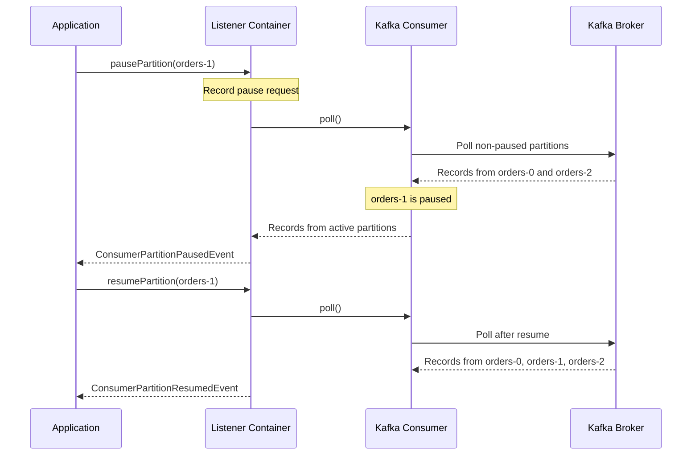
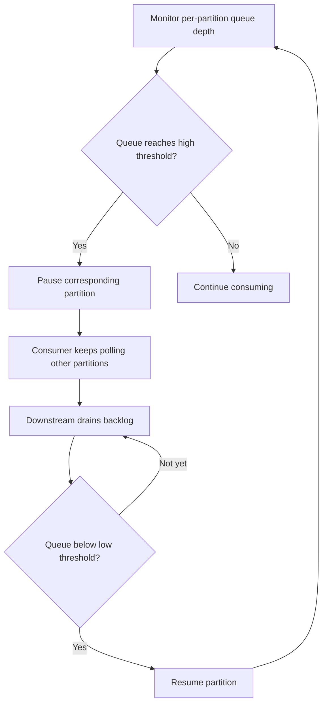

# Pausing a Specific Partition

In a Kafka consumer group, sometimes only a single partition needs to temporarily stop receiving records: a downstream service is overloaded, a particular data type requires maintenance, or a partition's local processing queue has reached its threshold. Stopping the entire listener in this situation would halt healthy partitions as well.

Spring Kafka has supported pausing and resuming by `TopicPartition` since version 2.7. Applications can instruct a listener container to pause one partition, continue processing other partitions, and resume that partition once conditions stabilize.

This lesson focuses on controlling partitions via `KafkaListenerEndpointRegistry` and `MessageListenerContainer`, observing actual pause state, handling concurrency/rebalances, and building safe backpressure.

## 1. What problem does pausing a partition solve?

Suppose the `orders` topic has three partitions:

| Partition | Status | Decision |
|---|---|---|
| `orders-0` | Payment service operating normally | Continue consuming |
| `orders-1` | Inventory check service is overloaded | Temporarily pause |
| `orders-2` | Processing normally | Continue consuming |

If the entire listener container is paused, partitions 0 and 2 also stop receiving data. Pausing only `orders-1` allows the consumer to keep processing the remaining partitions.

Partition pausing is typically useful when:

- A downstream dependency for a specific data type or shard is overloaded.
- One partition has an excessively large local processing backlog.
- Maintenance or processing configuration changes are needed for a single partition.
- The system applies per-partition backpressure.
- You want to halt one data stream while keeping other streams active.

Pausing only stops fetching additional records from the selected partition. Records continue to be written to Kafka by producers, and the partition's lag may grow while paused.

## 2. Container pause vs. partition pause

Spring Kafka provides two levels of control:

| API | Scope | Effect |
|---|---|---|
| `pause()` | Entire listener container | Temporarily stops fetching records from all partitions managed by the container |
| `pausePartition(tp)` | Single `TopicPartition` | Temporarily stops fetching records from the specified partition |
| `resume()` | Entire listener container | Resumes all partitions paused at the container level |
| `resumePartition(tp)` | Single `TopicPartition` | Resumes the specified partition |

For example, if a container is processing `orders-0`, `orders-1`, and `orders-2`, calling `pausePartition(orders-1)` only requests stopping partition 1. The remaining two partitions can still be consumed.

Pausing does not mean:

- Stopping the listener container.
- Leaving the consumer group.
- Committing offsets immediately.
- Resetting offsets to a different position.
- Deleting records from Kafka.
- Moving the partition to another consumer.

This is an important detail when designing backpressure: pausing keeps the consumer active and the partition stays in the current assignment while the consumer continues polling.

## 3. How pause/resume works inside a listener container

Since Spring Kafka 2.7, the listener container provides:

- `pausePartition(TopicPartition)`
- `resumePartition(TopicPartition)`
- `isPartitionPauseRequested(TopicPartition)`
- `isPartitionPaused(TopicPartition)`

These pause/resume methods are thread-safe. Applications can call them from an HTTP thread, a scheduler, or a backpressure management service; the actual interaction with the Kafka consumer is executed on the consumer thread.

A partition pause command takes effect before the next `poll()`. A resume command takes effect after the current `poll()` returns. Therefore, the method call returning does not mean the consumer has finished pausing or resuming.

`isPartitionPauseRequested(tp)` indicates that the pause request has been recorded. `isPartitionPaused(tp)` indicates that the partition is actually paused on the consumer.



During the pause, the consumer continues polling to maintain consumer group liveness, while fetching no records from the paused partition. This avoids triggering a rebalance simply because the application temporarily stops consuming a partition.

## 4. Declaring a listener with a stable ID

To control a listener via the registry, declare an explicit `id` on `@KafkaListener`:

```java
import org.springframework.kafka.annotation.KafkaListener;
import org.springframework.stereotype.Component;

@Component
public class OrderListener {

    @KafkaListener(
        id = "orders-listener",
        topics = "orders",
        groupId = "billing-service"
    )
    public void consume(OrderCreated event) {
        // Process event.
    }
}
```

`id` is the listener identifier registered in `KafkaListenerEndpointRegistry`. The application uses this ID to look up the container.

Do not confuse `id` with `groupId`:

- `id` identifies the listener container in the Spring application.
- `groupId` identifies the consumer group on Kafka.
- A consumer group may have multiple listeners/containers depending on the design.
- Listener IDs must be unique within the registry.

## 5. Retrieving the container and pausing a partition

`KafkaListenerEndpointRegistry` manages the listener containers created by `@KafkaListener`. Use `getListenerContainer(id)` to retrieve the corresponding container.

Example of a partition control service:

```java
import org.apache.kafka.common.TopicPartition;
import org.springframework.kafka.config.KafkaListenerEndpointRegistry;
import org.springframework.kafka.listener.MessageListenerContainer;
import org.springframework.stereotype.Service;

@Service
public class PartitionControlService {

    private final KafkaListenerEndpointRegistry registry;

    public PartitionControlService(
            KafkaListenerEndpointRegistry registry) {
        this.registry = registry;
    }

    public void pause(String listenerId, String topic, int partition) {
        MessageListenerContainer container =
            requireContainer(listenerId);

        TopicPartition topicPartition =
            new TopicPartition(topic, partition);

        container.pausePartition(topicPartition);
    }

    public void resume(String listenerId, String topic, int partition) {
        MessageListenerContainer container =
            requireContainer(listenerId);

        TopicPartition topicPartition =
            new TopicPartition(topic, partition);

        container.resumePartition(topicPartition);
    }

    private MessageListenerContainer requireContainer(String listenerId) {
        MessageListenerContainer container =
            registry.getListenerContainer(listenerId);

        if (container == null) {
            throw new IllegalArgumentException(
                "Listener container not found: " + listenerId
            );
        }

        return container;
    }
}
```

How to invoke it:

```java
partitionControlService.pause(
    "orders-listener",
    "orders",
    1
);

// When downstream has recovered:
partitionControlService.resume(
    "orders-listener",
    "orders",
    1
);
```

The container must be running and the partition must belong to the subscription/assignment managed by the listener. If the application calls this before the listener starts or before assignment completes, check the status afterward rather than assuming the partition paused immediately.

With `ConcurrentMessageListenerContainer`, you can call `pausePartition` on the parent container retrieved from the registry. Spring Kafka forwards the request to the child containers so that the pause state remains applied if the partition is reassigned to another child within the same parent container.

## 6. Checking pause request vs. actual state

Do not simply call `pausePartition` and immediately update business state to `PAUSED`. The request and the actual state can differ briefly.

Example:

```java
TopicPartition partition = new TopicPartition("orders", 1);

container.pausePartition(partition);

boolean requested =
    container.isPartitionPauseRequested(partition);

boolean paused =
    container.isPartitionPaused(partition);

log.info(
    "Partition pause state topic={} partition={} requested={} paused={}",
    partition.topic(),
    partition.partition(),
    requested,
    paused
);
```

Interpretation:

| requested | paused | Meaning |
|---|---|---|
| false | false | No pause request or partition is running |
| true | false | Pause requested, waiting for consumer thread to apply |
| true | true | Partition is actually paused |
| false | false after resume | Partition has resumed operation |

When resuming, the pause request state is cleared after the container processes the request. Rely on the status methods and corresponding events to confirm.

## 7. Resuming a partition after recovery conditions are met

Pausing a partition is only useful if the application has a clear resume policy.

For example, when downstream has a bounded-capacity queue:

- When pending tasks exceed a high threshold, pause the corresponding partition.
- When the queue drops below a low threshold, resume the partition.
- Record pause duration and pause/resume transition counts.
- Enforce a pause time limit to alert if a partition is held too long.

Use two different thresholds (hysteresis) to avoid continuous pause/resume cycling when queue depth fluctuates around a single value.

Example:

| Queue depth | Action |
|---:|---|
| `>= 800` | Pause partition |
| `500–799` | Keep current state |
| `< 500` | Resume partition |

Do not resume merely because a fixed time period has elapsed if downstream is still overloaded. Combine actual health signals with fallback timeouts and operational alerts.

## 8. Listening to pause/resume events

Spring Kafka publishes events to inform the application when the consumer has executed the operation:

- `ConsumerPartitionPausedEvent`
- `ConsumerPartitionResumedEvent`

These events were added in Spring Kafka 2.7. They carry information about the container and the associated `TopicPartition`.

Example:

```java
import org.slf4j.Logger;
import org.slf4j.LoggerFactory;
import org.springframework.context.event.EventListener;
import org.springframework.kafka.event.ConsumerPartitionPausedEvent;
import org.springframework.kafka.event.ConsumerPartitionResumedEvent;
import org.springframework.stereotype.Component;

@Component
public class PartitionPauseEvents {

    private static final Logger log =
        LoggerFactory.getLogger(PartitionPauseEvents.class);

    @EventListener
    public void onPartitionPaused(
            ConsumerPartitionPausedEvent event) {

        log.info(
            "Kafka partition paused: {}",
            event.getPartition()
        );
    }

    @EventListener
    public void onPartitionResumed(
            ConsumerPartitionResumedEvent event) {

        log.info(
            "Kafka partition resumed: {}",
            event.getPartition()
        );
    }
}
```

These events are useful for:

- Updating monitoring status.
- Logging exact pause/resume timestamps.
- Measuring how long a partition stayed paused.
- Emitting metrics and alerts.
- Correlating backpressure decisions with consumer behavior.

Events are published by the consumer processing the partition. With concurrency, one parent container may manage multiple child consumers; use the container/partition information in the event to identify the right listener.

## 9. Pausing a partition in ConcurrentMessageListenerContainer

When `concurrency > 1`, Spring Kafka creates a parent `ConcurrentMessageListenerContainer` and multiple child `KafkaMessageListenerContainer` instances. Each child consumer has its own assignment.

Example:

```java
@KafkaListener(
    id = "orders-listener",
    topics = "orders",
    groupId = "billing-service",
    concurrency = "3"
)
public void consume(OrderCreated event) {
    // Process event.
}
```

If a topic has multiple partitions, the partitions are distributed across consumers in the group. At any given time, a partition is owned by only one consumer in the group.

You can retrieve the parent container from the registry:

```java
MessageListenerContainer container =
    registry.getListenerContainer("orders-listener");

TopicPartition partition = new TopicPartition("orders", 1);

container.pausePartition(partition);
```

With a concurrent container, Spring Kafka dispatches the pause request to its child containers. This is helpful when assignments shift between children within the same parent container: the partition remains in the pause-requested state when handed to another child.

If you need to know which child container currently holds a partition, you can use `getContainerFor(topic, partition)` on `ConcurrentMessageListenerContainer`. However, regular pause/resume operations can be called directly on the parent container.

Do not select a child container by index or `client.id` and hold a long-lived reference to it. After a rebalance, assignments may change.

## 10. Pausing and rebalances

Pausing a partition does not remove the partition from the consumer group. The consumer keeps polling, maintains membership, and continues receiving data from other partitions.

However, if a rebalance occurs:

- The partition may be revoked from the current consumer.
- The partition may be assigned to another consumer.
- Pause state on one application instance does not automatically become a cluster-wide policy.
- The application must decide whether to reapply the pause on the new consumer.

With `ConcurrentMessageListenerContainer`, Spring Kafka propagates pause requests to child containers within the same parent container so state is not lost when a partition moves between children.

However, if a partition moves to another pod in the same consumer group, the new pod does not automatically know about the old pod's pause decision. If cluster-wide pausing is needed, store the policy in a shared location such as a database, control topic, or orchestration system; instances must apply the policy upon receiving an assignment.

For automatic topic or pattern subscriptions, listen to assignment/revocation events or use `ConsumerRebalanceListener` to resynchronize pause policies when partitions are assigned.

## 11. Pausing does not replace committing offsets

Pausing a partition does not automatically commit offsets, nor does it reset offsets.

Offsets continue to be managed according to the `AckMode` and commit mechanism configured on the listener container.

For example:

- The listener successfully processes records and commits offsets according to `BATCH`.
- The application pauses the partition.
- New records continue to be written to Kafka but are not fetched by the consumer.
- Upon resuming, the consumer continues from its current read position/committed offset per existing policy.

If the application pauses when a poll has already returned multiple records, already-fetched records may still be awaiting processing. The partition pause command applies at the next poll boundary; it does not cancel already-fetched records.

With batch listeners, pay special attention because a single batch may contain records from multiple partitions. Pausing a partition does not automatically split the current batch into independent parts.

## 12. PauseImmediate and when processing stops

Since Spring Kafka 2.9, `ContainerProperties.pauseImmediate` allows the container to stop processing after the current record when a **full container pause** is requested. By default, the container finishes processing all records from the previous poll before pausing.

Configuration:

```java
factory.getContainerProperties().setPauseImmediate(true);
```

When enabled, remaining records in the poll result are kept in memory and delivered to the listener when the container resumes.

`pauseImmediate` is a property that controls pause behavior at the container level. Do not treat it as a mechanism to immediately interrupt only one partition being processed inside the current batch. For per-partition control requirements, design appropriate listener and batch boundaries.

With batch listeners, inspect how the listener receives batches and configure `subBatchPerPartition` if you need to split batches by partition. This helps limit processing scope and clarify which partition is currently being processed.

## 13. Pausing a partition as a backpressure mechanism

A simple backpressure model can use per-partition queue depth:



Example policy:

1. Monitor the local processing queue for each partition.
2. When the queue reaches the high watermark, call `pausePartition`.
3. The consumer continues processing other partitions.
4. When the queue drops to the low watermark, call `resumePartition`.
5. Record pause duration, lag, and post-resume throughput.

If a listener uses a single sequential consumer thread, one slow record can still delay other records from the same poll. Partition pausing only controls subsequent polls; it does not parallelize processing of the current records.

If the listener hands off work to an asynchronous executor, manage offsets/acknowledgments carefully so records are not committed before work finishes. Pausing does not replace ordering guarantees or safe commit mechanisms.

## 14. Limits to remember during prolonged pauses

Pausing a partition does not create additional storage capacity. Producers can keep writing records and consumer lag will grow.

Monitor:

- Consumer lag by topic-partition.
- How long the partition stays in the paused state.
- Producer write rate to the partition.
- Average and p95/p99 processing times.
- Downstream queue depth.
- Error rate after resuming.

If paused for too long, older records may expire past retention before the consumer resumes. Calculate retention against lag growth rate and expected maintenance duration.

Do not pause all partitions for long periods if the application must still meet SLAs or if the consumer group has progress requirements.

If downstream fails completely, pausing the entire container or stopping the listener may be a more appropriate operational decision. Choose the pause scope to match the actual failure scope.

## 15. Never call Kafka Consumer directly from another thread

Kafka's `Consumer` is not designed for concurrent calls from multiple application threads. Do not keep a reference to the consumer and call it directly:

```java
// Should not be called from an HTTP thread or scheduler:
consumer.pause(Set.of(topicPartition));
```

Instead, call the thread-safe API on the listener container:

```java
container.pausePartition(topicPartition);
container.resumePartition(topicPartition);
```

The container forwards the request to the consumer thread and executes it at the proper point in the poll loop.

Also avoid using `Thread.sleep` inside a listener to simulate pausing. This keeps the consumer thread busy, can delay polling, and affects `max.poll.interval.ms`. Container pausing continues polling to maintain group membership.

## 16. Testing partition pausing with Embedded Kafka

Integration tests should demonstrate three things:

1. A partition is requested to pause and its actual paused state is confirmed.
2. Other partitions continue to be consumed.
3. After resuming, the paused partition resumes consumption.

Example test structure:

```java
import static org.assertj.core.api.Assertions.assertThat;

import java.util.concurrent.TimeUnit;

import org.apache.kafka.common.TopicPartition;
import org.junit.jupiter.api.Test;
import org.springframework.beans.factory.annotation.Autowired;
import org.springframework.kafka.config.KafkaListenerEndpointRegistry;
import org.springframework.kafka.core.KafkaTemplate;
import org.springframework.kafka.listener.MessageListenerContainer;
import org.springframework.kafka.test.utils.ContainerTestUtils;
import org.springframework.kafka.test.context.EmbeddedKafka;
import org.springframework.boot.test.context.SpringBootTest;

@SpringBootTest
@EmbeddedKafka(partitions = 2, topics = "orders")
class PartitionPauseIntegrationTest {

    @Autowired
    KafkaListenerEndpointRegistry registry;

    @Autowired
    KafkaTemplate<String, String> kafkaTemplate;

    @Autowired
    TestRecordSink sink;

    @Test
    void pausesOnePartitionAndKeepsOtherPartitionActive()
            throws Exception {

        MessageListenerContainer container =
            registry.getListenerContainer("orders-listener");

        ContainerTestUtils.waitForAssignment(container, 2);

        TopicPartition paused =
            new TopicPartition("orders", 0);

        container.pausePartition(paused);

        // Helper that waits for isPartitionPaused(paused) to return true.
        awaitPartitionPaused(container, paused);

        kafkaTemplate.send("orders", 0, "key-0", "paused-event").get();
        kafkaTemplate.send("orders", 1, "key-1", "active-event").get();

        assertThat(sink.await("active-event", 10, TimeUnit.SECONDS))
            .isTrue();

        assertThat(sink.contains("paused-event")).isFalse();

        container.resumePartition(paused);
        awaitPartitionResumed(container, paused);

        assertThat(sink.await("paused-event", 10, TimeUnit.SECONDS))
            .isTrue();
    }
}
```

This is a test skeleton; `TestRecordSink`, `awaitPartitionPaused`, and `awaitPartitionResumed` are test helpers you need to implement using `BlockingQueue` and Awaitility. Wait for partition assignment before sending records so results do not depend on listener startup timing.

Do not use a fixed `Thread.sleep` interval as proof that the partition is paused. Wait until `isPartitionPaused` returns true before sending test records.

Additional tests should include:

| Test case | Expected result |
|---|---|
| Pause partition 0 | Partition 0 receives no new records after pause takes effect |
| Partition 1 not paused | Partition 1 continues to be consumed |
| Resume partition 0 | Pending records are processed after resuming |
| Pause request before consumer applies it | `isPartitionPauseRequested` is true before `isPartitionPaused` is true |
| Internal concurrent container rebalance | Partition stays paused when moved to another child |
| Rebalance to another pod | Pause policy is reapplied via the coordination mechanism |
| Prolonged pause | Lag increases and pause duration metrics are updated |

## 17. Common pitfalls

| Symptom | Cause | How to handle |
|---|---|---|
| Partition still receives records after calling pause | Consumer has not reached the poll boundary or still has already-fetched records | Wait for `isPartitionPaused` and account for in-progress batches |
| Accidentally paused entire listener | Called `pause()` instead of `pausePartition()` | Use the right method with `TopicPartition` |
| Listener container not found | ID does not match `@KafkaListener` | Declare a stable ID and check the registry |
| No new records after resume | Partition is not actually resumed yet or topic has no records | Monitor resume events and status |
| Partition was paused on old pod but runs on new pod | Rebalanced to another application instance | Store shared pause policy and apply on assignment |
| Other partitions also slow down | Listener thread is processing a slow record/batch | Optimize processing or separate workloads |
| Consumer rebalances while paused | Thread is blocked and stops polling | Use container APIs and avoid sleeping/blocking the consumer thread |
| Lag grows too high | Partition paused for too long | Monitor retention and enforce a resume/escalation policy |

## 18. Operations checklist

- Listener has a stable ID so the registry locates the right container.
- Use `TopicPartition` with the exact topic and partition number.
- Call `pausePartition`/`resumePartition` through the listener container.
- Wait for `isPartitionPaused` to confirm actual state.
- Do not call Kafka `Consumer` directly from other threads.
- Monitor `ConsumerPartitionPausedEvent` and `ConsumerPartitionResumedEvent`.
- Verify concurrency and assignment before pausing.
- Maintain a policy to reapply pause after rebalancing to another application instance.
- Use high/low watermarks to avoid continuous pause/resume cycling.
- Monitor lag, retention, and pause duration.
- Test pausing a partition while other partitions continue consuming.
- Verify batch listener and `pauseImmediate` behavior for your exact version.

## 19. Takeaways

- `pausePartition(TopicPartition)` and `resumePartition(TopicPartition)` have been available since Spring Kafka 2.7.
- Pausing a partition only stops fetching records from the selected partition; other partitions can keep operating.
- The consumer keeps polling while paused to maintain consumer group membership.
- Pause requested and actual paused state are two distinct states.
- `isPartitionPauseRequested` checks the request; `isPartitionPaused` checks the applied state.
- `ConcurrentMessageListenerContainer` distributes pause requests to its child containers.
- Pausing does not commit offsets, reset offsets, or leave the consumer group.
- Pausing is a backpressure tool; monitor lag, retention, and pause duration.
- If a partition moves to another pod after a rebalance, the pause policy must be shared and reapplied.
- Never call `Consumer.pause` directly from other application threads.

Pausing a partition helps the system isolate a problematic data stream, keep remaining partitions running, and give downstream time to recover. When combined with assignment awareness, actual state tracking, queue watermarks, and monitoring, Spring Kafka applications can enforce per-partition backpressure while keeping the consumer group stable.

## References

- [Spring Kafka – Pausing and Resuming Partitions](https://docs.spring.io/spring-kafka/reference/kafka/pause-resume-partitions.html)
- [Spring Kafka – Pausing and Resuming Listener Containers](https://docs.spring.io/spring-kafka/reference/kafka/pause-resume.html)
- [Spring Kafka – Listener Container Properties](https://docs.spring.io/spring-kafka/reference/kafka/container-props.html)
- [Spring Kafka – Application Events](https://docs.spring.io/spring-kafka/reference/kafka/events.html)
- [Spring Kafka – MessageListenerContainer API](https://docs.spring.io/spring-kafka/docs/current/api/org/springframework/kafka/listener/MessageListenerContainer.html)
- [Spring Kafka – ConcurrentMessageListenerContainer API](https://docs.spring.io/spring-kafka/docs/current/api/org/springframework/kafka/listener/ConcurrentMessageListenerContainer.html)

