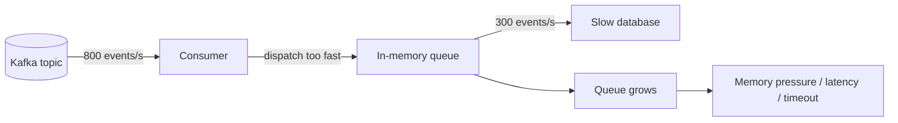

# Backpressure When Downstream Is Slow

Backpressure is the practice of regulating the rate at which records are received and processed when systems behind Kafka cannot keep up. For example, a consumer reads events faster than a database can write data or a REST service can handle requests. If the application continues receiving records and pushes them into an unbounded in-memory queue, the queue grows continuously, causing rising latency, memory exhaustion, and eventually service crashes.

With Spring Kafka, you can throttle consumers by limiting concurrency and the number of records per poll, using bounded queues, monitoring downstream health, and pausing/resuming the listener container or individual partitions when needed. Kafka retains records in the topic for the retention period; consumer lag grows during the pause and is drained once downstream recovers.

## 1. When does backpressure appear?

Suppose the `orders.created` topic receives an average of 800 events/second, while the database can only write 300 events/second steadily. The consumer reads faster than the database can process. The difference accumulates as backlog.



Backpressure should be considered when one or more of these signs appear:

- Consumer lag grows continuously even though consumer count is unchanged.
- Processing time per record or batch increases.
- Internal queues or pending downstream requests grow.
- Database connection pools become exhausted, HTTP 429/503 responses rise, or timeouts increase.
- Heap grows, GC runs frequently, or `OutOfMemoryError` occurs.
- Consumers frequently exceed `max.poll.interval.ms` and trigger rebalances.

Growing consumer lag is not always an error. When intentionally pausing to protect downstream, lag represents backlog safely held in Kafka. Distinguish controlled lag growth from lag caused by a hung consumer or insufficient processing capacity.

The record listener examples in this lesson use the following event and service contract:

```java
import java.math.BigDecimal;

public record OrderCreatedEvent(
        String eventId,
        String orderId,
        BigDecimal total
) {}

public interface OrderApplicationService {
    void handle(OrderCreatedEvent event);
}
```

## 2. Why shouldn't you use an unbounded in-memory queue?

An implementation prone to failure is having the listener receive records and submit tasks to an unbounded executor:

```java
@KafkaListener(topics = "orders.created", groupId = "orders-service")
public void listen(OrderCreatedEvent event) {
    unboundedExecutor.submit(() -> orderService.handle(event));
}
```

The listener returns immediately after submitting, while downstream processes slower than the submission rate. The queue grows without bound, and the container may commit offsets before the business task actually finishes. If the application stops, tasks still in memory may be lost even though their offsets have been committed.

If asynchronous processing is necessary, you must have a bounded queue, a limit on in-flight tasks, a pause/resume mechanism, and rules for acknowledging offsets after side effects complete. For many applications, synchronous processing on the listener thread with sensible timeouts is simpler and easier to keep semantically sound.

## 3. Layers for throttling consumer speed

Backpressure should be designed in multiple layers:

| Mechanism | Effect | When to use |
|---|---|---|
| Reduce `concurrency` | Reduces consumer threads in the group | Downstream has limited capacity or overall load must be reduced |
| Reduce `max.poll.records` | Reduces records returned per poll | Batches take long to process or create excessive load spikes |
| Bound in-flight/queue | Caps pending work inside the application | Asynchronous processing or worker dispatch is used |
| Pause/resume container | Temporarily stops receiving records from assigned partitions | Downstream is overloaded or waiting for recovery |
| Pause/resume partition | Temporarily stops specific partitions | Load or errors are concentrated on one partition |
| Rate limit/circuit breaker | Limits requests or trips calls to a failing downstream | REST service, database, or dependency has quotas/timeouts |

These mechanisms complement one another. Do not rely on pause as the sole solution if the current listener can block indefinitely on an HTTP call; the container can only apply a pause once the consumer thread returns to the poll loop.

## 4. Reducing `concurrency` and `max.poll.records`

`concurrency` on `@KafkaListener` or the container factory determines how many child consumer containers are created for the listener. Within a consumer group, the number of consumers receiving partitions cannot exceed the number of assigned partitions.

Example:

```java
@KafkaListener(
        id = "ordersListener",
        topics = "orders.created",
        groupId = "orders-service",
        concurrency = "2"
)
public void listen(OrderCreatedEvent event) {
    orderService.handle(event);
}
```

If the topic has 6 partitions and concurrency is 2, at most two consumer threads of the listener process in parallel. Reducing concurrency from 6 to 2 can ease pressure on downstream, at the trade-off of lower maximum throughput.

`max.poll.records` limits how many records are returned in one `poll()`. Configuration example:

```yaml
spring:
  kafka:
    consumer:
      properties:
        max.poll.records: 20
        max.poll.interval.ms: 300000
```

Smaller batches reduce processing time per poll and limit the number of records held in container memory. However, if records process very quickly and downstream is healthy, setting this too low can reduce throughput due to higher polling overhead.

## 5. Pausing and resuming the listener container

Spring Kafka provides pause/resume APIs on `MessageListenerContainer`. You can retrieve the container by `@KafkaListener` `id` via `KafkaListenerEndpointRegistry`.

```java
import org.springframework.kafka.config.KafkaListenerEndpointRegistry;
import org.springframework.kafka.listener.MessageListenerContainer;
import org.springframework.stereotype.Component;

@Component
public class OrdersConsumerFlowControl {

    private final KafkaListenerEndpointRegistry registry;

    public OrdersConsumerFlowControl(KafkaListenerEndpointRegistry registry) {
        this.registry = registry;
    }

    public void pause() {
        MessageListenerContainer container =
                registry.getListenerContainer("ordersListener");
        if (container != null) {
            container.pause();
        }
    }

    public void resume() {
        MessageListenerContainer container =
                registry.getListenerContainer("ordersListener");
        if (container != null) {
            container.resume();
        }
    }
}
```

`pause()` and `resume()` are designed to be called from another thread; the container coordinates the operations on the Kafka consumer on the consumer thread. Do not call `KafkaConsumer.pause()` directly from a health/monitoring thread because the Kafka consumer is not thread-safe.

Pausing does not stop the listener container completely. The container keeps calling `poll()` while paused to maintain consumer group liveness; paused partitions deliver no new records to the listener. Consequently, pauses can last as long as needed while keeping the consumer in the group, provided the consumer thread continues polling.

## 6. When does a pause take effect?

Calling `pause()` submits a request that the container applies on the next eligible poll cycle; it does not interrupt a running listener mid-invocation. Records already polled may still be waiting for processing in the container.

For record listeners, you can enable `pauseImmediate` so the container stops dispatching after the current record rather than finishing all remaining records fetched from the previous poll:

```java
factory.getContainerProperties().setPauseImmediate(true);
```

`pauseImmediate` is helpful when you need to react quickly to downstream saturation. Verify the API for your Spring Kafka version. If disabled, the container may finish processing the rest of the already-polled batch before fully pausing.

Pausing also does not cancel an in-flight HTTP request or database call. You still need timeouts, circuit breakers, or cancellation at the downstream layer so a single invocation does not hang the consumer thread for too long.

## 7. Automatic pause/resume based on load thresholds

A simple pattern uses a high watermark and a low watermark:

- When the downstream queue or in-flight request count exceeds the high threshold, pause the container.
- When load drops below the low threshold, resume the container.
- Use two distinct thresholds to prevent continuous pause/resume cycling when load fluctuates around a single point.

Example controller that can be invoked by a monitor tracking queue depth:

```java
import java.util.concurrent.atomic.AtomicBoolean;

import org.springframework.stereotype.Component;

@Component
public class OrdersBackpressurePolicy {

    private static final int HIGH_WATERMARK = 800;
    private static final int LOW_WATERMARK = 300;

    private final OrdersConsumerFlowControl flowControl;
    private final AtomicBoolean paused = new AtomicBoolean();

    public OrdersBackpressurePolicy(OrdersConsumerFlowControl flowControl) {
        this.flowControl = flowControl;
    }

    public void onQueueDepthChanged(int queueDepth) {
        if (queueDepth >= HIGH_WATERMARK
                && paused.compareAndSet(false, true)) {
            flowControl.pause();
        } else if (queueDepth <= LOW_WATERMARK
                && paused.compareAndSet(true, false)) {
            flowControl.resume();
        }
    }
}
```

This example assumes the monitor calls `onQueueDepthChanged()` whenever new queue measurements arrive. `AtomicBoolean` avoids sending duplicate pause/resume commands on every sample. In real applications, high/low watermarks must be tuned to your capacity, processing times, and memory budget; do not copy example numbers as defaults.

With multiple replicas, each instance runs its own consumer container. A local pause policy only controls the consumer on that instance; to regulate total service-wide load, share capacity signals or have each instance monitor the same dependency with appropriate thresholds.

## 8. Pausing and resuming individual partitions

When only one partition has an issue, you can pause just that partition instead of halting the entire listener container:

```java
import org.apache.kafka.common.TopicPartition;
import org.springframework.kafka.config.KafkaListenerEndpointRegistry;
import org.springframework.kafka.listener.MessageListenerContainer;
import org.springframework.stereotype.Component;

@Component
public class PartitionFlowControl {

    private final KafkaListenerEndpointRegistry registry;

    public PartitionFlowControl(KafkaListenerEndpointRegistry registry) {
        this.registry = registry;
    }

    public void pausePartition(String topic, int partition) {
        MessageListenerContainer container =
                registry.getListenerContainer("ordersListener");
        if (container != null) {
            container.pausePartition(new TopicPartition(topic, partition));
        }
    }

    public void resumePartition(String topic, int partition) {
        MessageListenerContainer container =
                registry.getListenerContainer("ordersListener");
        if (container != null) {
            container.resumePartition(new TopicPartition(topic, partition));
        }
    }
}
```

Partition-level pausing is useful when downstream or data issues affect only one partition. Remember that a partition is owned by at most one consumer in the same group at any point; if a rebalance moves the partition to another consumer, pause state must be observed and applied according to current container assignments. Partition pause APIs depend on the Spring Kafka version; verify against your project's version.

Do not pause a partition merely for a single record with a permanent business error if the intended policy is to route that record to retry/DLT. A prolonged pause blocks all subsequent records on that partition, including valid ones.

## 9. Observing pause state

You can inspect both the pause request state and whether the consumer has actually paused:

```java
MessageListenerContainer container =
        registry.getListenerContainer("ordersListener");

if (container != null) {
    boolean pauseRequested = container.isPauseRequested();
    boolean containerPaused = container.isContainerPaused();
}
```

The two states are not identical:

- `isPauseRequested()` indicates the application has requested a pause.
- `isContainerPaused()` indicates the container has applied the pause to its assigned partitions.

Monitoring should not simply record "paused" as soon as `pause()` is called. Observe actual state via `isContainerPaused()`, application delay, and pause reason so dashboards reflect reality accurately.

## 10. Keeping consumer polling active while paused

An important characteristic of Spring Kafka is that the container continues polling while the listener container is paused in order to keep the consumer group alive. Therefore, pausing the consumer to relieve downstream load does not mean stopping the entire consumer thread.

However, if a listener blocks inside a database or HTTP call without a timeout, the consumer thread does not return to poll. Once the time between two polls exceeds `max.poll.interval.ms`, the consumer may leave the group and trigger a rebalance. Pausing cannot rescue a thread stuck inside a listener.

To preserve poll liveness:

- Configure explicit timeouts for HTTP clients, database queries, and connection acquisition.
- Never wait indefinitely on `Future.get()` or a semaphore.
- Keep batch processing time comfortably within `max.poll.interval.ms`.
- Reduce `max.poll.records` when each record takes significant time to process.
- Use a circuit breaker to fail fast when downstream fails continuously.
- If asynchronous processing is needed, manage in-flight work and offset semantics explicitly.

## 11. Backpressure and offset commits

Pausing only controls receiving new records; it does not decide which offsets are committed. Offsets still follow `AckMode`, transactions, and listener processing.

- With `AckMode.RECORD`, successfully processed records can be committed per record semantics.
- With `AckMode.BATCH`, commits correspond to processed poll batches.
- With `MANUAL`/`MANUAL_IMMEDIATE`, the listener controls acknowledgment per configured semantics.
- With transactional listeners, offsets are committed alongside the Kafka transaction when the listener succeeds.

If the listener hands off tasks to an executor and returns immediately, the container may commit before the tasks finish. In that case, pause/resume only reduces how many new tasks get submitted, without fixing premature offset acknowledgment. Never ack or return successfully before side effects reach a safe point per your design.

## 12. Retries, pausing, and circuit breakers

Backpressure and retries solve two related but distinct problems:

| Mechanism | When to use | Behavior |
|---|---|---|
| Short retry with backoff | Transient failure on a single record | Retries the record after a pause |
| Non-blocking retry topic | Move failed records to a retry flow and continue with other records | Retries via a separate topic topology |
| Container pause | Overall downstream is overloaded | Temporarily stops receiving new records in the container |
| Partition pause | One partition needs isolated throttling | Temporarily stops receiving records from that partition |
| Circuit breaker | Dependency is failing continuously | Prevents further requests and gives the dependency time to recover |

Do not use container-wide pausing as an infinite retry for a single bad record; doing so can stall every partition on the listener. Conversely, if the database is overloaded system-wide, retrying individual records can add even more load. Match the mechanism to the failure scope.

## 13. Producer-side and downstream backpressure

Pausing consumers does not make producers stop sending. Kafka continues accepting records as long as producers send and brokers have capacity. During extended consumer pauses, monitor:

- Consumer lag and the age of the oldest unconsumed record.
- Disk usage, retention, and data growth rate on brokers.
- Producer rate and topic/cluster quotas.
- Downstream recovery rate compared to new event ingestion rate.
- Estimated time required to drain the backlog after resuming.

If the backlog threatens to exceed retention or broker storage, throttle upstream via rate limits, quotas, admission control, or reduced event generation. You cannot rely on pausing consumers indefinitely if producers keep writing data.

## 14. Metrics to monitor

A useful backpressure dashboard should include:

| Metric | Meaning |
|---|---|
| Consumer lag by partition | Unprocessed consumer backlog |
| Record processing duration | Processing time per record/batch |
| Downstream latency/error rate | Health of the target database or service |
| Queue depth/in-flight count | Amount of pending or actively running work |
| Pause requested/paused duration | Duration and actual pause state (`isPauseRequested()`/`isContainerPaused()`) |
| Pause/resume transition count | Frequency of policy state transitions |
| Rebalance count | Frequency of consumer group assignment changes |
| DLT/retry rate | Records routed to retry or dead-letter |
| Heap/GC/thread utilization | Resource pressure within the application |

Tag logs with `listenerId`, topic, partition, and pause/resume reason. Avoid using event IDs as metric labels due to high cardinality.

## 15. Testing backpressure

Integration tests should simulate a slow downstream and verify the consumer is throttled properly:

1. Create a topic with multiple partitions and a listener with deterministic concurrency.
2. Use a simulated slow downstream or bounded queue.
3. Send records faster than downstream can process them.
4. Once the queue exceeds the high watermark, trigger pause and verify `isPauseRequested()`/`isContainerPaused()`.
5. Verify the consumer stops dispatching additional records outside the selected pause scope, accounting for already-polled records and `pauseImmediate`.
6. Once the queue drops below the low watermark, resume and verify records resume processing.
7. Verify committed offsets only advance for actually completed records per `AckMode`.
8. Hold the pause long enough to verify the consumer group does not rebalance solely from pausing, provided the consumer thread keeps polling.
9. Make a downstream call hang with a timeout to verify processing does not exceed `max.poll.interval.ms`.
10. Verify lag grows during the pause and drains after resuming.

Use Embedded Kafka or Testcontainers and wait on conditions using Awaitility or timed polling. Avoid fixed sleeps assuming a pause takes effect immediately after the API call.

## 16. Common mistakes

- **Using an unbounded queue:** memory grows at the rate of producer throughput minus downstream throughput.
- **Submitting async work and returning from the listener:** offsets may commit before side effects finish.
- **Calling `KafkaConsumer.pause()` from a monitor thread:** the Kafka consumer is not thread-safe; use the container API.
- **Assuming `pause()` interrupts the current listener:** pause takes effect at the next eligible poll cycle and does not cancel an active invocation.
- **Leaving `pauseImmediate` disabled when early stop is needed:** remaining records in the poll may still be processed.
- **Letting the listener block indefinitely:** the consumer misses polls, can exceed `max.poll.interval.ms`, and triggers rebalances.
- **Pausing the entire container for one bad partition:** halts other healthy partitions unnecessarily.
- **Resuming at a single threshold:** oscillating load triggers constant pause/resume cycles; use high/low watermarks.
- **Ignoring lag/retention:** backlog can exceed cluster storage capacity.
- **Confusing pause with retry:** pause throttles consumption; retry handles failed records.

## 17. Implementation checklist

- [ ] Measured producer rates, consumer throughput, and downstream capacity.
- [ ] Bounded queues and in-flight work limits are explicitly defined.
- [ ] `concurrency` and `max.poll.records` match downstream capacity.
- [ ] High-watermark/low-watermark thresholds prevent continuous pause/resume oscillation.
- [ ] `KafkaListenerEndpointRegistry` and `MessageListenerContainer` are used for pause/resume.
- [ ] `KafkaConsumer` is never called directly from external threads.
- [ ] Decided between full-container pause and per-partition pause.
- [ ] Evaluated `pauseImmediate` and remaining records in a poll.
- [ ] Downstream calls have appropriate timeouts and circuit breakers.
- [ ] Listeners do not ack or return success before safe processing completes.
- [ ] `max.poll.interval.ms` accommodates realistic processing times.
- [ ] Monitored lag, pause duration, queue depth, downstream latency, and rebalances.
- [ ] Have a producer throttling plan if backlog risks exceeding retention/storage.
- [ ] Integration tests cover pause, resume, offsets, poll liveness, and recovery.

Backpressure helps consumers adapt to actual downstream speed by bounding pending work and pausing record ingestion when necessary. Combining bounded queues, threshold-based pause/resume, dependency timeouts, and consumer lag monitoring protects the application from overload while keeping records safely in Kafka until downstream recovers.
