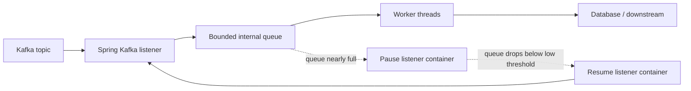

# Pausing When the Internal Queue Is Full

A Spring Kafka consumer sometimes forwards received records into an internal queue for background worker threads to process. Decoupling ingestion from processing lets the listener return quickly and scale worker counts independently. However, if Kafka delivers records faster than workers drain them, the queue grows until memory runs out or no capacity remains for new items.

Backpressure is the mechanism for throttling input when downstream processing cannot keep up. With Spring Kafka, you can request the listener container to pause when the queue hits a high threshold and resume once the queue drops to a low threshold. This approach lets the consumer temporarily stop accepting new records while keeping the polling loop alive to stay in the consumer group.

## 1. Why pause when the internal queue is nearly full?

Suppose a listener receives `OrderEvent` records and puts them into a `BlockingQueue`; a pool of workers pulls events from the queue and writes to a database. If producers emit 2,000 records/second while workers can only process 1,200 records/second, the backlog grows by roughly 800 records every second. An unbounded queue causes continuous heap growth; a bounded queue fills up and forces the application to decide what to do with incoming records.



Without throttling, you can run into several problems:

- Heap grows as the queue holds large numbers of payloads and intermediate objects.
- Garbage collection pauses lengthen, further degrading processing throughput.
- A full queue prevents the listener from accepting additional records.
- If the listener blocks too long waiting for free space, the consumer may fail to call `poll()` on time and drop out of the consumer group.
- If the queue exists only in RAM, records whose offsets were committed but have not yet been processed by workers can be lost on application restart.

Pause/resume throttles consumption rate at the consumer. It does not slow down producers and does not remove existing backlog on Kafka; unfetched records continue accumulating in the topic subject to retention and appear as consumer lag.

## 2. How pausing and resuming the listener container works

Spring Kafka provides `pause()` and `resume()` on the listener container. You can retrieve the container by listener ID via `KafkaListenerEndpointRegistry`:

```java
@KafkaListener(
        id = "ordersListener",
        topics = "orders",
        groupId = "order-service")
public void consume(OrderEvent event) {
    orderWorkQueue.submit(event);
}
```

Another bean can control the container:

```java
@Component
public class OrderConsumerFlowControl {

    private final KafkaListenerEndpointRegistry registry;

    public OrderConsumerFlowControl(KafkaListenerEndpointRegistry registry) {
        this.registry = registry;
    }

    public void pauseOrders() {
        MessageListenerContainer container =
                registry.getListenerContainer("ordersListener");
        if (container != null) {
            container.pause();
        }
    }

    public void resumeOrders() {
        MessageListenerContainer container =
                registry.getListenerContainer("ordersListener");
        if (container != null) {
            container.resume();
        }
    }
}
```

`pause()` and `resume()` can be called from threads other than the consumer thread. Spring Kafka records the request and executes the pause/resume operation on the Kafka consumer on the thread that owns the consumer; never call `consumer.pause()` directly from a worker thread. The container continues calling `poll()` while paused to maintain group liveness and heartbeats, while paused partitions deliver no new records to the listener.

Pausing does not mean stopping the container. `stop()` shuts down the container and can cause the consumer to leave the group; `pause()` suspends record delivery while keeping the container running. Once the queue clears, `resume()` allows consumption to continue.

With `ConcurrentMessageListenerContainer`, pausing the container generally applies to the child consumers it manages. If only one partition experiences abnormal backlog, consider pausing/resuming that partition instead of the whole container, taking assignments and your Spring Kafka version's APIs into account.

## 3. Using high and low watermarks

Do not pause the instant the queue grows slightly and resume the instant a single record is drained. That causes the container to flap continuously between states, creating throughput oscillations. Use two separate thresholds:

- **High watermark:** when queue depth reaches or exceeds this threshold, request a pause.
- **Low watermark:** only resume when queue depth drops to or below this threshold.

For example, with a queue capacity of 1,000 records, set the high watermark to 800 and the low watermark to 400. When the queue reaches 800, the consumer pauses. Workers continue draining the backlog; only when the queue drops to 400 does the consumer resume.

```java
@Component
public class OrderQueueBackpressure {

    private static final int HIGH_WATERMARK = 800;
    private static final int LOW_WATERMARK = 400;

    private final BlockingQueue<OrderEvent> queue =
            new ArrayBlockingQueue<>(1_000);
    private final OrderConsumerFlowControl flowControl;
    private final Object stateLock = new Object();
    private boolean paused;

    public OrderQueueBackpressure(OrderConsumerFlowControl flowControl) {
        this.flowControl = flowControl;
    }

    public void submit(OrderEvent event) {
        if (!queue.offer(event)) {
            flowControl.pauseOrders();
            throw new QueueSaturatedException(
                    "Internal order queue is full");
        }
        updatePauseState();
    }

    public OrderEvent take() throws InterruptedException {
        OrderEvent event = queue.take();
        updatePauseState();
        return event;
    }

    private void updatePauseState() {
        synchronized (stateLock) {
            int depth = queue.size();
            if (!paused && depth >= HIGH_WATERMARK) {
                paused = true;
                flowControl.pauseOrders();
            }
            else if (paused && depth <= LOW_WATERMARK) {
                paused = false;
                flowControl.resumeOrders();
            }
        }
    }
}
```

This example focuses on the throttling mechanism; in production applications you must also handle worker lifecycles, shutdown, metrics, and queue-full scenarios. If `offer()` fails, never silently drop the record. You can fall back to durable storage, bounded synchronous processing, or throw an exception so the error handler performs retries/recovery per policy. Retries must be bounded with an appropriate DLT; if the queue remains full, endless retries do not increase processing capacity.

When running multiple listener containers or multiple application instances, queues are typically per-process. Pausing one container only throttles consumers in that container; it does not automatically pause other replicas. If a shared downstream is overloaded, consider service-level throttling, quotas, or global concurrency limits.

## 4. Leaving headroom for already-polled records

Pausing does not necessarily take effect at the exact instant it is called. A consumer may have already polled a batch of records from the broker before the pause request is applied. For a record listener, the container may continue processing the remainder of the current poll before pausing completely, depending on configuration.

Therefore, the high watermark must sit below queue capacity by a safety margin. If `N` consumers are active and `max.poll.records = M`, a conservative upper bound for records already polled is roughly `N × M`. For instance, 3 consumers with up to 100 records per poll can hold up to ~300 already-fetched records across active polls. Reserve corresponding headroom or adjust `max.poll.records`, concurrency, and batch sizes.

In Spring Kafka versions supporting `pauseImmediate`, you can configure the container to stop processing after the current record rather than waiting to finish every record from the previous poll:

```java
factory.getContainerProperties().setPauseImmediate(true);
```

For batch listeners, the current unit of processing is the batch; do not assume you can stop mid-batch if the listener processes the entire list together. `pauseImmediate` depends on the Spring Kafka version, so verify your project's API. Even with this mode enabled, reserve buffer capacity for in-flight records and child consumers.

Never place the high watermark right next to maximum capacity. If the queue fills up before the pause takes effect, the listener still needs a safe overflow policy.

## 5. Never block the consumer thread waiting for queue space

It is tempting to call `queue.put(event)` inside the listener. `put()` waits until space becomes available. However, when the queue is full, the listener thread can block for a long time and miss the poll loop. If the gap between two `poll()` calls exceeds `max.poll.interval.ms`, Kafka may consider the consumer dead and trigger a rebalance.

Instead:

1. Use a bounded queue with `offer()` and an explicit result.
2. Request a pause as soon as the high watermark is reached, before the queue fills completely.
3. Let workers drain the backlog and trigger a resume once the queue drops to the low watermark.
4. If the queue still fills due to already-polled records or races, use an intentional overflow path; do not drop records and do not block the consumer thread indefinitely.
5. Monitor processing times and poll intervals to ensure the container stays in the consumer group.

Pause/resume should be controlled by a single component with clear state ownership. Avoid having multiple places call `pause()` and `resume()` independently without shared state, as a worker could resume while another condition still requires a pause.

## 6. Preserving offsets when handing off to async workers

This is the most critical point when a listener only enqueues and returns. With automatic acknowledgment or an `AckMode` that commits upon listener return, the container can commit the offset immediately after the listener puts the record into the queue. If the queue lives only in RAM and the application restarts before workers finish processing, Kafka will not redeliver committed records; queued work can be lost.

Pausing only regulates record ingestion speed. It does not turn an in-memory queue into durable storage, nor does it automatically tie worker completion to Kafka offsets.

Design options:

| Approach | Characteristics | Requirements |
|---|---|---|
| Process inside the listener before returning | Listener completes only after work is processed | Simple offset semantics; keep processing time within poll and transaction limits. |
| Write to a durable work store then return | Record is durably stored before the input offset is committed | Database/store must confirm write success; requires idempotency and worker re-reading. |
| In-memory handoff and ack offset after worker finishes | Decouples ingestion from processing | Requires manual/async acknowledgment obeying thread, partition order, and container rules; must handle restarts and rebalances. |
| Use Kafka as the work queue | Worker consumers read directly from a topic and throttle via pause/resume | Avoids moving records to volatile RAM queues; scales workers via consumer groups and partitions. |

If using `AckMode.MANUAL` or `MANUAL_IMMEDIATE`, verify how `Acknowledgment` may be invoked across threads in your Spring Kafka version. With asynchronous processing, acknowledgments can arrive out of order; `asyncAcks` may support certain patterns, though it alters commit behavior and can temporarily pause the consumer until pending acknowledgments from a poll complete. Do not pass acknowledgments into worker threads casually.

For systems requiring high reliability, a durable handoff or letting Kafka act as the queue is usually easier to reason about than holding uncommitted offsets for long periods. Whichever approach you choose, ensure a record is acknowledged only after work has been safely stored or completed according to your application's durability contract.

## 7. Combining pause with worker pools and downstream

The internal queue usually acts as a buffer between the listener and a worker pool. When designing this, bound both the queue and the number of concurrently running tasks. If the queue shrinks because workers pull records only to submit more tasks to an unbounded executor, the backlog has merely moved from one queue to another.

Key principles:

- Use bounded queues at every handoff layer; never push backlog into an unbounded executor.
- Size worker counts according to CPU capacity, database connection pools, and downstream limits.
- Account for in-flight records when estimating memory and load, not just `queue.size()`.
- When workers fail, apply bounded retries and idempotency; never keep a worker thread blocked waiting forever.
- If downstream has rate limits, tune worker count or dequeue rate rather than simply enlarging the queue.
- On shutdown, stop accepting new records, wait for workers to finish within a grace period, and ensure offsets are acknowledged only per safe policy.

If a queue is shared across multiple listener containers, pausing/resuming containers individually may not suffice. Use a central coordinator that tracks downstream load and each input source's state. Avoid letting one consumer repeatedly resume while the shared queue remains overloaded.

## 8. Monitoring backpressure

To verify pausing works properly, observe both the internal queue and Kafka:

| Metric | Meaning |
|---|---|
| Queue depth and remaining capacity | Shows buffer fullness and remaining headroom. |
| Pause/resume counts and paused duration | Detects threshold oscillation or overly long pauses. |
| Consumer lag by topic/partition | Shows backlog accumulating in Kafka while the consumer slows down. |
| Worker throughput and processing latency | Compares processing capacity against incoming record rates. |
| In-flight record count | Measures work dequeued by workers but not yet completed. |
| Queue overflow/rejected count | Detects insufficient headroom or pauses taking effect too late. |
| Heap, GC, and downstream latency | Detects memory bottlenecks or dependency slowdowns. |
| Retries, DLT, and processing failures | Tracks records failing under overload conditions. |

A queue that frequently hits the high watermark indicates the worker pool or downstream lacks sufficient capacity. If paused time grows continuously and consumer lag exceeds thresholds, slow down producers, scale processing capacity, or adjust partitions/concurrency after identifying the bottleneck. Simply increasing queue capacity only delays when it fills rather than fixing a throughput mismatch.

## 9. Procedure for testing pause/resume

Test under load exceeding worker capacity to confirm the system throttles properly:

1. Use small queue capacity, high watermark, and low watermark values in test environments to make state transitions easy to observe.
2. Produce records faster than workers can process; verify the container pauses when the queue hits the high watermark.
3. While paused, verify the container stays alive and the consumer group does not continuously rebalance solely due to pausing.
4. Let workers drain the backlog; once the queue drops to the low watermark, verify the container resumes.
5. Check the number of already-polled but unprocessed records when pause is requested; verify headroom prevents overflow.
6. Slow down or temporarily halt workers; verify the queue never exceeds its bound and the overflow path does not drop records.
7. Restart the application while the queue holds records; verify durable handoff or offset policies prevent work loss.
8. Test multiple concurrent consumers and multiple instances sharing a downstream to verify the coordinator does not resume prematurely.
9. Monitor consumer lag, poll intervals, pause duration, heap, and retry/DLT behavior throughout the test.

Pausing when the internal queue nears capacity is an effective backpressure pattern for Spring Kafka: the listener container stops accepting new records, workers get time to drain the backlog, and the consumer resumes once the queue drops to a safe level. This mechanism is only reliable when paired with a bounded queue, dual pause/resume thresholds, headroom for already-polled records, an explicit overflow path, and an offset policy that prevents losing work on restarts.
