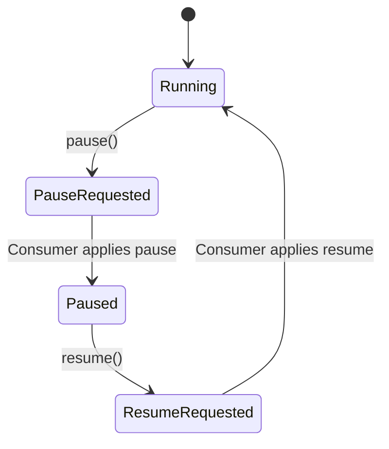

# Monitoring Paused State

Spring Kafka allows pausing consumers when downstream systems are overloaded or when the application needs to throttle processing rates. Calling `pause()` only sends a pause request; the consumer thread applies that request on the next eligible poll cycle. Therefore, the "pause requested" state and the "consumer actually paused" state occur at two different moments.

To monitor accurately, observe both the requested state and the actual state, combined with pause/resume events and backpressure metrics such as queue depth, consumer lag, and paused duration.

## 1. Distinguishing pause requested from consumer paused

On `MessageListenerContainer`, Spring Kafka provides two essential methods:

- `isPauseRequested()`: indicates whether the application has requested the container to pause.
- `isConsumerPaused()`: indicates whether the consumer is actually in the paused state.

When `pause()` is called, the container records the request and applies it on the consumer thread when that thread handles the next poll cycle. Records already fetched in the current poll may still be processed by the listener under default behavior before the pause takes effect. Thus, `isPauseRequested()` may return `true` while `isConsumerPaused()` is still `false`.



Do not treat the return of `pause()` as proof that the consumer stopped receiving records at the exact instant of the call. If you need to display status on a dashboard or administrative API, represent the requested state and the applied state separately.

## 2. Reading listener container status

For listeners declared with `@KafkaListener`, you can retrieve the container through `KafkaListenerEndpointRegistry`. The ID passed to `getListenerContainer()` must match the `id` on the annotation:

```java
@KafkaListener(
    id = "orders-listener",
    topics = "orders",
    groupId = "order-service")
public void consume(OrderEvent event) {
    orderService.process(event);
}
```

An administrative service can read and request state changes:

```java
@Service
public class ListenerPauseService {
    private final KafkaListenerEndpointRegistry registry;

    public ListenerPauseService(KafkaListenerEndpointRegistry registry) {
        this.registry = registry;
    }

    public PauseStatus status(String listenerId) {
        MessageListenerContainer container =
            registry.getListenerContainer(listenerId);
        if (container == null) {
            throw new IllegalArgumentException(
                "Unknown listener: " + listenerId);
        }

        return new PauseStatus(
            container.isPauseRequested(),
            container.isConsumerPaused());
    }

    public void pause(String listenerId) {
        MessageListenerContainer container = requireContainer(listenerId);
        container.pause();
    }

    public void resume(String listenerId) {
        MessageListenerContainer container = requireContainer(listenerId);
        container.resume();
    }
}
```

`PauseStatus` can be a DTO holding two booleans: `pauseRequested` and `consumerPaused`. In production code, handle unknown listener IDs and stopped containers according to a clear API contract. Having both values `false` means no pause request is pending and the consumer is not currently paused; it does not by itself prove that the listener is processing records successfully.

With `ConcurrentMessageListenerContainer`, there are multiple child consumers. Pausing and resuming apply to the consumers owned by the container; when monitoring, inspect the container/listener ID, assigned partitions, and per-partition status if the application uses partition-level pausing.

## 3. Monitoring per-partition status

Sometimes only one partition has hot data or a key-group-specific downstream is overloaded. You can pause a specific partition rather than pausing the entire listener container.

```java
TopicPartition partition = new TopicPartition("orders", 2);

container.pausePartition(partition);
boolean paused = container.isPartitionPaused(partition);

// When the downstream system has recovered:
container.resumePartition(partition);
```

Only pause partitions that the container owns or is configured to handle. In a concurrent container, each partition is assigned to one child consumer at a time; monitoring should correlate topic-partition and listener ID to avoid confusing state across consumers.

Pause the entire container when every partition of the listener needs load reduction. Pause per partition when only a portion of the stream needs throttling. Your choice of scope directly affects throughput and processing order.

## 4. Using ConsumerPausedEvent and ConsumerResumedEvent

Querying status shows the state at the moment of the read. Spring Kafka also emits application events when the consumer actually transitions state. You can listen for `ConsumerPausedEvent` and `ConsumerResumedEvent` to log, update metrics, or notify monitoring systems.

```java
@Component
public class ConsumerPauseEventListener {
    private static final Logger log =
        LoggerFactory.getLogger(ConsumerPauseEventListener.class);

    @EventListener
    public void onPaused(ConsumerPausedEvent event) {
        log.info("Kafka consumer paused: {}", event);
    }

    @EventListener
    public void onResumed(ConsumerResumedEvent event) {
        log.info("Kafka consumer resumed: {}", event);
    }
}
```

For partition-level pause/resume, Spring Kafka also provides corresponding events such as `ConsumerPartitionPausedEvent` and `ConsumerPartitionResumedEvent`. These events are helpful for knowing which partition has actually been paused or resumed.

Events are emitted when the consumer thread applies the change, so they distinguish the request time from the actual state transition time. If the application event multicaster is configured to run asynchronously, event handlers may be invoked with a delay; do not treat event receipt time as a precise clock for synchronous decisions.

## 5. Combining pause/resume with backpressure

A common pattern places a bounded queue behind the listener. Background workers pull from the queue and call downstream services. When the queue nears capacity, the application pauses the consumer; when the queue drops to a safe level, the application resumes.

Use two different thresholds to prevent continuous pause/resume cycling when the queue fluctuates around a single value:

| Threshold | Action |
| --- | --- |
| High watermark | Request a pause when the queue reaches the high threshold. |
| Low watermark | Request a resume when the queue drops to the low threshold. |

```java
if (queue.size() >= HIGH_WATERMARK
        && !container.isPauseRequested()) {
    container.pause();
}

if (queue.size() <= LOW_WATERMARK
        && container.isPauseRequested()) {
    container.resume();
}
```

This snippet represents minimal control logic. In real applications, ensure queue reads and state transitions are safely coordinated across listener threads, worker threads, and schedulers. A single component should own pause/resume decisions so two threads never issue conflicting commands.

Do not wait until the queue is completely full before pausing. Because a pause request only takes effect on an eligible poll cycle, remaining records in the current poll may still enter processing. The high watermark must leave room for in-flight records, `max.poll.records`, and container concurrency.

If the queue fills up before the consumer stops receiving records, `offer()` can fail. Define clearly how to handle that case: keep the record in the current processing flow, throw an error to trigger policy-based retries, or use a durable persistence mechanism. Never silently drop a record just because the queue is full.

## 6. Pause is not stop and does not trigger rebalances on its own

When a consumer pauses partitions, it continues calling `poll()` to maintain liveness and membership in the consumer group. The broker stops delivering new records from paused partitions, while records remain stored in Kafka. Upon resuming, the consumer continues reading from the unprocessed offset.

This differs from `stop()`: stopping closes the consumer and leaves the consumer group, which can trigger a rebalance. Pause fits temporary backpressure; stop fits ending the container lifecycle or changing configurations.

Pausing also does not fix a listener that blocks for too long. If the consumer thread does not return to `poll()` because the listener processes slowly or waits on a synchronous call, `max.poll.interval.ms` can still be exceeded. A pause can only be applied when the consumer thread gets a chance to handle the request; bound processing times and avoid blocking the consumption thread.

## 7. Monitoring status in multi-consumer systems

A listener with concurrency greater than one has multiple child consumers and multiple partition assignments. Do not record a single global boolean metric and assume all partitions are paused. Operational dashboards should capture these dimensions:

- Listener/container ID and consumer group.
- Topic-partitions assigned to each consumer.
- Pause requested state and actual paused state.
- Pause start timestamp, paused duration, and last resume timestamp.
- Queue depth, in-flight record count, and consumer lag.

If the application uses per-partition pausing, events and metrics must retain topic-partition information. If pausing the whole container, aggregate child consumer status while still supporting per-partition inspection during investigations.

## 8. Testing pause and resume

An integration test should send multiple records to a topic, call `pause()`, and verify `isPauseRequested()` becomes `true`. Then wait for `isConsumerPaused()` or `ConsumerPausedEvent` to confirm the consumer has applied the pause. Send additional records while paused and verify the listener does not receive them yet; then call `resume()` and verify the records are processed.

Also test these scenarios:

- Calling pause twice and calling resume when not paused.
- Pausing while the listener is actively processing a multi-record poll.
- Pausing/resuming a specific partition in a concurrent container.
- Queue exceeding the high watermark and then dropping below the low watermark.
- Application restart while paused and re-initialization behavior.
- Blocked listeners and the effect of `max.poll.interval.ms`.

Use Embedded Kafka or Testcontainers to verify poll behavior, partition assignments, and committed offsets. Do not merely assert that the pause method was called; verify that the consumer actually stops receiving new records from paused partitions and continues after resuming.

## 9. Essential operational metrics

Track pause/resume counts, time from pause request to paused state, paused duration, count of currently paused partitions, queue depth, in-flight record count, consumer lag, and queue offer failures. Alert when consumers stay paused too long, lag rises rapidly, or queues fail to drain after downstream recovers.

Record the pause reason, such as `DOWNSTREAM_OVERLOADED`, `QUEUE_HIGH_WATERMARK`, or `MAINTENANCE`. When resuming, log the cause and pause duration so operators know which condition was resolved.

Monitoring paused state means observing both the control intent and the state applied by the consumer thread. Combining `isPauseRequested()`, `isConsumerPaused()`, partition state, consumer pause/resume events, and backpressure metrics tells the application when to wait, when to resume, and whether the consumer is genuinely protected from an overloaded downstream.
