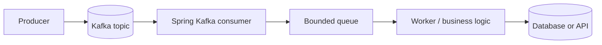

# Designing Graceful Degradation

A Kafka consumer can read records faster than a database, HTTP API, or downstream system can process them. When that happens, increasing concurrency or adding more consumers will not necessarily fix the problem; downstream can become even more overloaded, application queues balloon, and latency rises continuously.

Graceful degradation is the practice of reducing a system's level of operation in a controlled manner when a component is overloaded or degraded. With Spring Kafka, you can combine resource limits, listener container pause/resume, shedding non-essential work, bounded retries, and appropriate fallbacks. The goal is to keep the system stable, preserve messages, and recover smoothly once downstream is ready.

## 1. Identifying bottlenecks and overload signals

A messaging pipeline typically flows through several components:



If the consumer fetches records faster than workers can process them, the queue grows steadily. If workers run quickly while the database is slow, pending requests or connection pools become exhausted. If the database recovers while the consumer remains paused, throughput may never return on its own without a resume mechanism.

Key signals to watch:

| Signal | What it may indicate |
|---|---|
| Queue depth growing continuously | Ingestion rate exceeds processing rate |
| Queue nearly full or low remaining capacity | Application is about to run out of buffer space |
| Increasing consumer lag | Consumer cannot keep up with producer rate or is paused |
| Rising processing p95/p99 | Downstream is slow or experiencing resource contention |
| Database connection pool nearly exhausted | Too many concurrent tasks or slow queries |
| Rising HTTP 429/503 responses and timeouts | Dependency is rate-limiting or degraded |
| Rising retry/DLT rates | Prolonged failures or an unsuitable retry policy |
| Growing heap and GC activity | Holding too many records or allocating too many pending objects/tasks |

Do not rely on a single metric to decide when to pause. For example, high consumer lag can be caused by a producer traffic spike while downstream remains healthy. Queue depth, processing latency, and dependency health usually pinpoint the actual bottleneck more accurately.

## 2. What is graceful degradation?

When a component degrades, the system can shift to a reduced service mode while keeping resources and data under control.

Examples for an order-processing service:

- Continue processing critical operations such as payment confirmation.
- Pause or defer non-essential notification tasks.
- Reduce concurrent requests sent to a slow database.
- Serve bounded stale cached data for certain read queries if business rules allow.
- Pause consumption on selected partitions when queues near capacity.
- Leave records in Kafka for later processing rather than fetching and buffering them endlessly on the heap.

Graceful degradation must be defined by business semantics. Never silently drop critical events, return fake successes, or commit offsets before required side effects have completed.

## 3. Backpressure and pause/resume in Spring Kafka

Backpressure signals upstream that downstream cannot accept more work at the current rate. With Kafka, the consumer can temporarily stop fetching records from the broker while unprocessed records remain safely in the topic.

Spring Kafka provides pause/resume operations on the listener container:

- `pause()`: requests the container to pause consumption on assigned partitions.
- `resume()`: requests the container to resume consumption.
- `pausePartition(...)`: pauses a specific partition when per-partition throttling is needed.
- `resumePartition(...)`: resumes a paused partition.

Example retrieving the container from the registry:

```java
@Service
public class OrderConsumerFlowControl {

    private final KafkaListenerEndpointRegistry registry;

    public OrderConsumerFlowControl(
            KafkaListenerEndpointRegistry registry) {
        this.registry = registry;
    }

    public void pauseOrders() {
        MessageListenerContainer container =
                registry.getListenerContainer("orders-listener");

        if (container != null && container.isRunning()) {
            container.pause();
        }
    }

    public void resumeOrders() {
        MessageListenerContainer container =
                registry.getListenerContainer("orders-listener");

        if (container != null && container.isRunning()) {
            container.resume();
        }
    }
}
```

The listener needs an explicit ID:

```java
@KafkaListener(
        id = "orders-listener",
        topics = "orders",
        groupId = "order-service")
public void consume(OrderEvent event) {
    orderService.process(event);
}
```

`pause()` and `resume()` are container control requests. The actual pause is applied on the consumer's poll cycle. The container continues polling while paused to maintain consumer group membership; paused partitions deliver no new records to the listener. Thus, pausing a container differs from stopping it: stopping closes the consumer and makes it leave the group, whereas pausing keeps the consumer in the group.

Pausing does not delete records from Kafka and does not roll back work already fetched in the current poll. Account for already-fetched or in-progress records when setting pause thresholds.

## 4. Using high and low watermarks

If you pause the instant the queue crosses a threshold and resume the instant it drops below that same threshold, the system can oscillate rapidly between states. This is called *flapping*.

A more stable approach uses two thresholds:

- **High watermark:** pause the consumer when the queue reaches this level.
- **Low watermark:** resume the consumer when the queue drops to this level.

Example for a queue with a capacity of 1,000 items:

| Queue level | Action |
|---:|---|
| Below 600 | Continue operating in current state |
| 600 and above | Pause consumer |
| 250 and below | Resume consumer |

The gap between the two thresholds creates hysteresis, preventing constant pause/resume cycling when queue depth fluctuates around one point.

Example controller:

```java
@Component
public class QueueWatermarkController {

    private static final int HIGH_WATERMARK = 600;
    private static final int LOW_WATERMARK = 250;

    private final KafkaListenerEndpointRegistry registry;
    private boolean pauseRequested;

    public QueueWatermarkController(
            KafkaListenerEndpointRegistry registry) {
        this.registry = registry;
    }

    public synchronized void updateQueueDepth(int queueDepth) {
        MessageListenerContainer container =
                registry.getListenerContainer("orders-listener");

        if (container == null || !container.isRunning()) {
            return;
        }

        if (!pauseRequested && queueDepth >= HIGH_WATERMARK) {
            container.pause();
            pauseRequested = true;
        }
        else if (pauseRequested && queueDepth <= LOW_WATERMARK) {
            container.resume();
            pauseRequested = false;
        }
    }
}
```

A queue monitor or worker coordinator can call `updateQueueDepth(...)` as the queue changes. The thresholds in this example are illustrative; tune them according to queue capacity, consumption rate, processing duration, and the volume of records that may already be fetched.

In multi-instance deployments, `pauseRequested` only reflects controller state inside a single JVM. Each instance must manage its own container; if pause state is coordinated centrally, store control state in an appropriate mechanism and handle instance restarts.

## 5. Bounded queues and limiting pending work

Pausing the consumer only works effectively when the application bounds pending work. If the listener pushes records into an unbounded queue, the heap can still grow until the process hits OOM before backpressure takes effect.

Use a fixed-capacity queue:

```java
private final BlockingQueue<OrderEvent> queue =
        new ArrayBlockingQueue<>(1_000);
```

A bounded queue lets the application know the exact maximum number of items it can hold in memory. When the queue reaches the high watermark, the controller requests a pause. Workers drain the queue, and once it drops to the low watermark, the controller resumes.

However, records already polled by the consumer may still sit in internal buffers or be mid-processing. Therefore, set the high watermark well below maximum capacity to leave headroom for already-fetched records and running requests.

If using `queue.offer(event)` and offering fails, the listener must have an explicit policy. Never discard the event and return normally if the offset will be committed. Throw an exception so the error handler handles it, or design the listener to accept records only when capacity exists. For asynchronous processing, acknowledge only after work finishes per your chosen offset strategy.

Do not use an unbounded queue and rely solely on consumer lag; growing lag on the broker is far safer than pulling millions of objects onto the heap.

## 6. Pause the whole container or just one partition?

There are two common throttling scopes.

**Pausing the whole container** fits when a downstream dependency serving all partitions is overloaded. The container stops fetching new records from every assigned partition.

**Pausing by partition** fits when only one tenant, key range, or data stream is causing pressure. If that partition can pause independently, the remaining partitions keep processing.

Conceptual example:

```java
TopicPartition partition =
        new TopicPartition("orders", 2);

container.pausePartition(partition);

// When downstream is ready:
container.resumePartition(partition);
```

Only pause partitions assigned to the corresponding container's consumer. When a rebalance occurs, assignments may shift; the controller must observe partition assignments and update pause decisions for the new consumer/container.

Per-partition pausing will not solve a shared dependency that is overloaded system-wide. In that scenario, pausing the whole container or lowering concurrency is more suitable.

## 7. How pause differs from stop, seek, and retry

These operations serve distinct goals:

| Mechanism | Effect | When appropriate |
|---|---|---|
| Pause/resume | Temporarily stops or resumes fetching new records | Throttling load when downstream is overloaded |
| Stop/start | Closes the consumer and rejoins the group on start | Shutting down a consumption stream for a period |
| Seek | Changes the consumer's read position | Controlling offsets or replaying records per policy |
| Retry | Retries processing a failed record | Recoverable processing errors |
| Retry topic | Routes records to a separate retry flow | Delaying retries without blocking the main flow |

Do not use seek as a substitute for pause when the goal is merely slowing down. Seeking can re-read records and introduce duplicates. Do not use retries for every queue-overload case when the real issue is accepting more work than capacity allows; aggressive retries can amplify load.

## 8. Impact on polling, offsets, and consumer groups

While a container is paused, Spring Kafka continues polling to preserve consumer group membership. This prevents the consumer from leaving the group just because it temporarily paused record ingestion.

Important points to understand:

- Pausing does not commit offsets of unprocessed records.
- Successfully processed records are still committed per the configured `AckMode`/transaction.
- Records fetched before the pause may still need to be processed.
- Stopping the container makes the consumer leave the group and can trigger a rebalance.
- Upon resuming, the consumer continues from the committed offset or current position per container mechanics.

If a listener blocks too long on a synchronous operation, the consumer thread may fail to return to poll. In that case, `max.poll.interval.ms` remains a critical limit and the consumer can be evicted from the group. Pause/resume cannot rescue a listener thread hung inside a database or HTTP call without a timeout.

Therefore, configure timeouts on dependencies, bound processing durations, and avoid holding the consumer thread indefinitely.

## 9. Graceful degradation at the business layer

Backpressure regulates workload volume. Graceful degradation can also reduce service quality or scope while a dependency is degraded.

Examples:

| Situation | Controlled degradation approach |
|---|---|
| Slow email-sending API | Defer notifications, retain events for later processing |
| Database nearly out of connections | Lower concurrency or pause consumers |
| Cache unavailable | Fall back to database with rate limiting if capacity permits |
| Non-critical event type causing load | Lower priority or isolate into a separate consumer group |
| Downstream returning 429 | Respect rate limits, throttle speed, and retry with backoff |
| Dependency down for extended period | Pause affected stream, alert, and wait for recovery |

Fallbacks must match business requirements. For example, serving stale cache data may be acceptable on a reporting screen, but unsuitable for deducting balances or checking inventory where strict accuracy is required.

If safe processing is impossible, keeping records in Kafka and deferring processing is usually better than acknowledging and discarding them.

## 10. Combining circuit breakers and rate limiters

A circuit breaker detects repeated dependency failures and transitions to an open state to block new calls for a period. A rate limiter caps requests per unit of time.

These two mechanisms complement pause/resume:

- **Circuit breaker:** shields dependencies from calls likely to fail.
- **Rate limiter:** caps the rate of requests sent to dependencies.
- **Pause/resume:** throttles consumers fetching additional records from Kafka.
- **Bounded queue:** bounds work held in memory.

For instance, if an inventory API returns repeated 503 errors, the circuit breaker opens. A controller can pause the consumer processing orders that depend on that inventory API. Once the circuit breaker transitions to half-open/closed and the queue drops to the low watermark, the controller resumes.

Do not resume solely because the circuit breaker just closed if the queue is still nearly full. Combine dependency health with actual local capacity.

## 11. Avoiding practices that worsen overload

Some seemingly simple tactics make recovery harder:

- **Unbounded queues:** hide overload briefly but eventually exhaust heap.
- **Retries without backoff:** hammer an already failing dependency with bursts of requests.
- **Continuously increasing concurrency:** can push an overloaded database/API into deeper failure.
- **Sleeping inside the listener:** ties up the consumer thread, starves polling, and extends processing.
- **Acking before processing completes:** risks losing work if the process stops after acking.
- **Pausing and forgetting to resume:** causes consumer lag to grow forever even after the dependency recovers.
- **Pausing all topics for a single isolated dependency:** unnecessarily disrupts unrelated flows.

Establish clear thresholds, states, timeouts, and recovery mechanisms. When a dependency serves only one subset of events, scope backpressure to that subset where architecture permits.

## 12. Setting thresholds and sizing buffers

High/low watermarks should not be picked arbitrarily. Estimate how many records can still arrive after issuing a pause request.

Suppose:

- The consumer processes 400 records/second.
- Time from detecting the high watermark to pause taking effect is 0.5 seconds.
- The current poll may have 100 unprocessed records remaining.
- The queue has 200 free slots left.

Additional records that may arrive before stopping completely:

```text
400 * 0.5 + 100 = 300 records
```

In this example, the queue only has 200 free slots remaining, so placing the high watermark too high can overflow the queue before the pause takes effect. Set the high watermark lower and leave enough buffer for already-fetched records, control latency, and in-flight tasks.

This is an initial estimate. Measure actual pause latency, poll sizes, partition counts, concurrency, and throughput in a production-like environment to calibrate.

## 13. Observability and alerting

Maintain dashboards or metrics covering both consumer and downstream state:

| Metric | Purpose |
|---|---|
| Queue depth and remaining capacity | Detect memory pressure |
| Pause duration | Detect consumers paused for too long |
| Pause/resume count | Detect flapping or misconfigured control logic |
| Consumer lag by partition | Identify which streams are accumulating backlog |
| Record processing latency | Track processing times |
| Downstream latency/error rate | Pinpoint bottlenecked dependencies |
| In-flight requests | Cap concurrent requests |
| Retry/DLT rate | Detect prolonged errors or retry storms |
| Heap/GC and thread pool saturation | Detect JVM resource exhaustion |

Alerts should cover pause duration exceeding thresholds, queues failing to drain while paused, rapidly growing consumer lag, or unrecovered downstream dependencies. A consumer paused for a few seconds can be normal; remaining paused for many minutes without an alert is an operational risk.

## 14. Testing backpressure and graceful degradation

Integration tests should verify real container behavior against a test broker:

1. Continuously send records and slow down workers so the queue grows.
2. Confirm the controller pauses the container when the queue hits the high watermark.
3. Confirm the queue never exceeds expected capacity due to already-fetched records.
4. Let workers keep draining the queue and confirm resume triggers at the low watermark.
5. Verify no continuous pause/resume loop occurs around a threshold.
6. Pause one partition and confirm other partitions continue processing if designed independently.
7. Stop the container and confirm the consumer leaves the group; restart and check offsets.
8. Have downstream return 429/503 and verify rate limiters/circuit breakers engage.
9. Verify the listener does not ack records when business work is incomplete.
10. Test shutting down while paused and ensure the container closes cleanly.

Do not just assert that `pause()` was called. Verify the consumer stops receiving new records, stays in the group while paused, and resumes processing afterward.

## 15. Implementation checklist

- [ ] Identified which dependency or queue triggers backpressure.
- [ ] Queues and thread pools have bounded capacity.
- [ ] High watermark is low enough to accommodate already-fetched records and in-flight work.
- [ ] Low watermark sits below the high watermark to prevent flapping.
- [ ] Pause/resume is managed at the appropriate container or partition scope.
- [ ] Control state and automatic resume mechanisms exist when downstream recovers.
- [ ] Timeouts are set for databases/APIs; polling is never blocked indefinitely.
- [ ] Retries use backoff and bounds without creating retry storms.
- [ ] Offsets are acked/committed only after required work completes.
- [ ] Metrics exist for queues, pause duration, lag, latency, and downstream errors.
- [ ] Tested overload, recovery, pause/resume, rebalances, and shutdown.
- [ ] Alerts exist for prolonged pauses or non-draining queues.

Graceful degradation in Spring Kafka combines bounding pending work, throttling consumers, and reducing service scope by business priority. Use pause/resume when downstream needs time to recover, bounded queues to protect the heap, high/low watermarks to avoid flapping, and circuit breakers/rate limiters to control dependency calls. Above all, preserve offset and message safety: acknowledge processing only after required work completes, with clear resume and recovery mechanisms in place.

