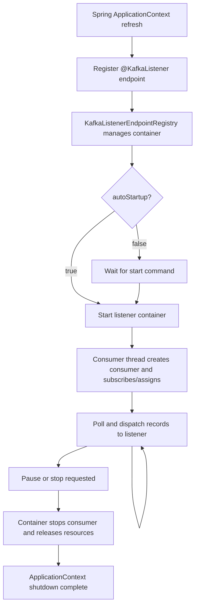

# Application Events in the Container Lifecycle

In Spring Kafka, the listener container does more than receive and deliver Kafka records to `@KafkaListener` methods. The container also emits **Spring application events** so the application can observe consumer lifecycle and listener operational state: consumers starting, stopping, receiving no data for a period, pausing, or showing signs of unresponsiveness.

These events integrate Kafka lifecycles with Spring's management mechanisms. Applications can log them, update metrics, raise alerts, or coordinate containers through `KafkaListenerEndpointRegistry`. They are especially helpful when operating event-driven applications built with Spring Kafka, `KafkaTemplate`, and `@KafkaListener`.

## 1. Spring Application Events and Kafka Records Are Different Concepts

A Kafka record is data written by a producer to a topic. Records have a key, value, timestamp, partition, and offset; brokers store records for consumers to read by consumer group. For example, `OrderCreated` is a business event that can be sent to the `orders` topic.

A Spring application event is an in-process notification within a running Spring application. The listener container emits notifications such as `ConsumerStartedEvent` or `ListenerContainerIdleEvent` via Spring's application event mechanism. Beans in the same application context can subscribe to these notifications using `@EventListener` or `ApplicationListener`.

| Criterion | Kafka record | Container Spring application event |
|---|---|---|
| Scope | Stored in a Kafka topic and readable by multiple applications | Inside the running Spring process |
| Purpose | Transfer data or business events between components | Report status and lifecycle of listener containers |
| Receiving mechanism | Kafka consumer, consumer group, offset | `@EventListener` or `ApplicationListener` |
| Storage and replay | Retained and replayable according to retention/offset | No durable log for replay after application restart |
| Examples | `OrderCreated`, `PaymentCaptured` | `ConsumerStartedEvent`, `ListenerContainerIdleEvent` |

Because application events are not data written to Kafka, do not use them as a substitute for business events or inter-service communication. If another service needs to know an order was created, send a record to a topic. If the application itself needs to know a consumer just started, an application event is the right choice.

## 2. How Are Containers Created and Managed?

When Spring processes beans with `@KafkaListener`, `KafkaListenerAnnotationBeanPostProcessor` detects the annotation and registers a listener endpoint. `KafkaListenerEndpointRegistry` manages the corresponding listener containers. The container is responsible for creating the Kafka consumer, subscribing or assigning partitions, running the poll loop, and delivering records to the listener.

A simple listener can be declared as follows:

```java
import org.springframework.kafka.annotation.KafkaListener;
import org.springframework.stereotype.Component;

@Component
public class OrderListener {

    @KafkaListener(
            id = "ordersListener",
            topics = "orders",
            groupId = "orders-service"
    )
    public void onOrder(String message) {
        // Process deserialized payload.
    }
}
```

`id` identifies the listener endpoint; this ID can be used to retrieve the container from the registry. Unless `autoStartup` is configured otherwise, containers are normally started automatically by the registry following the application context lifecycle.

General sequence:



The container participates in Spring's lifecycle mechanism. When the context starts, the registry starts listeners configured to run automatically. When the context stops, the registry tells containers to stop and release consumers. Applications can also control containers via the registry at runtime.

### 2.1. Single containers and concurrency

With a single listener container, one consumer performs polling and processing according to listener configuration. When `concurrency` is set higher than one on `ConcurrentMessageListenerContainer`, Spring Kafka manages multiple child consumer containers. Each consumer has its own thread and lifecycle; therefore, certain events can be emitted per child consumer/container rather than once for the entire listener logic.

When inspecting events, distinguish the listener endpoint ID from individual child consumers/containers. Do not assume a single start or stop event represents the entire consumer group. The consumer group is also coordinated by the Kafka broker, such as during rebalances when members join or leave the group.

## 3. Events in the Consumer Lifecycle

Spring Kafka provides events to track key milestones as consumers start up and shut down.

| Event | When emitted | Common usage |
|---|---|---|
| `ConsumerStartingEvent` | Consumer thread is about to start | Record startup progress |
| `ConsumerStartedEvent` | Consumer has started running | Update status or metrics showing the consumer is active |
| `ConsumerFailedToStartEvent` | Consumer failed to start | Log error and raise alert |
| `ConsumerStoppingEvent` | Consumer is preparing to stop | Record shutdown progress |
| `ConsumerStoppedEvent` | Consumer has stopped | Update status, investigate stop reason |

Startup and shutdown events distinguish different states. For example, a container created in the application context does not yet mean the consumer started successfully. Similarly, receiving a stop request does not mean the consumer has finished stopping and releasing resources.

Do not use `ConsumerStartedEvent` alone to conclude that the consumer group has received all partitions. Partition assignment also depends on subscriptions, brokers, and rebalance progress. When verifying assigned partitions, observe appropriate container or consumer assignment metrics.

## 4. Events Reflecting Operational State

Besides startup and shutdown, listener containers emit events that reveal runtime processing health.

| Event | Meaning | Notes |
|---|---|---|
| `ListenerContainerIdleEvent` | Container received no records for the configured idle interval | Does not mean the consumer failed or disconnected |
| `ListenerContainerNoLongerIdleEvent` | Container receives records again after an idle period | Can be used to clear an idle alert |
| `NonResponsiveConsumerEvent` | Consumer made no poll progress within the monitored interval | Check slow listeners, blocked threads, broker, or network |
| `ConsumerPausedEvent` | Consumer/container entered paused state | Used to monitor consumption throttling |
| `ConsumerResumedEvent` | Consumer/container resumed | Indicates consumption has resumed |
| `ConsumerPartitionPausedEvent` | One or more partitions were paused | Useful when pausing only part of a data stream |
| `ConsumerPartitionResumedEvent` | Partition resumed | Track per-partition state |

`ListenerContainerIdleEvent` is only useful when an idle event interval is configured, for example via `ContainerProperties.setIdleEventInterval(...)`. Idle may simply mean the topic has no new data or the assigned partitions produced no records. Do not automatically restart containers merely upon receiving an idle event.

`NonResponsiveConsumerEvent` is a signal requiring deeper investigation. The consumer may be failing to return to poll on time because the listener is taking too long, an I/O call is hanging, a thread is blocked, or Kafka connectivity has issues. Correlate the event with processing logs, poll intervals, consumer lag, and broker health before taking recovery actions.

Pause and stop also have different semantics. When paused, the container temporarily stops delivering records from paused partitions to the listener, while the consumer can still continue polling to stay alive and maintain group membership. When stopped, the container terminates the consumer and releases resources. Thus pause fits temporary load throttling; stop is used to end the container lifecycle.

## 5. Listening to Application Events with `@EventListener`

You can create a dedicated bean to receive events. The following example logs startup, shutdown, and idle milestones:

```java
import org.slf4j.Logger;
import org.slf4j.LoggerFactory;
import org.springframework.context.event.EventListener;
import org.springframework.kafka.event.ConsumerFailedToStartEvent;
import org.springframework.kafka.event.ConsumerStartedEvent;
import org.springframework.kafka.event.ConsumerStartingEvent;
import org.springframework.kafka.event.ConsumerStoppedEvent;
import org.springframework.kafka.event.ConsumerStoppingEvent;
import org.springframework.kafka.event.ListenerContainerIdleEvent;
import org.springframework.kafka.event.ListenerContainerNoLongerIdleEvent;
import org.springframework.stereotype.Component;

@Component
public class KafkaContainerEventListener {

    private static final Logger log =
            LoggerFactory.getLogger(KafkaContainerEventListener.class);

    @EventListener
    public void onConsumerStarting(ConsumerStartingEvent event) {
        log.info("Kafka consumer is starting: {}", event.getSource());
    }

    @EventListener
    public void onConsumerStarted(ConsumerStartedEvent event) {
        log.info("Kafka consumer has started: {}", event.getSource());
    }

    @EventListener
    public void onConsumerFailedToStart(ConsumerFailedToStartEvent event) {
        log.error("Kafka consumer failed to start: {}", event.getSource());
    }

    @EventListener
    public void onConsumerStopping(ConsumerStoppingEvent event) {
        log.info("Kafka consumer is stopping: {}", event.getSource());
    }

    @EventListener
    public void onConsumerStopped(ConsumerStoppedEvent event) {
        log.info("Kafka consumer has stopped: {}", event.getSource());
    }

    @EventListener
    public void onContainerIdle(ListenerContainerIdleEvent event) {
        log.warn("Kafka listener container is idle: {}", event.getListenerId());
    }

    @EventListener
    public void onContainerActive(ListenerContainerNoLongerIdleEvent event) {
        log.info("Kafka listener container is active again: {}", event.getListenerId());
    }
}
```

Spring scans for methods annotated with `@EventListener` and invokes the matching method when the application context receives an event of a compatible type. A method can listen to a specific event; `ApplicationListener<E>` can also be used if an interface-based implementation is preferred.

In the example, `event.getSource()` is the source inherited from Spring's `ApplicationEvent`. For events carrying specialized details, read the properties provided by the exact event class in your project's Spring Kafka version. For example, idle events provide the listener ID to identify which endpoint emitted the notification.

If the listener uses concurrency, inspect the container/consumer details in the event before aggregating metrics. A single event may reflect only the state of one child consumer.

## 6. Controlling Containers via `KafkaListenerEndpointRegistry`

An application event can trigger an orchestration workflow, while starting, stopping, pausing, or resuming should be performed through the listener container API. `KafkaListenerEndpointRegistry` provides containers by the ID declared on `@KafkaListener`.

```java
import org.springframework.kafka.config.KafkaListenerEndpointRegistry;
import org.springframework.kafka.listener.MessageListenerContainer;
import org.springframework.stereotype.Service;

@Service
public class OrderListenerControl {

    private final KafkaListenerEndpointRegistry registry;

    public OrderListenerControl(KafkaListenerEndpointRegistry registry) {
        this.registry = registry;
    }

    public void pauseOrders() {
        MessageListenerContainer container =
                registry.getListenerContainer("ordersListener");
        if (container != null) {
            container.pause();
        }
    }

    public void resumeOrders() {
        MessageListenerContainer container =
                registry.getListenerContainer("ordersListener");
        if (container != null) {
            container.resume();
        }
    }

    public void stopOrders() {
        MessageListenerContainer container =
                registry.getListenerContainer("ordersListener");
        if (container != null && container.isRunning()) {
            container.stop();
        }
    }
}
```

If a listener needs manual startup control from the beginning, configure `autoStartup = "false"` on `@KafkaListener`, then call `start()` on the container retrieved from the registry once the application is ready. Ensure the ID passed to the registry matches the `id` of the listener endpoint.

Do not call methods on Kafka `Consumer` directly from an arbitrary thread. Consumer is not designed for concurrent manipulation across threads. Use Spring Kafka's container control APIs to pause/resume and manage lifecycle; let the container execute operations on the consumer thread via its own mechanism.

## 7. Threading and Considerations When Handling Events

By default, Spring application events are dispatched synchronously on the publishing thread. Listener container events are typically emitted from the consumer/container execution thread. This has two consequences:

1. A slow event handler can delay the publishing thread and interfere with container polling or lifecycle progress.
2. If dispatching the event to an executor or using `@Async`, never pass the Kafka `Consumer` object to another thread and invoke its methods.

For handlers that only log or update metrics, quick synchronous execution inside the listener is usually sufficient. If you need to call an external system, send notifications, or run time-consuming tasks, pass the necessary data to an asynchronous task. Pass only immutable values such as listener ID, event name, timestamp, and safely extracted info; never pass the consumer for another thread to manipulate.

Operational principles:

- Keep event handlers short with clear error handling.
- Do not perform network queries or long I/O operations directly inside synchronous callbacks.
- Do not treat an idle event as sole proof of a Kafka failure.
- Do not repeatedly restart containers upon receiving multiple status events; apply deduplication and rate limiting on actions.
- Do not treat a startup event as proof that all partitions are assigned or consumers have successfully processed records.
- Use metrics, logs, and consumer group state to complement events, especially when investigating rebalances, lag, and deserialization errors.

## 8. Practical Application: Monitoring the Orders Listener

Suppose a service processes the `orders` topic. A straightforward organization is:

| Component | Responsibility |
|---|---|
| `OrderListener` | Processes each record payload and runs business logic |
| `KafkaContainerEventListener` | Records startup, shutdown, idle, and container state |
| `OrderListenerControl` | Pauses, resumes, or stops the listener on operational requests |
| Monitoring/alerting | Combines logs, metrics, consumer lag, and alerts |

An observation workflow might proceed as follows:

1. The application context starts and the registry starts listener `ordersListener`.
2. `ConsumerStartingEvent` and then `ConsumerStartedEvent` record the consumer startup progress.
3. When the topic has no records during the configured idle window, `ListenerContainerIdleEvent` is emitted. Monitoring can record low-traffic state without auto-restarting.
4. When records arrive again, `ListenerContainerNoLongerIdleEvent` closes the idle state.
5. If the consumer fails to poll within the monitored period, `NonResponsiveConsumerEvent` provides a signal to investigate processing threads, network, and brokers.
6. When the service shuts down, the container emits stop events and the registry completes the listener lifecycle.

These application events support local in-process operations. If you need to monitor service health from an external system, export metrics, logs, or health information via your observability stack; do not expect external systems to receive in-memory Spring application events directly.

## 9. Common Misconceptions

- **Confusing application events with business events:** container application events only describe runtime state inside one process; business events must be sent over Kafka when other services need them.
- **Assuming a created container means a running consumer:** distinguish endpoint registration, start request, and actual consumer startup events.
- **Treating idle as an error:** a topic with no new data is a valid state. Alert only when idle duration exceeds expected business thresholds.
- **Using events to replace consumer lag:** lifecycle events do not expose backlog size. Track lag and offsets separately.
- **Calling the consumer from another thread:** direct manipulation outside the consumer thread can cause concurrency errors. Control via `MessageListenerContainer`.
- **Letting event handlers run too long:** synchronous callbacks can block the publishing thread. Keep handlers brief or offload extracted data to an executor.
- **Assuming one event represents the whole listener when concurrency > 1:** events may be emitted per child consumer/container; aggregate at the right scope.

## 10. Checklist for Integrating Application Events

- [ ] Every important `@KafkaListener` has a stable ID for registry lookup.
- [ ] Identified which listeners auto-start and which require manual `autoStartup`.
- [ ] Handlers exist for necessary startup/shutdown events.
- [ ] Idle events are configured only when monitoring periods with no records is needed.
- [ ] Complementary metrics/logs exist to analyze non-responsive consumers, lag, and rebalances.
- [ ] Synchronous event handlers do not run long-lived tasks.
- [ ] Kafka `Consumer` is never accessed from other threads.
- [ ] With concurrency, clarified whether events are at child consumer or listener endpoint scope.
- [ ] Application events are not used in place of business Kafka records.

By understanding application events in the container lifecycle, a Spring Kafka application can intentionally observe and coordinate consumers. `@KafkaListener` continues handling record processing; application events signal container status; and `KafkaListenerEndpointRegistry` serves as the lifecycle control point within the application context.
