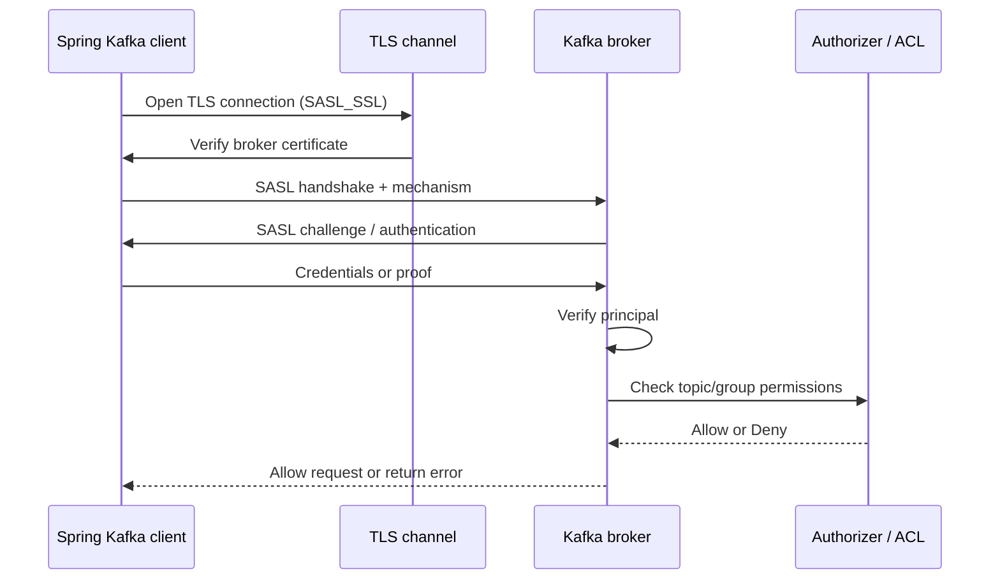

# SASL/PLAIN and SASL/SCRAM

In a Spring Kafka application, SASL/PLAIN and SASL/SCRAM are two mechanisms for authenticating clients with Kafka brokers. They help the broker determine which principal the connecting client represents. For a secure deployment, configuration must be aligned across the broker, producer, consumer, `KafkaAdmin`, and any other clients in the application.

Three concepts must be distinguished:

- **Authentication:** verifying client identity via SASL/PLAIN or SASL/SCRAM.
- **Transport encryption:** encrypting data sent over the network using TLS. With Kafka, clients typically use the `SASL_SSL` protocol to combine SASL and TLS.
- **Authorization:** deciding which topics an authenticated principal can read/write, which consumer groups it can use, or which cluster operations it can perform via ACLs.

Successful SASL authentication does not mean the client is allowed to read every topic. TLS also does not replace authentication or ACLs. A production configuration needs to design all three layers.

## 1. SASL Authentication Flow in Kafka

When a client connects to a broker, Kafka performs these general steps:



SASL/PLAIN and SASL/SCRAM differ in how they verify credentials. After authentication, the broker builds the corresponding principal, typically in a form such as `User:orders_app`. The authorizer uses that principal to evaluate ACLs.

With `SASL_PLAINTEXT`, SASL performs authentication, but network traffic is not encrypted with TLS. With `SASL_SSL`, the connection is protected by TLS. In production environments, prefer `SASL_SSL`, even when using SCRAM.

## 2. How Does SASL/PLAIN Work?

SASL/PLAIN uses a username and password for authentication. The client sends credentials in a SASL PLAIN response; the broker compares the username/password against the credential data configured on the server.

This makes PLAIN easy to configure and widely compatible, but the password is not encrypted by the PLAIN mechanism itself. If the connection does not use TLS, login credentials can be exposed if network traffic is sniffed.

Therefore:

- Do not use SASL/PLAIN over untrusted networks without TLS.
- Use `SASL_SSL` to protect usernames/passwords in transit.
- Use a dedicated principal for each application or workload.
- Do not share an administrative account for business producers/consumers.
- Restrict permissions with ACLs per topic and consumer group.

PLAIN fits systems that need a simple mechanism, have TLS protection, and have a clear credential management process. PLAIN is not a secure choice if you only enable SASL while skipping transport encryption.

## 3. Broker Configuration for SASL/PLAIN

Example of a broker with a listener named `SASL_SSL` allowing the PLAIN mechanism:

```properties
listeners=SASL_SSL://0.0.0.0:9093
advertised.listeners=SASL_SSL://broker-1.example.net:9093

sasl.enabled.mechanisms=PLAIN,SCRAM-SHA-256,SCRAM-SHA-512
sasl.mechanism.inter.broker.protocol=SCRAM-SHA-512

listener.name.sasl_ssl.plain.sasl.jaas.config=org.apache.kafka.common.security.plain.PlainLoginModule required user_admin="CHANGE_ME_ADMIN" user_orders_app="CHANGE_ME_APP";
listener.name.sasl_ssl.scram-sha-512.sasl.jaas.config=org.apache.kafka.common.security.scram.ScramLoginModule required username="broker_1" password="CHANGE_ME_BROKER";
```

Explanation:

- `listeners` opens a listener using the `SASL_SSL` protocol.
- `advertised.listeners` publishes the hostname/port reachable by clients.
- `sasl.enabled.mechanisms` lists mechanisms accepted by the broker.
- `sasl.mechanism.inter.broker.protocol` selects the mechanism for inter-broker connections; the value must be supported and configured consistently across the cluster.
- `listener.name.sasl_ssl.plain.sasl.jaas.config` declares the server JAAS config for the `SASL_SSL` listener and PLAIN mechanism.
- The `user_<username>` options in server PLAIN JAAS are the credentials the broker uses to verify clients.
- Because the example chooses `SCRAM-SHA-512` for inter-broker traffic, the broker also needs its own SCRAM JAAS client credential. Each broker should use its own principal; provision the corresponding credentials in Kafka before switching the inter-broker listener to SCRAM.

The listener name in `listener.name.<listener>.<mechanism>.sasl.jaas.config` must be lowercase. For listener `SASL_SSL`, the name segment is `sasl_ssl`.

The example above uses placeholders. Do not commit real passwords into configuration files or repositories. In real deployments, store JAAS configs in a secret store or the operating platform's secure configuration mechanism.

## 4. SASL/PLAIN Client Configuration

The client needs the matching security protocol, mechanism, and JAAS login module:

```properties
security.protocol=SASL_SSL
sasl.mechanism=PLAIN
sasl.jaas.config=org.apache.kafka.common.security.plain.PlainLoginModule required username="orders_app" password="CHANGE_ME";
```

These three properties serve distinct roles:

| Property | Example Value | Meaning |
|---|---|---|
| `security.protocol` | `SASL_SSL` | SASL combined with TLS |
| `sasl.mechanism` | `PLAIN` | Authentication mechanism |
| `sasl.jaas.config` | `PlainLoginModule ...` | Client username/password |

The username must match the credentials declared on the broker. Both sides must use the same mechanism. If the broker only enables SCRAM while the client chooses PLAIN, the connection will fail right at the SASL handshake step.

For TLS using an internal CA, the client must also trust the CA that signed the broker certificate. TLS details are covered in a separate section.

## 5. How Does SASL/SCRAM Work?

SCRAM stands for Salted Challenge Response Authentication Mechanism. Instead of sending the password directly during authentication, the client and broker perform a challenge-response exchange based on the password, a salt, and a hash iteration count.

Kafka supports two common mechanisms:

- `SCRAM-SHA-256`
- `SCRAM-SHA-512`

The broker stores SCRAM credentials derived from the password, including salt, iteration count, and required verification values. When the client authenticates, both sides prove knowledge of the password without sending the plaintext password over the SASL exchange.

SCRAM improves authentication compared to PLAIN, but it does not replace TLS. TLS still protects metadata, payloads, headers, and all Kafka traffic, while also verifying the broker endpoint. Use `SASL_SSL` for SCRAM in production environments.

## 6. Comparing PLAIN and SCRAM

| Criterion | SASL/PLAIN | SASL/SCRAM |
|---|---|---|
| Authentication method | Username/password in PLAIN response | Challenge-response using salt and proof |
| Password sent directly over SASL | Yes | No plaintext password sent |
| Broker-side credential data | Password verifier in PLAIN JAAS config | Salted SCRAM credentials |
| Initial setup | Simple | Requires provisioning user credentials |
| TLS | Strongly required in production | Still recommended in production |
| Mechanism | `PLAIN` | `SCRAM-SHA-256` or `SCRAM-SHA-512` |
| Best suited for | Simple systems that already have TLS and secret management | Systems needing challenge-response and broker-managed credentials |

For new deployments, `SCRAM-SHA-512` is usually a good choice when all brokers and clients support it. If compatibility with systems standardized on SHA-256 is required, `SCRAM-SHA-256` can be used. Do not pick a weaker mechanism just to mask configuration errors; verify the capabilities of your Kafka version and client library.

## 7. Broker Configuration for SASL/SCRAM

The broker must enable the SCRAM mechanisms allowed by the cluster:

```properties
listeners=SASL_SSL://0.0.0.0:9093
advertised.listeners=SASL_SSL://broker-1.example.net:9093

sasl.enabled.mechanisms=SCRAM-SHA-256,SCRAM-SHA-512
sasl.mechanism.inter.broker.protocol=SCRAM-SHA-512
listener.name.sasl_ssl.scram-sha-512.sasl.jaas.config=org.apache.kafka.common.security.scram.ScramLoginModule required username="broker_1" password="CHANGE_ME_BROKER";
```

Unlike PLAIN, the broker does not need to declare a list of user passwords inside a PLAIN JAAS login module. SCRAM credentials are managed in Kafka's metadata/credential store. With KRaft clusters, user credentials are managed via the Kafka Admin API and the `kafka-configs.sh` tool connecting to the broker.

The JAAS property above is the client credential the broker uses when connecting to other brokers. On each broker, replace `broker_1` with that broker's dedicated principal and provision the corresponding `SCRAM-SHA-512` credential. On the server side, Kafka verifies these credentials from Kafka's SCRAM credential store; do not create a PLAIN `user_<username>` entry for SCRAM.

Example creating a `SCRAM-SHA-512` credential for principal `orders_app`:

```bash
kafka-configs.sh \
  --bootstrap-server broker-1.example.net:9093 \
  --command-config admin-client.properties \
  --alter \
  --add-config 'SCRAM-SHA-512=[iterations=8192,password=CHANGE_ME]' \
  --entity-type users \
  --entity-name orders_app
```

`admin-client.properties` must contain secure connection settings and credentials of an administrator authorized to alter user configurations. Do not put real passwords directly in shell history or shared documentation; use secret injection or a secret management tool to supply values at runtime.

You can inspect user configuration using `kafka-configs.sh --describe` with the proper bootstrap server and admin client config. The output can show credential metadata, but should not be treated as a place to recover the original password.

## 8. SASL/SCRAM Client Configuration

The client uses the corresponding mechanism and the SCRAM login module:

```properties
security.protocol=SASL_SSL
sasl.mechanism=SCRAM-SHA-512
sasl.jaas.config=org.apache.kafka.common.security.scram.ScramLoginModule required username="orders_app" password="CHANGE_ME";
```

Items that must match:

- The broker enables `SCRAM-SHA-512` in `sasl.enabled.mechanisms`.
- User `orders_app` has a `SCRAM-SHA-512` credential provisioned.
- The client selects `sasl.mechanism=SCRAM-SHA-512`.
- The client uses `ScramLoginModule` and the matching password.
- The client connects to the right listener supporting `SASL_SSL`.

If the user only has a SHA-256 credential while the client selects SHA-512, authentication will not succeed. A single user can have multiple SCRAM mechanisms configured; manage each mechanism deliberately and avoid letting clients run inconsistent configurations.

## 9. Spring Boot Configuration for Spring Kafka

Spring Boot passes Kafka client properties via `spring.kafka.properties`. Example using `SCRAM-SHA-512`:

```yaml
spring:
  kafka:
    bootstrap-servers: kafka-1.example.net:9093,kafka-2.example.net:9093
    properties:
      "[security.protocol]": SASL_SSL
      "[sasl.mechanism]": SCRAM-SHA-512
      "[sasl.jaas.config]": 'org.apache.kafka.common.security.scram.ScramLoginModule required username="orders_app" password="CHANGE_ME";'
    consumer:
      group-id: orders-service
      enable-auto-commit: false
    producer:
      acks: all
```

Replace `CHANGE_ME` with a secret injected from a secret manager or environment. The illustrative example above uses a placeholder so real credentials are never placed in source control.

For SASL/PLAIN, keep the configuration structure and change two values:

```yaml
spring:
  kafka:
    properties:
      "[security.protocol]": SASL_SSL
      "[sasl.mechanism]": PLAIN
      "[sasl.jaas.config]": 'org.apache.kafka.common.security.plain.PlainLoginModule required username="orders_app" password="CHANGE_ME";'
```

Do not configure the PLAIN login module when the mechanism is SCRAM, or vice versa. `sasl.mechanism` and the login module class must belong to the same mechanism.

Shared properties under `spring.kafka.properties` typically apply to producer, consumer, and admin clients configured by Spring Boot. If individual clients need different principals or security configs, configure separate producer/consumer/admin properties or create separate factories with explicit configuration. Do not assume changing producer credentials automatically updates consumer credentials if the two factories were configured independently.

## 10. Configuring TLS When Using SASL_SSL

SASL authenticates the principal; TLS encrypts the transport channel and verifies the broker certificate. With an internal CA, the client needs a truststore containing the appropriate CA certificate.

Kafka client configuration example:

```properties
security.protocol=SASL_SSL
ssl.truststore.location=/etc/kafka/secrets/client.truststore.p12
ssl.truststore.password=CHANGE_ME
ssl.truststore.type=PKCS12
ssl.endpoint.identification.algorithm=https
sasl.mechanism=SCRAM-SHA-512
sasl.jaas.config=org.apache.kafka.common.security.scram.ScramLoginModule required username="orders_app" password="CHANGE_ME";
```

Spring Boot can configure the truststore using dedicated SSL properties or pass Kafka SSL properties via `spring.kafka.properties`, depending on the Boot version in use. Example using Kafka properties format:

```yaml
spring:
  kafka:
    properties:
      "[security.protocol]": SASL_SSL
      "[ssl.truststore.location]": /etc/kafka/secrets/client.truststore.p12
      "[ssl.truststore.password]": CHANGE_ME
      "[ssl.truststore.type]": PKCS12
      "[ssl.endpoint.identification.algorithm]": https
```

Do not disable hostname verification to avoid certificate errors. Hostnames in `bootstrap.servers` and `advertised.listeners` must match the broker certificate SAN. If mutual TLS is used, the broker must also be configured to require client certificates and the client needs a keystore; SASL username/password does not itself require a client certificate.

## 11. Authentication vs. Authorization: Configuring ACLs

Once SASL authentication succeeds, Kafka knows the client's principal, such as `User:orders_app`. The authorizer then checks whether the principal has permission to perform the operation.

With Kafka running KRaft, the broker can enable `StandardAuthorizer`:

```properties
authorizer.class.name=org.apache.kafka.metadata.authorizer.StandardAuthorizer
allow.everyone.if.no.acl.found=false
super.users=User:admin
```

The authorizer configuration must be deployed consistently across brokers, with a plan to bootstrap administrator/super users. If ACL enforcement is enabled without granting permissions to operational principals, clients can authenticate successfully yet be unable to read or write topics.

Example granting producer permissions for `orders_app` to write to topic `orders.events`:

```bash
kafka-acls.sh \
  --bootstrap-server broker-1.example.net:9093 \
  --command-config admin-client.properties \
  --add \
  --allow-principal User:orders_app \
  --operation Write \
  --operation Describe \
  --topic orders.events
```

Granting consumer permissions to read the topic and use the consumer group:

```bash
kafka-acls.sh \
  --bootstrap-server broker-1.example.net:9093 \
  --command-config admin-client.properties \
  --add \
  --allow-principal User:orders_app \
  --operation Read \
  --operation Describe \
  --topic orders.events

kafka-acls.sh \
  --bootstrap-server broker-1.example.net:9093 \
  --command-config admin-client.properties \
  --add \
  --allow-principal User:orders_app \
  --operation Read \
  --group orders-service
```

Grant the exact operations needed by the workload. A producer typically needs `Write` on the topic; a consumer needs `Read` on the topic and `Read` on the group; an application managing topics may need additional `Describe`/`Create` permissions depending on its function. Do not grant wildcard or administrative permissions to an application just to avoid authorization errors.

## 12. Credential Management and Secret Rotation

Kafka credentials are secrets capable of unlocking access to topics and data. Do not store passwords in Git, Docker images, logs, exception messages, or shared configuration files.

Recommended practices:

- Use a secret manager, Kubernetes Secrets, or an equivalent security mechanism.
- Separate principals per service, environment, and workload.
- Grant least-privilege permissions with ACLs.
- Restrict secret read access and audit access operations.
- Avoid printing the full JAAS config in logs during debugging.
- Rotate credentials periodically and whenever secret exposure is suspected.
- Revoke old principals after clients have switched to new credentials.

A lower-risk rotation approach is to create a new principal, grant equivalent ACLs, update the client secret, perform a rolling rollout, and verify the new client authenticates and operates properly. Once no clients use the old principal, revoke its ACLs and delete the old credential. For PLAIN, update the broker and client credential lists according to a synchronized plan. For SCRAM, create/update user credentials using Kafka admin tooling; if zero downtime is needed, use an alternate principal for a blue-green cutover.

Do not assume changing a password on the broker automatically updates running clients. Clients keep their old configuration until secrets are updated and clients are reloaded/restarted according to the application's mechanism.

## 13. Common Errors When Configuring SASL

| Error / Symptom | Possible Cause | What to Check |
|---|---|---|
| `SaslAuthenticationException: Authentication failed` | Wrong username/password, SCRAM user not yet created, or mechanism mismatch | Check JAAS config, user credentials, and mechanism |
| `UnsupportedSaslMechanismException` | Broker has not enabled the mechanism requested by the client | Check `sasl.enabled.mechanisms` on the listener |
| `LoginException` or JAAS module error | Mixed up `PlainLoginModule` and `ScramLoginModule` | Match the login module against `sasl.mechanism` |
| TLS connection fails | Untrusted CA, expired certificate, or SAN hostname mismatch | Check truststore, certificate chain, and advertised listener |
| `TopicAuthorizationException` | Authentication succeeded, but principal lacks ACL permissions | Check principal and topic ACLs |
| `GroupAuthorizationException` | Missing `Read` permission on consumer group | Check group ACLs |
| Producer fetches metadata but cannot write | Has `Describe` permission but lacks `Write` | Grant least-privilege ACLs for the exact operations |
| Only some brokers connect | Advertised listener or per-broker certificate is incorrect | Check DNS, port, SAN, and listener on each broker |
| `AdminClient` cannot connect | Security config only applied to producer/consumer, not admin | Check `spring.kafka.properties` or admin properties |
| SCRAM works on one client but not another | Different mechanism, credential, or secret version | Compare deployed configs without printing passwords |

Separating errors by layer speeds up investigation:

1. Cannot open TCP connection: check DNS, firewall, and port.
2. TLS handshake fails: check CA, certificate chain, SAN, and truststore.
3. SASL handshake fails: check mechanism, JAAS login module, username/password, and user credentials.
4. SASL succeeds but request is denied: check ACLs and principal.
5. Only one client type fails: check security properties of that specific producer, consumer, or admin client.

## 14. Testing Authentication and Access Permissions

Do not merely verify that the application starts successfully. Test real connectivity and the permissions of each principal.

| Test | Expected Result |
|---|---|
| PLAIN client with valid credentials over `SASL_SSL` | Authentication succeeds |
| PLAIN client with wrong password | Broker rejects authentication |
| `SCRAM-SHA-512` client with valid credentials | Authentication succeeds |
| SCRAM client using wrong mechanism | SASL handshake fails |
| Client using untrusted certificate | TLS handshake fails before SASL authentication completes |
| Principal with `Write` ACL on topic | Producer can send records |
| Principal without `Write` ACL | Broker rejects produce |
| Principal with `Read` ACL and matching group | Consumer can read records |
| Principal missing group ACL | Consumer receives authorization error |
| `KafkaAdmin` using dedicated credentials | Admin operations succeed only when the principal has matching ACLs |

For integration tests, run a broker/container with a real SASL listener and the mechanism being tested. Tests that only mock `ProducerFactory` or `ConsumerFactory` do not prove handshake, TLS, or ACL behavior works properly.

Test producer, consumer, `KafkaAdmin`, and listener containers because they may use different client configs. For production systems, test invalid credentials and missing ACL permissions in a test environment to verify errors are logged without exposing passwords.

## 15. Production Deployment Checklist

1. Explicitly choose SASL/PLAIN or SASL/SCRAM-SHA-256/512 for each listener.
2. Use `SASL_SSL` to encrypt Kafka traffic.
3. Configure the exact `sasl.mechanism` and corresponding JAAS login module.
4. With PLAIN, protect server JAAS credentials and never use PLAIN over unencrypted networks.
5. With SCRAM, provision credentials for the exact mechanism before clients connect.
6. Ensure the inter-broker mechanism and listeners are configured consistently across the cluster.
7. Issue separate principals per service and environment.
8. Enable the authorizer and grant least-privilege ACLs for topics/groups.
9. Configure the truststore and verify certificate hostnames; never disable endpoint identification.
10. Keep passwords out of source control and logs; use a secret manager.
11. Have a rotation/revocation process and test invalid credentials.
12. Verify producer, consumer, admin client, and all broker endpoints.
13. Monitor authentication failures, authorization failures, and TLS handshake failures.
14. Test both denied permissions and allowed permissions before release.

SASL/PLAIN is easy to configure but requires TLS to protect passwords. SASL/SCRAM uses challenge-response and derived credentials, making it suitable when a stronger authentication mechanism is desired. In both cases, a secure Spring Kafka deployment requires combining SASL, TLS, ACLs, secret management, and testing against real brokers.
