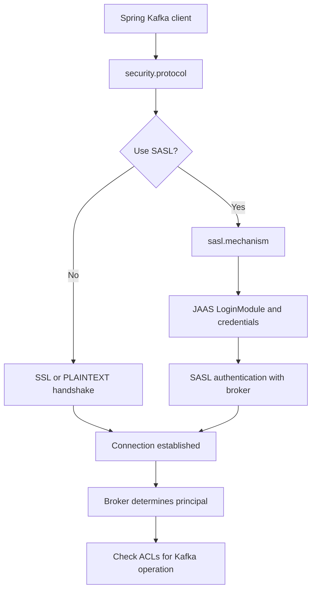

# JAAS Configuration

JAAS (Java Authentication and Authorization Service) is the Java mechanism used to configure authentication login modules. Apache Kafka uses JAAS when a client or broker logs in via SASL. In Spring Kafka applications, JAAS typically appears when configuring `SASL_SSL` or `SASL_PLAINTEXT` with a mechanism such as `SCRAM-SHA-512`, `PLAIN`, or `GSSAPI` (Kerberos).

JAAS defines **which login module and credentials the client uses to log in**. It does not itself grant permissions to read topics, write topics, or manage consumer groups. After authentication succeeds, Kafka uses the client's principal to evaluate ACLs. Therefore, proper JAAS configuration is one part of messaging security; the application still needs appropriate TLS and ACLs.

## 1. Where Does JAAS Fit in the Kafka Connection Process?

When a `KafkaProducer`, `KafkaConsumer`, `KafkaAdmin`, or Kafka Streams client connects to a broker, Kafka performs these general steps:

1. The client opens a connection to a broker address in `bootstrap.servers`.
2. `security.protocol` determines whether the connection uses `PLAINTEXT`, `SSL`, `SASL_PLAINTEXT`, or `SASL_SSL`.
3. If SASL is used, `sasl.mechanism` selects an authentication mechanism enabled by the broker.
4. JAAS supplies the login module and options needed to build credentials for that mechanism.
5. The broker authenticates the client and attaches a principal to the connection.
6. For operations on topics, partitions, or consumer groups, the broker checks the principal's ACLs.



Each component has a distinct role:

| Component | Role |
|---|---|
| `security.protocol` | Selects the transport protocol and whether SASL is used |
| `sasl.mechanism` | Selects PLAIN, SCRAM, GSSAPI, or OAUTHBEARER |
| JAAS LoginModule | Obtains or constructs credentials for the SASL mechanism |
| TLS (`SSL`) | Encrypts the transport and can verify broker/client certificates |
| ACL | Decides what the principal is allowed to do with Kafka resources |

`SASL_PLAINTEXT` performs SASL authentication without encrypting the connection. `SASL_SSL` combines SASL with TLS. When using passwords with PLAIN or SCRAM, use `SASL_SSL` to protect authentication data in transit.

## 2. Structure of a JAAS Login Entry

An entry in a JAAS file looks like:

```text
KafkaClient {
    org.apache.kafka.common.security.scram.ScramLoginModule required
    username="orders-consumer"
    password="RENDERED_SECRET_VALUE";
};
```

A static JAAS file is not a Spring Boot configuration file, so it does not automatically interpolate `${KAFKA_PASSWORD}`. Have your deployment system render secrets into the file during provisioning, mount the file from a secret store, or use an equivalent credential delivery mechanism; never commit real secrets to a repository.

In this entry:

- `KafkaClient` is the login context name that the Kafka client looks for when using a static JAAS file.
- `ScramLoginModule` is the class that performs login for the SCRAM mechanism.
- `required` is the control flag, determining how JAAS evaluates the result of the login module.
- `username` and `password` are options used by the login module.
- The `;` ends the module declaration; `};` closes the entry in the JAAS file.

JAAS control flags:

| Flag | Meaning |
|---|---|
| `REQUIRED` | The module must succeed; JAAS still runs subsequent modules before returning failure |
| `REQUISITE` | The module must succeed; if it fails, JAAS stops immediately and returns failure |
| `SUFFICIENT` | If the module succeeds and prior required modules succeeded, JAAS can immediately succeed |
| `OPTIONAL` | Result matters only if no other module determines the outcome |

In typical Kafka client configurations with a single login module, `required` is the clearest and most common choice.

## 3. Configuring JAAS Directly via `sasl.jaas.config`

Kafka allows declaring JAAS directly in each client's properties. This avoids creating a `.conf` file and also lets a producer and consumer in the same JVM use different credentials.

Example client using `SCRAM-SHA-512`:

```properties
security.protocol=SASL_SSL
sasl.mechanism=SCRAM-SHA-512
sasl.jaas.config=org.apache.kafka.common.security.scram.ScramLoginModule required username="orders-consumer" password="RENDERED_SECRET_VALUE";
```

This example shows plain Kafka client properties; Kafka does not automatically substitute `${ENV_VAR}` inside a JAAS string. The deployment system must supply the secret value into the configuration before the client is created. With Spring Boot, placeholders like `${KAFKA_PASSWORD}` can be used in `application.yml` as shown in the next section because Spring Boot processes externalized configuration.

In the `sasl.jaas.config` property, write only the login module, control flag, and options. Do not wrap it in `KafkaClient { ... };` as in a static JAAS file.

For SASL/PLAIN, the login module is `org.apache.kafka.common.security.plain.PlainLoginModule`:

```properties
security.protocol=SASL_SSL
sasl.mechanism=PLAIN
sasl.jaas.config=org.apache.kafka.common.security.plain.PlainLoginModule required username="orders-service" password="RENDERED_SECRET_VALUE";
```

For SCRAM, the login module is `org.apache.kafka.common.security.scram.ScramLoginModule`:

```properties
security.protocol=SASL_SSL
sasl.mechanism=SCRAM-SHA-256
sasl.jaas.config=org.apache.kafka.common.security.scram.ScramLoginModule required username="orders-service" password="RENDERED_SECRET_VALUE";
```

The broker must enable the exact SASL mechanism and have credentials for the corresponding user. For example, a client selecting `SCRAM-SHA-512` against a broker that only enables `PLAIN` cannot authenticate, even if the username and password are correct.

If a single JVM connects to multiple clusters using different accounts, set `sasl.jaas.config` individually per Kafka client. This is a major advantage of per-client JAAS configuration over a static JAAS file, which typically provides one shared login context across connections in the JVM.

## 4. Putting `sasl.jaas.config` into Spring Boot

Spring Boot exposes Kafka configuration through the `spring.kafka.*` namespace. Kafka properties without dedicated Spring Boot properties can still be passed via `spring.kafka.properties`, `spring.kafka.producer.properties`, `spring.kafka.consumer.properties`, or `spring.kafka.admin.properties`.

Example using one SCRAM account for producer, consumer, and admin client:

```yaml
spring:
  kafka:
    bootstrap-servers: kafka.internal.example:9093
    properties:
      "[security.protocol]": SASL_SSL
      "[sasl.mechanism]": SCRAM-SHA-512
      "[sasl.jaas.config]": >-
        org.apache.kafka.common.security.scram.ScramLoginModule required
        username="${KAFKA_USERNAME}"
        password="${KAFKA_PASSWORD}";
```

Kafka keys containing dots are placed in brackets and quotes so Spring Boot preserves the exact property names. `spring.kafka.properties` is shared configuration applied to clients created by Boot unless overridden by a client-type-specific configuration.

If the producer and consumer need separate accounts, place the JAAS configuration under each client:

```yaml
spring:
  kafka:
    bootstrap-servers: kafka.internal.example:9093
    properties:
      "[security.protocol]": SASL_SSL
      "[sasl.mechanism]": SCRAM-SHA-512
    producer:
      properties:
        "[sasl.jaas.config]": >-
          org.apache.kafka.common.security.scram.ScramLoginModule required
          username="${KAFKA_PRODUCER_USERNAME}"
          password="${KAFKA_PRODUCER_PASSWORD}";
    consumer:
      properties:
        "[sasl.jaas.config]": >-
          org.apache.kafka.common.security.scram.ScramLoginModule required
          username="${KAFKA_CONSUMER_USERNAME}"
          password="${KAFKA_CONSUMER_PASSWORD}";
```

Similar configuration can be added under `admin.properties` if the application uses `KafkaAdmin` with a separate administrative account. When using separate configs, inspect every actual client instantiated by the application, not just `KafkaTemplate` and listener consumers.

Do not commit real passwords to Git or hardcode them directly in `application.yml`. Use environment variables, a secret manager, Kubernetes Secrets, or the platform's secret delivery system. Ensure configuration logs do not print the `sasl.jaas.config` value because this property contains credentials.

## 5. Using a Static JAAS File for Kafka Clients

Instead of placing JAAS inside `sasl.jaas.config`, you can create a file such as `kafka_client_jaas.conf`:

```text
KafkaClient {
    org.apache.kafka.common.security.scram.ScramLoginModule required
    username="orders-consumer"
    password="RENDERED_SECRET_VALUE";
};
```

Start the JVM with the system property pointing to the file:

```bash
java \
  -Djava.security.auth.login.config=/etc/kafka/kafka_client_jaas.conf \
  -jar messaging-service.jar
```

The Kafka client looks for the login context named `KafkaClient` in the file. The file must exist inside the container/host running the application, and the OS user running the JVM must have read access to the file.

When both `java.security.auth.login.config` and `sasl.jaas.config` are configured, the client-level `sasl.jaas.config` takes higher precedence. Therefore, if `sasl.jaas.config` is set incorrectly or missing options, Kafka may not use the JAAS file you expected.

A static JAAS file fits cases where you want to manage login configuration at the JVM level, such as an application connecting to a single cluster with one principal. With multiple clusters or multiple accounts in the same JVM, per-client `sasl.jaas.config` is usually more flexible.

## 6. Configuring Kerberos with JAAS and Keytab

Kerberos uses the `GSSAPI` SASL mechanism. Clients typically authenticate with a principal and keytab rather than a regular username/password. A JAAS file for the Kafka client can declare:

```text
KafkaClient {
    com.sun.security.auth.module.Krb5LoginModule required
    useKeyTab=true
    storeKey=true
    keyTab="/etc/security/keytabs/kafka_client.keytab"
    principal="kafka-client@EXAMPLE.COM";
};
```

The Kafka client needs additional properties:

```properties
security.protocol=SASL_SSL
sasl.mechanism=GSSAPI
sasl.kerberos.service.name=kafka
```

Launch the application with the JAAS file and Kerberos realm configuration:

```bash
java \
  -Djava.security.auth.login.config=/etc/kafka/kafka_client_jaas.conf \
  -Djava.security.krb5.conf=/etc/krb5.conf \
  -jar messaging-service.jar
```

Important prerequisites:

- The keytab must contain the key for the principal used by the client, and only the user running the JVM should be permitted to read it.
- The principal must match the realm and the key issued in Kerberos.
- Broker hostnames must resolve via DNS/FQDN properly so Kerberos can construct the right service principal.
- Clocks between client, broker, and KDC must be synchronized within Kerberos tolerance.
- `sasl.kerberos.service.name` must match the service principal used by the broker, typically `kafka`.

### Using Spring Kafka's `KafkaJaasLoginModuleInitializer`

Spring Kafka provides `KafkaJaasLoginModuleInitializer` to declare JAAS in the Spring context. Spring Boot also provides corresponding properties under `spring.kafka.jaas.*`.

Configuration example in `application.yml`:

```yaml
spring:
  kafka:
    jaas:
      enabled: true
      login-module: com.sun.security.auth.module.Krb5LoginModule
      control-flag: required
      options:
        useKeyTab: true
        storeKey: true
        keyTab: ${KAFKA_KEYTAB_PATH:/etc/security/keytabs/kafka_client.keytab}
        principal: ${KAFKA_KERBEROS_PRINCIPAL}
    properties:
      "[security.protocol]": SASL_SSL
      "[sasl.mechanism]": GSSAPI
      "[sasl.kerberos.service.name]": kafka
```

`spring.kafka.jaas.enabled` defaults to `false`; it must be enabled explicitly if you want Boot to create the JAAS initializer from these properties. This approach is useful when an application uses one shared JAAS login context. If producers and consumers need different principals, consider configuring per-client `sasl.jaas.config`.

Spring Kafka also allows creating the bean directly:

```java
@Bean
KafkaJaasLoginModuleInitializer kafkaJaasLoginModuleInitializer() throws IOException {
    KafkaJaasLoginModuleInitializer initializer =
            new KafkaJaasLoginModuleInitializer();
    initializer.setControlFlag("REQUIRED");

    Map<String, String> options = new HashMap<>();
    options.put("useKeyTab", "true");
    options.put("storeKey", "true");
    options.put("keyTab", "/etc/security/keytabs/kafka_client.keytab");
    options.put("principal", "kafka-client@EXAMPLE.COM");
    initializer.setOptions(options);
    return initializer;
}
```

Choose one approach to manage JAAS in your application: Spring Boot properties, an initializer bean, or a static JAAS file. Avoid configuring multiple global sources simultaneously, as it makes it hard to determine which login context is active.

## 7. Client-Side JAAS and Broker-Side JAAS Differ

Client JAAS files normally use the `KafkaClient` section. Brokers have their own JAAS configuration, typically using the `KafkaServer` section; this section serves for authenticating clients connecting to the broker and internal SASL connections initiated by the broker.

For a broker using SASL/PLAIN, the broker JAAS file can look like:

```text
KafkaServer {
    org.apache.kafka.common.security.plain.PlainLoginModule required
    username="broker-admin"
    password="BROKER_INTER_BROKER_SECRET"
    user_broker-admin="BROKER_INTER_BROKER_SECRET"
    user_orders-service="ORDERS_SERVICE_SECRET";
};
```

In the default broker PLAIN configuration, `username` and `password` are the identity the broker uses for broker-to-broker connections; the `user_<username>` options declare the credentials the broker accepts from clients. Because this is a static JAAS file, `*_SECRET` strings must be replaced with values provisioned by the deployment system; JAAS does not interpolate environment variables automatically.

The broker can also configure JAAS directly in `server.properties` per listener and SASL mechanism. With SCRAM, user credentials are provisioned in the metadata log; this listener JAAS property configures the login module for SASL connections initiated by the broker itself, such as inter-broker connections:

```properties
listener.name.sasl_ssl.scram-sha-512.sasl.jaas.config=org.apache.kafka.common.security.scram.ScramLoginModule required username="broker-admin" password="BROKER_INTER_BROKER_SECRET";
```

The property name follows the structure `listener.name.{listenerName}.{saslMechanism}.sasl.jaas.config`. If a listener enables multiple mechanisms, each mechanism must be configured separately. This configuration belongs to the broker; do not put it into the client application's `spring.kafka.*`.

## 8. JAAS Does Not Replace TLS and ACLs

A successful SASL connection only proves that the client authenticated. The client can still receive `TopicAuthorizationException` or `GroupAuthorizationException` if the principal has not been granted the appropriate ACLs.

| Security Layer | Question to Answer | Main Configuration |
|---|---|---|
| TLS | Is data encrypted and does the broker have a valid certificate? | `SASL_SSL`, truststore, keystore if using mutual TLS |
| SASL + JAAS | Who is the client? | `sasl.mechanism`, `sasl.jaas.config` or JAAS login context |
| ACL | What is the principal allowed to do? | ACLs for topics, groups, transactional IDs, and cluster resources |

For example, a consumer needs `READ` permission on topic `orders` and `READ` permission on group `order-service`. A producer needs `WRITE` permission on the target topic. Applications using transactions also need ACLs on the transactional ID. Grant least-privilege permissions matching each service's role; do not use a shared admin account for all producers and consumers.

## 9. Diagnosing JAAS and SASL Errors

| Symptom | Common Cause | What to Check |
|---|---|---|
| `LoginException: No LoginModule found` | Wrong login module name or module missing from classpath | Check class name and Kafka client/JDK dependencies |
| `Could not find a 'KafkaClient' entry` | JAAS file missing the section or wrong section name | Check the `KafkaClient` section and system property path |
| `SaslAuthenticationException` | Wrong username/password, mismatched mechanism, or broker has not enabled mechanism | Check credentials, `sasl.mechanism`, and broker listener config |
| `UnsupportedSaslMechanismException` | Client requests a mechanism not supported by the broker | Choose a mechanism enabled on the listener |
| `SSLHandshakeException` | Invalid truststore, CA, hostname, or TLS certificate | Check trust chain, SAN hostname, certificate expiry, and protocol |
| `GSS initiate failed` | Wrong keytab, principal, realm, DNS, clock, or Kerberos service name | Check `klist -kte`, `krb5.conf`, FQDN, and `sasl.kerberos.service.name` |
| `TopicAuthorizationException` | Authentication succeeded, but principal lacks ACL | Check principal and topic ACLs |
| `GroupAuthorizationException` | Principal lacks permission on consumer group | Grant `READ` ACL for the appropriate group scope |

When troubleshooting, identify which client is failing: producer, consumer, or admin. Spring Boot can create multiple Kafka clients with different configurations; consumer success does not prove producer or admin uses the same credentials and permissions.

## 10. Deployment Checklist

- Broker and client agree on `security.protocol` and `sasl.mechanism`.
- Login module matches the mechanism: `PlainLoginModule`, `ScramLoginModule`, or `Krb5LoginModule`.
- If using a JAAS file, it has the exact `KafkaClient` section and the JVM points to the right `java.security.auth.login.config`.
- If using `sasl.jaas.config`, the value has valid login module syntax, control flag, options, and trailing semicolon.
- If using the Spring Boot JAAS initializer, `spring.kafka.jaas.enabled=true` is enabled.
- If using PLAIN or SCRAM, transport uses TLS (`SASL_SSL`) in real environments.
- Credentials come from a secret store or environment, are not committed to the repository, and do not appear in logs.
- If using Kerberos, keytab, principal, `krb5.conf`, DNS, and system time are all accurate.
- Producer, consumer, and admin client use separate credentials when separate permissions are needed.
- Authenticated principals have least-privilege ACLs for required topics, groups, and transactional IDs.

## 11. Key Takeaways

- JAAS configures login modules and credentials for SASL; Kafka uses the authentication result to build a principal.
- `KafkaClient` is the section commonly used in client-side JAAS files; `KafkaServer` belongs to broker configuration.
- `sasl.jaas.config` declares JAAS directly on each Kafka client without a `KafkaClient {}` wrapper and takes precedence over static JAAS files.
- `java.security.auth.login.config` points to a JAAS file; static files typically share a single login context across the JVM.
- Spring Boot supports `spring.kafka.jaas.*` and passes custom Kafka properties via `spring.kafka.properties` or per-client producer/consumer/admin settings.
- PLAIN and SCRAM should run over `SASL_SSL`; Kerberos uses `GSSAPI`, a principal, a keytab, and `krb5.conf`.
- Successful authentication does not imply read/write permission; ACLs still govern access to Kafka resources.

## References

- [Apache Kafka — Authentication using SASL](https://kafka.apache.org/documentation/#security_sasl)
- [Spring for Apache Kafka — JAAS and Kerberos](https://docs.spring.io/spring-kafka/reference/kafka/kerberos.html)
- [Spring Boot — Apache Kafka Support](https://docs.spring.io/spring-boot/reference/messaging/kafka.html)
- [Spring Boot — Common Application Properties (`spring.kafka.jaas.*`)](https://docs.spring.io/spring-boot/appendix/application-properties/index.html)
- [Apache Kafka — Authorization and ACLs](https://kafka.apache.org/documentation/#security_authz)
