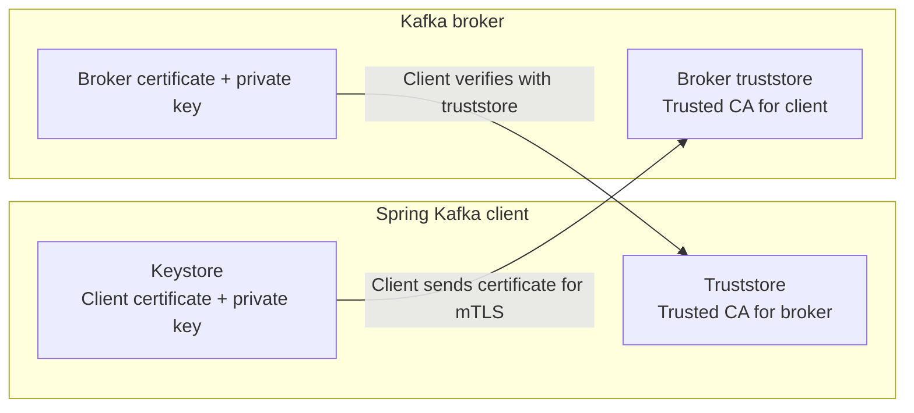

# Configuring Truststore and Keystore

When connecting to Kafka over TLS, the client must verify that the broker it connects to is a trusted server. To do so, the Kafka client uses a **truststore** containing CA certificates or trusted certificates. If the cluster requires mutual TLS (mTLS), the client must also prove its own identity using a **keystore** containing the client's private key and certificate chain.

In Spring Kafka, TLS configuration is typically set via `spring.kafka.ssl.*` and `spring.kafka.properties[security.protocol]`. Spring Boot passes these properties to Kafka producer, consumer, and admin clients managed by auto-configuration. If creating `ProducerFactory` or `ConsumerFactory` manually, ensure SSL properties are also included in the Kafka client's configuration map.

## 1. How Do Truststore and Keystore Differ?

Both store types can use JKS or PKCS12 formats, but their purposes differ:

| Store | Typical Contents | Used To |
| --- | --- | --- |
| Truststore | CA certificates, intermediate CAs, or trusted certificates | Verify the certificate sent by the broker to the client |
| Keystore | Client private key and matching certificate, usually with certificate chain | Prove client identity when the broker requires mTLS |

The truststore holds public certificates and does not need private keys. The keystore must protect its private key because anyone possessing the private key can impersonate that client.

In a one-way TLS connection (server-auth TLS), the client verifies the broker's certificate using its truststore; the client typically does not need a keystore. In mTLS, both sides verify each other's certificates: the client uses its truststore to trust the broker and sends its certificate/private key from its keystore; the broker uses its own truststore to verify the client certificate.



Note: broker-side truststore/keystore are Kafka broker configurations managed at the cluster level. `spring.kafka.ssl.*` only configures the Spring Kafka client.

## 2. Two Common Connection Modes

### 2.1. One-Way TLS: Client Verifies Broker

With TLS server authentication, the broker presents its certificate during the TLS handshake. The client checks whether the certificate chain is signed by a CA in its truststore, whether the certificate is still valid, and whether the hostname matches the SAN.

The client only needs a truststore:

```text
Spring Kafka client
  └── truststore: CA certificate of the Kafka cluster

Kafka broker
  └── broker certificate + private key
```

This configuration fits when the cluster uses TLS for encryption and broker authentication, while application authentication is handled by another mechanism such as SASL/SCRAM or SASL/PLAIN over TLS.

### 2.2. Mutual TLS (mTLS): Both Sides Verify Each Other

With mTLS, the broker asks the client to send a certificate. The client must have a keystore containing a private key and a certificate chain signed by a CA trusted by the broker. The client still needs a truststore to verify the broker certificate.

```text
Client:
  truststore -> trusts broker CA
  keystore   -> client certificate + private key

Broker:
  keystore   -> broker certificate + private key
  truststore -> trusts client CA
  client.auth -> required/requested per policy
```

Placing a keystore on the client does not automatically enable mTLS. The Kafka broker must be configured to request/verify client certificates and trust the CA that issued them. If the broker does not request a client certificate, a client with a keystore still connects using one-way TLS.

On the broker side, administrators usually configure `ssl.client.auth=required` (or the per-listener equivalent via `listener.name.<listener>.ssl.client.auth`) to mandate client certificates. The value `requested` asks for a certificate without necessarily enforcing it in all cases; follow your cluster's security policy.

## 3. Choosing JKS or PKCS12 Format

Java supports multiple keystore/truststore formats. Two common ones:

| Format | Characteristics |
| --- | --- |
| JKS | Traditional Java KeyStore format |
| PKCS12 (`.p12`, `.pfx`) | Widely adopted standard format, interoperable with many other TLS tools |

For new applications, PKCS12 is usually convenient if your certificate issuance system supports it. Explicitly declare the store type to avoid relying on JDK or Kafka client defaults.

File extensions are not guaranteed proof of format. A `.p12` file should be configured as `PKCS12`; a `.jks` file should be configured as `JKS`. Specifying the wrong type can cause the Kafka client to fail when loading the keystore/truststore.

## 4. Preparing a Truststore for One-Way TLS

Suppose your organization provides a CA certificate `kafka-ca.pem` used to sign broker certificates. The client needs to import that CA certificate into a truststore.

```bash
keytool -importcert \
  -alias kafka-cluster-ca \
  -file kafka-ca.pem \
  -keystore client.truststore.p12 \
  -storetype PKCS12 \
  -storepass:env KAFKA_TRUSTSTORE_PASSWORD \
  -noprompt
```

The command reads the environment variable `KAFKA_TRUSTSTORE_PASSWORD` (`-storepass:env` syntax is available on modern JDKs). Do not write real passwords in source code or commit scripts containing secrets. You can let `keytool` prompt interactively if your environment does not support passing it via an environment variable.

If brokers use certificates signed by an internal CA, the truststore typically holds the root CA and/or intermediate CAs required to build the certificate chain. If a broker uses a self-signed certificate, that certificate can be imported directly, though certificate rotation will require updating the truststore accordingly.

Do not import an arbitrary certificate just to make the handshake succeed. Verify the fingerprint and certificate issuer through a trusted channel before trusting that CA or certificate.

## 5. Creating a Keystore for mTLS

When the broker requires client certificates, each application or workload needs its own client identity. You can generate a key pair and CSR using `keytool`, then submit the CSR to your organization's CA for signing.

Create a PKCS12 keystore and key pair:

```bash
keytool -genkeypair \
  -alias orders-service \
  -keyalg RSA \
  -keysize 3072 \
  -validity 365 \
  -dname "CN=orders-service,OU=Applications,O=Example" \
  -keystore client.keystore.p12 \
  -storetype PKCS12 \
  -storepass:env KAFKA_KEYSTORE_PASSWORD \
  -keypass:env KAFKA_KEYSTORE_PASSWORD
```

Create a certificate signing request:

```bash
keytool -certreq \
  -alias orders-service \
  -file orders-service.csr \
  -keystore client.keystore.p12 \
  -storetype PKCS12 \
  -storepass:env KAFKA_KEYSTORE_PASSWORD
```

The CA signs the CSR and returns the client certificate along with the required certificate chain. Import the certificate reply into the exact alias where the key pair was generated:

```bash
keytool -importcert \
  -alias orders-service \
  -file orders-service-chain.pem \
  -keystore client.keystore.p12 \
  -storetype PKCS12 \
  -storepass:env KAFKA_KEYSTORE_PASSWORD
```

The certificate reply must match the public key in alias `orders-service`; importing the wrong certificate or using the wrong alias prevents `keytool` from pairing the certificate with its private key. The certificate chain should include any intermediate CAs needed for the broker to verify the client certificate.

When issuing certificates, the CA must issue them for the intended usage: broker certificates need Extended Key Usage suited for `serverAuth`; mTLS client certificates need `clientAuth`. A certificate with a valid chain but the wrong EKU can still be rejected by the TLS peer.

PKCS12 keystores typically use the same password for the store and the private key; the example above uses the same environment variable for both. For formats/providers supporting a separate private key password, Kafka can accept different `key-store-password` and `key-password` values. Use the exact password set when creating the key pair.

## 6. Configuring One-Way TLS in Spring Boot

Example where the client only verifies the broker certificate and does not send a client certificate:

```yaml
spring:
  kafka:
    bootstrap-servers: ${KAFKA_BOOTSTRAP_SERVERS:broker-1.example.internal:9093}
    properties:
      "[security.protocol]": SSL
    ssl:
      trust-store-location: ${KAFKA_TRUSTSTORE_LOCATION:file:/etc/kafka/secrets/client.truststore.p12}
      trust-store-password: ${KAFKA_TRUSTSTORE_PASSWORD}
      trust-store-type: PKCS12
      protocol: TLSv1.3
      enabled-protocols:
        - TLSv1.3
        - TLSv1.2
      endpoint-identification-algorithm: HTTPS
```

Important properties:

- `security.protocol: SSL`: instructs the Kafka client to use TLS.
- `trust-store-location`: truststore path readable by the process.
- `trust-store-password`: password to open the truststore.
- `trust-store-type`: truststore format, here `PKCS12`.
- `protocol` and `enabled-protocols`: TLS protocol(s) used/permitted by the client.
- `endpoint-identification-algorithm`: enables hostname verification of the broker certificate.

If the cluster uses one-way TLS, you do not need to declare `key-store-location` or `key-store-password`. Do not create an unnecessary keystore just to fill out configuration fields.

`spring.kafka.ssl.*` is Spring Boot `KafkaProperties` SSL configuration. `spring.kafka.properties[security.protocol]` passes the Kafka client `security.protocol` property down to producer/consumer/admin clients configured by Boot.

## 7. Configuring mTLS in Spring Boot

When the broker requires a client certificate, add the keystore:

```yaml
spring:
  kafka:
    bootstrap-servers: ${KAFKA_BOOTSTRAP_SERVERS:broker-1.example.internal:9093}
    properties:
      "[security.protocol]": SSL
    ssl:
      trust-store-location: ${KAFKA_TRUSTSTORE_LOCATION:file:/etc/kafka/secrets/client.truststore.p12}
      trust-store-password: ${KAFKA_TRUSTSTORE_PASSWORD}
      trust-store-type: PKCS12
      key-store-location: ${KAFKA_KEYSTORE_LOCATION:file:/etc/kafka/secrets/client.keystore.p12}
      key-store-password: ${KAFKA_KEYSTORE_PASSWORD}
      key-password: ${KAFKA_KEYSTORE_PASSWORD}
      key-store-type: PKCS12
      protocol: TLSv1.3
      enabled-protocols:
        - TLSv1.3
        - TLSv1.2
      endpoint-identification-algorithm: HTTPS
```

The truststore lets the client verify the broker. The keystore lets the client present its certificate and prove ownership of the private key during the TLS handshake. Passwords come from environment/secret injection and are never written directly into committed configuration files.

PKCS12 typically uses the same password for the store and private key; this example shares the same environment variable. For formats/providers supporting a separate private key password, `key-password` can differ from `key-store-password`; use the exact password used when creating the key entry.

## 8. Using `SASL_SSL` When Both TLS and SASL Are Needed

TLS and SASL address different parts:

- TLS encrypts the transport channel and verifies the broker certificate; it can also verify the client certificate if mTLS is used.
- SASL authenticates the client at the Kafka layer using a mechanism such as SCRAM or PLAIN.
- Kafka ACLs determine which topics or resources the principal may read, write, or operate on.

If the cluster uses SASL over TLS, `security.protocol` must be `SASL_SSL`, not `SSL`:

```yaml
spring:
  kafka:
    properties:
      "[security.protocol]": SASL_SSL
      "[sasl.mechanism]": SCRAM-SHA-512
      "[sasl.jaas.config]": ${KAFKA_SASL_JAAS_CONFIG}
    ssl:
      trust-store-location: ${KAFKA_TRUSTSTORE_LOCATION:file:/etc/kafka/secrets/client.truststore.p12}
      trust-store-password: ${KAFKA_TRUSTSTORE_PASSWORD}
      trust-store-type: PKCS12
```

This is an example of server-auth TLS combined with SASL/SCRAM. If the cluster also requires mTLS, add the keystore properties as shown earlier. SASL mechanism, JAAS, and ACLs must match cluster policy; do not use this example if the broker only enables plain TLS.

## 9. Certificate Paths in Deployment Environments

`trust-store-location` and `key-store-location` must point to files readable by the Spring Boot process. In containers, mount certificates/keystores from a Kubernetes Secret, Docker secret, or secret manager into a read-only path.

Example:

```text
/etc/kafka/secrets/
  client.truststore.p12
  client.keystore.p12
```

Access permissions should be restricted to the user running the application. Keystores contain private keys and need stricter protection than truststores; avoid mounting them in public directories or baking them into image/container layers.

With Spring Boot, `file:/...` paths can be used for mounted files. `classpath:` may work in some packaging styles, but keystores containing private keys should generally be supplied outside the artifact so they can be rotated without rebuilding the application.

## 10. Configuring SSL When Manually Creating `ConsumerFactory` or `ProducerFactory`

When using Spring Boot auto-configuration, `spring.kafka.ssl.*` is applied to Kafka clients created by Boot. However, when creating `DefaultKafkaConsumerFactory` or `DefaultKafkaProducerFactory` manually with a custom configuration map, do not assume SSL properties from `application.yml` are automatically copied into that map.

Illustrative example of a manual consumer configuration map:

```java
import java.util.HashMap;
import java.util.Map;
import org.apache.kafka.clients.CommonClientConfigs;
import org.apache.kafka.clients.consumer.ConsumerConfig;
import org.apache.kafka.common.config.SslConfigs;
import org.apache.kafka.common.serialization.StringDeserializer;
import org.springframework.kafka.core.ConsumerFactory;
import org.springframework.kafka.core.DefaultKafkaConsumerFactory;
import org.springframework.kafka.support.serializer.JsonDeserializer;

Map<String, Object> props = new HashMap<>();
props.put(ConsumerConfig.BOOTSTRAP_SERVERS_CONFIG, bootstrapServers);
props.put(ConsumerConfig.GROUP_ID_CONFIG, "orders-service");
props.put(CommonClientConfigs.SECURITY_PROTOCOL_CONFIG, "SSL");
props.put(SslConfigs.SSL_TRUSTSTORE_LOCATION_CONFIG, trustStoreLocation);
props.put(SslConfigs.SSL_TRUSTSTORE_PASSWORD_CONFIG, trustStorePassword);
props.put(SslConfigs.SSL_TRUSTSTORE_TYPE_CONFIG, "PKCS12");

// Only add keystore if the broker requires mTLS.
if (mtlsEnabled) {
    props.put(SslConfigs.SSL_KEYSTORE_LOCATION_CONFIG, keyStoreLocation);
    props.put(SslConfigs.SSL_KEYSTORE_PASSWORD_CONFIG, keyStorePassword);
    props.put(SslConfigs.SSL_KEY_PASSWORD_CONFIG, keyPassword);
    props.put(SslConfigs.SSL_KEYSTORE_TYPE_CONFIG, "PKCS12");
}

ConsumerFactory<String, OrderCreated> consumerFactory =
        new DefaultKafkaConsumerFactory<>(
                props,
                new StringDeserializer(),
                new JsonDeserializer<>(OrderCreated.class)
        );
```

This snippet covers the core SSL configuration; you still need to add deserializers, group, offset, security, and any other client properties required by the application. If not using mTLS, omit the `SSL_KEYSTORE_*` and `SSL_KEY_PASSWORD_CONFIG` lines. When creating a producer factory manually, apply the same SSL properties to the producer map.

The corresponding imports live in `org.apache.kafka.clients.consumer.ConsumerConfig`, `org.apache.kafka.clients.CommonClientConfigs`, and `org.apache.kafka.common.config.SslConfigs`. Use existing `KafkaProperties`/configuration properties if you want to avoid duplicating security settings across factories.

## 11. Hostname Verification and Broker Certificate SANs

The broker's TLS certificate must contain a Subject Alternative Name (SAN) matching the hostname the client uses in `bootstrap-servers` and returned in broker metadata. For example, if the client connects to `broker-1.example.internal`, the certificate needs a matching DNS SAN.

If the client connects by IP address, the certificate needs an appropriate IP SAN. A standalone Common Name (CN) does not replace SAN in modern TLS clients.

Keep `endpoint-identification-algorithm: HTTPS` so the Kafka client verifies the hostname. Do not disable hostname verification by setting an empty value just to bypass certificate mismatch errors. Fix the SAN or configure the broker address to match the certificate.

A multi-broker cluster needs valid certificates for every broker hostname that clients may connect to. A successful bootstrap connection alone does not prove every broker has a valid certificate; the client will connect to the brokers returned by metadata during produce/consume.

## 12. TLS Protocol, Cipher Suite, and Certificate Validity

Client and broker must share at least one compatible TLS protocol and cipher suite. Prefer TLS 1.2 or TLS 1.3 according to your organization's security policy and JDK/Kafka broker versions.

Checks to perform:

- The certificate is within its validity window (`Not Before`/`Not After`).
- The host running the application has synchronized time for accurate validity checks.
- The certificate chain is complete and signed by a trusted CA.
- The SAN matches the broker hostname.
- The TLS protocol is supported by both client and broker.
- Cipher suites are not blocked by JDK security policy.
- The certificate has not been revoked if the organization uses CRL/OCSP validation.

Do not downgrade TLS to an older protocol or enable weak ciphers just to establish a connection. If the handshake fails, identify the mismatch in certificate, protocol, or cipher before changing policy.

## 13. Inspecting Truststores and Keystores

Use `keytool -list` to view store contents:

```bash
keytool -list -v \
  -keystore client.truststore.p12 \
  -storetype PKCS12 \
  -storepass:env KAFKA_TRUSTSTORE_PASSWORD
```

The truststore should contain a trusted certificate entry for each CA/certificate permitted to verify brokers. Check alias, subject, issuer, serial number, fingerprint, and validity period.

Inspecting a keystore:

```bash
keytool -list -v \
  -keystore client.keystore.p12 \
  -storetype PKCS12 \
  -storepass:env KAFKA_KEYSTORE_PASSWORD
```

An mTLS keystore needs a `PrivateKeyEntry` with its matching certificate chain, not just a `trustedCertEntry`. If only a trusted certificate entry appears, that file lacks the client private key needed to perform mTLS.

You can check the broker certificate with OpenSSL from a machine that can reach the broker:

```bash
openssl s_client \
  -connect broker-1.example.internal:9093 \
  -servername broker-1.example.internal \
  -verify_hostname broker-1.example.internal \
  -CAfile kafka-ca.pem \
  -verify_return_error \
  -showcerts
```

This command lets you inspect the certificate chain and verify the server certificate against the CA file. For mTLS, add `-cert client.crt` and `-key client.key` if testing the handshake with PEM material; protect the private key when running commands and never paste keys into logs or tickets.

## 14. Managing Passwords and Private Keys

Truststore and keystore passwords protect the store files; they do not replace file protection in the OS or secret manager. Private keys must be protected as credentials capable of authenticating to the Kafka cluster.

Practices to follow:

- Do not hardcode passwords in Java, committed YAML, Dockerfiles, or shared scripts.
- Do not write secrets into logs, exception messages, or command history.
- Supply secrets via Kubernetes Secrets, Docker secrets, or an appropriate secret manager.
- Restrict read permissions on keystore files to the application user.
- Do not send keystores/private keys over unprotected chat or tickets.
- Use separate certificates per application/workload so they can be revoked independently.
- Have a certificate revocation procedure if an instance or private key is compromised.

Environment variables are a convenient illustration, but in production systems consider a secret manager or secret-mounting mechanism with proper rotation. Never place real secret values in the default `application.yml`.

## 15. Rotating Certificates and Truststores

Certificates expire. When a broker or client certificate nears expiration, rotate it without causing unexpected outages.

A CA/broker certificate rotation workflow can include:

1. Issue the new CA/certificate and verify its chain, SAN, and validity.
2. Update the truststore to trust both the old CA and the new CA during the transition period.
3. Distribute the new truststore to applications and perform a safe rollout/restart.
4. Update broker certificates to the new certificate.
5. Verify producer, consumer, and admin clients can connect to every broker.
6. Once no broker uses the old CA, remove the old CA from truststores as planned.

For mTLS clients, issue the new certificate, deploy the new keystore, verify the broker trusts the new CA, and only then revoke the old certificate. Do not remove the old CA from the broker's truststore before every client has switched to the new certificate.

Kafka clients typically load stores when creating the SSL context/client. Replacing files on disk does not guarantee running clients automatically reload them. Verify reload capabilities of your version/configuration; if no supported reload mechanism exists, roll out/restart consumer/producer clients to load the new certificate.

## 16. Distinguishing TLS Errors from Kafka Authorization Errors

The TLS handshake happens before Kafka processes requests at the protocol layer. Therefore, TLS errors and ACL errors show different symptoms:

| Symptom | Potentially Involved Error Layer | What to Check |
| --- | --- | --- |
| `SSLHandshakeException` | TLS handshake, trust chain, client certificate, or protocol | Truststore, keystore, certificate validity, TLS protocol, and broker logs |
| `PKIX path building failed` | Client cannot build a trust chain for the broker | CA/intermediate in truststore, chain sent by broker |
| `No subject alternative DNS name matching` | Hostname does not match SAN | Bootstrap/broker hostname and certificate SAN |
| `Keystore was tampered with, or password was incorrect` | Wrong store type/password or corrupted file | Store password, type, file mount, and integrity |
| `UnrecoverableKeyException` | Cannot open private key entry | `key-password`, alias, and keystore |
| Broker reports client certificate required | Broker requires mTLS but client did not send a valid certificate | Keystore, key entry, certificate chain, and broker truststore |
| `TopicAuthorizationException` | TLS is established, but principal lacks topic permission | Kafka ACLs and principal mapping |
| `GroupAuthorizationException` | Principal lacks consumer group permission | ACL for group resource |
| `SASL authentication failed` | SASL authentication, not necessarily TLS trust | SASL mechanism, JAAS credentials, and broker config |

A successful TLS connection does not mean the application already has permission to read/write topics. Principal authentication and ACL authorization are separate steps after the transport is established.

## 17. Testing Secure Connections

Test progressively from simple checks to full integration:

1. Use `keytool -list` to verify store type, alias, CA, and private key entry.
2. Use OpenSSL to check the broker certificate chain, SAN, and validity from the target network environment.
3. Run a small Kafka client with the same security properties to verify the handshake.
4. Start Spring Boot with the right secret mounts and `spring.kafka.ssl.*` configuration.
5. Verify the producer can send a record to a test topic.
6. Verify the consumer can read the record using an authorized group ID.
7. If using mTLS, verify broker logs record the right client principal/certificate.
8. Test ACLs: the principal can only read/write required resources.
9. Test expired certificates, wrong hostnames, or missing CAs to verify errors are caught.
10. Perform a rotation rehearsal in staging before changing production.

In integration tests, never commit production keystores or real passwords to the repository. Use test certificates and separate secrets for CI; restrict the validity period and permissions of test certificates.

## 18. Common Errors

| Symptom | Common Cause | Resolution |
| --- | --- | --- |
| `PKIX path building failed` | Truststore missing CA/intermediate or using the wrong truststore | Import the right CA, check the chain sent by the broker |
| `SSLHandshakeException` when connecting to broker | Incompatible protocol/cipher or invalid certificate | Check TLS protocol, validity, and broker SSL logs |
| Hostname verification failed | SAN does not contain the hostname in broker metadata | Issue a certificate with the right SAN or use the matching advertised listener hostname |
| `Keystore was tampered with` | Password or store type mismatch | Verify password, `PKCS12`/`JKS`, and the file |
| `UnrecoverableKeyException` | Wrong key password or alias lacks a private key | Check `key-password` and `PrivateKeyEntry` |
| mTLS reports client certificate missing | Keystore not configured or broker requires cert | Configure keystore, chain, and broker-side trust |
| Only bootstrap broker connects | Other brokers in metadata have different hostnames/certificates | Check SANs and certificates on all brokers |
| Store file unreadable in container | Wrong mount path, owner, or file permissions | Check volume mount and process read permissions |
| Certificate updated but app still fails | Client holds old SSL context or broker/client rollout out of sync | Check reload support and rollout/restart |
| TLS succeeds but produce/consume is denied | Principal lacks ACL or wrong SASL identity | Check ACLs, principal mapping, and SASL config |

## 19. Deployment Checklist

Before enabling TLS/mTLS for Spring Kafka in production, confirm:

1. Determine whether the cluster uses `SSL` or `SASL_SSL`.
2. Determine server-auth TLS or mTLS.
3. Truststore contains the right approved CA/intermediate or certificate.
4. Keystore is configured only when the client must present a certificate.
5. Store type matches the file format, such as `PKCS12`.
6. Passwords are supplied via secret management and never committed to source.
7. Private key files have restricted read permissions.
8. Broker certificates have SANs matching the hostnames clients actually connect to.
9. Hostname verification remains enabled.
10. TLS protocols/ciphers are compatible with the JDK and brokers.
11. For mTLS, the broker truststore trusts the client CA and the broker actually requires client certificates.
12. Custom producer/consumer factories also receive full SSL properties.
13. Producer, consumer, and admin clients all connect according to security policy.
14. ACLs grant only required permissions after TLS/SASL authentication succeeds.
15. Processes exist to track expiry, rotate, and revoke certificates.
16. Errors for CA, hostname, password, client certificates, and ACLs have been tested in staging.

The truststore tells the client which broker certificates to trust; the keystore holds the private key and certificate for the client to prove its identity when mTLS is required. Spring Kafka configuration must match the broker's security mode, store format, certificate hostnames, and secret delivery method. When combining TLS verification, least-privilege ACLs, and a certificate rotation workflow, applications can connect to Kafka securely while remaining operable as certificates change.

## 20. Self-Check

1. How do truststore and keystore differ in contents and purpose?
2. When does a client only need a truststore, and when does it also need a keystore?
3. Why is configuring a keystore on the client alone not enough to enable mTLS?
4. How does `security.protocol=SSL` differ from `SASL_SSL`?
5. What must `trust-store-type` and `key-store-type` match?
6. Why must hostname verification and broker certificate SANs be kept?
7. What does a `PrivateKeyEntry` in a keystore indicate that a `trustedCertEntry` lacks?
8. Why do custom `ConsumerFactory`/`ProducerFactory` beans need to be checked separately for SSL properties?
9. How can you rotate a CA without disrupting all clients at once?
10. Does a successful TLS handshake mean the principal is allowed to read a topic? Why or why not?
