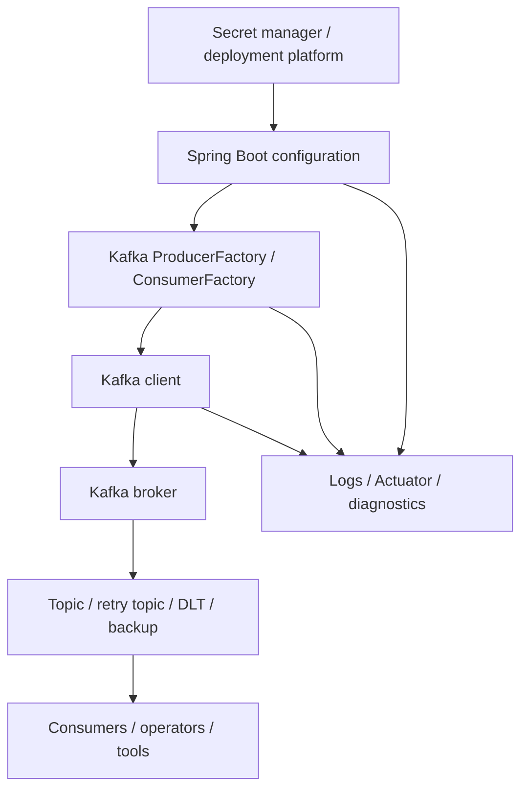

# Protecting Secrets and Sensitive Information in Spring Kafka

A Spring Kafka application must protect two different kinds of information: **secrets used to connect and operate the system**, such as SASL passwords, API keys, private keys, and truststore passwords; and **sensitive data carried inside messages**, such as personal information, tokens, payment information, or business data. These two categories have different lifecycles and protection measures.

TLS and SASL protect the connection to Kafka and authenticate clients. ACLs restrict which principals can read/write topics. However, once a consumer has permission to read a topic, the payload sent by the producer can still usually be read in plaintext. If data inside an event must be hidden from broker operators or consumers that are not permitted to view certain fields, application-layer encryption or tokenization is required.

## 1. Distinguishing Secrets from Sensitive Data

Not all sensitive information should be handled like a password:

| Information Type | Examples | Primary Protection |
|---|---|---|
| Kafka credentials | SASL username/password, OAuth client secret | Secret manager, config tree, rotation |
| TLS material | Private keys, keystore/truststore passwords, client certificates | Secret mounts, file permissions, certificate rotation |
| API credentials | Schema Registry tokens, HTTP client secrets | Secret manager, narrow scopes, rotation |
| Personal data | Email, phone number, address, identifiers | Data minimization, authorization, masking, or field-level encryption |
| Payment data | PAN, bank account, payment tokens | Tokenization or industry-standard encryption |
| User authentication data | Passwords, refresh tokens, session tokens | Omit from events unless needed; appropriate hashing/tokenization |
| Business data | Purchase prices, contracts, customer information | Topic ACLs, retention, encryption, and auditing |

Secrets typically grant a system or user access to other resources. If a secret leaks, an attacker can exercise that access. Sensitive data is content that must remain confidential; leaking it harms users or the business even without access to other systems.

Classify data before designing an event schema. If a field is not needed by consumers, do not include it in the message. Removing unnecessary data at the source is usually more effective than trying to protect data already copied across multiple topics.

## 2. Identifying Where Secrets Can Leak

Secrets can appear in many places across an application's lifecycle:



Places to inspect:

- Source code, `application.yml`, profile files, and sample configuration files.
- Git history, pull requests, build logs, and CI/CD variables.
- Environment variables, command lines, process dumps, and crash dumps.
- Container images, mounted volumes, Kubernetes Secrets, or secret managers.
- Logs, exception messages, tracing baggage, and diagnostic endpoints.
- Kafka message payloads, headers, retry topics, DLTs, compacted topics, and backups.
- Kafka management tools, Schema Registry, connectors, and monitoring dashboards.

Do not look only for obvious password strings. Usernames, internal endpoints, tokens, certificate private keys, and JAAS configuration details can also help an attacker escalate access.

## 3. Never Hardcode Secrets in Source Code

Do not place credentials directly in Java code:

```java
// Do not use this approach.
Map<String, Object> props = new HashMap<>();
props.put("sasl.jaas.config",
        "org.apache.kafka.common.security.scram.ScramLoginModule required " +
        "username=\"service-user\" password=\"my-real-password\";");
```

Do not commit passwords to `application.yml`, even in files dedicated to the `production` profile. Configuration files in the repository must contain placeholders or non-secret values:

```yaml
spring:
  kafka:
    bootstrap-servers: ${KAFKA_BOOTSTRAP_SERVERS}
    properties:
      "[security.protocol]": SASL_SSL
      "[sasl.mechanism]": SCRAM-SHA-512
```

Actual credentials are supplied at deployment time through a secret manager, secret volume, or the platform's secret management mechanism. Never put real secrets into README examples, tickets, chats, logs, or committed test files.

If a secret was already committed to Git, deleting that line in a new commit is not enough. The credential must be rotated/revoked because the old value may still exist in history, forks, caches, build artifacts, or clones of the repository.

## 4. Managing Secrets Outside the Repository

Prefer a secret manager or secret mechanism provided by the operating platform:

- Cloud secret managers or Vault with policies granting access by workload identity.
- Kubernetes Secrets mounted into pods as volumes with strict RBAC; configure encryption at rest for the backing store (such as etcd) because Secret data should not be assumed encrypted at rest by default.
- Docker/Kubernetes secret mounts or files provisioned by the deployment system.
- CI/CD secret stores that expose secrets only to the jobs and environments that need them.

Secrets should follow the principle of least privilege: each service has its own credentials, accesses only the required clusters/topics/groups, and can be revoked independently.

Environment variables are a convenient way to pass configuration, but they are not a secret manager. Values can appear in process environments, diagnostic dumps, or host admin tools depending on OS permissions. For production workloads, prefer workload identity and secret volumes/secret managers when supported by the platform.

Do not store secrets in Docker images, build artifacts, source maps, or packaged config files. Images should be reusable across environments; secrets should only be attached at deploy time.

## 5. Using Spring Boot Config Trees to Read Secrets from Mounted Files

Spring Boot supports config trees, where each filename becomes a property key and the file contents become the property value. This fits platforms that mount each secret as a read-only file.

Example mounted file structure:

```text
/run/secrets/
  kafka.sasl.username
  kafka.sasl.password
```

Each file contains only one secret value, without property names or YAML:

```yaml
spring:
  config:
    import: "configtree:/run/secrets/"
  kafka:
    bootstrap-servers: ${KAFKA_BOOTSTRAP_SERVERS}
    properties:
      "[security.protocol]": SASL_SSL
      "[sasl.mechanism]": SCRAM-SHA-512
      "[sasl.jaas.config]": 'org.apache.kafka.common.security.scram.ScramLoginModule required username="${kafka.sasl.username}" password="${kafka.sasl.password}";'
```

With this configuration, Spring Boot reads `kafka.sasl.username` and `kafka.sasl.password` from the config tree and resolves placeholders inside `sasl.jaas.config`. If a secret is mandatory in production, omit the `optional:` prefix so the application fails fast when the secret file is missing.

Mount paths and file permissions must be restricted to the user running the application. Do not copy secret files into working directories, image layers, or startup logs.

## 6. Configuring `SASL_SSL` for Kafka Clients

Kafka separates connection encryption from client authentication:

- `SSL`: TLS connection encryption; can use client certificates when mutual TLS is configured.
- `SASL_PLAINTEXT`: SASL authentication without transport encryption; unsuitable for untrusted paths.
- `SASL_SSL`: SASL authentication over a TLS connection; typically the choice for production Kafka clusters.

Example using `SCRAM-SHA-512` over TLS:

```yaml
spring:
  kafka:
    bootstrap-servers: kafka-1.example.internal:9093,kafka-2.example.internal:9093
    properties:
      "[security.protocol]": SASL_SSL
      "[sasl.mechanism]": SCRAM-SHA-512
      "[sasl.jaas.config]": '${KAFKA_SASL_JAAS_CONFIG}'
```

`KAFKA_SASL_JAAS_CONFIG` must be supplied from a secret store. The JAAS value contains username/password, so never log this property or print the full Kafka client config when debugging.

If producer and consumer need different identities, place properties in `spring.kafka.producer.properties` and `spring.kafka.consumer.properties` instead of shared configuration. This separates write permissions from read permissions. Check the effective configuration of each factory when the application creates custom `ProducerFactory` or `ConsumerFactory` beans.

## 7. TLS Truststores, Keystores, and Certificates

When a Kafka cluster requires TLS, clients need to trust the CA that signed broker certificates. With mutual TLS, the client also presents its own certificate and private key.

Commonly used Kafka client properties:

| Property | Meaning | Can Contain Secrets? |
|---|---|---|
| `ssl.truststore.location` | Path to truststore containing trusted CAs | Not necessarily |
| `ssl.truststore.password` | Password to open the truststore | Yes |
| `ssl.keystore.location` | Path to keystore containing client certificate/private key | Not necessarily |
| `ssl.keystore.password` | Password to open the keystore | Yes |
| `ssl.key.password` | Password protecting the private key in the keystore | Yes |
| `ssl.endpoint.identification.algorithm` | Broker hostname verification mechanism | No; should not be arbitrarily disabled |

Example:

```yaml
spring:
  kafka:
    properties:
      "[security.protocol]": SASL_SSL
      "[ssl.truststore.location]": /run/secrets/kafka-truststore.p12
      "[ssl.truststore.type]": PKCS12
      "[ssl.truststore.password]": ${KAFKA_TRUSTSTORE_PASSWORD}
```

The truststore file and password should be supplied via a secret mount/secret manager. If using mTLS, add the corresponding keystore and key password. Never disable hostname verification just to bypass certificate errors; fix the SAN, hostname, or trust chain properly.

Private keys must have minimal read permissions and must never be committed to Git. When certificates expire or are revoked, the application needs a process to issue new ones and update Kafka clients.

## 8. Kafka Authorization with ACLs

Authentication answers "who is the client?". Authorization/ACLs answer "what is the client allowed to do?". Successful authentication does not mean the client can read or write every topic.

A producer service typically only needs:

- `WRITE` on the target topic.
- `DESCRIBE` on the topic if client operations need metadata.

A consumer service typically needs:

- `READ` and `DESCRIBE` on subscribed topics.
- `READ` on its consumer group to join the group and commit offsets.

If the application uses retry topics and DLTs, grant appropriate permissions on those topics as well. If the application creates topics or manages topic configurations, administrative permissions should be granted separately to a deployment/admin identity, not broadly to runtime services.

Do not use a shared superuser credential across all microservices. Create separate principals per service and environment; if one service is compromised, the blast radius is smaller.

Exact ACL operation names and requirements may vary by Kafka distribution, authorizer, and version. Verify actual permissions on the cluster, especially for group IDs, retry/DLT topics, and Schema Registry.

## 9. Separating Producer, Consumer, and Admin Identities

A Spring Kafka application can instantiate several kinds of Kafka clients:

| Client | Responsibility | Recommended Permissions |
|---|---|---|
| Producer | Write events | Only `WRITE` to required topics |
| Consumer | Read events and commit offsets | `READ` required topics and `READ` required groups |
| `AdminClient` | Create/inspect topics, partitions, configs | Grant admin permissions only when genuinely needed |
| Retry/DLT publisher | Write retry/DLT records | `WRITE` to retry/DLT topics |
| Retry/DLT consumer | Read retry/DLT records | `READ` corresponding topics and groups |

If every client shares one credential, revocation and access auditing are harder. When identities need separation, configure dedicated Kafka properties for producer, consumer, and admin client, then verify the actual factories in use.

## 10. Secret and Certificate Rotation

Secrets need a lifecycle: creation, provisioning, usage, rotation, revocation, and auditing. Do not wait until a credential leaks to build a rotation process.

A rotation workflow can follow these steps:

1. Create a new credential/certificate with equivalent or narrower permissions.
2. Configure the broker/identity provider to accept the new credential during the transition window if supported by the mechanism.
3. Update the secret store and roll out the application so Kafka clients use the new credential.
4. Verify producers can send, consumers can join groups/read, and no authentication errors occur.
5. Revoke the old credential once all instances have switched over.
6. Monitor authentication failures and keep an audit record of the rotation.

Do not assume changing an environment variable or secret file automatically updates running Kafka clients. Producers/consumers typically retain configuration captured at creation time; perform a restart/rollout or explicitly recreate clients/factories using framework-supported approaches.

For certificates, track expiration dates, CA rotation, trust chains, and rollout duration. If all instances switch simultaneously without proper overlap, a cluster-wide connectivity outage can occur.

## 11. Do Not Put Sensitive Data in Events Unless Necessary

Events should contain only the data consumers need to perform business logic. Do not publish an entire entity or database row simply because the producer already has the object in memory.

Example of an event that should not contain these fields:

```json
{
  "eventId": "evt-1001",
  "orderId": "order-42",
  "customerEmail": "person@example.com",
  "customerPassword": "plaintext-password",
  "accessToken": "eyJhbGciOi...",
  "cardNumber": "4111111111111111",
  "cardCvv": "123"
}
```

Passwords, access tokens, and CVVs should never be placed in events. If consumers need to know which customer is involved, use a customer ID or internal token. If contacting the customer is necessary, authorized consumers can query the customer service by ID rather than duplicating emails and phone numbers across multiple topics.

Apply data minimization:

- Publish only the fields required for the event's purpose.
- Use reference IDs or tokens instead of raw data when appropriate.
- Classify fields as public, internal, confidential, or restricted.
- Set retention periods aligned with storage purpose.
- Have a data-handling policy when users request deletion or contracts expire.

## 12. Encrypting Sensitive Fields at the Application Layer

TLS protects data in transit between clients and brokers. Disk encryption protects storage media in certain scenarios. However, brokers and any consumer permitted to read the topic can still see plaintext payloads if the producer sends plaintext.

When only a specific group of consumers is permitted to read a sensitive field, encrypt that field before publishing:

```json
{
  "eventId": "evt-1001",
  "orderId": "order-42",
  "customerId": "cust-91",
  "paymentReference": {
    "algorithm": "AES-256-GCM",
    "keyId": "payments-dek-2026-01",
    "nonce": "base64-encoded-nonce",
    "ciphertext": "base64-encoded-ciphertext-and-tag"
  }
}
```

Consumers without decryption permission see only ciphertext. Only authorized consumers can call KMS or a key service to fetch/unwrap the data key.

Encrypt only fields that truly need protection. If the entire payload is encrypted, consumers without keys cannot filter, validate, or route events. Design schemas so non-sensitive metadata can still support routing and observability.

## 13. Envelope Encryption and Key Management

A common pattern is envelope encryption:

1. The application generates a random Data Encryption Key (DEK).
2. It encrypts data with the DEK using authenticated encryption such as AES-GCM.
3. It sends the DEK to KMS/HSM to be wrapped with a Key Encryption Key (KEK).
4. It stores ciphertext, nonce, authentication tag, wrapped DEK, key ID, and algorithm version in the event.
5. Authorized consumers call KMS to unwrap the DEK and then decrypt the ciphertext.

Never place a raw DEK or KEK inside a Kafka message. Even a wrapped DEK is sensitive metadata and must be protected per policy. Key ID/version helps identify which key to use during rotation.

With AES-GCM:

- The nonce must be unique for every encryption under the same key; never reuse a nonce.
- Use the authentication tag to detect ciphertext tampering.
- Additional Authenticated Data (AAD) such as event ID, tenant ID, or schema version can bind ciphertext to its context.
- Never design your own cryptographic algorithm or format; use vetted libraries and appropriate KMS/HSM tooling.

Key policies should separate encrypt, decrypt, wrap, and unwrap permissions. A producer may only have encrypt/wrap permission; only consumers authorized to handle sensitive fields have decrypt/unwrap permission.

## 14. Hashing, Encryption, and Tokenization Are Not the Same

Choose the technique to fit the purpose:

| Technique | Can Original Data Be Recovered? | Suitable Use Cases |
|---|---|---|
| Cryptographic hash | No | Fingerprinting, value comparison; do not use plain hashing for passwords |
| Salted password hashing | No | Storing authentication passwords using Argon2id, bcrypt, or PBKDF2 per policy |
| Encryption | Recoverable with the key | Data that must be recovered, such as shipping addresses or contract details |
| Tokenization | Lookup token via controlled system | PANs, account numbers, or identifiers requiring strict control |
| Masking | Shows only a partial value | Logs/UIs needing limited identifying display |

Do not encrypt passwords for storage and decrypt them at login. Passwords must be hashed using a dedicated password-hashing algorithm with salt and appropriate work factor. API tokens or refresh tokens should normally be stored hashed if the system only verifies token matches; if the original value must be reused, store it in a secret manager or encrypt it with a managed key.

Hashing an email or phone number does not automatically make data anonymous: small or predictable value spaces allow attackers to run dictionary attacks. Pseudonymized data still requires protection if it can be linked back to an individual.

## 15. Protecting Kafka Headers and Tracing Metadata

Kafka headers are often used for correlation IDs, trace context, event types, and schema versions. Never put passwords, bearer tokens, cookies, private keys, or unnecessary PII into headers.

Headers are also stored with records and can be copied to retry topics/DLTs. Anyone authorized to read the topic can inspect headers with the Kafka CLI or admin tools. Therefore, never treat headers as a secret channel.

For tracing baggage:

- Propagate only fields needed to trace requests.
- Do not put emails, access tokens, account numbers, or credentials into baggage.
- Configure a propagation allowlist rather than forwarding arbitrary full context.
- Verify log exporters/APMs do not record raw baggage.

If a header must carry a sensitive value by protocol, consider encryption/tokenization and explicitly define which consumers are allowed to decrypt it. Avoid using headers for large payloads or long-lived secrets.

## 16. Never Log Payloads and Secrets

Do not log entire messages by default:

```java
// Avoid logging the full event.
log.info("Received order: {}", event);

// Prefer logging non-sensitive metadata.
log.info("Received order eventId={} orderId={}",
        event.eventId(),
        event.orderId());
```

Logging rules:

- Never log SASL JAAS configs, passwords, tokens, private keys, or secret manager responses.
- Never log raw payloads/headers if the schema contains sensitive fields.
- Mask or hash identifiers per policy when correlation is needed.
- Sanitize user-controlled data to prevent log injection/CRLF.
- Restrict log access permissions and log platform retention.
- Check whether APM, tracing, error reporting, and crash dumps collect payloads.

Exception messages sometimes include URLs, request bodies, SQL parameters, or input values. Before logging stack traces in production, identify libraries that may embed secrets in exceptions. Never log entire `ProducerConfig` or `ConsumerConfig` maps if they contain credentials.

Spring Boot Actuator can expose environment/configuration information via endpoints depending on settings. Even when some sensitive values are masked, still restrict endpoints using authentication/authorization, network policies, and allowlists. Masking does not replace endpoint protection.

## 17. Retry Topics and DLTs Also Store Data

Non-blocking retry creates additional retry topics; dead-letter publishing creates a DLT. These topics can contain the same sensitive payloads as the original topic, plus exception metadata and record location details.

Therefore:

- Assign dedicated ACLs to retry/DLT topics.
- Allow only consumers/operators investigating failures to read the DLT.
- Never include credentials or PII in exception messages.
- Inspect exception headers/stack traces attached by the recoverer.
- Set retention on retry/DLT topics aligned with the error-handling workflow.
- Protect DLT exports, replay tools, and dashboards like production data systems.

If a DLT contains sensitive information, do not grant read access to every developer or support user by default. Establish an audited access workflow and display only necessary fields.

## 18. Encryption at Rest, Replication, and Backups

Kafka stores records on broker logs. TLS protects data in transit, whereas encryption at rest generally depends on disk/volume encryption, cloud storage, or the platform's storage encryption mechanism.

Distinguish these layers:

| Protection Layer | Protects Against | Does Not Solve on Its Own |
|---|---|---|
| `TLS`/`SASL_SSL` | Traffic sniffing/tampering in transit and client authentication | Authorized consumers still read plaintext |
| Broker ACLs | Unauthorized clients reading/writing topics | Principals granted overly broad permissions |
| Disk/volume encryption | Theft or unauthorized access to storage media | Broker processes/admins authorized to read data |
| Application field encryption | Brokers/operators or consumers without keys cannot read encrypted fields | Key compromise or compromise of a consumer authorized to decrypt |
| Backup encryption | Data exposure in backups | Overly broad restore/key access permissions |

Replication, retry topics, DLTs, MirrorMaker/replication pipelines, and backups can create additional copies of data. Every copy must fall under the same data classification, retention, and access policies.

Kafka retention and log compaction are not mechanisms for immediate secure deletion. Old records can remain in segments, replicas, backups, or downstream copies until cleaned up by their respective mechanisms. If personal data deletion is required, design for it upfront: store minimal data, use tokenization, key-per-subject/tenant encryption, or an appropriate purge workflow. Never promise that deleting a record key or lowering retention immediately erases all copies.

## 19. Schema Registry, Connectors, and Operational Tools

Secrets can reside outside Kafka payloads:

- Schema Registry may use Basic Auth, bearer tokens, or TLS client credentials.
- Kafka Connect source/sink connectors may contain database passwords, cloud access keys, or HTTP tokens.
- MirrorMaker/replication tools need credentials to read source clusters and write to destination clusters.
- Kafka admin UIs may store credentials and display payloads/headers.
- CI/CD pipelines and observability agents may hold cluster access tokens.

Manage these credentials as independent secrets; do not reuse runtime service SASL credentials unnecessarily. Grant least-privilege permissions to each connector, service account, and operator; protect connector configuration endpoints and audit configuration changes.

If a connector config holds passwords, verify Kafka Connect's config provider/secret provider mechanism and ensure the REST API returns redacted configurations. Never copy connector configs containing secrets into tickets or logs.

## 20. Testing and Reviewing Secret Protection

Security testing must cover source code, configuration, runtime, and data:

1. Secret scanning in source code and Git history; check for committed real credentials.
2. Verify the application fails fast when mandatory secrets are missing.
3. Verify startup logs do not print JAAS configs, passwords, or private keys.
4. Verify Kafka clients use the approved `SASL_SSL` or TLS mode.
5. Verify hostname verification and trust chains; untrusted certificates must fail.
6. Verify the producer principal cannot read out-of-scope topics and the consumer cannot write unauthorized topics.
7. Verify retry/DLT topics have separate ACLs and retention.
8. Send sample events and inspect payloads, headers, retry topics, DLTs, and logs for prohibited fields.
9. Verify consumers without keys cannot decrypt encrypted fields.
10. Rehearse credential/certificate rotation in staging and verify it causes no outage.
11. Verify Actuator, APM, dashboards, and support tools do not expose secrets.
12. Verify backup/restore and key revocation procedures for incident response.

Automated tests should use temporary credentials or isolated test brokers; never use production secrets in unit tests, CI logs, or test fixtures. If testing encryption, use rotatable test keys and never share keys with production.

## 21. Responding When a Secret Leaks

When a secret is discovered in Git, logs, events, or tickets:

1. Identify the secret type, principal, environment, and accessible resources.
2. Revoke or rotate the credential immediately based on risk severity; do not just delete the visible copy.
3. Check audit logs of Kafka, the secret manager, cloud IAM, and related systems.
4. Identify topics, partitions, retry/DLT topics, backups, and logs containing exposed data.
5. Restrict access or isolate any principal/consumer showing signs of compromise.
6. Handle copies according to retention/purge policies and incident notification obligations.
7. Remove the secret from repositories/artifacts/history per procedure; the old value must still be treated as compromised.
8. Find the root cause and add secret scanning, redaction, or policies to prevent recurrence.

Do not paste the leaked secret into chats, issues, or shell commands for illustration. When reporting the incident, record the credential type, impact scope, and rotation ID—never record the secret value itself.

## 22. Common Mistakes

**Putting passwords in `application.yml` thinking private repos/files are safe:** files can be committed, copied into images, or packaged in artifacts. Move secrets out to a secret manager or config tree.

**Using `SASL_PLAINTEXT` over untrusted networks:** SASL authenticates without encrypting transport. Use `SASL_SSL` or TLS per cluster policy.

**Using one superuser for every service:** overly broad permissions enlarge the blast radius. Separate principals and ACLs by workload.

**Assuming TLS hides payloads from brokers:** TLS only protects data in transit. Brokers and authorized consumers still see plaintext.

**Putting tokens/PII in Kafka headers:** headers are also stored, replicated, and may be copied to retry/DLT topics. Do not use headers as a secret store.

**Logging entire events while debugging:** payloads and exceptions can contain PII/credentials. Log allowlisted metadata and redact sensitive values.

**Forgetting DLTs and retry topics:** auxiliary topics hold copies of original data. Apply equivalent ACLs, retention, and operator controls.

**Treating environment variables as a secret manager:** environment variables can appear in process diagnostics. Prefer a secret manager or mounted files whenever possible.

**Rotating secrets without recreating Kafka clients:** existing clients can continue using old credentials. Roll out or recreate clients per procedure.

**Assuming log compaction deletes data immediately:** data may remain in segments, replicas, backups, and downstream consumers. Design the data lifecycle upfront.

## 23. Production Checklist

- Secrets are absent from source code, Git history, images, and build artifacts.
- Credentials are supplied via a secret manager, workload identity, or secret mount.
- Secrets have an owner, scope, expiry/rotation schedule, and revocation procedure.
- Kafka clients use TLS/`SASL_SSL` per policy; certificate hostname verification is enabled.
- Producers, consumers, admin clients, and connectors have separate principals/ACLs when appropriate.
- Runtime services have permissions only on required topics/groups.
- Payloads are minimized; passwords, access tokens, and unnecessary data do not enter events.
- Sensitive fields are tokenized or encrypted at the application layer when needed.
- Encryption keys are managed via KMS/HSM; raw keys never enter messages.
- Headers, trace baggage, exceptions, and logs contain no secrets outside policy.
- Retry topics, DLTs, backups, and replication are protected like source topics.
- Retention, compaction, and data deletion requirements are explicitly designed.
- Actuator, APM, Kafka UI, Schema Registry, and Kafka Connect have restricted access.
- Tests cover secret scanning, ACLs, TLS, redaction, rotation, and DLTs.
- An incident response procedure exists for credential/data exposure.

Protecting secrets and sensitive information in Spring Kafka requires multiple layers: managing credentials outside source code, encrypting and authenticating connections, least-privilege ACLs, minimizing sensitive data in events, field encryption when needed, controlling logs/DLTs, and managing retention/backups. No single property replaces all of these layers.

## References

- [Spring Boot – Externalized Configuration](https://docs.spring.io/spring-boot/reference/features/external-config.html)
- [Spring for Apache Kafka – Connecting to Kafka](https://docs.spring.io/spring-kafka/reference/kafka/connecting.html)
- [Apache Kafka – Security Overview](https://kafka.apache.org/documentation/#security)
- [Apache Kafka – Encryption and Authentication using SSL](https://kafka.apache.org/documentation/#security_ssl)
- [Apache Kafka – Authentication using SASL](https://kafka.apache.org/documentation/#security_sasl)
