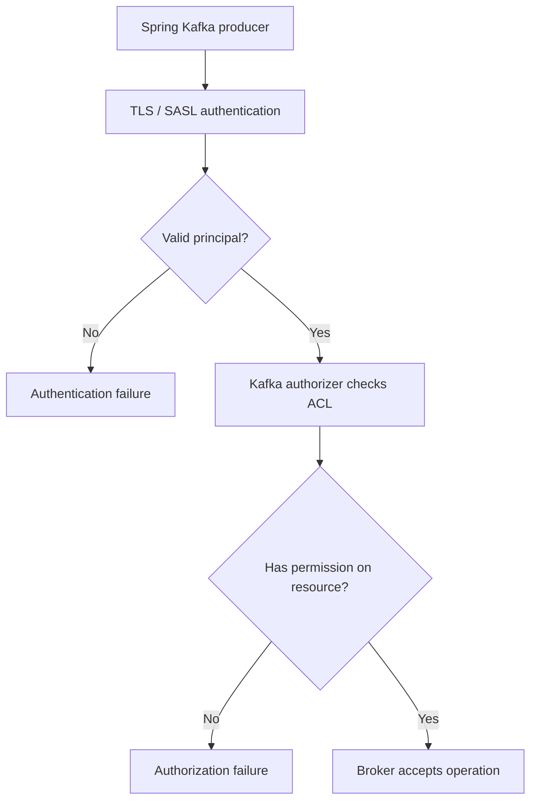

# Producer ACL Authorization

In Kafka, authentication identifies who the producer is, while ACLs (Access Control Lists) decide what the producer is allowed to do. A Spring Kafka application can connect to a broker successfully yet still fail to send records if its principal lacks permissions on the topic or transactional ID. Therefore, security configuration must combine authentication details with properly scoped access permissions.

A producer normally only needs permission to write to the topics where it publishes events. Granting broad privileges such as `super.users`, cluster admin permissions, or write access to all topics increases risk if credentials are compromised. This lesson covers identifying the principal, granting least-privilege ACLs for standard and transactional producers, configuring SASL in Spring Boot, and diagnosing authorization errors.

## 1. Distinguishing Authentication and Authorization

Kafka secures connections in two steps:

- **Authentication:** the broker verifies the client's identity through mechanisms such as SASL/SCRAM, SASL/OAUTHBEARER, or TLS client authentication.
- **Authorization:** the broker's authorizer checks ACLs to decide which operations the principal may perform on resources such as topics, consumer groups, transactional IDs, or the cluster.

For example, the `order-producer` application logs in using SASL/SCRAM with username `order-producer`. The broker can map that identity to the principal `User:order-producer`. ACLs then allow this principal to write to the `orders` topic.



Successful authentication does not imply permission to write to a topic. Conversely, creating an ACL for `User:order-producer` will not let the client log in if SASL credentials or TLS certificates are invalid.

## 2. Identifying the Principal Seen by the Broker

Before creating ACLs, you must know the exact principal recognized by the broker. The principal depends on the authentication mechanism and broker mapping configuration:

| Mechanism | Common Principal | Notes |
|---|---|---|
| SASL/SCRAM | `User:<username>` | The username usually becomes the principal name; verify broker logs and actual naming rules. |
| SASL/PLAIN | `User:<username>` | Use TLS to protect credentials in transit; never use PLAIN over unencrypted connections. |
| TLS client authentication | Principal derived from certificate subject | `ssl.principal.mapping.rules` can transform the principal name. |
| SASL/OAUTHBEARER | Principal determined by token and callback/handler | Check claims or mappings used by the broker. |

ACL examples in this lesson use the principal `User:order-producer`. If the broker maps certificates or tokens to a different name, replace the principal in ACL commands with the actual value. Do not guess the principal from the service name in code; verify it via authentication config and broker logs.

## 3. Least-Privilege Permissions for Standard Producers

A producer sending records to a topic needs `WRITE` permission on that topic. The Kafka client also commonly needs `DESCRIBE` to fetch topic and partition metadata. A common ACL for a producer writing only to topic `orders`:

```bash
bin/kafka-acls.sh \
  --bootstrap-server kafka.example.com:9093 \
  --command-config admin.properties \
  --add \
  --allow-principal User:order-producer \
  --operation Write \
  --operation Describe \
  --topic orders
```

In this example:

- `--bootstrap-server` points to the broker used for ACL admin requests.
- `--command-config` points to the security config file of an ACL admin account; it is not the producer application's credentials.
- `--allow-principal` specifies the principal being granted access.
- `--operation Write` allows writing records.
- `--operation Describe` allows reading topic metadata.
- `--topic orders` scopes permission strictly to topic `orders`.

If a producer needs to write to multiple topics, grant ACLs per topic or use a carefully scoped resource pattern. Do not grant `--topic '*'` just to avoid maintaining the topic list. Standard producers do not need `READ` on topics, `READ` on consumer groups, or administrative permissions such as `ALTER` and `DELETE`.

If a topic does not exist yet, let an administrative workflow create it beforehand. Do not grant cluster-level `CREATE` permission to a producer just so it can auto-create topics; topic creation belongs in a dedicated provisioning process.

## 4. ACLs for Idempotent Producers

Modern Kafka versions enable producer idempotence by default in many standard configurations. Idempotence lets Kafka detect and deduplicate retries within a producer session. When the broker uses an ACL authorizer, idempotent operations may require `IdempotentWrite` permission on the cluster.

Example granting this permission to the producer principal:

```bash
bin/kafka-acls.sh \
  --bootstrap-server kafka.example.com:9093 \
  --command-config admin.properties \
  --add \
  --allow-principal User:order-producer \
  --operation IdempotentWrite \
  --cluster
```

This is a cluster-scoped permission, so grant it only to principals that genuinely use idempotent producers. If a producer does not use idempotence and client/broker configs permit it, this permission may not be needed; however, do not disable idempotence just to bypass ACLs when the system requires reliable record delivery. Verify the requirements of your Kafka version and active authorizer.

## 5. ACLs for Transactional Producers

Transactional producers need permissions on both target topics and transactional IDs. For example, if Spring Kafka uses `transactionIdPrefix` set to `order-service-pod-a-`, the factory can generate transactional IDs starting with this prefix plus a suffix.

Topic ACLs still require `WRITE` and usually `DESCRIBE`. Additionally, grant `WRITE` on the transactional ID resource using a `prefixed` pattern to cover IDs generated by the factory from that prefix:

```bash
bin/kafka-acls.sh \
  --bootstrap-server kafka.example.com:9093 \
  --command-config admin.properties \
  --add \
  --allow-principal User:order-producer \
  --operation Write \
  --transactional-id order-service-pod-a- \
  --resource-pattern-type prefixed
```

If you only grant an ACL for one exact transactional ID while Spring Kafka generates multiple IDs with suffixes, the producer can be denied when initializing a transaction. The `prefixed` resource pattern allows IDs beginning with the specified prefix. Scope the prefix tightly to the service and instance; never use an overly broad prefix like an empty string or a cluster-wide generic name.

In consume-transform-produce flows that commit offsets inside a transaction, the producer also coordinates consumer group offsets. In that case, the application needs appropriate permissions on the consumer group, typically including `READ` on the group. That is an additional permission for consumer/transactional-listener flows, not needed for a producer that only sends records.

## 6. Enabling the Authorizer and Managing ACLs on the Broker

ACLs take effect only when the Kafka broker is configured with an authorizer. For modern Kafka running KRaft, the authorizer is commonly `org.apache.kafka.metadata.authorizer.StandardAuthorizer`. Legacy ZooKeeper clusters may use another authorizer; choose according to your cluster version and architecture.

Concise broker configuration example for KRaft:

```properties
authorizer.class.name=org.apache.kafka.metadata.authorizer.StandardAuthorizer
allow.everyone.if.no.acl.found=false
```

In production, configure `super.users` for administrative accounts or operational workflows that require admin rights, and protect those principals' credentials. Never add an application principal to `super.users` to resolve `TopicAuthorizationException`; grant the exact resource and operation ACLs instead.

Once the authorizer is enabled, verify ACLs for every topic, transactional ID, group, and cluster operation the application actually uses. Changing the authorizer or default policy on a live cluster can affect other clients; roll out changes following your environment's Kafka governance process.

## 7. Configuring `SASL_SSL`/SCRAM in Spring Boot

ACLs rely on the principal identified by the broker after authentication. The example below configures a Spring Boot producer using SASL/`SCRAM-SHA-512` over TLS:

```yaml
spring:
  kafka:
    bootstrap-servers: ${KAFKA_BOOTSTRAP_SERVERS}
    properties:
      "[security.protocol]": SASL_SSL
      "[sasl.mechanism]": SCRAM-SHA-512
      "[sasl.jaas.config]": >-
        org.apache.kafka.common.security.scram.ScramLoginModule required
        username="${KAFKA_USERNAME}"
        password="${KAFKA_PASSWORD}";
    producer:
      key-serializer: org.apache.kafka.common.serialization.StringSerializer
      value-serializer: org.springframework.kafka.support.serializer.JsonSerializer
```

Username/password values should be injected from a secret manager or platform-managed environment variables. Do not commit real credentials to `application.yml`, do not log passwords, and do not reuse a single admin account across all services. `SASL_SSL` encrypts the connection and uses SASL for authentication; the broker's CA certificate must be trusted by the client.

`spring.kafka.properties` applies shared properties to Kafka clients created by Spring Boot. If the producer has separate authentication settings, place them in `spring.kafka.producer.properties`; ensure the `KafkaTemplate` actually uses the producer factory receiving that configuration.

If using mTLS instead of SCRAM, configure `security.protocol=SSL`, truststore, and keystore per environment requirements. The principal is typically derived from the certificate subject and broker mapping rules; ACLs must reference that mapped principal, not a SCRAM username.

## 8. Verifying ACLs After Granting Permissions

You can list ACLs on a topic to confirm the principal and operations were created:

```bash
bin/kafka-acls.sh \
  --bootstrap-server kafka.example.com:9093 \
  --command-config admin.properties \
  --list \
  --topic orders
```

For transactional IDs, list the corresponding resource or inspect the ACL list using the pattern in use. Then run the producer with the application's own credentials—not `admin.properties`:

1. Send a record to an authorized topic and verify the broker returns an acknowledgment.
2. Attempt to send to an unauthorized topic; the producer must receive an authorization error.
3. If using idempotence, verify the producer initializes and sends with the required `IdempotentWrite` permission.
4. If using transactions, verify the producer can initialize and commit a transaction; test a transactional ID outside the granted prefix to confirm it is rejected.
5. Check broker logs to verify the principal, resource, and denied operation.

Do not rely solely on the application starting up without errors. A producer can initialize client config without sending a record; authorization is typically checked when performing specific operations.

## 9. Recognizing Authorization Errors

Common errors:

| Error | Possible Cause | What to Check |
|---|---|---|
| Authentication failure | Wrong username/password, mismatched SASL mechanism, or TLS handshake error | Check credentials, `sasl.mechanism`, CA, and principal in broker logs. |
| `TopicAuthorizationException` | Missing `WRITE` or `DESCRIBE` on the topic | Check ACLs for the exact principal, topic, and operation. |
| `ClusterAuthorizationException` | Missing cluster permission such as `IdempotentWrite` when producer uses idempotence | Check ACLs on the cluster resource and idempotence config. |
| `TransactionalIdAuthorizationException` | Missing `WRITE` on transactional ID or ACL prefix does not match actual ID | Check `transactionIdPrefix`, suffix, and resource pattern. |
| Sends succeed on one topic but fail on another | ACL granted only for a specific set of topics | Add permissions for the needed topic without granting cluster-wide wildcards. |
| Transactional producer starts but offset operation fails | Missing permission on consumer group in consume-transform-produce flow | Check `group.id` and the corresponding `READ` ACL. |

When debugging, correlate three details: the principal recognized by the broker, the resource accessed, and the denied operation. Fix the exact ACL from there. Do not work around it by switching the application to an admin principal or disabling the authorizer.

## 10. Least-Privilege Principles for Producers

A secure ACL policy should follow these principles:

1. Create separate principals for applications or workloads with distinct lifecycles and permissions.
2. Grant only `WRITE` and required metadata permissions on topics the producer actually publishes to.
3. Grant `IdempotentWrite` on the cluster when the producer needs idempotence per broker authorizer requirements.
4. For transactional producers, grant `WRITE` on the exact transactional ID prefix; do not share a prefix across unrelated applications.
5. Do not grant `READ`, `ALTER`, `DELETE`, `CREATE`, or admin permissions if the producer does not need them.
6. Provision topics through a separate administrative workflow instead of granting applications permission to auto-create topics.
7. Manage credentials in a secret store, rotate them periodically, and revoke unused principals.
8. Verify ACLs after every deployment, prefix, or topic list change.

A producer should have just enough permission to publish events within its scope of responsibility. By combining a clearly authenticated principal with ACLs scoped to topics and transactional IDs, a Spring Kafka application can send records safely without cluster admin privileges.
