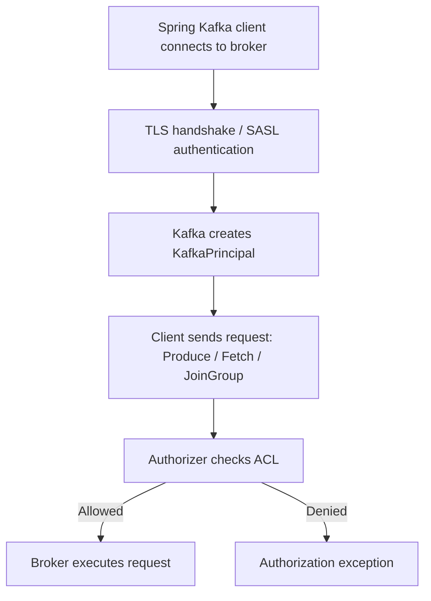

# Protecting Groups and Topics

Kafka topics hold application events; consumer groups represent a group of consumers sharing topic consumption and storing committed offsets. If every client shares a single full-privilege account, a compromised service credential could read another service's data, write events to unrelated topics, or delete data. Kafka ACLs (Access Control Lists) restrict each principal by resource and operation.

In Spring Kafka, the application does not typically enforce ACLs itself. The Kafka broker authenticates the client, identifies its principal, and then the authorizer checks permissions on topics, groups, or other resources. Therefore, protecting groups and topics requires configuring both the broker and the client: the broker enables an authorizer and defines ACLs; Spring Boot provides credentials and connects over TLS/SASL.

## 1. Authentication and Authorization Are Two Different Steps

**Authentication** identifies who the client is. **Authorization** determines what that client is allowed to do.



For example, a client logs in successfully using SCRAM with username `orders-consumer`. The broker recognizes principal `User:orders-consumer`. ACLs can then grant this principal read access to topic `orders.events` and participation in group `order-projection`.

Enabling SASL alone without configuring an authorizer does not enforce per-topic permissions. Under Kafka's security model, without an authorizer, authenticated principals have unrestricted access. Likewise, ACLs do not replace authentication: if every client logs in with the same account, the broker cannot distinguish permissions per service.

## 2. Which Resources Do Kafka ACLs Protect?

An ACL is a set of rules defining which principal is allowed or denied performing which operation from which host on which resource pattern.

| ACL Component | Meaning | Example |
|---|---|---|
| Principal | Identity established by authentication. | `User:orders-producer` |
| Resource type | Type of protected resource. | `Topic`, `Group`, `Cluster`, `TransactionalId` |
| Resource name | Specific resource name. | `orders.events`, `order-projection` |
| Pattern type | How the resource name is matched. | `LITERAL`, `PREFIXED` |
| Operation | Allowed or denied action. | `READ`, `WRITE`, `DESCRIBE` |
| Permission | Allow or deny. | `ALLOW`, `DENY` |
| Host | Permitted or denied IP address. | `198.51.100.20` or `*` |

A single principal can hold multiple ACLs across multiple resources. For example, `User:orders-consumer` has `READ` permission on `orders.events`, but no permission to read `payments.events` or join the payment service's consumer group.

## 3. Enabling `StandardAuthorizer` on Kafka KRaft

For Kafka running KRaft, Kafka provides `StandardAuthorizer`. Authorizer configuration must be applied on all relevant Kafka nodes: brokers, controllers, or combined broker/controller nodes.

Example ACL protection properties in `server.properties`:

```properties
authorizer.class.name=org.apache.kafka.metadata.authorizer.StandardAuthorizer

# Resources without a matching ACL are denied.
allow.everyone.if.no.acl.found=false

# Only cluster admin accounts bypass ACL checks.
super.users=User:kafka-admin
```

`allow.everyone.if.no.acl.found=false` explicitly expresses default-deny mode. This is also the default behavior when an authorizer is active: if no ACL matches a resource, only super users can access it. Do not enable `allow.everyone.if.no.acl.found=true` in steady-state operations because any resource without ACLs would be open to every principal.

`super.users` is a semicolon-separated list of privileged principals. Accounts on this list bypass ACL checks, so reserve it strictly for cluster administration and protect those credentials tightly. If the cluster uses dedicated principals for brokers/controllers, configure the super user list and internal permissions according to your actual topology; do not copy a demo configuration into production without evaluating inter-broker and KRaft controller traffic.

Kafka ACLs are stored in KRaft cluster metadata. The primary tool to add, list, and remove ACLs is `kafka-acls.sh`; they can also be managed programmatically via Kafka's `AdminClient` using `createAcls()` and `deleteAcls()`.

## 4. Common Operations for Topics and Groups

| Operation | Typical Meaning |
|---|---|
| `READ` | Read records from a topic or join/commit offsets for a consumer group. |
| `WRITE` | Write records to a topic. For transactional producers, appropriate permissions on the transactional ID are also required. |
| `DESCRIBE` | Read metadata for a topic, group, or resource. Consumers typically need topic describe to fetch metadata/offsets. |
| `CREATE` | Create a topic or allow the broker to auto-create topics per configuration. |
| `DELETE` | Delete a topic or group per supported operations. |
| `ALTER` | Modify a resource or perform cluster actions guarded by this operation. |
| `DESCRIBE_CONFIGS` | View resource configurations. |
| `ALTER_CONFIGS` | Modify resource configurations. |
| `IDEMPOTENT_WRITE` | Allow an idempotent producer to produce to the cluster. |
| `CLUSTER_ACTION` | Internal/cluster-level actions, usually reserved for brokers or administrative components. |

For `ALLOW` ACLs, Kafka treats `READ`, `WRITE`, `DELETE`, and `ALTER` as also permitting `DESCRIBE` on the corresponding resource. Therefore, a `READ` ACL on a topic/group or a `WRITE` ACL on a topic already includes the necessary describe permission; you do not need to create a separate `DESCRIBE` ACL unless you want to state it explicitly in policy.

A consumer group is not merely a configuration name in code. When a consumer joins a group, sends heartbeats, and commits offsets, the broker checks ACLs on resource type `Group`. Consumers typically need:

- `READ` on the topics to read (which also implies `DESCRIBE`).
- `READ` on the consumer group used to join the group and commit offsets.

Standard producers need `WRITE` on the topic (which also implies `DESCRIBE`). If the application creates topics itself or the broker has auto topic creation enabled, appropriate `CREATE` permission is also needed. If the producer uses idempotence without a transactional ID, evaluate `IDEMPOTENT_WRITE` on the `Cluster` resource.

## 5. Authorization Example for a Spring Kafka Flow

Suppose an order service has these components:

| Principal | Role | Resource | Required Permissions |
|---|---|---|---|
| `User:orders-producer` | Send order events | Topic `orders.events` | `WRITE` (includes `DESCRIBE`) |
| `User:orders-consumer` | Read order events | Topic `orders.events` | `READ` (includes `DESCRIBE`) |
| `User:orders-consumer` | Join group | Group `order-projection` | `READ` |
| `User:kafka-admin` | Administer ACLs/topics | Cluster and admin resources | Only required admin rights; illustrative example uses super user |

Producer and consumer use separate principals so that if one credential leaks, access remains bounded by role. A read-only service does not need topic write permission; a producer does not need topic read or group join permission.

## 6. Creating ACLs for Producers

Suppose topic `orders.events` was already created by an administrator and the broker disables auto topic creation. Specific permissions can be granted:

The commands use `--command-config` so Kafka `AdminClient` authenticates with an administrative account. Example `admin-client.properties` file contents:

```properties
security.protocol=SASL_SSL
sasl.mechanism=SCRAM-SHA-512
sasl.jaas.config=org.apache.kafka.common.security.scram.ScramLoginModule required username="kafka-admin" password="${KAFKA_ADMIN_PASSWORD}";
ssl.truststore.location=/etc/secrets/kafka-admin.truststore.p12
ssl.truststore.type=PKCS12
ssl.truststore.password=${KAFKA_TRUSTSTORE_PASSWORD}
```

This file contains privileged credentials; restrict read access to required operations accounts, pull values from a secret store, and never commit files with real credentials. The placeholder `${KAFKA_ADMIN_PASSWORD}` must be substituted by a secret manager or deployment step before the Kafka CLI reads the file; Java properties do not expand environment variables automatically. On Windows, use `bin/windows/kafka-acls.bat` with the same arguments instead of `bin/kafka-acls.sh`.

```bash
bin/kafka-acls.sh \
  --bootstrap-server broker.example.com:9093 \
  --command-config admin-client.properties \
  --add \
  --allow-principal User:orders-producer \
  --operation Write \
  --topic orders.events \
  --resource-pattern-type literal
```

If the producer is idempotent (often enabled by default in modern Kafka clients) and does not use a transactional ID, grant the cluster-level permission as well:

```bash
bin/kafka-acls.sh \
  --bootstrap-server broker.example.com:9093 \
  --command-config admin-client.properties \
  --add \
  --allow-principal User:orders-producer \
  --operation IdempotentWrite \
  --cluster
```

If the application is permitted to create topics itself, add `CREATE` on the topic or cluster according to your topic creation method and broker policy. In production systems, it is usually better to provision topics via infrastructure workflows and keep `CREATE` restricted to admin accounts. In that case, the producer only holds `WRITE`/`DESCRIBE`.

The Kafka CLI offers the convenience `--producer` flag, which creates `WRITE`, `DESCRIBE`, and `CREATE` ACLs on the topic. That option is handy in test environments but may grant `CREATE` more broadly than needed for a producer using pre-created topics. Specify explicit operations when least privilege is required.

## 7. Creating ACLs for Consumers and Consumer Groups

Consumers need permissions on both the topic and the group. The convenience `--consumer` flag can be used:

```bash
bin/kafka-acls.sh \
  --bootstrap-server broker.example.com:9093 \
  --command-config admin-client.properties \
  --add \
  --allow-principal User:orders-consumer \
  --consumer \
  --topic orders.events \
  --group order-projection
```

The `--consumer` flag creates `READ` and `DESCRIBE` ACLs on the topic, along with `READ` on the specified consumer group. You can create each ACL individually if you want each permission to be explicit:

```bash
# Read and describe the topic.
bin/kafka-acls.sh --bootstrap-server broker.example.com:9093 \
  --command-config admin-client.properties --add \
  --allow-principal User:orders-consumer \
  --operation Read \
  --topic orders.events

# Join the group and commit offsets.
bin/kafka-acls.sh --bootstrap-server broker.example.com:9093 \
  --command-config admin-client.properties --add \
  --allow-principal User:orders-consumer \
  --operation Read \
  --group order-projection
```

The group name in the ACL must match the actual group ID used by the consumer. If `@KafkaListener(groupId = "order-projection")` overrides `spring.kafka.consumer.group-id`, grant the ACL for `order-projection`, not the old group ID in YAML.

When a consumer uses `@KafkaListener`, concurrency spawns multiple consumer instances within the same group; separate ACLs per thread are not needed. When multiple listeners use different group IDs, each group needs its corresponding ACL.

## 8. Resource Patterns: `LITERAL` and `PREFIXED`

ACLs can apply to an exact resource or a group of resources matching a prefix.

| Pattern | Example | Scope |
|---|---|---|
| `LITERAL` | Topic `orders.events` | Only the topic named exactly `orders.events`. This is the CLI default. |
| `PREFIXED` | Topic prefix `orders.` | Topics starting with `orders.`, e.g., `orders.events`, `orders.retry`, `orders.events-dlt`. |
| Wildcard literal | Resource `*` | Every resource of that type; requires very strict control. |

Example allowing a consumer to read all topics with prefix `orders.`:

```bash
bin/kafka-acls.sh \
  --bootstrap-server broker.example.com:9093 \
  --command-config admin-client.properties \
  --add \
  --allow-principal User:orders-consumer \
  --operation Read \
  --operation Describe \
  --topic orders. \
  --resource-pattern-type prefixed
```

Prefix ACLs can be created for consumer groups in the same way:

```bash
bin/kafka-acls.sh \
  --bootstrap-server broker.example.com:9093 \
  --command-config admin-client.properties \
  --add \
  --allow-principal User:orders-consumer \
  --operation Read \
  --group orders- \
  --resource-pattern-type prefixed
```

Prefixes are useful when a service owns a family of topics such as retries and DLTs, but keep the prefix narrow enough. Do not grant `User:*` or resource `*` to regular applications without a clear reason.

## 9. Inspecting, Listing, and Revoking ACLs

List ACLs on a specific topic:

```bash
bin/kafka-acls.sh \
  --bootstrap-server broker.example.com:9093 \
  --command-config admin-client.properties \
  --list --topic orders.events
```

That command lists ACLs bound to a literal pattern with that exact name. Wildcard or prefix ACLs can also affect the topic without appearing in literal-only output. To view all ACLs matching a resource:

```bash
bin/kafka-acls.sh \
  --bootstrap-server broker.example.com:9093 \
  --command-config admin-client.properties \
  --list --topic orders.events \
  --resource-pattern-type match
```

List ACLs for a consumer group:

```bash
bin/kafka-acls.sh \
  --bootstrap-server broker.example.com:9093 \
  --command-config admin-client.properties \
  --list --group order-projection \
  --resource-pattern-type match
```

Revoke granted producer permissions:

```bash
bin/kafka-acls.sh \
  --bootstrap-server broker.example.com:9093 \
  --command-config admin-client.properties \
  --remove \
  --allow-principal User:orders-producer \
  --operation Write \
  --operation Describe \
  --topic orders.events
```

When removing ACLs, specify the exact pattern type. In particular, `--resource-pattern-type match` combined with `--remove` can delete multiple ACLs affecting the resource; use it only after previewing results and confirming scope.

## 10. Configuring `SASL_SSL` for Spring Boot

Example client using `SCRAM-SHA-512` over TLS. The broker needs a `SASL_SSL` listener, the corresponding SCRAM mechanism enabled, and valid TLS certificates. SCRAM users must be created on the cluster before the application connects.

```yaml
spring:
  kafka:
    bootstrap-servers: broker.example.com:9093
    security:
      protocol: SASL_SSL
    properties:
      sasl.mechanism: SCRAM-SHA-512
      sasl.jaas.config: >-
        org.apache.kafka.common.security.scram.ScramLoginModule required
        username="${KAFKA_USERNAME}"
        password="${KAFKA_PASSWORD}";
    ssl:
      trust-store-location: file:/etc/secrets/kafka-client.truststore.p12
      trust-store-type: PKCS12
      trust-store-password: ${KAFKA_TRUSTSTORE_PASSWORD}
    consumer:
      group-id: order-projection
```

Key points to note:

- `spring.kafka.security.protocol` selects the connection protocol for shared clients.
- `sasl.mechanism` chooses a SCRAM mechanism enabled on the broker.
- `sasl.jaas.config` provides the client principal's username/password.
- The truststore contains CAs/certificates the client uses to verify the broker's certificate.
- Passwords come from environment, secret store, or `ConfigProvider`; never commit credentials to Git.

Keys under `spring.kafka.properties` must be full Kafka client property names such as `sasl.mechanism` and `sasl.jaas.config`; do not nest them as YAML objects like `sasl: mechanism:` because this is a key/value property map.

Spring Boot provides dedicated SSL properties such as `spring.kafka.ssl.trust-store-location`, `spring.kafka.ssl.trust-store-password`, `spring.kafka.ssl.key-store-location`, and `spring.kafka.ssl.key-store-password`. If using mTLS, also configure a client keystore with certificate/private key, and the broker requires `ssl.client.auth=required` on the matching listener.

If producer, consumer, and `AdminClient` need different principals, configure security properties per component, such as `spring.kafka.producer.properties.sasl.jaas.config` and `spring.kafka.consumer.properties.sasl.jaas.config`. Also inspect `KafkaAdmin` because admin operations like creating topics or checking metadata go through the broker and must be granted matching permissions.

## 11. Creating SASL Users and Identifying Principals

With SCRAM, credentials are managed in cluster metadata. Administrators can create users with `kafka-configs.sh` for the mechanism enabled on the broker. Illustrative example:

```bash
bin/kafka-configs.sh \
  --bootstrap-server broker.example.com:9093 \
  --command-config admin-client.properties \
  --alter \
  --entity-type users \
  --entity-name orders-consumer \
  --add-config 'SCRAM-SHA-512=[iterations=8192,password=<secret-from-secret-manager>]'
```

Never put real passwords into committed scripts, shell history, or CI logs. Use your organization's secret provisioning workflow and restrict read access on admin configuration files.

With SASL/SCRAM, the username typically becomes principal `User:<username>` under the default principal builder. With TLS client authentication, the default principal is derived from the certificate's distinguished name; names can be normalized with `ssl.principal.mapping.rules`. Verify the actual principal seen by the broker before creating ACLs because a mismatched principal name causes all ACLs to miss.

The `--allow-host` and `--deny-host` options accept IP addresses, not hostnames. If connection sources must be restricted, use static IPs or enforce network restrictions via firewall/security groups; do not assume DNS names can be used directly in host ACLs.

## 12. Choosing an Authentication Mechanism

| Mechanism | When to Use | Notes |
|---|---|---|
| SASL/`SCRAM-SHA-256` or `SCRAM-SHA-512` | Using username/password with challenge-response. | Combine with TLS to encrypt data and credentials in transit. |
| SASL/PLAIN | Simple username/password integration. | Use only over `SASL_SSL`; never use `SASL_PLAINTEXT` in production. |
| SASL/GSSAPI (Kerberos) | Organization already runs Kerberos/KDC. | Manage principals, keytabs, and tickets via existing identity infrastructure. |
| SASL/OAUTHBEARER | Integrating OAuth 2.0/identity providers. | Requires a validator/JWKS and production config; unsecured default token implementations are only for testing. |
| SSL client authentication (mTLS) | Each client has an X.509 certificate. | Broker verifies certificate; principal is mapped from distinguished name. |

`SASL_SSL` combines SASL authentication and TLS encryption. `SSL` can use mTLS; `SASL_PLAINTEXT` provides authentication without encrypting traffic in transit. Choose a mechanism matching your identity provider, credential provisioning/revocation workflow, and secret rotation capabilities.

## 13. Granting Permissions for Retry Topics and Dead-Letter Topics

Spring Kafka non-blocking retries can create retry topics and DLTs. Because these topics are separate resources, ACLs on the source topic do not automatically grant permissions on all retry/DLT topics unless a prefix pattern covers them.

Example flow having:

- `orders.events`
- `orders.events-retry-1000`
- `orders.events-retry-2000`
- `orders.events-dlt`

Producers/recoverers need write permission on the corresponding target topics; retry/DLT consumers need read permission on the topics they subscribe to and permission on the actual group IDs. If retry infrastructure creates topics automatically, provisioning needs `CREATE`/admin permissions accordingly. Alternatively, have the platform team pre-create topics and grant narrow runtime ACLs to the application.

When topics share the `orders.events` prefix, a `PREFIXED` pattern can be used after verifying it does not accidentally match another service's topics. For strict permission isolation, create literal ACLs for each retry/DLT topic.

## 14. Additional Resources When Using Transactions

If a Spring Kafka producer configures `transaction-id-prefix`, in addition to `WRITE` on topics, the transactional producer needs `WRITE` on the `TransactionalId` resource. When a transaction commits consumer offsets inside the transaction, the group also needs matching permissions; transactional produce/consume adds ACL checks across topics, groups, and transactional IDs.

Example granting permissions for a transactional ID prefix:

```bash
bin/kafka-acls.sh \
  --bootstrap-server broker.example.com:9093 \
  --command-config admin-client.properties \
  --add \
  --allow-principal User:orders-processor \
  --operation Write \
  --transactional-id orders-processor-
```

If the producer generates suffixed transactional IDs from a prefix, the resource pattern must cover the actual IDs. Use `PREFIXED` when transaction ID names follow a stable prefix:

```bash
bin/kafka-acls.sh \
  --bootstrap-server broker.example.com:9093 \
  --command-config admin-client.properties \
  --add \
  --allow-principal User:orders-processor \
  --operation Write \
  --transactional-id orders-processor- \
  --resource-pattern-type prefixed
```

Do not grant `WRITE` across all transactional IDs if the service uses only a dedicated set of IDs. If a producer is idempotent without being transactional, also check `IdempotentWrite` on `Cluster` as covered in producer ACLs.

## 15. Distinguishing Runtime Permissions from Admin Permissions

Never share one principal between runtime application workloads and cluster administration. They can be separated as follows:

| Principal | Responsibility | Example Permissions |
|---|---|---|
| `User:orders-producer` | Send order events | Topic `orders.events`: `WRITE` (includes `DESCRIBE`); cluster `IDEMPOTENT_WRITE` if needed. |
| `User:orders-consumer` | Read order events | Topic: `READ` (includes `DESCRIBE`); Group `order-projection`: `READ`. |
| `User:orders-admin` | Provision topics/ACLs for the service | `CREATE`/`ALTER`/`DESCRIBE_CONFIGS` scoped to assigned resources; `ALTER` on Cluster when managing ACLs. |
| `User:kafka-admin` | Global cluster administration | Super user or tightly controlled cluster-level privileges. |

Adding/removing ACLs requires `ALTER` on resource `Cluster`; listing ACLs requires `DESCRIBE` on `Cluster`. Runtime accounts should not hold these permissions. If Spring Boot creates `NewTopic` beans, `KafkaAdmin` executes topic creation and requires corresponding admin permissions; consider disabling runtime auto-creation or granting scoped permissions per workflow.

## 16. Common Authorization Errors

| Error | Common Cause | How to Check |
|---|---|---|
| `TopicAuthorizationException` / `TOPIC_AUTHORIZATION_FAILED` | Missing `READ`, `WRITE`, or `DESCRIBE` on topic. | List topic ACLs with `--resource-pattern-type match`; verify principal and topic name. |
| `GroupAuthorizationException` / `GROUP_AUTHORIZATION_FAILED` | Missing `READ` on consumer group. | Compare actual `group.id` against Group resources in ACLs. |
| `ClusterAuthorizationException` | Client called a cluster/admin API without principal permission. | Check operation and Cluster ACLs; separate `AdminClient` from runtime principals. |
| `TransactionalIdAuthorizationException` | Missing `WRITE` on transactional ID. | Check `transaction-id-prefix` and `TransactionalId` ACLs. |
| Authentication failed | Wrong username/password, mechanism, or JAAS config. | Verify SCRAM user, `sasl.mechanism`, `sasl.jaas.config`, and broker listener. |
| SSL handshake/certificate error | Truststore does not trust CA, expired cert, or hostname mismatch. | Check truststore, SAN/hostname, certificate expiry, and TLS protocol. |
| Consumer fails to read after joining group | Has group permission but lacks `READ`/`DESCRIBE` on topic or ACL pattern mismatch. | Check both Topic ACLs and Group ACLs. |
| Producer works in dev but is denied in production | Dev does not enable authorizer or principal differs across environments. | Verify `authorizer.class.name`, actual principal, and ACLs on the production cluster. |

Kafka's authorizer has the `kafka.authorizer.logger` logger. Denied decisions can be logged for investigation; in audited environments, ship logs to centralized storage with appropriate retention. Avoid overly verbose logging of every allowed request under high traffic.

## 17. Testing ACLs Under Least Privilege

Test both allowed and denied permissions. A test verifying only that a consumer reads a topic does not prove ACLs properly constrain scope.

| Principal | Operation | Expected Result |
|---|---|---|
| `orders-producer` | Send to `orders.events` | Succeeds. |
| `orders-producer` | Read `orders.events` | Denied. |
| `orders-producer` | Write `payments.events` | Denied. |
| `orders-consumer` | Read `orders.events` in group `order-projection` | Succeeds. |
| `orders-consumer` | Join group `payments-projection` | Denied. |
| `orders-consumer` | Read `payments.events` | Denied. |
| Runtime principal | Create or delete topic | Denied if not an admin role. |

Testing workflow:

1. Create topics/groups using an admin account or test fixture.
2. Provision separate credentials for test producer and consumer.
3. Use the same `security.protocol`, SASL mechanism, and TLS truststore as production.
4. Run real producer/consumer instances with the actual `group.id`.
5. Attempt accessing out-of-scope topics/groups and verify authorization failures.
6. List ACLs with pattern `match` to catch overly broad wildcards/prefixes.
7. Revoke test ACLs after completion.

Do not test using a super user because super users bypass ACLs. Use dedicated runtime principals to verify real permissions.

## 18. Deployment Checklist

- Broker enables `StandardAuthorizer` (KRaft) and default-deny.
- Only necessary admin principals are in `super.users`.
- Clients connect through listeners with proper authentication and TLS.
- Each service has its own principal; no shared credentials across all producers/consumers.
- Producers only have `WRITE` on topics they must send to (`WRITE` includes `DESCRIBE`).
- Consumers only have `READ` on topics they must read and `READ` on groups they must join (`READ` includes `DESCRIBE`).
- `group.id` in Spring Kafka matches the Group ACL.
- Retry/DLT topics have matching ACLs or are covered by a narrow prefix.
- Topics are provisioned by an admin account if runtime does not need `CREATE`.
- Transactional producers have `WRITE` ACLs on transactional IDs; idempotent producers have required permissions.
- Secrets are out of source control; password/certificate rotation plans exist.
- Tests cover both allowed and denied operations.
- Audit logs and periodic ACL review processes are in place.

## 19. Key Takeaways

- Authentication identifies the principal; authorization determines which resources the principal can operate on.
- KRaft uses `org.apache.kafka.metadata.authorizer.StandardAuthorizer` to enforce ACLs.
- No authorizer means authenticated clients have full access; an active authorizer with no matching ACL denies by default, except for super users.
- Consumers need `READ` on topics and `READ` on groups; `READ` implies `DESCRIBE`.
- Producers need `WRITE` on topics; `WRITE` implies `DESCRIBE`. `CREATE` is granted only when topic creation is needed.
- The actual `@KafkaListener` `group.id` must match the Group resource granted ACLs.
- `PREFIXED` patterns are convenient for retry/DLT topics but must remain narrowly scoped; avoid broad wildcards.
- SASL/SCRAM or mTLS authenticates principals; combine with TLS to encrypt data in transit.
- Runtime principals should not hold topic/ACL admin privileges or belong to `super.users`.
- Test both granted and denied permissions using the actual runtime principals.

Effective topic and group protection starts by separating principals per service, then granting exact operations per resource. When the broker enables a default-deny authorizer and Spring Kafka connects over `SASL_SSL` or mTLS using dedicated credentials, each service can read/write only its assigned event streams. Check topics, groups, retry/DLT topics, and transactional IDs so least privilege still covers the entire messaging lifecycle.

## References

- [Apache Kafka — Authorization and ACLs](https://kafka.apache.org/44/security/authorization-and-acls/)
- [Apache Kafka — Security Model](https://kafka.apache.org/44/security/security-model/)
- [Apache Kafka — Authentication using SASL](https://kafka.apache.org/44/security/authentication-using-sasl/)
- [Apache Kafka — Encryption and Authentication using SSL](https://kafka.apache.org/44/security/encryption-and-authentication-using-ssl/)
- [Spring Boot — Common Application Properties (Kafka)](https://docs.spring.io/spring-boot/appendix/application-properties/)
