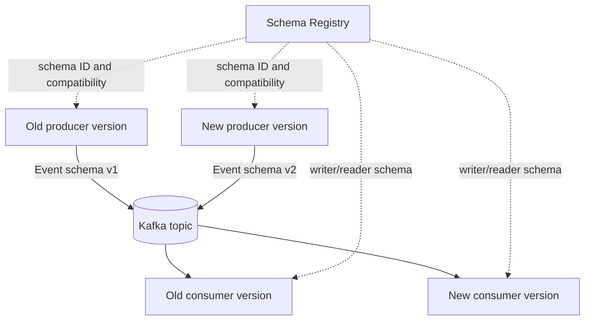

# Optional Fields and Default Values

The schema of a Kafka event often evolves over time. One event version might contain only `orderId`, while a later version adds `couponCode`, `currency`, or order origin details. Old and new consumers can coexist during rolling deployments; old data may also be re-read days after producers have started emitting the new schema.

Optional fields and default values help design these changes more compatibly. However, the two concepts are not identical. Optional describes whether a field may be absent or have no value under the format's rules. Default describes the value used when the field is not provided in a specific context. Their exact semantics depend on Avro, Protobuf, JSON Schema, and how the Java application maps the data.

## 1. Distinguishing missing, null, and default values

Before changing a schema, distinguish three states:

| State | Meaning | JSON example |
|---|---|---|
| Missing | The field does not appear in the payload | `{"orderId":"O-100"}` |
| Null | The field is present with a null value | `{"orderId":"O-100","couponCode":null}` |
| Has value | The field is present with concrete data | `{"orderId":"O-100","couponCode":"WELCOME"}` |

These three states can carry different business meanings:

- Missing may mean the producer is unaware of the field or the old schema did not define it.
- Null may mean the producer knows the field and explicitly indicates there is no value.
- A concrete value indicates that data was supplied.

A default value is a rule applied when a field is not supplied in a defined context. It does not automatically mean null, nor is it always applied by the serializer or deserializer.

For example, if `currency` has a default of `VND`, the application can interpret old events lacking `currency` as using VND. However, if a producer explicitly sends `currency = null`, the application must decide whether null is acceptable or should raise an error. Do not silently treat every null as missing.

## 2. How do optional fields and default values differ?

An optional field answers the question: *Is the field required to be present or have a value?*

A default value answers the question: *If the field has no data in a defined situation, which value will the system use?*

| Concept | Purpose | What it does not automatically guarantee |
|---|---|---|
| Optional field | Allows the field to be absent or without a value per format rules | Does not automatically pick a replacement business value |
| Nullable field | Allows a null value | Does not mean the field may be omitted in every schema |
| Default value | Supplies a fallback value when the format/runtime applies the default rule | Does not necessarily make the field optional |
| Required field | Requires the field to appear according to the schema | Does not guarantee the value is business-valid |

For example, a `couponCode` field can be optional and nullable because an order may not use a coupon. A `currency` field can have a default of `VND` if the system specifies a default currency for old data. But if new producers must always send `currency` explicitly, do not use a default to mask producer bugs.

## 3. Why are optional fields important for Kafka?

Kafka stores records as bytes and does not itself know which fields are optional. Schema rules are enforced at the serializer, deserializer, and schema registry layers if the application uses them.

In a Spring Kafka system, producer and consumer versions can be deployed at staggered times:



For example:

- Producer v1 sends only `orderId`.
- Producer v2 adds `couponCode`.
- Consumer v1 is still running during deployment.
- Consumer v2 must read both v1 events already stored in Kafka and newly emitted v2 events.

If the new field is designed with a format-appropriate default, new consumers can read old events without requiring old producers to republish data under the new schema.

This is especially critical when consumers replay data from older offsets, when retry topics retain records for a long time, or when a new consumer group starts reading from `earliest`.

## 4. Optional fields and defaults in Avro

Avro commonly represents optional fields using a union between the data type and `null`. If the default is null, the null branch must come first in the union.

Example schema v1:

```json
{
  "type": "record",
  "name": "OrderCreated",
  "namespace": "com.example.events",
  "fields": [
    { "name": "orderId", "type": "string" }
  ]
}
```

Schema v2 adds two fields:

```json
{
  "type": "record",
  "name": "OrderCreated",
  "namespace": "com.example.events",
  "fields": [
    { "name": "orderId", "type": "string" },
    {
      "name": "couponCode",
      "type": ["null", "string"],
      "default": null
    },
    {
      "name": "currency",
      "type": "string",
      "default": "VND"
    }
  ]
}
```

Meaning:

- `couponCode` can be null or a string.
- `currency` has type string and a default of `VND`.
- Consumers using schema v2 to read records written under schema v1 can receive defaults for fields not yet present in the writer schema.

**Important note:** in Avro, a default is part of schema resolution when a reader reads data whose writer schema lacks the corresponding field. A default is not a general directive allowing the serializer to omit the field when writing a record. When writing under schema v2, the record is still encoded per writer schema v2; the application must supply or initialize the field appropriately for the generated class/record in use.

A default also does not make a field nullable. If a field should accept null, its type must be a union containing a null branch. A field with type `string` and default `"VND"` still does not accept null in that Avro schema.

### 4.1. Unions and branch order

In Avro, the default must match the first branch of the union per Avro rules. Common declaration:

```json
{
  "name": "couponCode",
  "type": ["null", "string"],
  "default": null
}
```

If changed to:

```json
{
  "name": "couponCode",
  "type": ["string", "null"],
  "default": null
}
```

the schema is invalid under Avro's union default rules because the first branch is string while the default is null.

Do not add `default: null` while forgetting to add the null branch to the type. These two parts solve different things: the union allows the null type; the default supplies a value for the reader when the field is absent in the writer schema.

## 5. Avro schema evolution and compatibility

When using a schema registry, the compatibility mode determines whether a new schema is accepted relative to registered schemas. Common mode names include BACKWARD, FORWARD, FULL, and their transitive variants.

| Mode | Key question | Rollout implication |
|---|---|---|
| BACKWARD | Can consumers using the new schema read data written under the old schema? | New consumers can be deployed before new producers |
| FORWARD | Can consumers using the old schema read data written under the new schema? | New producers can be deployed while old consumers remain running |
| FULL | Are both backward and forward satisfied? | Greater flexibility when producer/consumer rollouts are staggered |
| Transitive | Checks against all prior versions or only the latest version? | Important when old data remains within retention or is replayed |

With Avro:

- Adding a new field to the reader schema usually requires a default so the reader can read old records lacking that field.
- Old reader schemas typically ignore new fields sent by a newer writer schema.
- Removing a field can affect old readers if their reader schema lacks a default to handle the field no longer present in the writer schema.
- Renaming a field is not automatically recognized as the same field; it may require aliases and compatibility verification under the registry in use.

Compatibility checks schema structure, not business semantics. For example, a default currency of `VND` may let old records be read technically, yet if historical data was actually in USD, the business result will still be wrong.

## 6. Generated Avro classes in Spring Kafka

When using Avro `SpecificRecord`, Java classes are typically generated from the schema. Example code creating a v2 event might look like:

```java
OrderCreated event = OrderCreated.newBuilder()
        .setOrderId("O-100")
        .setCouponCode(null)
        .setCurrency("VND")
        .build();

kafkaTemplate.send(
        "orders",
        event.getOrderId(),
        event
);
```

The generated builder may initialize fields from schema defaults, so verify code generated from the exact schema version and project build configuration. Setting fields explicitly in application mapping makes producer behavior clearer, especially for business-significant fields.

A Spring Kafka consumer can receive `SpecificRecord`:

```java
@KafkaListener(
        topics = "orders",
        groupId = "order-projection")
public void consume(OrderCreated event) {
    String currency = event.getCurrency();
    String couponCode = event.getCouponCode();

    orderProjectionService.apply(
            event.getOrderId(),
            couponCode,
            currency
    );
}
```

If the event is deserialized with an appropriate reader schema, new consumers can read old records and receive defaults applied by Avro schema resolution. Distinguish schema defaults from Java mapping defaults: both can coexist, but they operate at different layers.

## 7. Configuring Avro serializer/deserializer for Spring Kafka

If using Confluent Schema Registry, producer and consumer can be configured as follows:

```yaml
spring:
  kafka:
    producer:
      key-serializer: org.apache.kafka.common.serialization.StringSerializer
      value-serializer: io.confluent.kafka.serializers.KafkaAvroSerializer
      properties:
        schema.registry.url: http://schema-registry:8081
    consumer:
      key-deserializer: org.apache.kafka.common.serialization.StringDeserializer
      value-deserializer: io.confluent.kafka.serializers.KafkaAvroDeserializer
      properties:
        schema.registry.url: http://schema-registry:8081
        specific.avro.reader: true
```

This is an illustrative configuration for Confluent serializers; if using another registry or serializer, classes and configuration properties will differ.

The producer serializer registers or looks up the schema and writes the schema ID alongside the payload per the serializer's wire format. The consumer deserializer uses the schema ID to fetch the writer schema, then can apply the reader schema and schema resolution to produce the Java object.

With `specific.avro.reader: true`, the deserializer targets the generated `SpecificRecord` class. Ensure the corresponding class is on the classpath and compatible with the schema used for reading.

Do not let producers and consumers pick schemas arbitrarily without governance. The compatibility policy must be configured in the registry and checked during the schema release workflow.

## 8. Optional fields and defaults in Protobuf

Protobuf represents presence differently from Avro. In proto3, scalar fields not declared `optional` can have an implicit default value, yet the application cannot clearly distinguish an omitted field from one sent with the default value.

Example:

```proto
syntax = "proto3";

message OrderCreated {
  string order_id = 1;
  optional string coupon_code = 5;
  string currency = 6;
}
```

Meaning:

- `order_id` defaults to an empty string if absent.
- `coupon_code` uses `optional` to track presence; generated code supports checking whether the field was set.
- `currency` is a non-optional scalar string, so when absent it reads as an empty string per proto3's implicit default.

In the generated Java API, optional fields can provide presence methods such as `hasCouponCode()`. This lets the application distinguish unset from explicitly set to an empty string, within the supported presence semantics.

### 8.1. Rules when changing Protobuf schemas

When evolving Protobuf messages:

- Add new fields using an unused field number.
- Never change the field number of an existing field.
- Never reuse a deleted field number.
- Use `reserved` to mark retired field numbers or names.
- Use `optional` only when the application needs to distinguish presence from implicit defaults.
- Check new enums and how old consumers handle unknown enum values.

Example marking removed fields:

```proto
message OrderCreated {
  reserved 3, 4;
  reserved "legacy_note";

  string order_id = 1;
  optional string coupon_code = 5;
  string currency = 6;
}
```

Do not reuse numbers 3, 4, or the name `legacy_note` for new fields. Protobuf wire format relies on field numbers; reusing old numbers can cause consumers to misinterpret bytes.

## 9. Optional and defaults in JSON Schema

JSON Schema uses `required` to indicate mandatory properties. A property not listed in `required` may be omitted. To allow null, the property's schema must also accept the null type.

Example using modern JSON Schema syntax:

```json
{
  "$schema": "https://json-schema.org/draft/2020-12/schema",
  "type": "object",
  "properties": {
    "orderId": {
      "type": "string"
    },
    "couponCode": {
      "type": ["string", "null"],
      "default": null
    },
    "currency": {
      "type": "string",
      "default": "VND"
    }
  },
  "required": ["orderId"],
  "additionalProperties": false
}
```

In this example:

- `orderId` is required.
- `couponCode` is optional and accepts null or string.
- `currency` is optional and has default metadata of VND.
- `additionalProperties: false` rejects undeclared properties.

**Critical difference:** in JSON Schema, the `default` keyword is primarily an annotation describing the default value. Standard validators do not mutate payloads to inject missing properties. The application must actively apply defaults via a mapper, constructor, custom deserializer, or explicit normalization step.

If a consumer receives:

```json
{"orderId":"O-100"}
```

the validator does not necessarily transform the payload into:

```json
{"orderId":"O-100","couponCode":null,"currency":"VND"}
```

To get that behavior, application mapping must perform it explicitly. Syntax for null and compatibility configuration may depend on the JSON Schema draft and Schema Registry product in use.

## 10. Applying defaults at the Java layer

Schema defaults and Java defaults are two distinct layers. During JSON deserialization, a missing property may map to null for reference types or the primitive default for primitives. That does not mean JSON Schema automatically injected a default into the payload.

Example DTO:

```java
public record OrderPayload(
        String orderId,
        String couponCode,
        String currency) {
}
```

Defaults can be applied in an application mapper:

```java
public OrderCommand toCommand(OrderPayload payload) {
    String currency = payload.currency() == null
            ? "VND"
            : payload.currency();

    return new OrderCommand(
            payload.orderId(),
            payload.couponCode(),
            currency
    );
}
```

This example treats null and missing identically because a DTO record receives both as null under standard Jackson configuration. If business logic must distinguish missing from explicit null, preserve presence information via `JsonNode`, a custom deserializer, or a presence-aware DTO.

Do not use `@JsonProperty(defaultValue = "...")` as if it were a Jackson databind directive that automatically populates defaults; that attribute primarily provides metadata and does not guarantee values are filled during deserialization.

Defaults should be applied at a deliberate layer. If multiple services read the event, standardize mapping rules or place semantically stable defaults into a schema format supporting resolution so different consumers do not interpret missing fields inconsistently.

## 11. Choosing business-meaningful defaults

A wrong default can be more dangerous than rejecting the event.

Examples:

| Field | Potentially suitable default | What to verify |
|---|---|---|
| `currency` | `VND` if all historical data definitely used VND | Do not apply if old data spans multiple currencies |
| `source` | `LEGACY` for events emitted from prior systems | Do not confuse with an actual known source |
| `isGift` | `false` if business rules confirm old orders had no gifts | Do not use false if missing data does not mean no |
| `couponCode` | null if no coupon is a valid state | Distinguish unknown from unused coupon if business requires |
| `shippingAddress` | Usually should not fabricate a dummy address | May be mandatory data for delivery |

Ask three questions before setting a default:

1. Is this value true for every old event missing the field?
2. Does the default erase the distinction between unknown data and absent data?
3. If the default is wrong, could the system cause side effects such as miscalculating money, misrouting shipments, or producing inaccurate reports?

Without confident answers, preserve an unknown/absent state and require explicit handling instead of assigning a seemingly valid value.

## 12. Producer and consumer rollout workflow

Optional fields and defaults enable phased rollouts of new versions. The exact sequence depends on the compatibility mode.

For a backward-compatible change such as adding a field with a default in Avro:

1. Register the new schema and verify compatibility.
2. Deploy new consumers able to read both old and new events.
3. Wait for new consumers to stabilize.
4. Deploy new producers to begin emitting the additional field.
5. Monitor deserialization errors, mapping behavior, and defaulted data.
6. Remove old compatibility logic only once old data no longer needs to be read or replayed.

If forward compatibility is required so new producers can emit data while old consumers still run, verify whether old readers can interpret the new schema. Old consumers can ignore new fields in formats supporting that rule, yet new enums, changed data types, or semantic changes can still break them.

Do not deploy a new schema simply because registration succeeded. Test with both stored payloads from old versions and new payloads.

## 13. Common field changes

| Change | Risk | Recommended approach |
|---|---|---|
| Add optional field | Old or new consumers misunderstand presence rules | Choose default and compatibility per format |
| Add required field | Old events lack the field | Avoid if old data must be read; consider defaults or multi-step rollout |
| Change data type | Bytes/JSON values may be incompatible | Add a new field, transition gradually, and deprecate the old field |
| Rename field | Readers may treat it as removing old and adding new | Use aliases if supported or a two-step migration |
| Remove field | Old consumers may still depend on the field | Deprecate first, audit consumers and retention |
| Change default | Old events may be interpreted differently on replay | Assess historical impact and version semantics |
| Add enum value | Old consumers may fail on unknown values | Provide fallback/unknown handling or roll out per compatibility |
| Change nullability | Consumers may encounter unexpected nulls | Check old payloads, generated code, and validation |

A structural change can be compatible yet still alter business meaning. For instance, changing a default from `VND` to `USD` does not make old payloads syntactically invalid, yet replaying old events could produce different calculations. Defaults are part of the data contract and must be reviewed like business logic.

## 14. Testing schema evolution

Maintain a representative set of payloads and schemas for released versions and test new readers against old data.

Key tests:

1. New consumer reads events written under the old schema.
2. New consumer reads new events with the field supplied.
3. Consumer handles null fields properly.
4. Consumer applies defaults accurately when the field is missing per format rules.
5. Consumer does not confuse explicit null with missing if business logic separates the two.
6. New producer does not emit values invalid under the registered schema.
7. Registry accepts the new schema under the intended compatibility mode.
8. Replaying old data yields correct business outcomes.
9. Old consumer reads new events if rollout requires forward compatibility.
10. Invalid records flow through error handlers/DLT in an investigable state.

For Avro, test schema resolution with the old writer schema and new reader schema. For Protobuf, test field presence and reserved numbers. For JSON Schema, test both validation and application mapping because the default annotation does not insert values automatically.

Contract tests in CI can block incompatible schema changes before producer deployment.

## 15. Post-deployment monitoring

After adding optional fields or defaults, observe:

- Percentage of events missing the new field.
- Ratio of null fields to populated fields.
- Count of defaults applied in application mapping.
- Schema registry or serializer/deserializer errors.
- Consumer errors, retries, and DLT counts by schema version.
- Volume of old events replayed.
- Business outcome differences between events containing the field and events falling back to the default.

If defaults are applied too often after the rollout window, new producers may not be emitting the field as expected. If null rates spike suddenly, producer mapping or upstream data sources may have an issue. Turn default application into an observable metric rather than letting it happen silently.

## 16. Checklist for designing optional fields and defaults

- [ ] Distinguished missing, null, and populated values.
- [ ] Confirmed whether the field is genuinely allowed to be absent.
- [ ] Selected defaults based on historical data meaning, not coding convenience.
- [ ] Checked default semantics of Avro, Protobuf, or JSON Schema in use.
- [ ] For Avro unions with null defaults, placed the null branch first and allowed null in the type.
- [ ] Understood Avro defaults apply during schema resolution, not as a mechanism to omit fields when writing.
- [ ] For Protobuf, avoided reusing removed field numbers/names and used `optional` when presence is needed.
- [ ] For JSON Schema, avoided assuming validators auto-insert defaults.
- [ ] Java mapper handles missing/null explicitly without masking invalid data.
- [ ] Schema Registry compatibility mode aligns with rollout order.
- [ ] Tested new readers with old payloads and old consumers with new payloads where required.
- [ ] Monitored missing/null/default rates and DLT errors post-deployment.

Optional fields let schemas expand without forcing all old producers to emit new data immediately. Default values help consumers interpret missing data according to an agreed rule. In Spring Kafka, these two mechanisms work properly only when serializers, deserializers, Schema Registry, and Java mapping follow the format's semantics together. Distinguish missing from null, choose business-accurate defaults, and test historical data before deploying new schemas.

