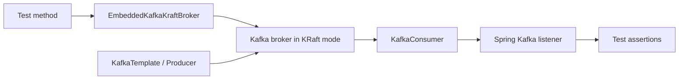

# EmbeddedKafkaKraftBroker

Testing Spring Kafka applications requires a real broker to verify that producers send records, consumers receive the right data, listeners process them, and offsets behave as expected. Mocking `KafkaTemplate` or mocking a listener can verify calls between Java classes, but cannot verify serialization, partitions, consumer groups, broker acknowledgments, or actual polling behavior.

`EmbeddedKafkaKraftBroker` provides an embedded Kafka broker running in KRaft mode for use in tests. You can instantiate the broker directly in Java or use the `@EmbeddedKafka` annotation so Spring Test manages its lifecycle. This lesson covers adding the dependency, configuring the broker, integrating with Spring Boot, and writing repeatable producer/consumer tests.

## 1. What Are Embedded Kafka and KRaft?

Embedded Kafka starts a Kafka broker inside the test process, typically using dynamic ports and temporary log directories. Tests can connect to this broker using regular Kafka clients, making it possible to test the real path through producer, broker, and consumer without a separately installed Kafka cluster.

`EmbeddedKafkaKraftBroker` is Spring Kafka Test's implementation for an embedded broker running KRaft. KRaft uses Kafka's metadata quorum instead of ZooKeeper. In Spring Kafka 3.1 and later, KRaft is the default mode for the embedded broker; older versions may have other options or implementations, so check the `spring-kafka-test` version in your project.



An embedded broker is suitable for integration tests and component tests. It verifies real Kafka communication on a small scale, but does not fully simulate operational characteristics of a production cluster such as multi-machine distribution, network partitions, heavy load, security infrastructure, or complex broker failures.

## 2. Adding the `spring-kafka-test` Dependency

`EmbeddedKafkaKraftBroker`, `@EmbeddedKafka`, and `KafkaTestUtils` utilities live in the `spring-kafka-test` artifact. Add the dependency in test scope while keeping its version compatible with the Spring Kafka version your application uses.

With Gradle:

```groovy
dependencies {
    implementation 'org.springframework.kafka:spring-kafka'
    testImplementation 'org.springframework.kafka:spring-kafka-test'
    testImplementation 'org.springframework.boot:spring-boot-starter-test'
}
```

With Maven:

```xml
<dependency>
    <groupId>org.springframework.kafka</groupId>
    <artifactId>spring-kafka-test</artifactId>
    <scope>test</scope>
</dependency>
```

If the project uses Spring Boot dependency management, let the BOM manage the corresponding Spring Kafka and `spring-kafka-test` versions. Avoid pairing a `spring-kafka-test` version that differs from runtime `spring-kafka`, as test APIs and embedded broker startup behavior may be incompatible.

## 3. Initializing with `@EmbeddedKafka`

In most integration tests using Spring Test, `@EmbeddedKafka` is the most concise way to declare the broker. The annotation instructs Spring to create an embedded broker, create topics, and shut down the broker along with the test context lifecycle.

Example testing a Spring Boot application:

```java
@SpringBootTest
@EmbeddedKafka(
        partitions = 1,
        topics = "orders",
        bootstrapServersProperty = "spring.kafka.bootstrap-servers")
class OrderKafkaIntegrationTest {

    @Autowired
    private KafkaTemplate<String, String> kafkaTemplate;

    @Autowired
    private EmbeddedKafkaBroker embeddedKafka;

    @Test
    void publishesOrderEvent() throws Exception {
        kafkaTemplate.send("orders", "order-42", "ORDER_CREATED")
                .get(10, TimeUnit.SECONDS);

        // Create a test consumer and verify the record reached the broker.
    }
}
```

Important attributes:

| Attribute | Meaning |
|---|---|
| `topics` | Declares topics to create before tests run. |
| `partitions` | Number of partitions for the topics declared in the annotation. |
| `bootstrapServersProperty` | Property name that receives the embedded broker address. |
| `brokerProperties` | Broker configuration properties for testing. |
| `count` | Number of embedded brokers to start. |

When setting `bootstrapServersProperty = "spring.kafka.bootstrap-servers"`, Spring Boot auto-configuration uses the embedded broker address to create `ProducerFactory`, `ConsumerFactory`, and `KafkaTemplate`. If the property is not mapped, the application might still try to connect to the default Kafka address or a broker configured in another environment.

In modern versions where KRaft is the default, `@EmbeddedKafka` uses an embedded KRaft broker. If the project uses an older version, check the `kraft` attribute or the corresponding broker options for that version; do not copy configuration from a newer version into an older project without verifying the API.

## 4. Directly Instantiating `EmbeddedKafkaKraftBroker`

When not using a Spring Test context or when wanting explicit control over the broker lifecycle, you can instantiate the implementation directly:

```java
class EmbeddedBrokerLifecycleTest {

    private EmbeddedKafkaKraftBroker broker;

    @BeforeEach
    void startBroker() {
        broker = new EmbeddedKafkaKraftBroker(1, 1, "orders");
        broker.afterPropertiesSet();
    }

    @AfterEach
    void stopBroker() {
        if (broker != null) {
            broker.destroy();
        }
    }

    @Test
    void brokerHasExpectedTopic() {
        assertTrue(broker.getTopics().contains("orders"));
        assertNotNull(broker.getBrokersAsString());
    }
}
```

The constructor accepts the number of brokers, the default partition count for topics, and the list of topics to create. `afterPropertiesSet()` starts the broker and `destroy()` releases resources. If initialization fails midway, you still need to ensure cleanup in the test lifecycle or use appropriate `try/finally` blocks.

`EmbeddedKafkaKraftBroker` implements the `EmbeddedKafkaBroker` contract, so you can hold a reference by the interface if the test only needs common operations like retrieving bootstrap servers, listing topics, or adding topics. Use the concrete implementation type when the test needs to explicitly instantiate KRaft mode or control the broker lifecycle.

Do not start a new broker for every test method if the entire test class can safely share one broker. Starting a broker is relatively expensive; sharing the broker per test context makes the suite run faster. Conversely, tests needing isolated broker state must manage topics, group IDs, and data between tests to avoid execution-order dependencies.

## 5. Writing a Test Where a Producer Sends and a Consumer Reads Back

A basic integration test should verify both directions: the producer receives an acknowledgment from the broker, and the consumer reads the expected key/value. You can use `KafkaTestUtils` to build properties or obtain bootstrap information from `EmbeddedKafkaBroker`.

Example independent of a Spring Boot context:

```java
@EmbeddedKafka(
        partitions = 1,
        topics = "orders",
        bootstrapServersProperty = "spring.kafka.bootstrap-servers")
class KafkaRoundTripTest {

    @Autowired
    private EmbeddedKafkaBroker embeddedKafka;

    @Test
    void producerRecordCanBeConsumed() throws Exception {
        String topic = "orders";

        Map<String, Object> producerProps = new HashMap<>();
        producerProps.put(ProducerConfig.BOOTSTRAP_SERVERS_CONFIG,
                embeddedKafka.getBrokersAsString());

        try (Producer<String, String> producer = new KafkaProducer<>(
                producerProps,
                new StringSerializer(),
                new StringSerializer())) {
            producer.send(new ProducerRecord<>(topic, "order-42", "CREATED"))
                    .get(10, TimeUnit.SECONDS);
        }

        Map<String, Object> consumerProps = new HashMap<>();
        consumerProps.put(ConsumerConfig.BOOTSTRAP_SERVERS_CONFIG,
                embeddedKafka.getBrokersAsString());
        consumerProps.put(ConsumerConfig.GROUP_ID_CONFIG, "orders-test-group");
        consumerProps.put(ConsumerConfig.AUTO_OFFSET_RESET_CONFIG, "earliest");
        consumerProps.put(ConsumerConfig.ENABLE_AUTO_COMMIT_CONFIG, false);

        try (Consumer<String, String> consumer = new KafkaConsumer<>(
                consumerProps,
                new StringDeserializer(),
                new StringDeserializer())) {

            embeddedKafka.consumeFromAnEmbeddedTopic(consumer, topic);
            ConsumerRecords<String, String> records =
                    consumer.poll(Duration.ofSeconds(10));

            assertFalse(records.isEmpty());
            ConsumerRecord<String, String> record = records.iterator().next();
            assertEquals("order-42", record.key());
            assertEquals("CREATED", record.value());
        }
    }
}
```

The example creates the consumer after the producer sends the record and then calls `consumeFromAnEmbeddedTopic(...)`, a helper that assigns the consumer to the topic and seeks to the beginning of the topic. For topics with multiple records or multiple partitions, do not inspect only the first record; read until the condition is met or use a test helper suited to the expected record count.

In real code, you can use `KafkaTestUtils.consumerProps(...)` and `KafkaTestUtils.producerProps(...)` to reduce repetitive configuration. Regardless of the helper used, set the deserializers matching the data types, a dedicated group ID for the test, and an appropriate `auto.offset.reset`.

## 6. Testing `@KafkaListener` in a Spring Context

A round-trip test only verifies that the broker accepts and returns records. To test a Spring Kafka listener, start the application context, send records with `KafkaTemplate`, and wait for side effects or recorded results.

Example listener:

```java
@Component
public class OrderListener {

    private final OrderEventStore store;

    public OrderListener(OrderEventStore store) {
        this.store = store;
    }

    @KafkaListener(topics = "orders", groupId = "order-listener-test")
    public void consume(OrderEvent event) {
        store.save(event);
    }
}
```

The test can use `Awaitility` to wait for asynchronous results:

```java
@SpringBootTest
@EmbeddedKafka(
        partitions = 1,
        topics = "orders",
        bootstrapServersProperty = "spring.kafka.bootstrap-servers")
class OrderListenerIntegrationTest {

    @Autowired
    private KafkaTemplate<String, OrderEvent> kafkaTemplate;

    @Autowired
    private OrderEventStore store;

    @Test
    void listenerStoresReceivedEvent() throws Exception {
        OrderEvent event = new OrderEvent("evt-42", "order-42");
        kafkaTemplate.send("orders", event.orderId(), event)
                .get(10, TimeUnit.SECONDS);

        await().atMost(Duration.ofSeconds(10)).untilAsserted(() ->
                assertTrue(store.contains("evt-42")));
    }
}
```

Do not use a fixed `Thread.sleep()` to assume the listener has finished processing. Consumers process asynchronously; test speed depends on the scheduler, polling, and machine load. Awaitility or synchronization mechanisms in tests allow waiting for real conditions with a bounded timeout.

If the listener writes to a database, use an appropriate test database or test repository and verify the data was committed. If the listener calls an external service, mock that service while keeping the real broker to test the Kafka path. The goal is to isolate unrelated dependencies while still testing real Kafka integration.

## 7. Topics, Partitions, and Consumer Groups in Tests

The embedded broker lets you declare multiple topics and partitions to test different behaviors:

```java
@EmbeddedKafka(
        partitions = 3,
        topics = {"orders", "orders.DLT"},
        bootstrapServersProperty = "spring.kafka.bootstrap-servers")
class OrderPartitionTest {
    // Integration tests
}
```

Cases worth testing:

- Records with keys are routed to the partition matching the active partitioner.
- Consumer groups receive records according to assignment, and no two consumers in the same group own the same partition simultaneously.
- Two different consumer groups independently receive the same record.
- Offsets are committed according to `AckMode`, and uncommitted records can be redelivered after a restart.
- The DLT topic has partitions compatible with how `DeadLetterPublishingRecoverer` routes records.
- Batch listeners receive the expected batch of records in a poll and handle errors according to the error handler.

Tests should use a dedicated or unique group ID per case so offsets from an earlier test do not alter results of a later test. If a test reuses a group, actively reset offsets or create isolated topics/groups rather than relying on stale offsets.

## 8. Broker Configuration and Test Repeatability

`EmbeddedKafkaKraftBroker` supports configuring broker properties to test specific conditions. Only set properties required for the scenario; do not try to turn the embedded broker into a full production clone.

Example annotation declaring broker properties:

```java
@EmbeddedKafka(
        partitions = 1,
        topics = "orders",
        brokerProperties = {
                "auto.create.topics.enable=false",
                "num.partitions=1"
        },
        bootstrapServersProperty = "spring.kafka.bootstrap-servers")
class OrderBrokerConfigurationTest {
}
```

Principles for stable tests:

1. Use dynamic ports or the bootstrap address provided by the embedded broker; avoid hard-coding ports that another process might occupy.
2. Create topics explicitly so tests do not rely on topic auto-creation.
3. Use separate group IDs per test class or test case when offset isolation is needed.
4. Wait for producer acknowledgments and consumer conditions using bounded timeouts.
5. Close manually created producers/consumers in `try-with-resources`.
6. Let Spring Test manage the broker when using `@EmbeddedKafka`; if instantiated directly, always call `destroy()`.
7. Avoid having multiple tests write to the same topic while sharing a group unless ordering and data are controlled.
8. Do not depend on test order or offsets retained from a previous run.

In large test suites, the Spring context may be cached and the broker shared across the context. If a completely fresh state is needed, close the context or use distinct topics/groups. `@DirtiesContext` can force Spring to close and recreate the context, but increases runtime; use it only when a test genuinely mutates context state that cannot be cleaned up otherwise.

## 9. Limitations of `EmbeddedKafkaKraftBroker`

An embedded broker is useful but does not replace testing on a production-like cluster. A single embedded broker cannot fully prove replication behavior, cross-machine leader election, network partitions, rack awareness, real security infrastructure, or performance under production load.

| Can Be Tested Well | Needs Another Environment for Full Verification |
|---|---|
| Producer sending and consumer receiving records | Throughput and latency under heavy load, multiple brokers, and real networks |
| Serialization/deserialization and headers | Schema registry compatibility, ACLs, and production identity if not configured accordingly |
| Listener container, basic group assignment, offsets | Complex rebalances and failover across multiple brokers/machines |
| Retries, DLT, and transactions at test scope | Transaction state log durability and production cluster fault tolerance |
| Topics/partitions and key routing | Replication factor, ISR, leader movement, and real rack placement |

If security testing is needed, you can configure SASL/SSL and ACLs on the embedded broker depending on version capabilities, but a production-like test environment is still required to confirm certificates, secret rotation, broker policies, and actual access permissions. Do not use embedded test results to conclude that a production cluster is configured properly.

## 10. Common Errors with Embedded KRaft Broker

| Symptom | Possible Cause | Resolution |
|---|---|---|
| Application mistakenly connects to `localhost:9092` | `spring.kafka.bootstrap-servers` is not mapped to the embedded broker | Set `bootstrapServersProperty` to the exact property Spring Boot uses. |
| Test does not see the just-sent record | Consumer starts at a new offset, group ID already has offsets, or topic is not subscribed properly | Use a separate group ID, `auto.offset.reset=earliest`, and assign the consumer with the right helper. |
| Port already in use | Test configures a fixed port or multiple suites run concurrently | Use dynamic ports assigned by the embedded broker. |
| Topic does not exist | Annotation does not declare the topic or test uses the wrong name | Declare `topics` or call the API to add the topic before sending. |
| Class/method errors when starting broker | `spring-kafka-test` version mismatches Spring Kafka or code uses a different version's API | Align dependencies and check the API for the exact version. |
| Test hangs waiting for listener | Listener did not start, wrong deserializer, or exception was swallowed | Check context/logs and use a bounded timeout with clear assertions. |
| Broker resources linger after tests | Broker was instantiated manually without calling `destroy()` | Place cleanup in `@AfterEach`, `@AfterAll`, or appropriate lifecycle management. |

When debugging, check the actual bootstrap address, topic, group ID, serializer/deserializer, and broker logs first. These details usually pinpoint quickly whether the test is connecting to the wrong broker, reading from the wrong offset, or the listener has not processed the record.

## 11. Integration Test Design Checklist

- Add the matching version of `spring-kafka-test` in `test` scope.
- Choose `@EmbeddedKafka` for Spring context integration tests or `EmbeddedKafkaKraftBroker` when manual management is needed.
- Declare required topics and partitions before tests run.
- Map Spring Boot's bootstrap servers to the embedded broker.
- Use serializers/deserializers matching the test's key/value types.
- Create separate group IDs and set offset reset according to test goals.
- Verify both producer acknowledgments and the data consumers actually read.
- For asynchronous listeners, wait on conditions using Awaitility or synchronization primitives with timeouts.
- Close resources and isolate data so tests can run repeatedly in any order.
- Use a dedicated test cluster for replication, failover, security, or production-like performance scenarios.

`EmbeddedKafkaKraftBroker` enables testing Spring Kafka against a real KRaft broker in the test process. When dependencies, bootstrap servers, topics, partitions, and broker lifecycle are configured properly, integration tests can verify that producers, consumers, and listeners work together. Combining embedded tests with testing on dedicated clusters builds greater confidence in messaging flows prior to deployment.
