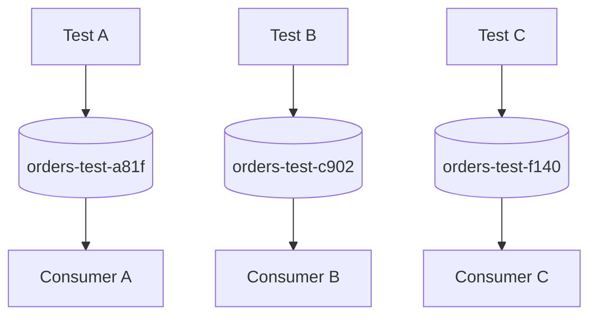

# Dedicated Topic per Test

Kafka tests are easily affected by leftover state from previous runs. If multiple tests send to and read from the same topic, one test may receive records created by another test, a consumer group may resume from a committed offset, or two parallel tests may compete for partitions.

A clear isolation approach is creating a dedicated topic for each test. Each test gets a unique topic name, its own consumer group, and independent data. When the test finishes, the application stops the consumer and deletes the created topic. This produces more stable results when testing producers, consumers, listener containers, retries, or request-reply flows.

## 1. Why Use a Dedicated Topic per Test?

Suppose two tests share the `orders-test` topic:

- Test A sends an `OrderCreated` event.
- Test B also sends an `OrderCancelled` event.
- Both consumers may read each other's records if they share subscriptions and offsets are not isolated.
- When tests run in parallel, record ordering and poll timing can alter outcomes.

A dedicated topic establishes a data boundary for each test:



Topic names can be built from the test class, test method, and a UUID. A UUID avoids name collisions when running in parallel, rerunning tests, or running multiple JVMs against the same broker.

Example:

```java
String topic = "orders-test-" +
        UUID.randomUUID().toString().replace("-", "");
```

Kafka topic names should only use characters supported by Kafka; a fixed prefix combined with a hex UUID is an easy-to-control naming pattern.

## 2. Isolating Topics, Consumer Groups, and Offsets

Creating a dedicated topic alone is not enough if tests still share a consumer group or reuse the same container. Isolate the following components:

| Component | How to Isolate | Reason |
|---|---|---|
| Topic | Unique name per test | Avoid reading records from other tests |
| Consumer group | Separate group ID per test | Avoid sharing partitions or committed offsets |
| Consumer instance | Create and close within test scope | Do not retain subscriptions across the next test |
| Offset | New group and explicit reset policy | Do not depend on old commit state |
| Downstream data | Separate database/schema or keys | Prevent business results from interfering |
| Retry/DLT topic | Separate names or separate namespace config | Avoid receiving retry records from other tests |

A dedicated group ID can usually be generated similarly to the topic:

```java
String groupId = "orders-test-group-" +
        UUID.randomUUID().toString().replace("-", "");
```

Do not generate a new group ID on every production consumer startup if the goal is to resume from committed progress. Random group IDs fit tests because each test needs independent reading progress.

## 3. Using @EmbeddedKafka as the Test Broker

Spring Kafka provides the `spring-kafka-test` module with the `@EmbeddedKafka` annotation. The embedded broker runs inside the test process, allowing testing of producers, consumers, and listener containers without connecting to an external Kafka broker.

Maven dependency example:

```xml
<dependency>
    <groupId>org.springframework.kafka</groupId>
    <artifactId>spring-kafka-test</artifactId>
    <scope>test</scope>
</dependency>
```

Declaring the broker in an integration test:

```java
@SpringBootTest
@EmbeddedKafka(
        partitions = 1,
        bootstrapServersProperty = "spring.kafka.bootstrap-servers"
)
class OrderKafkaIntegrationTest {
    // Test code
}
```

`bootstrapServersProperty` binds the embedded broker address to Spring Boot configuration. In older Spring Kafka versions, property configuration may differ; check the API of the dependency in use.

An embedded broker is typically shared within a test context to reduce startup time. Dedicated topics per test can still be created on that broker. There is no need to spawn a new broker process for each test method once topics and groups are isolated.

## 4. Creating Topics at Runtime with AdminClient

The `@EmbeddedKafka(topics = ...)` annotation is convenient when the topic set is known before the test context starts. If a new topic is needed for each test method, create the topic at runtime using Kafka `AdminClient`.

Example topic creation helper:

```java
private String createTestTopic(
        AdminClient adminClient) throws Exception {

    String topic = "orders-test-" +
            UUID.randomUUID().toString().replace("-", "");

    NewTopic newTopic = new NewTopic(topic, 1, (short) 1);

    adminClient.createTopics(List.of(newTopic))
            .all()
            .get(10, TimeUnit.SECONDS);

    return topic;
}
```

Where:

- `topic` is the unique name for the test.
- `numPartitions = 1` keeps the example simple and assignment easy to control.
- `replicationFactor = 1` suits a single embedded broker.
- `all().get(...)` waits for topic creation to finish before the consumer subscribes.

Creating an `AdminClient` from the embedded broker:

```java
AdminClient adminClient = AdminClient.create(
        Map.of(
                AdminClientConfig.BOOTSTRAP_SERVERS_CONFIG,
                embeddedKafka.getBrokersAsString()
        )
);
```

In a complete example, create `AdminClient` in `@BeforeEach` or a lifecycle helper, then close it via `close()` after the test. Do not leave `AdminClient` or consumers alive after the `ApplicationContext` shuts down.

## 5. Integration Test Example with a Dedicated Topic per Test

The example below creates a topic in `@BeforeEach`, sets up a listener container subscribing only to that topic, sends a record, and confirms the listener receives the expected payload.

```java
@SpringBootTest
@EmbeddedKafka(
        partitions = 1,
        bootstrapServersProperty = "spring.kafka.bootstrap-servers"
)
class OrderKafkaIntegrationTest {

    @Autowired
    private EmbeddedKafkaBroker embeddedKafka;

    @Autowired
    private ConsumerFactory<String, String> consumerFactory;

    @Autowired
    private KafkaTemplate<String, String> kafkaTemplate;

    private AdminClient adminClient;
    private String topic;

    @BeforeEach
    void setUp() throws Exception {
        adminClient = AdminClient.create(
                Map.of(
                        AdminClientConfig.BOOTSTRAP_SERVERS_CONFIG,
                        embeddedKafka.getBrokersAsString()
                )
        );

        topic = "orders-test-" +
                UUID.randomUUID().toString().replace("-", "");

        NewTopic newTopic = new NewTopic(topic, 1, (short) 1);

        adminClient.createTopics(List.of(newTopic))
                .all()
                .get(10, TimeUnit.SECONDS);
    }

    @Test
    void listenerConsumesFromItsOwnTopic() throws Exception {
        BlockingQueue<String> received = new LinkedBlockingQueue<>();

        ContainerProperties properties =
                new ContainerProperties(topic);

        properties.setGroupId(
                "orders-test-group-" +
                UUID.randomUUID().toString().replace("-", "")
        );

        ConcurrentMessageListenerContainer<String, String> container =
                new ConcurrentMessageListenerContainer<>(
                        consumerFactory,
                        properties
                );

        container.setupMessageListener(
                (MessageListener<String, String>) record ->
                        received.offer(record.value())
        );

        try {
            container.start();

            ContainerTestUtils.waitForAssignment(container, 1);

            kafkaTemplate.send(
                    topic,
                    "order-100",
                    "ORDER_CREATED"
            ).get(10, TimeUnit.SECONDS);

            String value = received.poll(10, TimeUnit.SECONDS);

            assertEquals("ORDER_CREATED", value);
        }
        finally {
            container.stop();
        }
    }

    @AfterEach
    void tearDown() throws Exception {
        try {
            if (adminClient != null && topic != null) {
                adminClient.deleteTopics(List.of(topic))
                        .all()
                        .get(10, TimeUnit.SECONDS);
            }
        }
        finally {
            if (adminClient != null) {
                adminClient.close();
            }
        }
    }
}
```

The example assumes Spring Boot has configured `ConsumerFactory<String, String>` and `KafkaTemplate<String, String>` with the embedded broker's bootstrap servers. Imports and generic types must match the serializers/deserializers in the application.

Key points in the test:

1. The topic is created before the container starts subscribing.
2. The group ID is unique for the test run.
3. `waitForAssignment(...)` waits for the consumer to receive its partition before sending records.
4. The producer waits for the future to complete to confirm the broker acknowledged the send request.
5. The queue polling for records has a timeout to avoid hanging the test indefinitely.
6. The container is stopped in `finally`, even if assertions fail.
7. The topic is deleted after the consumer has stopped.

`ContainerTestUtils.waitForAssignment` prevents a common race condition where the test sends a record right after `start()` while the consumer has not yet joined the group and received a partition assignment.

## 6. Testing Annotation-Declared @KafkaListener

In many applications, the goal is to test the `@KafkaListener` method itself rather than creating a listener container manually. You can declare the test topic via test context properties:

```java
@EmbeddedKafka(
        partitions = 1,
        topics = "orders-listener-test",
        bootstrapServersProperty = "spring.kafka.bootstrap-servers"
)
@SpringBootTest(properties = {
        "app.kafka.orders-topic=orders-listener-test",
        "spring.kafka.consumer.group-id=orders-listener-test-group"
})
class AnnotatedOrderListenerTest {
    // Send events to the topic and verify the listener's effects.
}
```

This isolates at the test class or test context level. If each test method requires a different topic, a `@KafkaListener` created from `ApplicationContext` does not automatically change its subscription just because a topic variable in the test changed. There are three options:

- Use a dedicated topic for the whole test class and clean up data between tests.
- Create a listener container programmatically per test method as in the previous example.
- Create a separate `ApplicationContext` per test with a different topic property, accepting context startup overhead.

Do not mutate a property inside a test method and assume an already-created listener container will automatically subscribe to the new topic.

## 7. Choosing the Right Partition Count for Tests

A test topic usually only needs one partition unless the test verifies concurrency or partition assignment. Multiple partitions are only needed when testing one of these scenarios:

- Consumer concurrency greater than one.
- Key-to-partition distribution.
- Record ordering within the same partition.
- Rebalancing when consumer count changes.
- Partition-level pause/resume.
- A consumer group splitting partitions across multiple instances.

Example creating a three-partition topic:

```java
NewTopic topic = new NewTopic(topicName, 3, (short) 1);
```

Do not use multiple partitions merely to make tests look like production. Multiple partitions increase assignment complexity and invalidate assertions about global ordering. Kafka guarantees ordering only within each partition.

If a test needs to prove that records with the same key go to the same partition, send multiple records with the same key and inspect `record.partition()`. Never assume keyless records will always land in the same partition.

## 8. Offset Reset and Starting Read Position

A new consumer group has no committed offsets. The starting read position is determined by `auto.offset.reset` when no valid offset is found:

| Value | Behavior |
|---|---|
| `earliest` | Reads from the earliest retained offset |
| `latest` | Starts from the end of the log at the time the consumer needs a reset |
| `none` | Throws an error if no committed offset exists |

In tests, `earliest` is often useful when the producer sends records before the consumer begins polling. However, if the test creates the container, waits for assignment, and then sends records, `latest` can also work.

Test configuration can set:

```java
Map<String, Object> consumerProps =
        KafkaTestUtils.consumerProps(
                "orders-test-group",
                "false",
                embeddedKafka
        );

consumerProps.put(
        ConsumerConfig.AUTO_OFFSET_RESET_CONFIG,
        "earliest"
);
```

Helper signatures may change across Spring Kafka versions. Use the API matching the version in your project. What matters is that tests explicitly choose the group ID and offset reset rather than relying on settings from a developer machine.

## 9. Deleting Topics After Tests and Cleanup Limitations

Deleting topics reduces leftover state on the embedded broker. However, cleanup must run in the right order:

1. Stop the listener container or close the consumer.
2. Wait for the container to complete stopping.
3. Delete the topic using `AdminClient`.
4. Wait for the delete operation to finish.
5. Close `AdminClient` and test clients.

Do not delete a topic while a consumer is still active or holding an assignment. Topic deletion can be asynchronous on the broker; if the same name is reused too soon, tests may hit topic-marked-for-deletion errors or unstable metadata.

A per-test UUID reduces dependence on immediate topic deletion. Cleanup is still necessary to prevent the embedded broker from accumulating many topics during a long test suite.

For long-lived shared brokers outside tests, tests should not freely create/delete topics on an integration environment without dedicated namespaces and permissions. Prefer an embedded broker or Testcontainers broker dedicated to tests.

## 10. Running Tests in Parallel

JUnit can run tests in parallel. In that case, dedicated topics and dedicated group IDs reduce contention between tests, but other resources still need isolation:

- Topic names must be unique across the entire test process, not just within one class.
- Group IDs must also be unique.
- Do not share a static `topic` variable and overwrite it across tests.
- Each test needs its own container and `AdminClient`, or a manager with thread-safe concurrency control.
- Database fixtures must have separate keys/schemas or be safely reset.
- Do not use `@DirtiesContext` as a default for every test because it can significantly slow down the suite.

If tests run across multiple JVMs or agents sharing a broker, UUIDs still prevent collisions. You can add a build ID or test run ID to the prefix to make log investigation easier.

Do not run tests in parallel against an embedded broker if tests also mutate global broker settings or share non-thread-safe resources. Dedicated topics are one part of isolation, not a replacement for isolating the entire test fixture.

## 11. Dedicated Topics for Retry and Dead-Letter Tests

Retry tests often create extra retry topics and DLTs. If the source topic of multiple tests shares a name, retry records can enter the same topic and interfere with assertions in other tests.

Create a per-test namespace:

```java
String baseTopic = "orders-retry-test-" + testRunId;

String retryTopic = baseTopic + "-retry";
String dltTopic = baseTopic + "-dlt";
```

If using `@RetryableTopic`, retry/DLT topic names are generated by Spring Kafka according to suffixes and naming strategies. Ensure each test's base topic name is sufficiently unique and auxiliary topics do not collide.

For retry tests, verify:

- Records are published to the expected retry topic.
- Retry attempt count matches configuration.
- DLT receives records only when retries are exhausted or per recoverer policy.
- Origin and exception headers are preserved for investigation.
- Cleanup deletes the source topic, retry topics, and DLT after the container stops.

Do not hardcode retry topic names if the framework applies a different suffix strategy. You can inspect actual topics via metadata or configure suffixes explicitly so tests remain predictable.

## 12. Testing Request-Reply with Dedicated Topics

Request-reply tests also need dedicated topics so a reply from an earlier test does not complete a later test's future or disturb correlation.

Each test should isolate:

- Request topic.
- Reply topic or corresponding reply routing.
- Responder's consumer group.
- Reply listener container.
- Correlation ID / request ID.

If multiple tests share a reply topic and reply consumer group, a response can be delivered to another consumer that does not hold the matching future. For parallel tests, using a dedicated reply topic per test is usually simpler.

Also verify that the reply container has been assigned partitions before sending the first request. Test timeouts should be long enough to tolerate CI load while remaining bounded, and late responses must not cause a subsequent test to receive the wrong result.

## 13. Embedded Kafka or Testcontainers?

Both options are useful depending on test scope:

| Criterion | Embedded Kafka | Testcontainers Kafka |
|---|---|---|
| Execution model | Embedded broker in the test process | Broker running in a container |
| Startup speed | Usually faster for focused tests | Has container startup overhead |
| Environment | JVM and test libraries | Close to packaged broker environment |
| Broker configuration | Suits concise test configuration | Flexible with images and container settings |
| Best suited for | Listener, serializer, producer/consumer integration tests | Production-like integration tests, networking, and images |
| Requirements | `spring-kafka-test` dependency | Docker or compatible container runtime |

Whichever approach you choose, the dedicated-topic-per-test principle remains the same. Running a separate broker per test method is usually expensive; you can share a broker across a test class or suite while creating dedicated topics per test.

Do not use an embedded broker to draw conclusions about production cluster behaviors such as replication, leader election, or rack awareness. Those scenarios require a multi-broker test environment or an appropriate cluster.

## 14. Common Pitfalls

| Symptom | Possible Cause | Resolution |
|---|---|---|
| Test receives records from another test | Shared topic and group | Dedicated topic/group per test |
| Test passes intermittently | Record sent before consumer assignment | Wait for assignment or sequence consumer setup properly |
| Consumer misses sent record | New group uses `latest` and record was sent before subscribe | Pick `earliest` or wait for assignment before sending |
| Topic creation reports already exists | Topic name not unique or cleanup not finished | Use UUID and wait for deletion to complete |
| Test suite slows down over time | Accumulating topics, consumers, or `ApplicationContext` instances | Clean up resources and reuse brokers carefully |
| Parallel tests interfere | Shared group, topic, queue, or fixture | Isolate all resources per test |
| DLT receives records not belonging to the test | Retry/DLT topics derive suffixes from a shared base topic | Unique base topic and clean up auxiliary topics |
| Container fails to stop | Cleanup not inside `finally`/teardown | Stop container before deleting topics |

## 15. Test Topic Design Checklist

- [ ] Every test has a unique topic name built from a prefix and UUID/test ID.
- [ ] Every test uses a dedicated consumer group if independent offsets are needed.
- [ ] Partition count fits the test objective.
- [ ] Topic creation completes before the consumer subscribes.
- [ ] Test waits for partition assignment before sending records when needed.
- [ ] `auto.offset.reset` is configured intentionally.
- [ ] Consumer/listener container is stopped in teardown/`finally`.
- [ ] Topic is deleted after the consumer stops and deletion completes.
- [ ] Retry topics and DLT have separate namespaces.
- [ ] Request topics and reply topics are not shared between parallel tests.
- [ ] `AdminClient`, producers, and consumers are closed according to lifecycle.
- [ ] Parallel tests do not share mutable fixtures or group IDs.
- [ ] Logic testing is separated from real broker/cluster testing.

Using a dedicated topic per test gives control over data and offsets, reduces execution-order dependencies, and enables more reliable parallel execution. In Spring Kafka, combine unique topics, dedicated group IDs, waiting for partition assignment, and proper lifecycle cleanup. You can share one embedded broker across a test context, while each test owns its own Kafka namespace so records, retries, DLTs, and replies do not interfere with one another.

