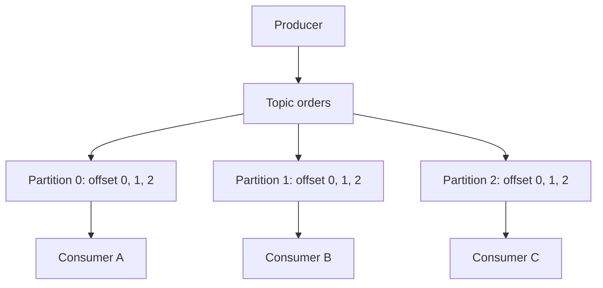

# Testing Multiple Partitions and Ordering

Kafka stores records by partition. Ordering is guaranteed within each partition by offset, while there is no global order across partitions of the same topic. Therefore, testing a multi-partition topic must verify the business's exact ordering requirement: records in the same partition must keep the expected order, whereas records in different partitions can be consumed in parallel and complete in a different order.

With Spring Kafka, you can use an embedded broker to create multi-partition topics, send records with keys or explicit partitions, and verify partitions, offsets, and listener results. This lesson covers designing deterministic test data, verifying per-partition ordering, testing consumer concurrency, and recognizing cases where the application itself breaks ordering after Kafka delivers records.

## 1. At What Scope Does Kafka Guarantee Ordering?

Each partition is an ordered log. The broker assigns monotonically increasing offsets to records appended to that partition. Consumers read a partition in offset order; a consumer group never assigns the same partition to two different consumers at the same time.



Example `orders` topic with three partitions:

| Partition | Records in Offset Order |
|---|---|
| 0 | `OrderCreated-1` → `OrderPaid-1` → `OrderShipped-1` |
| 1 | `OrderCreated-2` → `OrderPaid-2` → `OrderShipped-2` |
| 2 | `OrderCreated-3` → `OrderPaid-3` → `OrderShipped-3` |

Kafka preserves order within each row. You cannot conclude that `OrderPaid-1` is always processed before `OrderCreated-2`, because the two records belong to different partitions and can be consumed in parallel.

When talking about "ordering", specify which order is meant:

- **Append order:** order in which records are written to a partition, reflected by offset.
- **Delivery order:** order in which the consumer receives records from a partition.
- **Processing completion order:** order in which business logic finishes processing records.
- **Side-effect order:** observed order of database updates or external service calls.

Kafka guarantees log order and consumer reading in partition offset order. If a listener hands records off to a multi-threaded executor, processes asynchronously, or calls downstream services in parallel, completion order and side-effect order may differ from delivery order. Tests must observe the exact layer required by the business.

## 2. Using Keys to Keep Related Events in the Same Partition

Producers often use keys so events for the same aggregate route to the same partition. For example, events for an order use `orderId` as the key:

```java
kafkaTemplate.send("orders", orderId, new OrderCreated(orderId));
kafkaTemplate.send("orders", orderId, new OrderPaid(orderId));
kafkaTemplate.send("orders", orderId, new OrderShipped(orderId));
```

With the default partitioner and an unchanged partition count, the same key is typically mapped to the same partition. Thus the consumer can process state changes for the same order sequentially.

Do not test by assuming two different keys are guaranteed to go to different partitions. Hashes of two keys can collide onto the same partition. When needing to test each partition deterministically, specify partitions explicitly in the test or inspect actual metadata returned by the producer.

Example verifying that the same key routes to the same partition:

```java
SendResult<String, String> first = kafkaTemplate
        .send("orders", "order-42", "CREATED")
        .get(10, TimeUnit.SECONDS);

SendResult<String, String> second = kafkaTemplate
        .send("orders", "order-42", "PAID")
        .get(10, TimeUnit.SECONDS);

assertEquals(
        first.getRecordMetadata().partition(),
        second.getRecordMetadata().partition());
assertTrue(
        second.getRecordMetadata().offset()
                > first.getRecordMetadata().offset());
```

Waiting for each future to complete allows the test to inspect metadata from each send. This test confirms the key is routed consistently and offsets increase on that partition. In production, if using a custom partitioner or changing partition counts, re-verify routing rules.

## 3. Creating a Multi-Partition Topic with Embedded Kafka

With Spring Kafka Test, declare the partition count in `@EmbeddedKafka`:

```java
@SpringBootTest
@EmbeddedKafka(
        partitions = 3,
        topics = "orders",
        bootstrapServersProperty = "spring.kafka.bootstrap-servers")
class OrderPartitionOrderingTest {

    @Autowired
    private KafkaTemplate<String, String> kafkaTemplate;

    @Autowired
    private EmbeddedKafkaBroker embeddedKafka;
}
```

The `orders` topic is created with three partitions. `bootstrapServersProperty` maps the embedded broker to Spring Boot so `KafkaTemplate`, the producer factory, and the consumer factory connect to the test broker.

To keep tests reliably repeatable:

- Use a dedicated topic for the test or ensure tests do not unintentionally share data.
- Use a fresh group ID for the test consumer so old offsets do not affect results.
- Set finite timeouts on sends and polls.
- Wait for broker acknowledgments before verifying data if the test relies on deterministic send order.
- Do not depend on record return order across partitions.

## 4. Verifying Ordering Independently per Partition

One deterministic testing approach is sending records directly to chosen partitions. Then the consumer assigns all three partitions and groups records by partition to check each group's order.

Example sending two records to each partition:

```java
@Test
void preservesOrderWithinEachPartition() throws Exception {
    for (int partition = 0; partition < 3; partition++) {
        kafkaTemplate.send("orders", partition, "key-" + partition,
                "p" + partition + "-first").get(10, TimeUnit.SECONDS);
        kafkaTemplate.send("orders", partition, "key-" + partition,
                "p" + partition + "-second").get(10, TimeUnit.SECONDS);
    }

    Map<Integer, List<String>> actual = consumeByPartition(3, 6);

    assertEquals(List.of("p0-first", "p0-second"), actual.get(0));
    assertEquals(List.of("p1-first", "p1-second"), actual.get(1));
    assertEquals(List.of("p2-first", "p2-second"), actual.get(2));
}
```

The `consumeByPartition` method below illustrates a consumer reading directly from the embedded broker. In test code, import the corresponding Kafka client and collection classes:

```java
private Map<Integer, List<String>> consumeByPartition(
        int partitionCount,
        int expectedCount) {

    Properties props = new Properties();
    props.put(ConsumerConfig.BOOTSTRAP_SERVERS_CONFIG,
            embeddedKafka.getBrokersAsString());
    props.put(ConsumerConfig.GROUP_ID_CONFIG, "ordering-test-" + UUID.randomUUID());
    props.put(ConsumerConfig.AUTO_OFFSET_RESET_CONFIG, "earliest");
    props.put(ConsumerConfig.ENABLE_AUTO_COMMIT_CONFIG, false);

    Map<Integer, List<String>> result = new HashMap<>();
    List<TopicPartition> assignments = IntStream.range(0, partitionCount)
            .mapToObj(partition -> new TopicPartition("orders", partition))
            .toList();

    try (KafkaConsumer<String, String> consumer = new KafkaConsumer<>(
            props, new StringDeserializer(), new StringDeserializer())) {

        consumer.assign(assignments);
        consumer.seekToBeginning(assignments);

        long deadline = System.nanoTime() + TimeUnit.SECONDS.toNanos(10);
        int received = 0;
        while (received < expectedCount && System.nanoTime() < deadline) {
            ConsumerRecords<String, String> records =
                    consumer.poll(Duration.ofMillis(200));
            for (ConsumerRecord<String, String> record : records) {
                result.computeIfAbsent(record.partition(), ignored -> new ArrayList<>())
                        .add(record.value());
                received++;
            }
        }
    }

    assertEquals(expectedCount, result.values().stream()
            .mapToInt(List::size).sum());
    return result;
}
```

The consumer uses `assign()` to read the chosen partitions directly rather than waiting for group assignment. `seekToBeginning()` positions the consumer at the start of the partitions. A deadline ensures the test fails clearly if records are missing instead of waiting indefinitely.

The key point is grouping assertions by partition. Do not write an assertion like `p0-first, p1-first, p2-first, p0-second, ...` across the combined result, because Kafka specifies no global order across partitions 0, 1, and 2.

## 5. Checking Increasing Offsets and No Out-of-Order Reversals

Offsets are direct evidence of ordering within a partition. For records in the same partition, a later record's offset must be greater than an earlier record's offset. You can capture metadata while sending:

```java
List<RecordMetadata> metadata = new ArrayList<>();

for (String state : List.of("CREATED", "PAID", "SHIPPED")) {
    SendResult<String, String> result = kafkaTemplate
            .send("orders", 0, "order-42", state)
            .get(10, TimeUnit.SECONDS);
    metadata.add(result.getRecordMetadata());
}

assertEquals(0, metadata.get(0).partition());
assertEquals(0, metadata.get(1).partition());
assertEquals(0, metadata.get(2).partition());
assertTrue(metadata.get(0).offset() < metadata.get(1).offset());
assertTrue(metadata.get(1).offset() < metadata.get(2).offset());
```

This test only checks three sequential sends to partition 0. In real applications, offsets can have gaps from other records, aborted transactions, or concurrent writers to the partition; do not require contiguous offsets, only strictly increasing order when comparing target records.

When a consumer commits offsets, the committed value represents the next position to read, not the offset of the record just processed. When testing commits, understand `AckMode` and commit semantics rather than comparing the committed offset directly to the record offset without adding the next position.

## 6. Testing Multiple Consumers and Partition Assignment

Spring Kafka's `ConcurrentMessageListenerContainer` creates child consumers according to its concurrency setting. If a topic has three partitions and the listener container has concurrency 3, three consumers can receive partitions in parallel.

Example factory configuration:

```java
@Bean
ConcurrentKafkaListenerContainerFactory<String, OrderEvent>
        orderListenerFactory(ConsumerFactory<String, OrderEvent> consumerFactory) {

    var factory = new ConcurrentKafkaListenerContainerFactory<String, OrderEvent>();
    factory.setConsumerFactory(consumerFactory);
    factory.setConcurrency(3);
    return factory;
}
```

A test listener can record the partition and offset received:

```java
@Component
public class OrderPartitionProbe {

    private final BlockingQueue<ReceivedOrder> received = new LinkedBlockingQueue<>();

    @KafkaListener(
            id = "ordersProbe",
            topics = "orders",
            groupId = "orders-probe-group",
            containerFactory = "orderListenerFactory")
    public void consume(ConsumerRecord<String, OrderEvent> record) {
        received.add(new ReceivedOrder(
                record.partition(), record.offset(), record.value().eventId()));
    }

    public BlockingQueue<ReceivedOrder> received() {
        return received;
    }
}
```

The test can wait until the container receives full partition assignment:

```java
MessageListenerContainer container = registry.getListenerContainer("ordersProbe");
ContainerTestUtils.waitForAssignment(container, 3);
```

`ContainerTestUtils.waitForAssignment` belongs to `spring-kafka-test`; it waits until the listener container is assigned the expected number of partitions or times out. Then send records to each partition and verify the probe receives records from those partitions.

Do not assert that consumer 1 always gets partition 0 and consumer 2 always gets partition 1. Assignment depends on the partition assignor, consumer count, partition count, and active group members. Check the set of assigned partitions rather than relying on a fixed mapping unless the test explicitly configures a deterministic assignor and topology.

If concurrency exceeds the partition count, some consumers will receive no partitions and no records. That is normal behavior, not a test error.

## 7. Testing Ordering When the Listener Processes Concurrently

Kafka may deliver records in exact partition order, yet the application can still finish processing out of order if the listener dispatches work to a multi-worker thread pool.

For example, a listener receives `OrderCreated` before `OrderPaid`, but submits both tasks to an executor:

```java
@KafkaListener(topics = "orders")
public void consume(OrderEvent event) {
    workerPool.submit(() -> orderService.process(event));
}
```

The `OrderPaid` task can finish before `OrderCreated` if workers run at different speeds. Tests must verify completion order or final state, not just the order records were polled.

If business rules require sequential processing per order ID, use one of these approaches:

- Process synchronously inside the listener so records on the same partition run sequentially.
- Use dedicated worker lanes per key/aggregate so all events with the same key enter the same sequential queue.
- Use business sequence/version numbers and reject or defer out-of-order events.
- Design operations to be idempotent and safe to reapply when an event arrives late.

When testing a worker pool, send multiple events with the same key and increasing sequences and record completion order in a test store. Assert that the final sequence matches business requirements. Also send events across multiple keys to verify different lanes still run in parallel.

## 8. Producer Retries and Configuration Affecting Ordering

Producers can retry on transient broker errors. When idempotence is enabled, the Kafka producer preserves record order under supported configuration limits. With a non-idempotent producer, retrying while allowing multiple in-flight requests can cause a later batch to be written by the broker before an earlier retried batch.

Points to verify:

- Enable idempotence when the application must preserve order across producer retries.
- Do not configure `max.in.flight.requests.per.connection` beyond the limit supported by idempotent producers in your Kafka version.
- If idempotence is disabled, understand the impact of retries and in-flight request counts on ordering.
- If multiple threads call the producer concurrently, desired ordering must be defined by key, partition, or business sequence; do not assume cross-thread ordering always matches event creation order elsewhere.
- With transactions, only `read_committed` consumers skip records from aborted transactions; tests must set the right `isolation.level` when verifying outputs.

Do not test only the happy path. A valuable ordering test simulates reproducible retries or send failures and verifies that record order in the partition still meets requirements.

## 9. Changing Partition Counts Can Affect Key Ordering

With the default partitioner, partitions are normally chosen based on a hash of the key and the current partition count. When increasing the partition count, the same key can map to a different partition. Older records for that key sit in the old partition while newer records may enter the new partition.

In that case, Kafka still preserves order within each partition, without providing a single combined order across the two partitions. If business rules require continuous ordering for an aggregate across topic expansion, you need a migration plan or sequence/version checks on the consumer.

Tests can verify both phases using recreated topics with different partition counts or a controllable test partitioner. However, do not rely on a specific hash value of a key as a long-term contract; test routing behavior per the actual partitioner and client version.

## 10. Ordering Assertions You Should and Should Not Write

| Assertion | Valid? | Reason |
|---|---|---|
| Records in the same partition have increasing offsets | Yes | Offsets reflect log order within a partition. |
| Events with the same key land in the same partition when partition count and partitioner are stable | Yes | That is the goal of standard key-based partitioning. |
| Record in partition 0 is always processed before partition 1 | No | There is no global ordering across partitions. |
| A specific consumer always receives a fixed partition | Not by default | Assignment depends on group membership and assignor. |
| Thread pool completion order matches delivery order | Not by default | Workers can finish tasks at different speeds. |
| Events for the same aggregate have ordered sequences after processing | Yes, if required by business rules | Must be tested at the service/side-effect layer, not only on Kafka records. |
| Record offsets must be contiguous | No | Other records or gaps can exist in the log. |

## 11. Multi-Partition Testing Checklist

1. Create test topics with explicit partition counts and verify topic metadata.
2. Send records with stable keys for events belonging to the same aggregate.
3. Use explicit partitions in tests that must inspect individual partitions deterministically.
4. Verify records in the same partition have increasing offsets and ordered payloads.
5. Group results by partition; do not assert a global order across partitions.
6. Use dedicated group IDs and wait for assignment to complete before testing consumer concurrency.
7. Test concurrency equal to, less than, and greater than the partition count.
8. If the listener uses an executor, verify completion order and final business state.
9. Test producer retries/idempotence if ordering must survive send errors.
10. Evaluate impact when partition counts change and keys may be remapped.

Testing multiple partitions requires separating log order from business completion order. Kafka guarantees records are stored and read in offset order within each partition; keys group related events into the same partition for sequential processing. When tests independently verify each partition, assignments, and completion order, teams can catch both Kafka configuration bugs and application-level concurrency issues that scramble order.
