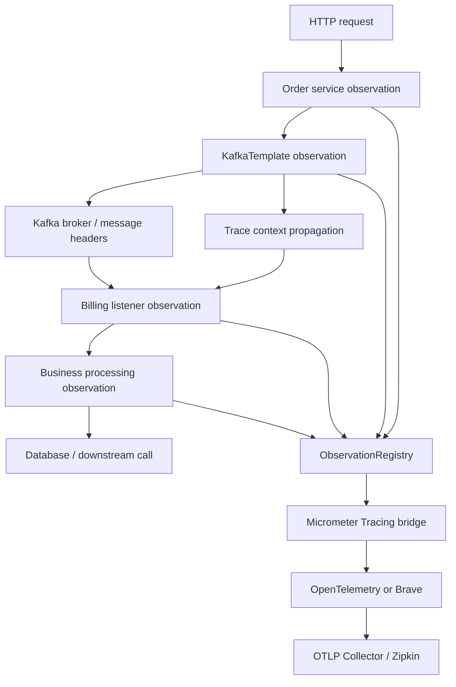

# Observation and tracing

In a Spring Kafka system, an event can start from an HTTP request, be published via `KafkaTemplate`, pass through a broker, be processed by one or more `@KafkaListener`s, and then call a database or another service. When one step is slow or fails, individual service logs alone are often insufficient to see the entire journey.

**Micrometer Observation** provides a unified API to describe an ongoing operation. When combined with **Micrometer Tracing** and a tracer such as OpenTelemetry or Brave, observations can create spans and link them into a distributed trace. Spring Kafka supports observation for `KafkaTemplate` and listener containers starting in Spring Kafka 3.0.

The goal is to track an event from producer to consumer, know which service handled it, how long it took, where errors occurred, and which logs belong to the same trace. Observation/tracing complement metrics and logs; they do not replace those signals.

## 1. Distinguishing Observation, Span, Trace, and Correlation ID

| Concept | Meaning | Example |
| --- | --- | --- |
| Observation | Describes an operation in the application; can produce metrics and tracing depending on registered handlers | Sending an `OrderCreated` event |
| Span | A unit of work with start/end times, duration, status, and attributes | Producer sending a record to `orders.events` |
| Trace | A collection of related spans representing a journey across multiple processes/services | HTTP → Order service → Kafka → Billing service |
| Trace ID | Shared ID grouping spans belonging to the same trace | `4bf92f3577b34da6a3ce929d0e0e4736` |
| Span ID | ID of a specific span | `00f067aa0ba902b7` |
| Correlation ID | Correlation key defined by the application/business domain | `orderId`, `requestId` |
| Baggage | Small contextual data propagated along with the trace as configured | `tenant-tier=gold` |

A trace ID and a business correlation ID are not the same thing. A trace ID serves technical observability and can change when a new trace starts; a correlation ID is typically tied to business workflows and can persist across multiple retries or multiple traces. Do not use `orderId` as a substitute for a trace ID.

## 2. How do Observation and tracing work together?

`ObservationRegistry` is the registration and coordination point for observation handlers. An observation is created when an operation starts and stops when it finishes. If the registry has a metrics handler, the observation can produce a timer; if it has a tracing handler, the observation can produce a span.

With Spring Boot Actuator and Micrometer Tracing properly configured, the tracing handler is attached to `ObservationRegistry`. Applications can use the same Observation API to generate both metrics and spans instead of writing separate logic per backend.



One observation can produce both metrics and spans, but only when the corresponding handlers exist. Simply adding `spring-boot-starter-actuator` does not guarantee a trace exporter is present; you must choose an appropriate tracer bridge and exporter.

## 3. Spring Kafka Observation

Spring Kafka supports two main instrumentation points:

| Component | Observed operation | Default observation |
| --- | --- | --- |
| `KafkaTemplate` | Sending a record to Kafka | `spring.kafka.template` |
| Listener container | Receiving and invoking a listener to process a record | `spring.kafka.listener` |

Default observations populate messaging attributes such as destination/topic, operation, consumer group, partition, offset, and listener/template identity into the context/span according to your Spring Kafka version's conventions.

Specific tags may vary by version. Consult the Micrometer Observation documentation for your exact Spring Kafka version to see the convention and low/high-cardinality keys.

Observation for `KafkaTemplate`/listener containers has been available since Spring Kafka 3.0. When observation is enabled, Spring Kafka disables legacy Micrometer timers for the same operation because timers are managed through observation. Do not enable both mechanisms just to double-count metrics.

## 4. Dependencies to enable tracing

With Spring Boot 3.x, a common setup uses Actuator, a Micrometer Tracing bridge, and an exporter. Example for OpenTelemetry with OTLP:

```xml
<dependencies>
    <dependency>
        <groupId>org.springframework.boot</groupId>
        <artifactId>spring-boot-starter-actuator</artifactId>
    </dependency>

    <dependency>
        <groupId>io.micrometer</groupId>
        <artifactId>micrometer-tracing-bridge-otel</artifactId>
    </dependency>

    <dependency>
        <groupId>io.opentelemetry</groupId>
        <artifactId>opentelemetry-exporter-otlp</artifactId>
    </dependency>
</dependencies>
```

With Spring Boot 4.x, the OpenTelemetry starter provided by Spring Boot can bundle the required auto-configuration:

```xml
<dependency>
    <groupId>org.springframework.boot</groupId>
    <artifactId>spring-boot-starter-opentelemetry</artifactId>
</dependency>
```

The examples above represent two dependency approaches by major version; do not blindly add both. Use Spring Boot dependency management/BOM to keep Micrometer, Micrometer Tracing, and OpenTelemetry versions compatible.

Another option is the Micrometer Tracing bridge for Brave and Zipkin. Choose a tracer implementation aligned with your organization's observability stack. OpenTelemetry typically sends traces via OTLP to a collector, while Zipkin is a backend with a trace viewer UI.

## 5. Enabling observation for KafkaTemplate and listeners

In Spring Boot, you can enable observation via configuration:

```yaml
spring:
  kafka:
    template:
      observation-enabled: true
    listener:
      observation-enabled: true

management:
  tracing:
    sampling:
      probability: 0.1
    propagation:
      type: w3c
```

`observation-enabled` turns on observation for `KafkaTemplate` and listener containers configured via Spring Boot. `sampling.probability` controls the proportion of traces recorded/exported; for example, `0.1` corresponds to roughly 10% of new traces if the sampler uses that ratio. Development environments may temporarily use `1.0` to observe every trace, while production must weigh load and backend cost.

`propagation.type: w3c` selects the W3C Trace Context standard. If your organization uses B3, configure the corresponding propagation type and ensure services in the flow understand the same format.

If creating `KafkaTemplate` or a container factory manually, enable observation on those objects:

```java
import io.micrometer.observation.ObservationRegistry;
import org.springframework.kafka.core.KafkaTemplate;
import org.springframework.kafka.core.ProducerFactory;

@Bean
KafkaTemplate<String, OrderCreated> orderTemplate(
        ProducerFactory<String, OrderCreated> producerFactory,
        ObservationRegistry observationRegistry
) {
    KafkaTemplate<String, OrderCreated> template =
            new KafkaTemplate<>(producerFactory);
    template.setObservationRegistry(observationRegistry); // Spring Kafka 3.3.1+
    template.setObservationEnabled(true);
    return template;
}
```

For the listener container factory:

```java
import io.micrometer.observation.ObservationRegistry;
import org.springframework.kafka.config.ConcurrentKafkaListenerContainerFactory;
import org.springframework.kafka.core.ConsumerFactory;

@Bean
ConcurrentKafkaListenerContainerFactory<String, OrderCreated> orderFactory(
        ConsumerFactory<String, OrderCreated> consumerFactory,
        ObservationRegistry observationRegistry
) {
    var factory =
            new ConcurrentKafkaListenerContainerFactory<String, OrderCreated>();
    factory.setConsumerFactory(consumerFactory);
    factory.getContainerProperties().setObservationRegistry(observationRegistry); // 3.3.1+
    factory.getContainerProperties().setObservationEnabled(true);
    return factory;
}
```

`setObservationRegistry()` was introduced in Spring Kafka 3.3.1. For earlier versions, use the registry configuration mechanism supported by that version or let Spring Boot auto-configuration wire the registry; do not copy setters onto APIs that do not exist yet. In Spring Boot applications, prefer configuration via properties if auto-configuration already creates the template/factory. For custom beans, verify that the registry is wired and observation is enabled on the exact bean the listener uses.

## 6. Configuring the exporter and collector

Spring Boot 3.4/3.5 with the OTLP exporter typically uses the `management.otlp.tracing.*` property group. Example HTTP OTLP endpoint:

```yaml
management:
  otlp:
    tracing:
      endpoint: ${OTEL_EXPORTER_OTLP_TRACES_ENDPOINT:http://otel-collector:4318/v1/traces}
      transport: http
      timeout: 10s
```

With Spring Boot 4.x, OTLP tracing properties are placed under `management.opentelemetry.tracing.export.otlp.*`:

```yaml
management:
  opentelemetry:
    tracing:
      export:
        otlp:
          endpoint: ${OTEL_EXPORTER_OTLP_TRACES_ENDPOINT:http://otel-collector:4318/v1/traces}
          transport: http
```

Exporter property names change across Spring Boot major versions. Check the application properties appendix for your exact version before copying configuration between projects.

An OTLP Collector typically receives spans from services and processes/exports them onward to backends such as Tempo, Jaeger, or your organization's observability platform. Applications do not necessarily have to send directly to the final UI/backend.

## 7. Trace context flows through Kafka headers

Producer and consumer are two independent processes; thread-local context in the producer cannot appear automatically in the consumer. To link traces across Kafka, a tracing propagator injects trace context into message headers on publish. When a listener receives a record, instrumentation extracts the context from headers and creates a consumer observation/span.

With W3C Trace Context, common headers include:

| Header | Role |
| --- | --- |
| `traceparent` | Contains trace ID, parent span ID, and trace flags |
| `tracestate` | Carries vendor-specific state under the W3C standard |
| `baggage` | Carries baggage items permitted for propagation |

With B3, header names and formats differ. Actual headers depend on the configured propagator. Do not hardcode `traceparent`/B3 headers in a business producer when the framework already manages propagation; manually creating or overwriting them can break traces or forge invalid context.

General flow:

```text
HTTP span (traceId=T, spanId=A)
       |
       v
Kafka producer span (traceId=T, spanId=B)
       |
       | inject trace context into Kafka headers
       v
Kafka record: traceparent / tracestate / baggage
       |
       | extract context at listener
       v
Kafka consumer span (traceId=T, spanId=C)
       |
       v
Business/database spans
```

Parent/child modeling or span links may depend on messaging conventions, batch processing, and instrumentation version. What matters is that context is propagated and the backend can correlate operations under the same trace context.

## 8. Ensuring both producer and consumer support propagation

To keep traces unbroken across the Kafka boundary, verify these conditions:

1. Producer has `KafkaTemplate` observation enabled.
2. Producer has an `ObservationRegistry` with an appropriate tracing handler/bridge.
3. Consumer listener container has observation enabled.
4. Consumer uses a propagator compatible with the producer.
5. Kafka headers are preserved across serializers, interceptors, retries, and republish paths.
6. Services use the same trace context format or compatible conversion settings.

If a producer sends records using a raw Kafka client or a `KafkaTemplate` without observation enabled, there is no guarantee trace context will be injected automatically. If an intermediate service reads and publishes a new record, that service must continue propagation in the new publish operation.

Do not strip all headers when mapping messages or forwarding records to retry/DLT topics if you want to preserve trace context. When intentionally constructing a new message, use the framework's propagation mechanism to attach valid context for the new operation.

## 9. Observing custom business operations

Default instrumentation reports Kafka send/receive durations, but cannot automatically know individual business steps. You can create custom observations to measure an operation such as pricing calculation, saving an order, or updating inventory.

```java
package com.example.orders.service;

import io.micrometer.observation.Observation;
import io.micrometer.observation.ObservationRegistry;
import org.springframework.stereotype.Service;

@Service
public class OrderProcessingService {

    private final ObservationRegistry observationRegistry;
    private final OrderRepository orderRepository;

    public OrderProcessingService(
            ObservationRegistry observationRegistry,
            OrderRepository orderRepository
    ) {
        this.observationRegistry = observationRegistry;
        this.orderRepository = orderRepository;
    }

    public void process(OrderCreated event) {
        Observation.createNotStarted(
                        "orders.business.process",
                        observationRegistry
                )
                .lowCardinalityKeyValue("event.type", "order-created")
                .observe(() -> orderRepository.apply(event));
    }
}
```

`Observation.observe(...)` manages the start/stop lifecycle and scope for the operation. When a tracing handler is present, the observation can create a span; when a metrics handler is present, it can create a timer. You do not need to call `start()`/`stop()` manually in this example.

Only add low-cardinality keys with a small, stable set of values. If you want to record `orderId` or `eventId`, use a high-cardinality span attribute only when truly needed and permitted by data policy; never turn them into metric labels.

## 10. Custom ObservationConvention for Kafka

Spring Kafka provides default conventions for templates and listeners. When you need extra tags such as event type or business flow, you can configure a custom `KafkaTemplateObservationConvention` or `KafkaListenerObservationConvention`.

Conventions help standardize observation naming and key-values. Prefer attributes with a bounded set of values, such as `event.type=order-created`, `event.type=payment-authorized`, or `listener.role=billing`.

Example attaching a convention to a template (exact API may vary by Spring Kafka version):

```java
template.setObservationConvention(orderTemplateObservationConvention);
```

For listener containers, configure the convention on the corresponding `ContainerProperties`. You can extend `DefaultKafkaTemplateObservationConvention` or `DefaultKafkaListenerObservationConvention` and add the required key-values.

Do not add `orderId`, `customerId`, `email`, `correlationId`, or exception messages to low-cardinality tags. Those values create huge numbers of combinations and can cause unbounded cardinality growth in the metrics backend.

## 11. Low-cardinality and high-cardinality attributes

Micrometer Observation distinguishes two kinds of key-values:

| Type | Where it goes | Example |
| --- | --- | --- |
| Low cardinality | Metrics and traces | `topic=orders.events`, `operation=publish`, `result=success` |
| High cardinality | Traces only | `event.id=evt-123`, `order.id=ord-456` |

Low-cardinality values must have a bounded, controlled set. Using unique IDs as metric tags can create a new time series for every record.

High-cardinality attributes can be useful when investigating a specific trace, but still require attention to storage volume, span attribute limits, and sensitive data. Do not place tokens, passwords, payment details, or personal data in spans.

## 12. When to use Baggage?

Baggage is small contextual data that can be propagated alongside a trace across multiple services. For example, you might carry a tenant tier or an approved business partitioning code.

Example creating baggage with Micrometer Tracer:

```java
import io.micrometer.tracing.BaggageInScope;
import io.micrometer.tracing.Tracer;
import org.springframework.stereotype.Component;

@Component
public class TenantContext {

    private final Tracer tracer;

    public TenantContext(Tracer tracer) {
        this.tracer = tracer;
    }

    public void runForTenant(String tier) {
        try (BaggageInScope baggage =
                     tracer.createBaggageInScope("tenant-tier", tier)) {
            // Instrumented operations within this scope can see the baggage.
        }
    }
}
```

To propagate baggage, configure remote fields if needed:

```yaml
management:
  tracing:
    baggage:
      remote-fields:
        - tenant-tier
      correlation:
        fields:
          - tenant-tier
```

W3C propagation can carry baggage natively according to the standard. With B3, baggage is not automatically propagated in every configuration; remote fields must be declared. Confirm propagator configuration across all services.

Baggage is not a place for business payloads or secrets. Propagated values traverse multiple systems and may be recorded in traces or logs; include only small, non-sensitive, genuinely necessary data.

## 13. Correlation IDs in logs

Spring Boot combined with Micrometer Tracing can inject `traceId` and `spanId` into MDC. Producer and consumer logs can then be searched by trace context.

Example pattern configuration:

```yaml
logging:
  pattern:
    correlation: "[%X{traceId:-},%X{spanId:-}] "
```

A log line can look like:

```text
[4bf92f3577b34da6a3ce929d0e0e4736,00f067aa0ba902b7] Processing order event
```

Keep business correlation IDs in logs as well when you need to search by order or request. There is no need to turn business IDs into metric tags.

If logging runs on another thread, MDC and trace context are restored only when context propagation is configured. Otherwise, logs may lose trace IDs or accidentally retain the previous task's context in a thread pool if the application mismanages ThreadLocals.

## 14. Context propagation across thread switches

Observation scopes are typically bound to the current execution context. When a listener hands off work to `@Async`, an executor, or a reactive pipeline, the listener thread's ThreadLocal does not automatically appear on another thread in every configuration.

With Spring Boot and `@Async`, you can enable context propagation for the auto-configured executor:

```yaml
spring:
  task:
    execution:
      propagate-context: true
```

If creating an `AsyncTaskExecutor` manually, register `ContextPropagatingTaskDecorator`:

```java
import org.springframework.context.annotation.Bean;
import org.springframework.context.annotation.Configuration;
import org.springframework.core.task.support.ContextPropagatingTaskDecorator;

@Configuration
public class AsyncConfiguration {

    @Bean
    ContextPropagatingTaskDecorator contextPropagatingTaskDecorator() {
        return new ContextPropagatingTaskDecorator();
    }
}
```

Custom executors must have the decorator attached explicitly. For Reactor, check `spring.reactor.context-propagation` and your Spring Boot/Reactor versions. Do not assume context automatically crosses every `CompletableFuture`, executor, or scheduler.

Test logs/traces on both the originating thread and the async thread. If context propagation is not enabled, traces may split into new traces or lose their parent context.

## 15. Batch listeners and observation limitations

A batch listener receives multiple records in a single poll. One observation tied to the thread invocation does not necessarily correspond one-to-one with each record in the batch.

Supported behavior depends on the Spring Kafka version:

- Spring Kafka 3.1 documentation states Observation does not support batch listeners in the usual way; batch listeners continue using Micrometer timers.
- Newer Spring Kafka documentation provides `recordObservationsInBatch` to create observations for each record in a batch. When enabled, observations are created per record, though not propagated into the listener method as a single batch observation.
- Without per-record mode enabled, there is no default record-level observation for batch listeners in versions using the newer mechanism.

Example configuring per-record observation in a version supporting this property:

```java
factory.getContainerProperties().setRecordObservationsInBatch(true);
```

Check the reference documentation for your exact Spring Kafka version before using this. If a batch listener processes the entire list inside one business transaction, you can also wrap the whole batch in a custom business observation to measure batch-level duration.

## 16. Sampling and tracing cost

Sampling determines which traces are recorded/exported. Spring Boot defaults to sampling 10% of traces to control cost. The ratio can be configured via `management.tracing.sampling.probability`.

| Environment | Recommendation |
| --- | --- |
| Local development | Can be set to `1.0` to easily observe every trace |
| Integration test | Choose sampling suitable for testing trace propagation reliably |
| Staging | Use a rate high enough to catch issues yet close to production |
| Production | Choose rate based on throughput, retention, backend capacity, and investigation needs |

Low sampling can cause a specific request not to appear in the trace backend even though instrumentation ran. Do not use the absence of a single trace as proof that a producer/consumer did not execute.

OpenTelemetry supports samplers such as `always-on`, `always-off`, `trace-id-ratio`, and parent-based samplers. Parent-based sampling decides child spans based on the parent trace's sampled state where applicable.

## 17. Testing traces end-to-end

A practical verification scenario:

1. Send an HTTP order creation request to the Order service.
2. Order service creates a business observation and publishes `OrderCreated` via an observation-enabled `KafkaTemplate`.
3. Verify the record carries trace propagation headers matching the active propagator.
4. Billing service consumes the record via an observation-enabled listener container.
5. Billing service creates a business observation while processing the event and writing to the database.
6. Open the trace backend and search by trace ID or service name.
7. Verify producer span, consumer span, and downstream spans share the same trace context or are linked according to messaging conventions.
8. Compare publish duration, Kafka wait time, and listener processing duration.
9. Verify producer/consumer logs contain the matching `traceId` and `spanId`.

Do not simply check that `traceparent` exists in headers and conclude tracing is complete. Also verify that spans were exported and the backend displays the relationship between producer and consumer.

## 18. Testing Observation and tracing

Tests can be split into multiple layers:

**Unit testing business observations:** use `TestObservationRegistry` (part of Micrometer observation test support) or a test registry to verify observations are created with the right name and low/high-cardinality key-values.

**Kafka integration tests:** run a test broker using Embedded Kafka or Testcontainers, enable observation on producer/consumer, send an event, and verify the listener is invoked and propagation headers are preserved.

**Tracing integration tests:** use a test tracer/exporter or test backend to verify trace IDs, spans, and propagation. With `@SpringBootTest`, a tracing exporter is not necessarily auto-configured the same way as in normal application runs; configure a test tracer/exporter explicitly.

Assertions should focus on:

- Producer and listener observations are created when properly configured.
- Trace context is injected into Kafka headers.
- Consumers extract compatible context.
- Business observations execute within the proper execution context.
- Error paths record span/error status according to configuration.
- Baggage propagates only allowed fields.
- Context is not lost across executors configured with propagation.
- Attributes contain no secrets or sensitive data.

Avoid asserting exact durations or relying on random sampling. In tests that need full trace verification, configure an `always-on` sampler or wire an appropriate test exporter.

## 19. Troubleshooting

| Symptom | Common cause | Resolution |
| --- | --- | --- |
| No Kafka spans | Observation not enabled on template/container | Check `spring.kafka.*.observation-enabled` or setters |
| Observations exist but no traces | Missing tracing bridge/handler or exporter | Check Actuator, tracer dependencies, and exporter config |
| Producer has trace, consumer not linked | Consumer lacks observation enabled or propagator mismatch | Check listener config and propagation type |
| Trace headers lost | Code creates new messages or filters headers in pipeline | Preserve required headers and use framework propagation |
| Trace does not appear every time | Sampling probability less than 1 | Check sampling and trace flags |
| Logs missing trace ID in async task | Context not propagated across executor | Configure `ContextPropagatingTaskDecorator` or matching propagation |
| Trace splits on downstream HTTP call | Manually created HTTP client not using auto-configured builder | Use Spring Boot's provided builder or configure instrumentation |
| Metrics duplicated after enabling observation | Legacy Micrometer timers still enabled / custom timer measures same operation | Check instrumentation; observation replaces legacy timers for that operation |
| Baggage does not reach consumer | B3 used or remote fields not configured | Check propagator and `management.tracing.baggage.remote-fields` |
| Spans have too many attributes | Dynamic IDs or payloads put onto spans | Reduce attributes, cap span data, and remove sensitive data |
| Batch listener lacks per-record spans | Version unsupported or batch record observations not enabled | Check `recordObservationsInBatch` for your version |
| Backend receives no spans | Wrong OTLP endpoint, transport, auth, or network | Check collector logs, exporter properties, and connectivity |

## 20. Production checklist

Before rolling out tracing for Spring Kafka in production, confirm:

1. Spring Boot, Spring Kafka, Micrometer, and tracer bridge versions are compatible.
2. Only one tracer implementation and exporter are chosen per observability architecture.
3. `ObservationRegistry` has an appropriate tracing handler.
4. `KafkaTemplate` has observation enabled.
5. Listener containers have observation enabled.
6. Producers and consumers use the same propagation format or explicit conversion settings.
7. Kafka headers are preserved across retry, republish, and DLT flows per policy.
8. Sampling probability matches throughput and trace backend budget.
9. Low-cardinality tags have a bounded value set.
10. High-cardinality span attributes contain no secrets/PII and are bounded.
11. Baggage carries only small, non-sensitive, allowlisted data.
12. Async executors/reactive pipelines have context propagation where needed.
13. Batch listeners are configured according to version capabilities.
14. Logs include trace ID/span ID for correlated investigation.
15. Exporters/collectors have proper timeouts, retries, and network policies.
16. Integration tests verify trace propagation across producer-consumer boundaries.
17. Dashboards/backends can look up traces by service, operation, and trace ID.

Observation provides a common model to measure and trace operations; Micrometer Tracing turns observations into spans; Kafka headers carry trace context across process boundaries. When observation is properly enabled on both `KafkaTemplate` and listener containers, propagators are configured consistently, and sampling/attributes are controlled, an event can be traced end-to-end from producer to consumer and downstream services.

## 21. Self-check

1. How does an Observation differ from a Span and a Trace?
2. Why is enabling Actuator alone insufficient to export distributed traces?
3. From which version does Spring Kafka support Observation for `KafkaTemplate` and listener containers?
4. Why must observation be enabled on both the producer and the consumer?
5. By what mechanism is trace context transmitted across Kafka?
6. What roles do `traceparent`, `tracestate`, and `baggage` play?
7. How do low-cardinality and high-cardinality key-values differ?
8. Why should `orderId` or email not be put into metric tags?
9. What kind of data should baggage contain and what must be avoided?
10. Why must context propagation be configured when a listener hands off processing to another executor?
11. How does sampling affect the ability to find traces in the backend?
12. What must be tested to confirm traces flow across producer, Kafka, and consumer?

## References

- [Spring Kafka – Monitoring and Micrometer Observation](https://docs.spring.io/spring-kafka/reference/kafka/micrometer.html)
- [Spring Kafka – Micrometer Observation Documentation](https://docs.spring.io/spring-kafka/reference/appendix/micrometer.html)
- [Spring Boot – Tracing](https://docs.spring.io/spring-boot/reference/actuator/tracing.html)
- [Spring Boot – Observability and Context Propagation](https://docs.spring.io/spring-boot/reference/actuator/observability.html)
