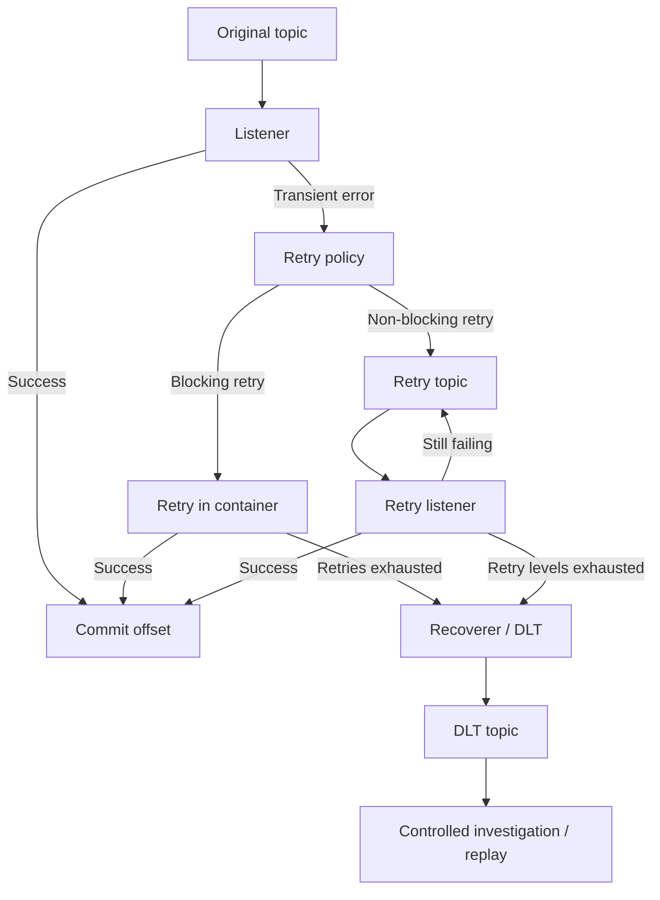

# Monitoring retries and dead letters

Retries help consumers recover from transient errors. Dead-letter topics (DLTs) retain records that cannot be processed after the retry policy finishes or when an error is classified as non-retryable. However, simply configuring retries and a DLT is not enough for safe operations: teams need to know which attempt a record is on, whether retries are spiking abnormally, whether retry topics are backing up, and whether DLTs are accumulating records requiring investigation.

In Spring Kafka, observability for retries and dead letters requires combining listener/container metrics, Kafka consumer metrics, structured logs, trace context, and DLT handling workflows. Each signal answers a different question: metrics show trends, logs tell what happened to a specific record, traces show the path across services, and DLTs store records for analysis and recovery.

## 1. Viewing the entire lifecycle of a record

With blocking retry, records are typically retried within the listener container's processing flow. Once retries are exhausted, a recoverer can write the record to a DLT. With non-blocking retry, Spring Kafka forwards the record across retry topics on a backoff schedule; once all retry levels are exhausted, the record is sent to the DLT.



When designing observability, separate these distinct events:

- A listener invocation.
- A processing failure.
- A retry execution.
- A publish to a retry topic.
- A record routed into a DLT.
- A record read and handled from a DLT.
- A record replayed from a DLT back into the processing flow.

These numbers are not identical. For example, a listener counter incremented every time the listener fails does not necessarily equal the number of retries executed: the very first failure is not yet a retry, and a record may be forwarded to a retry topic without re-invoking the original listener.

## 2. Key metrics to monitor

A retry/DLT dashboard should include the following metric groups:

| Group | Suggested metrics | Questions to answer |
|---|---|---|
| Listener | Invocation count, success/failure, processing duration | Is the listener failing or slower than normal? |
| Retry | Retry count, retry rate, retry publish count | How many records need retries and is the trend rising? |
| Retry topic | Consumer lag, pending record count, oldest record age | Are retries backing up or falling behind schedule? |
| DLT | New records entering DLT, backlog, oldest record age | Are there unprocessable records needing intervention? |
| Consumer | Lag by group/partition, rebalances, poll duration | Is the consumer keeping up with original and retry topics? |
| Dependency | DB/API latency, timeouts, 429/5xx, connection pool | Are retries caused by a downstream issue? |
| JVM | Heap, GC pauses, thread pools, CPU | Are retries or backlogs exhausting resources? |

Do not track only total record counts. A DLT receiving 10 new records in one minute can be more severe than 10,000 old records already triaged and scheduled for processing. Track ingress rate, backlog age, and business impact together.

## 3. Measuring listener errors and processing duration

Spring Kafka supports metrics/observations for listener containers and `KafkaTemplate` depending on version. Alongside framework-provided metrics, applications should measure business processing time separately to distinguish listener overhead from database or API call time.

Example using Micrometer `Timer` to measure an event-processing service:

```java
@Service
public class OrderProcessingService {

    private final MeterRegistry registry;
    private final OrderRepository repository;

    public OrderProcessingService(
            MeterRegistry registry,
            OrderRepository repository) {
        this.registry = registry;
        this.repository = repository;
    }

    public void process(OrderEvent event) {
        Timer.Sample sample = Timer.start(registry);
        String outcome = "success";

        try {
            repository.apply(event);
        }
        catch (RuntimeException ex) {
            outcome = "failure";
            throw ex;
        }
        finally {
            sample.stop(
                    Timer.builder("app.kafka.order.processing")
                            .description("Business processing time for order events")
                            .tag("outcome", outcome)
                            .register(registry)
            );
        }
    }
}
```

This timer records business processing duration split by success/failure outcome. If the listener retries a record, each service call records its own observation. When analyzing latency, clarify whether you want to measure a single attempt or total elapsed time from initial receipt to completion.

Supplement this with counters for failures and completed events. For retries, do not name a counter `retry.count` if it actually counts every listener exception; metric names must accurately reflect the measured event.

## 4. Counting retries accurately

To count retries, determine the exact point of recording. You can use container delivery-attempt metadata, instrumentation around the error handler, or retry-topic metadata/headers. Implementation depends on whether blocking or non-blocking retry is used and your Spring Kafka version.

With blocking retry, the container can be configured to include the delivery attempt in a header:

```java
@Bean
ConcurrentKafkaListenerContainerFactory<String, OrderEvent>
orderListenerFactory(
        ConsumerFactory<String, OrderEvent> consumerFactory) {

    var factory =
            new ConcurrentKafkaListenerContainerFactory<String, OrderEvent>();

    factory.setConsumerFactory(consumerFactory);
    factory.getContainerProperties().setDeliveryAttemptHeader(true);

    return factory;
}
```

When enabled, the listener can read the delivery attempt from the message header using the Spring Kafka API for your version. This value represents the delivery/attempt count in the container; verify how your specific version numbers attempts before converting it to a retry count.

With non-blocking retry, records travel through retry topics and retry headers are managed by the framework. When displaying attempt counts, read retry metadata per your Spring Kafka version's contract, or emit metrics where the application controls forwarding. Do not guess header names or assume a blocking-retry header has identical semantics in a retry-topic flow.

At minimum, distinguish:

- `listener.failures`: number of times a listener threw an error.
- `retry.scheduled`: number of times a record was scheduled/routed for retry.
- `retry.attempts`: number of actual retry executions.
- `retry.exhausted`: number of records that exhausted the retry policy.

If you cannot measure each category precisely, document the metric definition clearly in dashboards and operational runbooks instead of merging them into one ambiguous number.

## 5. Monitoring retry topics and consumer lag

With non-blocking retry, each retry topic is a real Kafka topic. Monitor the retry listener's consumer group just like the original topic:

- Lag per retry topic and partition.
- Pending record count.
- Age of the oldest record.
- Input/output throughput per retry topic.
- Time from when a record is sent to a retry topic until it is reprocessed.
- Retry listener errors and failures when publishing to the next retry level.

High consumer lag does not automatically mean the retry policy is broken. A retry topic may be receiving records faster than it can process them, the consumer group may lack instances, a downstream dependency may be down, or backoff delays mean records are not yet due for processing. Combine lag with record age and dependency health.

For blocking retry, there is no separate retry topic for lag measurement. Instead, monitor listener duration, redelivery counts, poll duration, lag on the original topic, and how long the container is occupied in error handling.

## 6. Monitoring DLT as a dedicated business flow

A DLT is not a trash bin to forget about. Every record in a DLT needs enough information to answer:

- Which original topic, partition, and offset did the record come from?
- Which consumer group processed the record?
- What exception class occurred and at which step?
- How many times did the record retry or which retry topics did it traverse?
- Which event ID/correlation ID links it to the original business flow?
- Can it be replayed safely after a fix, or does it require a compensating action?

DLT metrics should include:

| Metric | Meaning |
|---|---|
| DLT ingress rate | Rate of new records sent to the DLT |
| DLT backlog | Number of records not yet processed/investigated |
| DLT oldest age | Age of the oldest unaddressed record |
| DLT handler failures | Number of failures while processing DLT records |
| DLT replay count | Number of records replayed |
| DLT replay failures | Number of failed replays |

DLT ingress and DLT handler throughput are two separate metrics. A topic may receive records steadily without any investigating consumer, causing the backlog to grow indefinitely. Conversely, a DLT handler may read records yet fail to persist them into an incident-tracking system.

## 7. Structured logging for retries and DLTs

Logs should contain enough metadata for investigation without dumping full payloads. A useful log entry usually includes:

| Field | Purpose |
|---|---|
| `eventId` | Trace the same event across producer, retry, and DLT |
| `topic` | Current topic |
| `originalTopic` | Initial source topic |
| `partition`, `offset` | Locate the record in Kafka |
| `consumerGroup`, `listenerId` | Identify the processing flow |
| `attempt` | Delivery/processing attempt if metadata is reliable |
| `exceptionClass` | Error classification |
| `outcome` | `success`, `retry`, `recovered`, or `dlt` |
| `correlationId`, `traceId` | Correlate logs across services |
| `durationMs` | Processing duration |

Structured logging example with SLF4J:

```java
log.warn(
        "Kafka record processing failed eventId={} topic={} partition={} offset={} listener={} exceptionClass={}",
        event.eventId(),
        record.topic(),
        record.partition(),
        record.offset(),
        "orders-listener",
        ex.getClass().getSimpleName(),
        ex
);
```

This example assumes the listener receives `ConsumerRecord` for metadata and `event` exposes `eventId()`. If the listener receives payloads directly, use Spring Kafka headers or accept `ConsumerRecordMetadata` according to the appropriate listener signature.

Do not put event ID, order ID, customer ID, exception message, or trace ID into high-cardinality metric tags. Those belong in logs/tracing; metrics should use bounded-value labels such as listener, topic, outcome, and standardized exception class.

Avoid writing sensitive payloads or credentials into logs. For repeatedly failing errors, log full details on the first and final attempts while relying on metrics or log sampling in between to prevent log storms.

## 8. Reading record metadata in a DLT

Spring Kafka attaches headers when forwarding records to a DLT to preserve origin and exception details. These headers can include original topic/partition/offset and exception info depending on recoverer mechanism, version, and configuration.

You can accept the full `ConsumerRecord` in a DLT handler to inspect them:

```java
@Component
public class OrderDltListener {

    private final MeterRegistry registry;
    private final DltCaseService dltCaseService;

    public OrderDltListener(
            MeterRegistry registry,
            DltCaseService dltCaseService) {
        this.registry = registry;
        this.dltCaseService = dltCaseService;
    }

    @DltHandler
    public void handle(ConsumerRecord<String, OrderEvent> record) {
        Counter.builder("app.kafka.dlt.received")
                .tag("topic", record.topic())
                .register(registry)
                .increment();

        dltCaseService.save(
                record.key(),
                record.value(),
                record.topic(),
                record.partition(),
                record.offset(),
                record.headers()
        );
    }
}
```

The counter above counts records received by the DLT handler, not necessarily successful DLT publishes on the recoverer side. If you need to measure DLT publish success/failure separately, instrument around the recoverer or DLT send callback to record the exact moment publishing is confirmed.

When persisting headers, retain metadata needed for investigation and strip unnecessary or sensitive data. Do not blindly serialize all headers if internal headers, credentials, or oversized payloads may be present.

## 9. Correlation ID and distributed tracing

An event can pass through multiple services, retry topics, and DLTs. Correlation IDs find all logs related to a business flow; trace IDs link spans within a distributed trace.

The two IDs serve different purposes:

- **Correlation ID:** identifies a business flow or request and can outlive a single trace.
- **Trace ID:** identifies a distributed trace; a long-running workflow can span multiple traces or spans depending on instrumentation.

Spring Kafka supports Micrometer Observation for producers and listeners in supported versions. When observation is enabled and integrated with a compatible Micrometer Tracing/OpenTelemetry bridge, trace context can propagate across Kafka headers.

Example enabling observation on listener container and template in Spring Kafka versions supporting this API:

```java
@Bean
ConcurrentKafkaListenerContainerFactory<String, OrderEvent>
orderListenerFactory(
        ConsumerFactory<String, OrderEvent> consumerFactory) {

    var factory =
            new ConcurrentKafkaListenerContainerFactory<String, OrderEvent>();

    factory.setConsumerFactory(consumerFactory);
    factory.getContainerProperties().setObservationEnabled(true);

    return factory;
}

@Bean
KafkaTemplate<String, OrderEvent> orderKafkaTemplate(
        ProducerFactory<String, OrderEvent> producerFactory) {

    KafkaTemplate<String, OrderEvent> template =
            new KafkaTemplate<>(producerFactory);

    template.setObservationEnabled(true);
    return template;
}
```

Observation APIs and auto-configuration depend on your Spring Kafka/Spring Boot version. Verify your project's versions and ensure `ObservationRegistry` and a tracing bridge are configured. Enabling observation without a suitable exporter or tracing bridge may create internal observations without exporting traces to your observability backend.

When a record moves to a retry topic, the trace may continue or start a new span/trace depending on instrumentation and timing. Do not assume a single trace always stays open across multi-hour retry waits. Keep a stable correlation ID in the event/headers so business flows remain traceable after a trace ends.

## 10. Distinguishing transient errors from non-retryable errors

Metrics grouped by exception class identify which errors are driving retries. However, exception names should be normalized into stable categories:

| Error category | Examples | Focus of observation |
|---|---|---|
| Transient dependency | DB timeout, HTTP 503 | Retry rate, dependency latency, recovery time |
| Rate limit | HTTP 429 | Retry delay, throttled request count |
| Invalid data | Missing required field, schema mismatch | Non-retryable count, DLT ingress |
| Business error | Invalid order state | DLT grouped by error code and business type |
| Config/permission error | ACL, authentication, serializer | Error rate, broker/client logs, DLT if recovered |

If every exception is retried, retry metrics can spike without aiding recovery. For unrecoverable data errors, retries only delay DLT routing and add load.

Monitor error rates by category and verify classification in the error handler or `@RetryableTopic` to ensure errors are routed accurately.

## 11. Retry and DLT dashboard

A practical dashboard should be organized into four areas:

**Main flow health**

- Records entering the original topic per minute.
- Listener success/failure rates.
- p50/p95/p99 processing duration.
- Consumer lag by group and partition.

**Retry health**

- Retry attempts and retries scheduled by listener/topic.
- Throughput of each retry topic.
- Lag and oldest record age in retry topics.
- Retry-exhausted counts.

**DLT health**

- DLT ingress rate.
- DLT backlog and oldest age.
- Breakdown by exception class/error code.
- Records investigated, replayed, or marked unrecoverable.

**Dependency health**

- Database/API latency and error rates.
- Connection pool usage.
- Circuit breaker state.
- Thread pool saturation, heap, and GC.

Provide dashboard variables for environment, service, consumer group, and topic. When viewing a metric spike, operators should be able to drill down to logs/traces via the corresponding event ID or correlation ID.

## 12. Designing actionable alerts

Do not alert just because a single record retried once. Retries are normal in distributed systems. Alerts should be based on rates, sustained duration, backlogs, and business impact.

Example alert policy:

| Condition | Suggested severity | Action |
|---|---|---|
| Retry failure rate climbs continuously for several minutes | Warning | Inspect dependencies and exception categories |
| Retry topic oldest age exceeds SLA | Warning/Critical | Check consumer lag and backoff |
| DLT ingress > 0 in a critical payment flow | Warning or Critical per SLO | Investigate the record and root error |
| DLT backlog grows continuously | Critical | Assign DLT triage and check replay readiness |
| DLT handler fails repeatedly | Critical | Check DLT storage/consumer health |
| Consumer lag grows alongside downstream 5xx | Warning | Throttle consumers and restore downstream dependency |
| Pause duration exceeds operational limit | Warning | Inspect backpressure and resume conditions |

Exact thresholds must align with SLOs and business characteristics. A telemetry topic may tolerate a small DLT trickle; for a payment settlement event, a single DLT record may require immediate investigation.

Every alert needs an owner and a runbook. Alerts without an owner or clear first diagnostic steps only create noise.

## 13. Investigating a record in the DLT

When a new record enters the DLT, follow a consistent procedure:

1. Identify original topic, partition, offset, consumer group, and event ID.
2. Read the exception class, error code, and retry metadata.
3. Inspect logs/traces by correlation ID.
4. Classify the failure as data, business logic, dependency, or configuration.
5. Decide whether to fix data, deploy a code fix, wait for a dependency, or mark unrecoverable.
6. Check whether any side effects were already executed before the failure occurred.
7. Choose the appropriate replay method and record an audit entry.
8. Monitor post-replay results and confirm the backlog shrinks.

Do not modify a DLT payload without preserving the original record and an audit trail. If an event must be transformed, record the data version, operator, and reason. For uncorrectable business errors, a compensating command or operational intervention may be needed instead of replaying the raw record.

## 14. Replaying DLT records safely

Replay re-emits a record; it does not erase past side effects from the system. During replay, consumers may re-execute partial side effects that occurred before the record entered the DLT. Therefore:

- Keep `eventId` stable so idempotent consumers recognize already-processed records.
- Inspect databases/APIs before replaying if the prior attempt's outcome was uncertain.
- Replay to the original topic or a dedicated recovery topic per the defined runbook.
- Rate-limit replays to avoid overloading downstream dependencies.
- Log the operator, timestamp, record count, and outcome.
- Prevent unbounded DLT → replay → DLT loops.

When replaying a large batch, split it into small chunks and watch lag, error rates, and DLT ingress while running. Pause replay if error rates climb or downstream capacity runs out.

## 15. Controlling cardinality and protecting data

Metrics backends perform poorly when every tag value creates a new time series. Never use these values as metric tags:

- Event ID, order ID, customer ID.
- Correlation ID or trace ID.
- Exception messages containing dynamic content.
- Unbounded Kafka keys.
- URLs with path parameters or payload fields.

Use logs or traces to store detailed identifiers. Metrics should only use bounded-value labels such as service, listener ID, allowlisted topics, outcome, or standardized exception class.

Do not log full payloads when events contain personal data, tokens, payment details, or business secrets. DLTs can also retain payloads longer than main topics; DLT retention and access control must be governed like sensitive data.

## 16. Testing observability for retries and DLTs

Tests should verify not only that records retry or land in the DLT, but also that observability signals are emitted properly:

1. Successful listener execution increments success count and records processing duration.
2. Failing listener execution increments failure count with the right outcome.
3. Retry counters reflect actual attempts according to defined semantics.
4. Records routed to retry topics appear on the expected topic and consumer group.
5. Retry-topic lag and oldest age are observable.
6. When retries are exhausted, DLT ingress is recorded.
7. The DLT handler captures origin metadata and exception details.
8. Trace/correlation IDs are preserved or linked across steps.
9. Replays increment replay counts without duplicating side effects.
10. Metrics do not create high cardinality as event IDs vary.
11. Alert rules fire when backlog/age crosses thresholds and resolve once cleared.

For custom metrics, use `SimpleMeterRegistry` to test counters/timers in unit tests. For real listeners, retry topics, and DLTs, use Embedded Kafka or Testcontainers for integration tests. Do not merely mock the recoverer and assume DLT broker publishing works.

## 17. Operational checklist

- [ ] Listener failure, retry attempt, retry scheduled, and DLT ingress are clearly defined.
- [ ] Success/failure metrics and processing duration timers are in place.
- [ ] Retry rate, retry exhausted, and per-retry-topic consumer lag are tracked when using non-blocking retry.
- [ ] DLT ingress, backlog, oldest age, and DLT handler failures are monitored.
- [ ] Logs include event ID, topic, partition, offset, listener, and exception class.
- [ ] Correlation ID stays consistent across retries and replays.
- [ ] Trace context is instrumented if distributed tracing is enabled.
- [ ] Metric tags have bounded cardinality with no dynamic IDs.
- [ ] Sensitive payloads and headers are not logged indiscriminately.
- [ ] Dashboards distinguish original topics, retry topics, and DLTs.
- [ ] Alerts have SLO-based thresholds, owners, and runbooks.
- [ ] Investigation and replay procedures include auditing, rate limits, and idempotency.
- [ ] Metrics, logs, traces, DLTs, and replays are tested against a test broker.

Monitoring retries and dead letters turns recovery mechanisms into an observable, operable workflow. Measure each event accurately, track lag and record age on retry topics, treat the DLT as an actionable triage queue, and link metrics to logs and traces via event/correlation IDs. With dashboards, alerts, and safe replay workflows, teams can detect dependency degradation early, handle failing records responsibly, and recover messaging flows without losing or duplicating business side effects.

