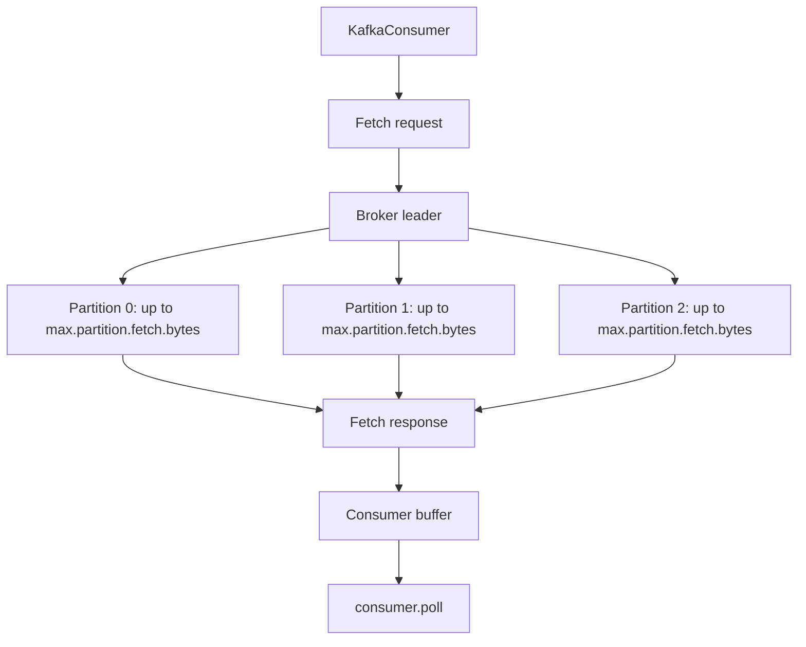

# `max.partition.fetch.bytes`

A Kafka consumer pulls data from the broker using fetch requests. One request can request data from multiple partitions, and each partition has a limit on how much data the broker returns. `max.partition.fetch.bytes` controls the per-partition limit within a fetch response. This parameter directly impacts the ability to consume large records, throughput, latency, and the memory the consumer must reserve.

In Spring Kafka, the parameter is passed to the Kafka consumer via `ConsumerFactory` or `spring.kafka.consumer.properties`. To tune it properly, distinguish it from `fetch.max.bytes` (total response limit), `fetch.min.bytes` (data threshold for the broker to consider returning a response), and `max.poll.records` (limit on records returned from a single `poll()`).

## 1. What does `max.partition.fetch.bytes` limit?

The Kafka consumer sends fetch requests to the broker holding the leaders of its assigned partitions. In the request, the consumer specifies the maximum amount of data it wants to receive per partition. `max.partition.fetch.bytes` is the byte limit for data returned from one partition in a single fetch response.

For example, suppose a consumer is assigned 4 partitions and `max.partition.fetch.bytes` is set to 2 MiB. Each partition can contribute up to roughly 2 MiB of data to the response under this limit, depending on available data and the overall `fetch.max.bytes` limit. The broker does not necessarily return a full 2 MiB for every partition; if a partition has few records or no new data, the response can be smaller.



This parameter is a per-partition limit, not a total memory limit for the entire consumer and not a record count limit. It usually needs to be evaluated alongside the number of partitions assigned to the consumer, record batch size, number of consumers in the application, and overall fetch settings.

## 2. Distinguishing fetch and poll parameters

These similarly named parameters control different parts of the consumption pipeline:

| Parameter | Scope | Effect |
|---|---|---|
| `max.partition.fetch.bytes` | Each partition in a fetch response | Limits bytes of data the broker returns for one partition in one response. |
| `fetch.max.bytes` | Total fetch response | Limits total bytes of data the broker returns in one fetch response. |
| `fetch.min.bytes` | Condition to return fetch response | Broker may wait for more data until the minimum byte threshold or wait timeout is reached. |
| `fetch.max.wait.ms` | Fetch wait time | Limits how long the broker waits to satisfy `fetch.min.bytes` before returning a response. |
| `max.poll.records` | A single `poll()` | Limits maximum records returned to the application in one poll; not a byte limit on fetch responses. |
| `max.poll.interval.ms` | Gap between two polls | Limits how long the consumer can process between two polls before being considered stalled. |

The two byte limits are usually tuned together. If `max.partition.fetch.bytes` is large but `fetch.max.bytes` is too low, total responses are still constrained by `fetch.max.bytes` under normal conditions. If `fetch.max.bytes` is large while the per-partition limit is low, a single partition may not contribute as much data as desired.

`fetch.min.bytes` and `fetch.max.wait.ms` are batch-accumulation controls. Under high traffic, the broker can reach the minimum byte threshold quickly. Under low traffic, the broker may wait up to `fetch.max.wait.ms`, increasing latency. Neither parameter increases the maximum size of a record batch.

`max.poll.records` limits the number of records the application receives in one poll. The consumer may already have fetched data into its buffer and only return a portion of records in the current poll; the remainder can be returned in subsequent polls. Therefore, increasing `max.partition.fetch.bytes` does not mean the listener always receives more records per invocation.

## 3. Exception so the consumer can still make progress

The `max.partition.fetch.bytes` limit is not an absolute barrier for the first record batch. If the first batch in the first non-empty partition of a fetch response is larger than the configured limit, Kafka can still return that batch so the consumer does not get stuck and can keep reading the log.

`fetch.max.bytes` has a similar exception: if the first batch needed to make progress exceeds the total response limit, the broker can still return that batch. Therefore:

- Do not treat `max.partition.fetch.bytes` as a mechanism to reject oversized messages.
- The consumer can still receive a batch exceeding the configuration when needed to guarantee progress.
- Actual memory usage can exceed simple estimates based on fetch limits.
- Producers and brokers still need appropriate message size limits to prevent oversized payloads.

If a record batch exceeds what the application can handle, solve it in payload design and producer/broker limits rather than expecting the consumer fetch limit to filter it out. For example, store large files in object storage and send only the URI, checksum, and metadata through Kafka.

## 4. Configuration in Spring Boot

Spring Boot forwards properties in `spring.kafka.consumer.properties` to the Kafka consumer. For Kafka properties containing dots, bracketed map keys in YAML can preserve the exact names:

```yaml
spring:
  kafka:
    bootstrap-servers: ${KAFKA_BOOTSTRAP_SERVERS:localhost:9092}
    consumer:
      group-id: order-consumer
      max-poll-records: 300
      properties:
        "[max.partition.fetch.bytes]": 2097152
        "[fetch.max.bytes]": 52428800
        "[fetch.min.bytes]": 65536
        "[fetch.max.wait.ms]": 100
```

In this example, the per-partition limit is 2 MiB, total fetch response is 50 MiB, and the broker is asked to gather at least 64 KiB of data and wait at most 100 ms to meet that threshold. This is only an illustrative configuration; production values must be based on record size, partition count, target latency, and actual memory.

If creating `ConsumerFactory` manually, you can set properties directly using Kafka client constants:

```java
Map<String, Object> props = new HashMap<>();
props.put(ConsumerConfig.BOOTSTRAP_SERVERS_CONFIG, bootstrapServers);
props.put(ConsumerConfig.GROUP_ID_CONFIG, "order-consumer");
props.put(ConsumerConfig.KEY_DESERIALIZER_CLASS_CONFIG, StringDeserializer.class);
props.put(ConsumerConfig.VALUE_DESERIALIZER_CLASS_CONFIG, OrderEventDeserializer.class);
props.put(ConsumerConfig.MAX_PARTITION_FETCH_BYTES_CONFIG, 2 * 1024 * 1024);
props.put(ConsumerConfig.FETCH_MAX_BYTES_CONFIG, 50 * 1024 * 1024);

ConsumerFactory<String, OrderEvent> consumerFactory =
        new DefaultKafkaConsumerFactory<>(props);
```

Ensure the listener container actually uses the configured `ConsumerFactory`. If the application has multiple factories for different listener groups, each factory may need its own fetch limits based on message size and topic load characteristics.

## 5. Choosing a value by record batch size

To choose `max.partition.fetch.bytes`, first know the actual record batch sizes the consumer must read. Kafka stores records in batches; the size on the wire can differ from the payload size after decompression and deserialization.

A selection process:

1. Measure p50, p95, p99, and maximum valid record batch sizes.
2. Identify the largest batch the consumer must process normally, including headers or schema metadata.
3. Choose a per-partition limit sufficient to fetch efficiently given the expected batch size.
4. Choose `fetch.max.bytes` large enough for total data needed in one response when multiple partitions are present.
5. Account for the number of partitions assigned per consumer and concurrent consumers in an instance.
6. Measure heap, GC, fetch latency, and consumer lag under representative load before raising limits further.

For example, if most record batches are under 256 KiB and p99 is under 1 MiB, setting `max.partition.fetch.bytes` to 2 MiB provides reasonable headroom. If valid batches of 8 MiB exist, a 1 MiB setting should not be viewed as blocking them; the consumer has the first-batch exception. Decide explicitly whether the application truly needs to support 8 MiB batches or should change how payloads are represented.

Do not set an arbitrarily huge value just to avoid measuring sizes. Large fetch responses can increase buffered data, deserialization time, batch processing time, and GC pressure. A consumer assigned many partitions can hold data from many partitions simultaneously.

## 6. Estimating memory impact

`max.partition.fetch.bytes` is not a hard heap limit. It is only one part of the fetch data limiting mechanism. For planning, you can use a conservative initial estimate:

\[
M_{fetch} \approx P_{assigned} \times F_{partition}
\]

Where:

- `P_assigned` is the number of partitions assigned to one consumer.
- `F_partition` is the value of `max.partition.fetch.bytes`.
- `M_fetch` is a rough estimate of fetched data based on the per-partition limit, not a guaranteed maximum heap figure.

The overall `fetch.max.bytes` cap usually lowers total response size below the product above, yet first-batch exceptions and in-flight fetches keep this from being a guaranteed bound. Beyond fetched bytes, the application also retains deserialized objects, records actively processed by the listener, intermediate batches, and data in internal queues.

If payloads are compressed, bytes over the network can be substantially smaller than decompressed data. Therefore, measure heap after deserialization and in-flight record counts, not just fetch response size. Multiple consumers in the same JVM also multiply active buffers and objects.

For example, an instance has 4 consumers, each assigned 12 partitions, with a 2 MiB per-partition limit. The rough multiplication gives 24 MiB per consumer, or 96 MiB for 4 consumers before counting overhead, decompression, Java objects, and downstream work. This is a scale warning for planning, not a precise heap forecast.

## 7. Relationship with producer and broker limits

Consumer fetch is only one link in the size-limit chain. A record batch must be created by the producer, accepted by the broker, and replicable by replicas before the consumer reads it.

| Component | Related property | Role |
|---|---|---|
| Producer | `max.request.size` | Limits request size sent by producer; should align with actual batches and requests. |
| Broker | `message.max.bytes` | Limits record batch size accepted by the broker at broker level. |
| Topic | `max.message.bytes` | Can override batch size limit for a specific topic. |
| Broker replica | `replica.fetch.max.bytes` | Limits data fetch size for replication between leader and follower. |
| Consumer | `max.partition.fetch.bytes` | Limits desired data per partition in a fetch response. |
| Consumer | `fetch.max.bytes` | Limits desired total data in a fetch response. |

If a producer sends a batch exceeding the broker/topic limit, the broker may reject it before the consumer ever sees it. If replicas cannot fetch the batch due to mismatched settings, replication and ISR health can suffer. If the consumer has a small fetch limit, Kafka still has the first-batch exception to make progress, but an overly low setting can make fetching inefficient and cause memory surprises.

When supporting large messages, align limits across producer, broker, topic, replication, and consumer. Test the largest valid record, not just average records. Also enforce business-level payload limits to prevent a producer from sending unbounded data.

## 8. Tuning by load scenario

| Scenario | Symptom | Tuning direction |
|---|---|---|
| Small records, high throughput | Consumer fetches very frequently, broker always has data | Consider raising `fetch.min.bytes` or `fetch.max.bytes` if CPU/network round trips are the bottleneck; measure latency before and after. |
| Large record batches | Fetches fragmented or consumer must support large batches | Raise `max.partition.fetch.bytes` and align `fetch.max.bytes`, broker/topic, and producer limits. |
| Low-traffic topic, latency priority | Consumer waits for fetch to meet byte threshold | Lower `fetch.min.bytes` or `fetch.max.wait.ms` to respond sooner. |
| Rising heap or GC | Many partitions and consumers holding large payloads simultaneously | Lower fetch limits, concurrency, or batch size; review large payloads and internal queues. |
| Consumer lag rising despite large fetch responses | Bottleneck is in deserialization, listener, or downstream | Optimize processing, adjust concurrency/partitions, and inspect dependencies; do not keep raising fetch limits blindly. |

Change each related parameter group deliberately and measure results. Raising `max.partition.fetch.bytes` does not help if the listener is slow or the database is saturated. Conversely, lowering the limit too much can force the consumer into more fetch round trips to pull the same amount of data.

## 9. Relationship with `max.poll.records` and processing time

Fetch byte limits govern how much data the client receives from the broker; `max.poll.records` governs the maximum records returned to the application per poll. Both limits work together without replacing each other.

For example, the consumer fetches 10 MiB of data from the broker while `max.poll.records` is only 100. One `poll()` returns at most 100 records; the remaining data stays buffered for subsequent polls. Conversely, `max.poll.records` of 1,000 does not force the broker to return 1,000 records if byte limits, available data, or fetch timing do not allow it.

If the listener processes sequentially, batches with many records or large payloads can extend processing time. Monitor p95/p99 listener duration and ensure the interval between polls does not exceed `max.poll.interval.ms`. When using a batch listener, evaluate both record count and total batch bytes because 100 small records and 100 large records have very different costs.

## 10. Monitoring fetch performance

Do not evaluate `max.partition.fetch.bytes` solely by its configured value. Observe:

- Fetch size and fetch latency per consumer.
- Records and bytes received per poll.
- Consumer lag per partition.
- Deserialization time and listener processing latency.
- Heap usage, allocation rate, and garbage collection.
- Assigned partitions per consumer and active consumer count.
- Rate of large record batches, message size errors, and broker request errors.
- Processing speed of databases or downstream services.

If fetch size regularly hits the limit while the consumer has spare capacity, try increasing fetch limits. If fetch size is already large yet lag keeps growing, look for bottlenecks after fetch. If heap scales up with partition count and concurrency, reduce buffers or limit consumers/partitions per instance.

## 11. Testing fetch limits

Integration tests with Embedded Kafka can verify that the consumer reads large records and respects fetch settings. Create records near the application's accepted limit, send them via a producer, and verify the consumer receives the full payload.

Cases to test:

1. Record batches smaller than `max.partition.fetch.bytes` are read normally.
2. Record batches larger than the configured limit yet accepted by the broker can still be read by the consumer via the first-batch exception; verify exact behavior for your Kafka version.
3. Records exceeding producer or broker/topic limits are rejected at the send layer, not mistaken for consumer fetch errors.
4. Multiple partitions simultaneously holding large data do not push heap past the allocated budget.
5. `max.poll.records` caps returned records even when the fetch buffer holds more data.
6. Consumer lag and listener latency are measured when raising or lowering fetch limits.
7. Compressed payloads are checked for both wire size and post-deserialization memory.

An embedded broker is suitable for verifying basic behavior. To evaluate throughput, heap, and GC under production load, test against a cluster with representative data sizes; an embedded broker does not fully simulate replication, networking, and distributed load.

`max.partition.fetch.bytes` is a per-partition fetch limit that must be tuned alongside `fetch.max.bytes`, `max.poll.records`, producer/broker message limits, and memory budgets. Pick values based on actual batch sizes and partitions per consumer, then measure fetch latency, consumer lag, listener latency, and heap to strike a balance between throughput, latency, and stability.
