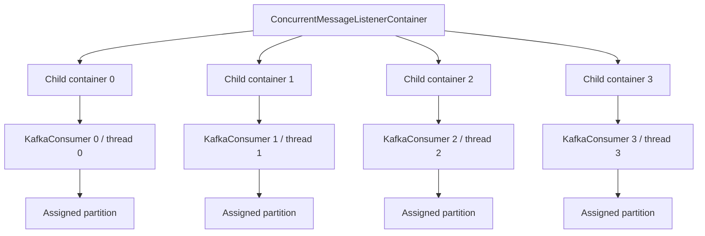

# Optimizing Concurrency

In Spring Kafka, `concurrency` determines how many consumer workers a listener container creates to read and process records in parallel. Increasing concurrency can increase throughput when the topic has enough partitions and the application has spare resources. If workers exceed assignable partitions, some workers sit idle; if increased too aggressively when the database, CPU, or dependencies are already saturated, latency and rebalances can climb without throughput gains.

Therefore, optimizing concurrency starts with three questions: how many partitions the topic has, how many consumer instances exist across the entire consumer group, and where the current bottleneck lies. `concurrency` is a consumer-side knob; it does not create more partitions and does not allow one partition to be processed concurrently by multiple consumers in the same group.

## 1. How does Spring Kafka create consumer workers?

Spring Kafka provides two primary listener containers:

- `KafkaMessageListenerContainer` uses one `KafkaConsumer` and processes on a single consumer thread.
- `ConcurrentMessageListenerContainer` manages multiple child `KafkaMessageListenerContainer` instances for parallel consumption.

When `concurrency = 4` is set, the concurrent container creates four child containers, each with its own consumer and its own thread. The Kafka group coordinator distributes partitions among these consumers when the listener subscribes by topic or topic pattern.



Each consumer thread can receive multiple partitions. However, in a standard consumer group, one partition at a time is assigned to at most one consumer member. Records from the same partition therefore continue to be read in offset order and processed sequentially in the default listener flow. Concurrency creates parallelism across partitions; it does not split one partition into multiple independent processing threads.

## 2. Limiting concurrency by partition count

For a topic with `P` partitions and a consumer group with `C` consumer members, the number of consumers that can actively receive data is capped by the partition count:

```text
consumer members = application instances × concurrency per instance
max active consumers ≤ min(consumer members, partition count)
```

For example, topic `orders` has 12 partitions:

| Application instances | Concurrency per instance | Total consumer members | Consumers with partitions |
|---:|---:|---:|---:|
| 1 | 1 | 1 | 1 |
| 1 | 4 | 4 | 4 |
| 3 | 4 | 12 | 12 |
| 3 | 8 | 24 | At most 12; remaining sit idle |

When there is only one partition, raising concurrency from 1 to 8 does not make eight threads process that partition concurrently. To increase parallel processing capacity for a consumer group, there must be enough partitions and data reasonably distributed across them.

If a consumer receives multiple partitions, it processes records from those partitions on the same consumer thread. Thus, when concurrency is lower than partition count, each consumer typically handles multiple partitions. This can still achieve good throughput if the record rate is moderate and the listener is not blocked.

## 3. Configuring concurrency in Spring Boot

For the default listener container auto-configured by Spring Boot, you can set concurrency via `spring.kafka.listener.concurrency`:

```yaml
spring:
  kafka:
    bootstrap-servers: localhost:9092
    consumer:
      group-id: order-service
      max-poll-records: 100
    listener:
      concurrency: 4
```

This value is the default concurrency for listener containers created by Boot. If the application declares `ConcurrentKafkaListenerContainerFactory` manually, configure it directly:

```java
@Bean
ConcurrentKafkaListenerContainerFactory<String, Order> ordersFactory(
        ConsumerFactory<String, Order> consumerFactory) {

    var factory = new ConcurrentKafkaListenerContainerFactory<String, Order>();
    factory.setConsumerFactory(consumerFactory);
    factory.setConcurrency(4);
    factory.getContainerProperties().setPollTimeout(1_000L);
    return factory;
}
```

Then select the factory on the listener:

```java
@KafkaListener(
        id = "ordersListener",
        topics = "orders",
        groupId = "order-service",
        containerFactory = "ordersFactory"
)
public void consume(Order order) {
    orderService.process(order);
}
```

If only one listener needs different concurrency, override it right on the annotation:

```java
@KafkaListener(
        id = "priorityOrdersListener",
        topics = "priority-orders",
        groupId = "order-service",
        concurrency = "6"
)
public void consumePriority(Order order) {
    priorityOrderService.process(order);
}
```

`@KafkaListener(concurrency = "...")` accepts literal values, property placeholders, or SpEL. When set on the annotation, that value overrides the factory's default concurrency for that endpoint.

## 4. Calculating total consumers across multiple application instances

Concurrency is counted per listener container in each application instance. If three pods are deployed and each pod has concurrency four for the same `group.id`, Kafka sees 12 consumer members total in the group.

Example:

```text
order-service pod-1: concurrency=4 -> consumer 1, 2, 3, 4
order-service pod-2: concurrency=4 -> consumer 5, 6, 7, 8
order-service pod-3: concurrency=4 -> consumer 9, 10, 11, 12

Total consumer members in group = 3 × 4 = 12
```

If the topic has 12 partitions, each member can receive one partition. If the topic has only six partitions, at most six members receive partitions; the remaining six members have no data to process. When autoscaling pods, multiply concurrency by the maximum replica count rather than looking at a single pod's config.

Listeners using different group IDs distribute partitions independently. Do not sum concurrency across two groups to compare against partition count as if they shared one consumer pool; each group can read the entire topic independently.

## 5. Choosing an appropriate partition assignment strategy

When subscribing by topic, Kafka uses `ConsumerPartitionAssignor` to distribute partitions across consumer members. The default `RangeAssignor` assigns per topic. With multiple topics having the same partition count, this can leave many consumers idle even when total partitions are large enough.

For example, three topics each have five partitions and listener concurrency is 15:

```text
RangeAssignor:
  consumer 0..4: each consumer receives 1 partition from all 3 topics
  consumer 5..14: no partitions assigned

RoundRobinAssignor:
  partitions of 3 topics are distributed round-robin across 15 consumers
  can utilize all 15 consumers
```

This is a case where `RoundRobinAssignor` should be considered:

```yaml
spring:
  kafka:
    consumer:
      properties:
        "[partition.assignment.strategy]": org.apache.kafka.clients.consumer.RoundRobinAssignor
```

Other assignors:

| Assignor | Characteristics | When to consider |
|---|---|---|
| `RangeAssignor` | Splits partitions per topic and by contiguous ranges | Single topic or per-topic distribution desired |
| `RoundRobinAssignor` | Cycles partitions across consumer members | Multiple topics, want to utilize more members |
| `StickyAssignor` | Balances while preserving previous assignments where possible | Want less partition movement when group changes |
| `CooperativeStickyAssignor` | Sticky assignment with incremental cooperative rebalancing | Want to avoid revoking all partitions during rebalance |

Changing the assignor does not increase partition count and does not guarantee every consumer stays busy in every topology. Inspect actual assignments after rebalancing. Consumers in the same group still do not concurrently process the same partition.

## 6. Manual partition assignment cases

When a listener uses `TopicPartitionOffset` or `@KafkaListener(topicPartitions = ...)`, the container is instructed to assign partitions directly rather than letting the group coordinator distribute via standard topic subscription.

Example:

```java
@KafkaListener(
        id = "fixedOrdersListener",
        topicPartitions = {
                @TopicPartition(topic = "orders", partitions = {"0", "1", "2", "3"})
        },
        concurrency = "2"
)
public void consumeFixed(Order order) {
    orderService.process(order);
}
```

With four `TopicPartitionOffset` entries and concurrency two, Spring Kafka distributes assignments across two child containers. If concurrency exceeds the declared partition count, Spring Kafka caps concurrency so each container has at least one partition; e.g., two partitions will not spawn eight active child consumers.

Manual assignment must be designed carefully when running multiple application instances. If multiple instances declare the same manual partition set, they can read the same partitions simultaneously because they do not rely on group assignment for mutual exclusion. Only use manual assignment when the application manages partition splitting across instances or has a dedicated coordination mechanism.

## 7. Concurrency and processing order

Kafka guarantees record ordering within a partition. In a traditional consumer group, one partition is assigned to one consumer member at a time; thus increasing concurrency preserves default processing order within that partition.

For example, topic `orders` has four partitions:

```text
partition 0: order A -> order B -> order C
partition 1: order D -> order E
partition 2: order F -> order G
partition 3: order H -> order I
```

With concurrency four, four consumers can process the four partitions in parallel. Within each partition, records are still processed in order. If business logic requires a single global order across all orders system-wide, increasing concurrency across partitions will not preserve global ordering.

Partition keys also affect balance. If all events for a hot customer share the same key, they land in the same partition and create a hot partition. Adding consumer threads does not split that key's stream. Consider keying by finer business granularity, isolating hot workloads, or redesigning processing if ordering permits.

Increasing partition count can unlock more parallelism for a consumer group, yet changing partition count can change key-to-partition mapping for new records under the default partitioner. If long-term per-key ordering is needed, evaluate impact before increasing partitions.

## 8. Balancing concurrency with max.poll.records and max.poll.interval.ms

The consumer calls `poll()` to retrieve records. `max.poll.records` caps the maximum records returned in one poll; it does not directly limit how much data the client fetches from the broker because the consumer can cache records and return them across multiple polls.

After polling, the container processes records before calling poll again. If total batch processing takes too long, the interval between polls may exceed `max.poll.interval.ms`; the consumer may be considered dead and trigger a group rebalance.

You can estimate the processing budget for one poll:

```text
T_poll_cycle ≈ N_records × T_process_per_record + T_commit + T_overhead

Operating condition:
T_poll_cycle < max.poll.interval.ms
```

This is an estimate for sequential per-record listeners. Use p95/p99 processing time and high-load scenarios to evaluate, not just averages. If using a batch listener, measure duration for the entire batch.

Example configuration:

```yaml
spring:
  kafka:
    consumer:
      max-poll-records: 100
      properties:
        "[max.poll.interval.ms]": 300000
    listener:
      concurrency: 4
```

If one record takes 200 ms at p99 and each poll can return 100 records, sequential processing alone estimates 20 seconds before counting commits and overhead. If p99 climbs to two seconds, the same batch could need ~200 seconds. In that case, reduce `max.poll.records`, optimize the listener, or adjust the poll budget after measuring real load.

Increasing concurrency creates more consumer threads, but does not shorten sequential processing time of a batch on one consumer. These two settings solve different problems: concurrency distributes partitions across multiple consumers; `max.poll.records` adjusts how many records one consumer receives per poll.

## 9. Choosing concurrency by bottleneck

There is no single right concurrency number for every application. Determine whether the listener is primarily CPU-bound or waiting on I/O:

| Workload type | Symptoms | How to tune |
|---|---|---|
| CPU-bound | High CPU, computation dominates processing time | Increase threads only while CPU has headroom; optimize code and consider scaling instances |
| I/O-bound | Much time spent waiting on database/HTTP | Can raise parallel consumers if connection pools and target systems handle the load |
| Database-bound | Connection pool exhausted, query latency rising | Optimize queries/pool and cap concurrency to database capacity |
| Hot partition | One partition has high lag while others are low | Inspect key distribution and partitioning; raising overall concurrency does not fix a hot partition |
| Broker/network-bound | High fetch latency, network throughput saturated | Check broker, network, fetch settings, and record sizes |

Listener beans are normally singletons invoked concurrently by multiple consumer threads. Therefore, do not hold shared mutable state in fields without proper synchronization. Injected services, repositories, and clients must be thread-safe; shared caches or counters must be thread-safe. With databases, listener concurrency must also fit connection pool and database connection limits.

## 10. Data-driven concurrency optimization workflow

Proceed step by step so you know which change produced the result:

1. **Measure baseline:** record throughput, per-partition consumer lag, listener duration p95/p99, CPU, heap, database pool, downstream latency, and rebalance count.
2. **Check partitions:** verify the topic has enough partitions for the desired number of consumers and keys distribute evenly.
3. **Calculate total members:** multiply maximum replicas by concurrency per instance for each listener group.
4. **Start with low concurrency:** pick a value aligned with partition count and resources, then increase incrementally.
5. **Observe assignments:** verify which consumers receive partitions, which sit idle, and whether load skew exists across partitions.
6. **Re-measure after each change:** compare throughput, lag, latency, and resources. Keep the new setting only when throughput improves while latency, errors, and resources stay within bounds.
7. **Check rebalances:** scaling replicas or changing concurrency can alter group membership. Monitor rebalance duration and disrupted work.

`ConcurrentMessageListenerContainer.metrics()` exposes metrics of child consumers grouped by `client-id`. Use them to compare fetch rate, records consumed, and Kafka client metrics across consumer threads. Combine with the Spring Kafka listener timer to separate listener processing time from consumer fetch/wait time.

## 11. Calculation example for an order service

Suppose topic `orders` has 16 partitions, the app deploys up to four pods, each running listener concurrency of two:

```text
4 pods × 2 consumers/pod = 8 consumer members
16 partitions / 8 consumers = avg 2 partitions per consumer
```

If concurrency is raised to four:

```text
4 pods × 4 consumers/pod = 16 consumer members
16 partitions / 16 consumers = avg 1 partition per consumer
```

The second case can increase parallelism if the listener and database still have headroom. However, if the database only sustains eight concurrent transactions, 16 listeners can cause contention and drive up latency. Cap concurrency to dependency capacity or scale database capacity before adding more consumers.

If pod count scales up to six under autoscaling while concurrency stays at four:

```text
6 pods × 4 consumers/pod = 24 consumer members
16 partitions -> max 16 members get partitions
8 members may sit idle
```

Therefore, concurrency should be calculated alongside autoscaler replica limits and partition counts rather than configured independently per pod.

## 12. Common issues when increasing concurrency

| Symptom | Possible cause | Suggested action |
|---|---|---|
| Raising concurrency does not raise throughput | Few partitions, idle consumers, or bottleneck in dependencies | Check assignments, lag, and database/network metrics |
| Many consumers idle across multiple topics | `RangeAssignor` assigns per topic | Try `RoundRobinAssignor` and verify assignments |
| One partition has high lag | Key skew or hot key | Inspect key distribution; handle hot workloads separately |
| Continuous rebalances | Poll cycle too long, replica/concurrency churn, or consumer errors | Check `max.poll.interval.ms`, processing time, and group events |
| Database timeouts after adding threads | Connection pool or database saturated | Cap concurrency, tune pool, and optimize queries |
| Listener suffers race conditions | Singleton listener called concurrently using unsafe mutable state | Make listener stateless or use thread-safe structures |
| More consumers yet business order lost | Related records land in different partitions | Choose appropriate keys and define required ordering scope |

## 13. Key takeaways

- `ConcurrentMessageListenerContainer` creates multiple child `KafkaMessageListenerContainer` instances; each child has its own consumer and thread.
- In a traditional consumer group, a partition is assigned to at most one consumer member at a time; concurrency helps when enough partitions exist.
- Total consumer members of a listener group equal application instances multiplied by concurrency per instance.
- `@KafkaListener(concurrency = "...")` can override factory default concurrency; Spring Boot supports `spring.kafka.listener.concurrency`.
- When listening to multiple topics, `RangeAssignor` can leave consumers idle; evaluate `RoundRobinAssignor`, `StickyAssignor`, or `CooperativeStickyAssignor` for your topology.
- Manual partition assignment requires self-coordination across application instances; raising concurrency beyond assigned partitions adds no active consumers.
- Concurrency keeps sequential processing within each partition; hot keys and hot partitions are not solved merely by adding threads.
- Choose concurrency alongside `max.poll.records`, `max.poll.interval.ms`, CPU, database pools, and downstream capacity.
- Increase concurrency incrementally, measuring throughput, lag, latency, rebalances, and resources after every change.

## References

- [Spring for Apache Kafka — Message Listener Containers](https://docs.spring.io/spring-kafka/reference/kafka/receiving-messages/message-listener-container.html)
- [Spring for Apache Kafka — `@KafkaListener` Annotation](https://docs.spring.io/spring-kafka/reference/kafka/receiving-messages/listener-annotation.html)
- [Spring Boot — Apache Kafka Support](https://docs.spring.io/spring-boot/reference/messaging/kafka.html)
- [Spring Boot — Common Application Properties (`spring.kafka.listener.concurrency`)](https://docs.spring.io/spring-boot/appendix/application-properties/index.html)
- [Apache Kafka — Consumer Configurations](https://kafka.apache.org/41/generated/consumer_config.html)
