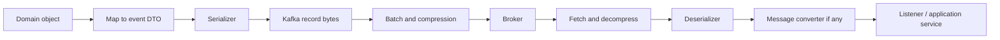

# Reducing Serialization and Deserialization Cost

In a Spring Kafka flow, business objects must be converted to bytes before the producer sends a record; the consumer receives bytes and converts them back into types the application understands. Both steps consume CPU, allocate memory, and can become a bottleneck as traffic grows. A pipeline can also convert the same payload multiple times: entity to DTO, DTO to JSON `String`, `String` to `byte[]`, and then parsed again through a converter. These redundant steps increase latency and garbage collection pressure.

Optimizing serialization/deserialization starts by identifying where each conversion occurs. Choose an appropriate wire format, configure serializers/deserializers to match the payload, reuse configured mappers, avoid repeated conversions, and measure cost on real data. JSON can still be a good choice; Avro or Protobuf is not automatically faster if schemas, object mapping, or Registry lookups are poorly designed.

## 1. Where does cost appear in a Kafka pipeline?

Producers and consumers have the following primary processing steps:



On the producer side, costs typically include:

- Mapping business objects to event DTOs.
- Reading fields, reflection, or accessors inside the serializer.
- Converting numbers, timestamps, enums, collections, and nested objects into wire representation.
- Allocating buffers, `String`, `byte[]`, and intermediate objects.
- Adding type/header metadata.
- Compressing batches before sending to the broker.

On the consumer side, costs typically include:

- Decompressing the Kafka batch if the producer compressed it.
- Parsing bytes into JSON/tokens or decoding a binary schema.
- Constructing the object graph, collections, and field values.
- Resolving the Java type from a target type or type header.
- Converting payloads via a message converter if the listener expects a different type.
- Validating and mapping to domain objects.

The serializer runs while the producer handles `send()` before the record enters the accumulator to be sent. Therefore, heavy serialization can consume CPU on the thread calling the producer. The deserializer runs on the consumer `poll()` thread; slow payload parsing can lengthen poll duration and reduce record ingestion rate. Compression is a separate batch-level step and does not replace the serializer.

## 2. Count conversions before optimizing

An event publishing flow usually needs only one business mapping and one serialization step:

```text
Order entity
  -> OrderCreatedEvent
  -> JSON bytes
  -> Kafka
```

A redundant pipeline often looks like this:

```text
Order entity
  -> JSON String for logging
  -> parse String into OrderCreatedEvent
  -> JsonSerializer converts to JSON bytes
  -> Kafka
```

Or the application builds bytes manually and still passes them through a JSON serializer:

```java
byte[] jsonBytes = objectMapper.writeValueAsBytes(event);

// Wrong: JsonSerializer treats byte[] as an object and serializes the byte array into JSON.
kafkaTemplate.send("orders.events", jsonBytes);
```

If you have already produced JSON bytes, use `KafkaTemplate<String, byte[]>` with `ByteArraySerializer`. If sending Java objects, let `JacksonJsonSerializer` perform serialization once. Never mix both approaches on the same payload path.

Similarly on the consumer, choose one of two paths:

- `JacksonJsonDeserializer` converts bytes to a POJO; the listener receives the POJO directly.
- `ByteArrayDeserializer` converts bytes to `byte[]`, then `JacksonJsonMessageConverter` converts it to the listener payload.

JSON class names in examples depend on version: Spring Kafka 2.x/3.x uses `JsonSerializer`, `JsonDeserializer`, `ByteArrayJsonMessageConverter`; Spring Kafka 4.x uses `JacksonJsonSerializer`, `JacksonJsonDeserializer`, `ByteArrayJacksonJsonMessageConverter`.

Do not deserialize bytes into a POJO and then serialize the POJO back to JSON so a converter can parse it back into the same POJO. One intentional conversion at each boundary is normally enough.

## 3. Choose a wire format based on real needs

| Wire format | Strengths | Costs/trade-offs | Best suited when |
|---|---|---|---|
| JSON | Readable, easy to debug, broad language support, and schema evolution if well designed. | Text can be larger than binary; token parsing and object creation cost CPU. | Event integration, inter-service APIs, direct payload observability needed. |
| Avro | Compact binary, explicit schema, supports evolution. | Requires schemas, generated/GenericRecord models, and usually Schema Registry. | Multiple services sharing schemas, high volume, compatibility governance required. |
| Protobuf | Compact binary, generated code, explicit contracts. | Requires `.proto`, code generation, and field number compatibility management. | Polyglot systems, stable contracts, and high throughput. |
| CBOR/MessagePack or other binary formats | Can be smaller than JSON without requiring identical Java classes. | Requires dedicated libraries, contracts, and debugging tooling. | Benchmarks prove benefit and the entire system supports the format. |
| Opaque `byte[]` | Requires no re-serialization in Kafka client once bytes exist. | Application must manage wire format, versioning, validation, and readability. | Payload already encoded upstream or raw bytes need to be relayed as-is. |

Do not choose binary solely because the payload is smaller. Total cost includes encode/decode, mapping, schema lookup/cache, compression, network, broker/client CPU, and operational overhead. A well-configured JSON serializer can meet target throughput with lower complexity.

### Schema design rules

- Keep events reasonably flat; avoid deeply nested object graphs or unnecessary nested collections.
- Do not embed an entire entity/database aggregate if consumers only need a few fields.
- Avoid duplicating the same data across multiple fields; use a reference identifier where appropriate.
- Choose meaningful numeric types. For example, money can be represented as minor units in `long` or decimal strings per contract; do not change types just to shave a few bytes if it sacrifices precision.
- Standardize timestamp formats, time zones, and enums between producer and consumer.
- Only omit `null` or default fields when event semantics permit. For patch/update events, distinguishing "field absent" from "field explicitly null" can be critical.
- Maintain field numbers and compatibility rules with Protobuf; maintain schema compatibility with Avro/JSON Schema.

## 4. Reuse ObjectMapper and serializers/deserializers

Do not create a new `ObjectMapper`, `JsonMapper`, serializer, or deserializer for every record. Mappers should be configured once and reused. Jackson mappers (`ObjectMapper` in Jackson 2, `JsonMapper` in Jackson 3) are thread-safe for read/write operations once all configuration completes before first use; do not mutate modules, serializers, or features on a mapper shared across threads.

Spring Kafka provides Jackson-based JSON serializers/deserializers and allows passing a configured mapper. Default JSON-aware components use an enhanced mapper with common modules such as Java Time and Kotlin. Leverage the default mapper when no special customization is needed, or inject the Spring-configured mapper instead of instantiating standalone mappers.

API depends on Spring Kafka version: the first example below uses Spring Kafka 2.x/3.x with Jackson 2 (`com.fasterxml.jackson.databind.ObjectMapper`, `JsonSerializer`, `JsonDeserializer`). From Spring Kafka 4.x onward, the new JSON classes are `JacksonJsonSerializer`/`JacksonJsonDeserializer` and use Jackson 3 `JsonMapper` (`tools.jackson.databind.json.JsonMapper`). Do not pass a Jackson 2 `ObjectMapper` into a constructor expecting a Jackson 3 `JsonMapper`.

Example configuring a factory with a shared mapper:

```java
import java.util.HashMap;
import java.util.Map;

import com.fasterxml.jackson.databind.ObjectMapper;
import org.apache.kafka.common.serialization.StringSerializer;
import org.springframework.context.annotation.Bean;
import org.springframework.kafka.core.DefaultKafkaProducerFactory;
import org.springframework.kafka.core.ProducerFactory;
import org.springframework.kafka.support.serializer.JsonSerializer;

@Bean
ProducerFactory<String, OrderCreatedEvent> orderProducerFactory(
        ObjectMapper objectMapper) {

    Map<String, Object> properties = new HashMap<>();
    properties.put("bootstrap.servers", "localhost:9092");

    var valueSerializer = new JsonSerializer<OrderCreatedEvent>(objectMapper)
            .noTypeInfo();

    return new DefaultKafkaProducerFactory<>(
            properties,
            new StringSerializer(),
            valueSerializer);
}
```

Here `ObjectMapper` is injected once and the serializer is retained in `ProducerFactory`. If the project uses Spring Kafka 2.x/3.x, use `JsonSerializer`/`JsonDeserializer` as shown; Spring Kafka 4.x moves to `JacksonJsonSerializer`/`JacksonJsonDeserializer`. Check the API for your running version. Never configure a mapper via `registerModule()` after record sending/receiving has begun.

The consumer factory also reuses the configured mapper:

```java
import java.util.Map;

import com.fasterxml.jackson.databind.ObjectMapper;
import org.apache.kafka.common.serialization.StringDeserializer;
import org.springframework.context.annotation.Bean;
import org.springframework.kafka.core.ConsumerFactory;
import org.springframework.kafka.core.DefaultKafkaConsumerFactory;
import org.springframework.kafka.support.serializer.JsonDeserializer;

@Bean
ConsumerFactory<String, OrderCreatedEvent> orderConsumerFactory(
        ObjectMapper objectMapper,
        Map<String, Object> consumerProperties) {

    var valueDeserializer = new JsonDeserializer<>(
            OrderCreatedEvent.class, objectMapper, false);

    return new DefaultKafkaConsumerFactory<>(
            consumerProperties,
            new StringDeserializer(),
            valueDeserializer);
}
```

With Spring Kafka 4.x, use the Jackson 3 mapper and new serializer/deserializer:

```java
import tools.jackson.databind.json.JsonMapper;
import org.springframework.kafka.support.serializer.JacksonJsonSerializer;
import org.springframework.kafka.support.serializer.JacksonJsonDeserializer;

JsonMapper jsonMapper = JsonMapper.builder().build();

var valueSerializer = new JacksonJsonSerializer<OrderCreatedEvent>(jsonMapper)
        .noTypeInfo();
var valueDeserializer = new JacksonJsonDeserializer<>(
        OrderCreatedEvent.class, jsonMapper)
        .ignoreTypeHeaders();
```

If the application needs no mapper customization, using Spring Kafka's default serializer/deserializer is usually sufficient; do not create a new mapper solely to pass into the constructor.

When a topic carries only a single event type, a fixed target type avoids dynamic class resolution from each record's headers. If a topic carries multiple event types, use type mapping or a type resolver with a clear contract; do not blindly disable type headers.

## 5. Choose one type metadata strategy

Spring Kafka's JSON serializer can write type information into Kafka record headers. Type headers are useful when a topic carries multiple event types or when producer and consumer use different Java classes. However, if a topic contains only one known event type, transmitting FQCNs and resolving types on every record may be unnecessary work.

For a single-event-type topic:

```java
var serializer = new JsonSerializer<OrderCreatedEvent>(objectMapper)
        .noTypeInfo();

var deserializer = new JsonDeserializer<>(
        OrderCreatedEvent.class, objectMapper, false);
```

The snippet above uses Spring Kafka 2.x/3.x. With Spring Kafka 4.x, replace with `JacksonJsonSerializer`/`JacksonJsonDeserializer` and Jackson 3 `JsonMapper` as shown earlier.

For a multi-event-type topic, use stable token mapping:

```yaml
spring:
  kafka:
    producer:
      properties:
        spring.json.type.mapping: order-created:com.example.events.OrderCreatedEvent,order-cancelled:com.example.events.OrderCancelledEvent
    consumer:
      properties:
        spring.json.type.mapping: order-created:com.example.projection.OrderCreated,order-cancelled:com.example.projection.OrderCancelled
```

Tokens avoid coupling the contract to Java package names and allow each service to use its own payload-compatible class. Do not disable type headers if the consumer genuinely needs to distinguish multiple event types in the same topic.

Type headers are tiny metadata compared to large payloads; the main benefit of choosing a fixed target type is reducing resolution logic and class-name coupling. Prioritize a stable contract before optimizing away a few header bytes.

## 6. Avoid unnecessary String and byte[] chains

JSON is usually transmitted as UTF-8 bytes. If the application already has bytes, keeping `byte[]` across producer/consumer avoids the `byte[] -> String -> byte[]` conversion step.

Example when the application needs to serialize manually before sending:

```java
import com.fasterxml.jackson.databind.ObjectMapper;
import org.apache.kafka.clients.producer.ProducerRecord;
import org.springframework.kafka.core.KafkaTemplate;

public class RawJsonPublisher {

    private final ObjectMapper objectMapper;
    private final KafkaTemplate<String, byte[]> kafkaTemplate;

    public RawJsonPublisher(ObjectMapper objectMapper,
            KafkaTemplate<String, byte[]> kafkaTemplate) {
        this.objectMapper = objectMapper;
        this.kafkaTemplate = kafkaTemplate;
    }

    public void publish(OrderCreatedEvent event) throws Exception {
        byte[] payload = objectMapper.writeValueAsBytes(event);
        var record = new ProducerRecord<>(
                "orders.events", event.orderId(), payload);
        kafkaTemplate.send(record);
    }
}
```

`KafkaTemplate<String, byte[]>` must use `StringSerializer` for keys and `ByteArraySerializer` for values. Do not pass this `payload` into a template configured with `JacksonJsonSerializer`, because the serializer will encode the byte array as another JSON object.

On the consumer, if you need a converter to turn JSON into objects, you can receive bytes directly:

```java
import org.springframework.context.annotation.Bean;
import org.springframework.kafka.annotation.KafkaListener;
import org.springframework.kafka.config.ConcurrentKafkaListenerContainerFactory;
import org.springframework.kafka.core.ConsumerFactory;
import org.springframework.kafka.support.converter.ByteArrayJsonMessageConverter;

@Bean
ConcurrentKafkaListenerContainerFactory<String, byte[]> rawJsonListenerFactory(
        ConsumerFactory<String, byte[]> consumerFactory) {

    var factory = new ConcurrentKafkaListenerContainerFactory<String, byte[]>();
    factory.setConsumerFactory(consumerFactory);
    factory.setRecordMessageConverter(new ByteArrayJsonMessageConverter());
    return factory;
}

@KafkaListener(topics = "orders.events", containerFactory = "rawJsonListenerFactory")
public void listen(OrderCreatedEvent event) {
    orderService.handle(event);
}
```

`ByteArrayJsonMessageConverter` in Spring Kafka 2.x/3.x (or `ByteArrayJacksonJsonMessageConverter` in 4.x) can convert `byte[]` into the method-level listener payload. If using a JSON deserializer to produce `OrderCreatedEvent` beforehand, do not add a JSON message converter for the same payload. Pick exactly one place to perform JSON parsing.

In Spring Kafka 2.x/3.x, the corresponding converter class is `ByteArrayJsonMessageConverter`; Spring Kafka 4.x uses `ByteArrayJacksonJsonMessageConverter`. Both paths require `ByteArrayDeserializer` on the consumer and `ByteArraySerializer` on the producer.

### When should you keep String?

- The payload is genuinely text such as commands, CSV, or plain text.
- Downstream systems require a UTF-8 string.
- Text processing is needed in a way supported by existing serializers/deserializers.

If the payload is JSON bytes and requires no text manipulation, `byte[]` or `Bytes` avoids an extra byte-to-String conversion. Switching to `byte[]` does not speed up JSON parsing itself; the gain comes from removing intermediate conversions.

## 7. Use message converters in the right place

Spring Kafka has two conversion layers to distinguish:

- Kafka `Serializer`/`Deserializer`: converts Java objects to Kafka bytes and vice versa.
- Spring `MessageConverter`: converts `Message<?>`/listener payloads per the Spring Messaging abstraction.

Valid combinations include:

Converter names in the table use Spring Kafka 4.x APIs. For Spring Kafka 2.x/3.x, use `ByteArrayJsonMessageConverter` and `StringJsonMessageConverter` respectively.

| Producer serializer | Consumer deserializer | Message converter | Data flow |
|---|---|---|---|
| `JacksonJsonSerializer` | `JacksonJsonDeserializer<OrderEvent>` | No JSON converter needed | POJO → JSON bytes → POJO. |
| `ByteArraySerializer` | `ByteArrayDeserializer` | `ByteArrayJacksonJsonMessageConverter` | POJO/Message → JSON bytes → POJO. |
| `StringSerializer` | `StringDeserializer` | `StringJacksonJsonMessageConverter` | POJO/Message → JSON String → UTF-8 bytes → String → POJO. |
| `ByteArraySerializer` | `ByteArrayDeserializer` | No converter | Application handles raw bytes directly. |

Do not configure both `JacksonJsonDeserializer` and `JacksonJsonMessageConverter` to parse the same JSON payload. Also do not use `StringSerializer` if `MessageConverter` already produces `byte[]` without a compatible serializer. The serializer and converter must agree on the output data type.

When using `KafkaTemplate.send(Message<?>)`, the converter builds a `ProducerRecord` from the Spring Message; the Kafka serializer then encodes the payload into bytes. Verify the payload type after the converter to avoid encoding JSON a second time.

## 8. Reduce allocations and object graphs

Heavy allocation increases GC frequency and can make p95/p99 latency erratic. Ways to reduce allocations:

- Create the event DTO once and avoid mapping through multiple intermediate layers unnecessarily.
- Do not instantiate `ObjectMapper`, `DateTimeFormatter`, `TypeFactory`, or serializers per publish call.
- Avoid calling `writeValueAsString()` just to log and then serializing the object again.
- Do not make multiple copies of `byte[]` when data only needs to be read or forwarded.
- Avoid building JSON manually via string concatenation; this is error-prone with escaping and creates many intermediate Strings.
- Use well-structured DTOs with appropriate primitive/value-object fields and avoid overly deep graphs.
- Create mutable copies only when ownership protection is required; do not copy entire payloads repeatedly out of habit.
- Avoid storing huge JSON payloads simultaneously across multiple logs, exceptions, and context objects.

Do not optimize by reusing one mutable `byte[]` across multiple records if the serializer/producer can process asynchronously. Each record must own stable bytes until the producer finishes using the buffer. If using direct buffers or pooled buffers, enforce clear ownership and lifecycle rules.

### Do not serialize solely for logging

Avoid:

```java
log.debug("Publishing event {}", objectMapper.writeValueAsString(event));
kafkaTemplate.send("orders.events", event);
```

Even when debug logging is disabled, this style still serializes before the logger checks the level. If logging is needed:

```java
if (log.isDebugEnabled()) {
    log.debug("Publishing order event id={}, orderId={}",
            event.eventId(), event.orderId());
}
kafkaTemplate.send("orders.events", event);
```

Log identifier fields and essential metadata instead of re-encoding the entire payload. If a payload snapshot is needed for auditing, create the snapshot intentionally and account for its cost separately.

## 9. Optimize JSON payloads with discipline

JSON field names, field count, and nesting affect payload size. Consider:

- Removing unnecessary fields from the event contract.
- Using short enums/tokens when the contract permits, while keeping meaning clear.
- Using `@JsonInclude(JsonInclude.Include.NON_NULL)` if omitting null fields does not alter semantics.
- Using numeric timestamps or ISO-8601 strings per contract; measure size and parse cost before switching.
- Not serializing computed or cached data that the consumer can derive.
- Using identifiers instead of full nested objects when the consumer can look them up safely without creating a new bottleneck.

Example:

```java
import java.time.Instant;
import java.util.UUID;

public record OrderCreatedEvent(
        UUID eventId,
        String orderId,
        long amountMinor,
        String currency,
        Instant occurredAt
) {}
```

The event carries only data needed by consumers. `amountMinor` represents money in the currency's smallest unit (e.g., cents), avoiding floating-point inaccuracy; the contract must specify scale/currency. If using decimals, choose a representation with clear precision and scale rules.

Do not abbreviate field names or strip information just to save a few bytes if doing so hurts readability, debugging, or compatibility. Compression can shrink repeated JSON fields in batches significantly without making the schema cryptic.

## 10. Batching and compression affect total cost

A Kafka producer groups records per partition into batches. `batch.size` sets the batch cap; `linger.ms` gives the producer extra time to wait for more records so batches fill further. Batching reduces request count and makes compression more effective, though it does not eliminate serializing each individual record.

Example experimental configuration in Spring Boot:

```yaml
spring:
  kafka:
    producer:
      properties:
        batch.size: 32768
        linger.ms: 5
        compression.type: lz4
```

Explanation:

- `batch.size: 32768` allows batches up to roughly 32 KiB per partition.
- `linger.ms: 5` lets the producer wait up to roughly 5 ms to gather more records if a batch is not full.
- `compression.type: lz4` compresses each batch before sending.

These values are only benchmark starting points, not optimal settings for every workload. Raising `batch.size` can increase buffer memory; raising `linger.ms` can add latency under low traffic. Compression reduces transmitted/stored bytes at the expense of CPU on both producer and consumer.

Kafka supports `none`, `gzip`, `snappy`, `lz4`, and `zstd`. Pick an algorithm based on compression ratio, CPU, latency, and broker/client support. `gzip` can save bandwidth well but costs more CPU in some workloads; `lz4`/`snappy` are often tested when speed matters; `zstd` offers multiple compression levels for balance. Benchmark with real payloads and batches.

Starting in Kafka 4.0, default `linger.ms` changed from `0` to `5` ms; default `batch.size` is 16 KiB. If your system uses a different Kafka client version, do not assume identical defaults. Check effective configuration and override only based on measurements.

## 11. Compression does not replace good serialization

Compression operates on batch bytes after serialization. If every record contains many repeating JSON field names, batches may compress well; if payloads are images, zips, or already-compressed binaries, compressing again can burn CPU while saving very few bytes.

| Payload characteristic | Experimentation direction |
|---|---|
| JSON text with many repeated field names, small records, steady traffic | Try `lz4` or `zstd` with larger batches. |
| Large payloads, limited bandwidth, spare CPU | Benchmark `zstd` and `gzip` across levels. |
| Already-compressed payloads or high-entropy data | Compare against `compression.type=none`. |
| Low traffic, very strict latency requirement | Keep `linger.ms` low and measure compression on actual batches. |
| Many partitions with few records per partition | Check per-partition batch utilization; high total traffic does not ensure full batches. |

Measure bytes before/after compression, producer CPU, consumer CPU, and end-to-end latency. Do not evaluate compression solely by log size on the broker.

## 12. Schema Registry and caching

Avro/Protobuf/JSON Schema serializers typically require a schema ID or schema version to encode/decode. Clients can cache schemas and mappings to avoid calling the Registry for every record, yet first schema use or cache misses can trigger network calls.

To avoid latency spikes:

- Initialize and warm up serializers/deserializers if the workload has strict latency requirements.
- Use stable schema subjects/versions and avoid registering unnecessary new schemas.
- Keep Registry connections and credentials stable; track cache hits/misses if the client exposes metrics.
- Never call the Registry or look up schemas over HTTP inside a listener for each record.
- Monitor Registry timeouts, retries, and errors separately from payload parsing time.
- Verify compatibility before publishing new schemas.

Binary schemas can reduce payload size and parse cost, yet generated objects still require allocation. Generic records offer flexibility at the potential cost of field lookup overhead. Benchmark generated classes vs. generic models on the same data and same schema cache state.

## 13. Do not overcomplicate type resolution

If a consumer has a topic carrying one event type, a fixed target type is simpler and cheaper than inspecting payloads/headers to decide the class on every record. For multi-event-type topics, use token mapping or a small, deterministic type resolver.

Avoid:

- Classpath reflection scanning per record.
- Loading classes via `Class.forName()` from arbitrary names in the payload without an allowlist.
- Parsing JSON once to guess the type and parsing a second time into an object.
- Calling service discovery or custom schema registries inside a type resolver per message.
- Creating a new `ObjectMapper`/`JavaType` inside the resolver method every time.

If you must classify events by a JSON discriminator, read the discriminator once using a streaming parser API or use a type header with a clear contract. Do not deserialize the entire JSON into a `Map` and then deserialize the same bytes into a DTO if the target type can be selected upfront.

## 14. When to use a streaming parser?

Jackson data binding builds a full object graph. For very large payloads where the application only needs a few fields, a streaming parser such as Jackson `JsonParser` can read sequentially and extract only needed fields, reducing object graph allocation.

A streaming parser is suitable when:

- Payloads are large and structured for sequential processing.
- Consumers do not need to keep the entire object in memory.
- Only a few fields are needed for routing or validation.
- Benchmarks confirm allocation/object binding is the bottleneck.

Do not use a streaming parser for every small event. Manual parsing code is harder to maintain, error-prone with nested fields, and does not automatically construct domain objects. If the listener needs the full event, data binding into a DTO is usually clearer and fast enough.

## 15. Measuring serializers and deserializers

Do not pick a solution based solely on byte count or gut feeling about code. Split benchmarks into two tiers:

### Microbenchmark

Measure separately:

- Mapping domain objects to event DTOs.
- `serialize()` with the same serializer and payload.
- `deserialize()` with the same bytes and target type.
- Allocation bytes/op and GC activity.
- Pre-compression payload size.

JMH can warm up the JVM, run multiple forks, and avoid conclusions from a short single run. Use the same representative data: small/large payloads, null fields, collections, nested objects, and different event types.

When running JMH, enable the GC profiler (`-prof gc`) to inspect allocation bytes/op and GC counts. Compare results after warm-up under identical JVM flags and identical payloads; never draw conclusions from a single run.

Example JMH skeleton:

```java
import java.util.Map;
import java.util.concurrent.TimeUnit;

import org.openjdk.jmh.annotations.Benchmark;
import org.openjdk.jmh.annotations.OutputTimeUnit;
import org.openjdk.jmh.annotations.Scope;
import org.openjdk.jmh.annotations.State;
import org.openjdk.jmh.annotations.Setup;
import org.openjdk.jmh.annotations.TearDown;
import org.springframework.kafka.support.serializer.JacksonJsonSerializer;

@State(Scope.Benchmark)
@OutputTimeUnit(TimeUnit.MICROSECONDS)
public class EventSerializationBenchmark {

    private JacksonJsonSerializer<OrderCreatedEvent> serializer;
    private OrderCreatedEvent event;

    @Setup
    public void setup() {
        serializer = new JacksonJsonSerializer<>();
        serializer.configure(Map.of(), false);
        event = TestEvents.orderCreated();
    }

    @Benchmark
    public byte[] serialize() {
        return serializer.serialize("orders.events", event);
    }

    @TearDown
    public void tearDown() {
        serializer.close();
    }
}
```

The skeleton must be completed with `Serializer.configure()`/lifecycle appropriate for your Kafka client version and actual benchmark setup. Never call `new ObjectMapper()` inside the benchmark method; doing so measures mapper instantiation cost rather than normal serialization.

### Integration/load test

Microbenchmarks do not measure batching, compression, network, broker replication, consumer-thread deserialization, or listener overhead. Run integration/load tests against real Kafka or Testcontainers and measure:

| Metric | Target |
|---|---|
| Records/sec | Achieved producer/consumer throughput. |
| p50/p95/p99 end-to-end latency | Time from publish until listener completion. |
| Producer CPU | Mapping, serialization, and compression cost. |
| Consumer CPU | Decompression, deserialization, and listener cost. |
| Allocation rate / GC pause | Memory pressure from object graphs and buffers. |
| Average record/batch size | Batching and compression effectiveness. |
| Bytes in/out | Bandwidth before/after compression. |
| Consumer lag | Whether consumers keep up as load increases. |

Compare at least these configurations:

1. Default JSON serializer/deserializer.
2. JSON with a configured and reused mapper.
3. JSON bytes with `ByteArraySerializer`/`ByteArrayDeserializer` or an appropriate message converter.
4. Avro/Protobuf if the system has schema contracts.
5. Different compression types and batch settings.

Keep event semantics, partition count, key distribution, replication factor, `acks`, idempotence, and listener workload constant. Changing multiple factors at once makes it impossible to tell which factor caused the difference.

## 16. Common optimization mistakes

| Practice | Problem | Fix |
|---|---|---|
| Creating `ObjectMapper` per send | Pays mapper, module, and metadata cache setup repeatedly. | Inject/reuse a configured mapper. |
| Serializing JSON to log then serializing object again | Duplicate encode/parse and allocations. | Log event ID/essential fields only. |
| Calling `writeValueAsBytes()` then sending via JSON serializer | Byte array may get encoded into JSON a second time. | Use `ByteArraySerializer` for pre-encoded bytes. |
| Using `StringSerializer` for JSON bytes | Adds `byte[]` ↔ `String` conversion. | Use `byte[]`/`Bytes` if text is unnecessary. |
| Using both JSON deserializer and JSON message converter | Payload is parsed/converted twice. | Pick one layer for JSON parsing. |
| Dynamic class resolution for every record on a single-type topic | Adds unnecessary headers/reflection/type lookups. | Configure a fixed target type. |
| Disabling type headers on multi-type topics | Consumers may deserialize the wrong class. | Use clear type mappings/tokens. |
| Switching to Avro/Protobuf without benchmarking | Adds schema/codegen/Registry complexity without guaranteed speedups. | Measure CPU, allocations, bytes, and end-to-end latency. |
| Raising batch and linger too high | Increases memory and latency under low traffic. | Tune to partition throughput and latency SLA. |
| Enabling high compression on already-compressed payloads | Burns CPU while saving minimal bytes. | Benchmark `none` and other codecs. |
| Making multiple payload copies | Increases allocations and GC. | Maintain clear ownership and pass stable bytes. |
| Parsing JSON into a Map then into a DTO | Builds intermediate object graphs. | Deserialize directly to target DTO or use a streaming parser. |

## 17. Step-by-step optimization workflow

1. **Measure baseline:** throughput, p95/p99, CPU, allocations, GC, bytes/record, and lag.
2. **Map the conversion path:** trace entity → DTO → serializer → bytes → deserializer/converter → listener.
3. **Eliminate duplicate conversions:** remove serialize-for-log, intermediate JSON strings, and unnecessary mappings.
4. **Reuse mappers and serializers:** configure once, inject via factory, never recreate per record.
5. **Choose a type strategy:** fixed target type for single-type topics; type mapping for multi-type topics.
6. **Optimize payloads:** drop redundant fields while preserving semantics and compatibility.
7. **Benchmark binary formats:** try Avro/Protobuf only when JSON metrics fail to meet targets.
8. **Tune batching/compression:** adjust `batch.size`, `linger.ms`, and `compression.type` based on real load.
9. **Re-run integration tests:** keep workload and environment identical for fair comparison.
10. **Monitor post-deployment:** verify CPU, latency, lag, and deserialization errors do not regress.

## 18. Key takeaways

- Serialization/deserialization consumes CPU and creates allocations; pinpoint where they happen in the pipeline.
- Each event should undergo only one encode and one decode at the wire-format boundary.
- Never serialize to log and then serialize again to send.
- Reuse configured `ObjectMapper` instances; do not mutate mappers after use begins.
- JSON, Avro, and Protobuf all have trade-offs; choose based on benchmarks and contract needs.
- Use a fixed target type when a topic holds one event type; use type mapping when a topic holds multiple types.
- `byte[]`/`Bytes` avoids intermediate String conversion when payloads are already bytes.
- `MessageConverter` and Kafka `Serializer` are separate layers; never parse/encode the same payload twice.
- Batching reduces requests and improves compression, yet each record must still be serialized.
- Compression operates on batches and trades CPU for network/storage; measure on real payloads.
- Trim object graphs and mutable copies to cut allocations/GC while keeping buffer ownership safe.
- Use JMH for microbenchmarks and Kafka load tests for end-to-end measurement.

Reducing serialization and deserialization cost is not a race to pick the format with the fewest bytes. First eliminate redundant conversion steps, reuse mappers/serializers, pick the right target type strategy, and keep payloads lean per contract. Only then tune batching, compression, or switch to binary schemas when benchmarks prove the benefit. This data-driven approach increases throughput and reduces GC while preserving compatibility, observability, and event stream operability.

## References

- [Spring for Apache Kafka — Serialization, Deserialization, and Message Conversion](https://docs.spring.io/spring-kafka/reference/kafka/serdes.html)
- [Spring for Apache Kafka — Jackson JSON Serializer and Deserializer](https://docs.spring.io/spring-kafka/reference/kafka/serdes.html)
- [Spring Kafka 3.3 — JsonSerializer API](https://docs.spring.io/spring-kafka/docs/3.3.x/api/org/springframework/kafka/support/serializer/JsonSerializer.html)
- [Spring Kafka 3.3 — ByteArrayJsonMessageConverter API](https://docs.spring.io/spring-kafka/docs/3.3.x/api/org/springframework/kafka/support/converter/ByteArrayJsonMessageConverter.html)
- [Apache Kafka 4.4 — Producer Configs](https://kafka.apache.org/44/configuration/producer-configs/)
- [Apache Kafka — Producer and Consumer APIs](https://kafka.apache.org/documentation/)
- [OpenJDK JMH — Java Microbenchmark Harness](https://github.com/openjdk/jmh)
