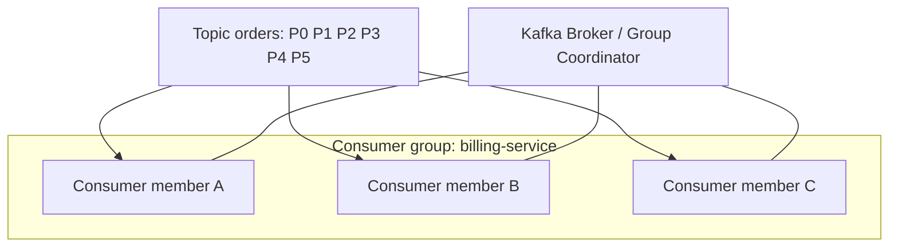

# Inspecting Group Members

A consumer group can consist of multiple consumer instances reading data concurrently from one or more topics. When operating Spring Kafka, you need to know which instances are participating in the group, which hosts the broker sees clients connecting from, which partitions each member holds, and whether the group is stable or rebalancing.

Inspecting members answers operational questions such as: are enough consumer instances running, is one pod holding too many partitions, why is a consumer receiving no partitions, are stale members still in the group, and is the group rebalancing or stable.

This lesson uses Kafka command-line tools and `AdminClient` to inspect membership. It focuses on consumer groups using the Kafka Consumer API, which is standard when Spring Kafka runs `@KafkaListener`.

## 1. What is a member in a consumer group?

A consumer group is a set of consumers sharing a common `group.id`. Kafka coordinates members in the group to distribute partitions of the topics they subscribe to.

For example, a billing service has:

- Group ID: `billing-service`.
- Topic: `orders` with 6 partitions.
- 3 application instances, each running a Kafka listener container.
- Each container creates a Kafka consumer joining the same group.

When the group is stable, partitions are divided among members. A partition in a standard consumer group is assigned to only one member at a time.



In Spring Kafka, a single application instance can host multiple listener containers or a concurrent listener container with multiple child consumers. Therefore, the member count in a Kafka group does not always equal the number of pods.

For example, `concurrency = 3` on a `@KafkaListener` can create three consumer members inside the same application instance if all three consumers share the same `group.id`.

## 2. Distinguishing group, member, client, and instance

When reviewing group details, distinguish these identifiers:

| Concept | Meaning | Example |
|---|---|---|
| `group.id` | Consumer group identifier | `billing-service` |
| `member.id` | ID assigned by the Kafka coordinator to an active member | `consumer-...-uuid` |
| `client.id` | Application-configured name identifying the client in logs/metrics | `billing-consumer-1` |
| `group.instance.id` | Stable instance identifier supplied by the app for static membership | `billing-pod-2` |
| `host` | Client address observed by the broker | `/10.2.1.15` |

`member.id` is typically generated dynamically and can change when a consumer leaves and rejoins the group. Never use it as a persistent ID for a pod or service instance.

`client.id` can be configured via Kafka consumer properties. In Spring Boot, you can use `spring.kafka.consumer.client-id`; when a container runs with concurrency, Spring Kafka can append suffixes to distinguish child consumers.

`group.instance.id` is used for static membership. When the application configures a unique value per consumer instance, Kafka can preserve membership across brief restarts and reduce unnecessary rebalances. This value must be unique within the same group. Never reuse the same value across multiple concurrently running pods.

`host` is the address observed by the broker. In Kubernetes or NAT/proxy environments, this may be a container IP or translated network address rather than a human-readable pod hostname.

## 3. What information does a member have?

Member details to inspect typically include:

- Member ID and client ID.
- Host/IP seen by the broker.
- Number of assigned partitions.
- List of topic-partition assignments.
- Group instance ID when static membership is enabled.
- Group state and partition assignor at the group level.
- Coordinator managing the group.

Illustrative example:

| Member | Client ID | Host | Partition count | Assignment |
|---|---|---|---:|---|
| `consumer-A` | `billing-1` | `10.2.1.15` | 2 | `orders-0`, `orders-3` |
| `consumer-B` | `billing-2` | `10.2.1.16` | 2 | `orders-1`, `orders-4` |
| `consumer-C` | `billing-3` | `10.2.1.17` | 2 | `orders-2`, `orders-5` |

Assignment shows which partitions are currently given to each member. It does not indicate whether a member processes fast or slowly, nor does it directly show consumer lag.

To evaluate performance, combine membership with offsets, lag, throughput, and record processing time.

## 4. Listing consumer groups with Kafka CLI

Kafka distributes the `kafka-consumer-groups.sh` script in the `bin` directory. On Windows, the Kafka distribution may provide `kafka-consumer-groups.bat` under `bin/windows`.

List consumer groups:

```bash
bin/kafka-consumer-groups.sh --bootstrap-server kafka-1:9092 --list
```

On Windows:

```powershell
.\bin\windows\kafka-consumer-groups.bat --bootstrap-server kafka-1:9092 --list
```

If security configuration must be passed to the CLI, use `--command-config` pointing to a properly secured client properties file:

```bash
bin/kafka-consumer-groups.sh --bootstrap-server kafka-1:9092 --command-config client.properties --list
```

Never place usernames, passwords, private keys, or secrets directly in shell command history. Protect configuration files and their read permissions.

Since Kafka 4.2, `kafka-groups.sh` serves as a general tool for listing multiple group types such as consumer, share, and streams groups. For regular consumer group operations, `kafka-consumer-groups.sh` remains direct and convenient.

## 5. Viewing active members

Use `--describe --members` to list active members of a consumer group:

```bash
bin/kafka-consumer-groups.sh --bootstrap-server kafka-1:9092 --describe --group billing-service --members
```

Output usually contains these columns:

| Column | Meaning |
|---|---|
| `CONSUMER-ID` | Kafka-assigned member ID |
| `HOST` | Client host/IP |
| `CLIENT-ID` | Consumer client ID |
| `#PARTITIONS` | Number of partitions assigned to the member |

Example:

```text
CONSUMER-ID       HOST          CLIENT-ID       #PARTITIONS
consumer-A        /10.2.1.15    billing-1       2
consumer-B        /10.2.1.16    billing-2       2
consumer-C        /10.2.1.17    billing-3       2
```

This command only shows members active at the moment the broker responds. If the group exists but no consumers are currently participating, the member list can be empty.

Do not conclude a group does not exist merely because no members appear. Check group state and offsets separately.

## 6. Viewing partitions assigned to each member

Add `--verbose` to display assignments:

```bash
bin/kafka-consumer-groups.sh --bootstrap-server kafka-1:9092 --describe --group billing-service --members --verbose
```

Output adds an `ASSIGNMENT` column:

```text
CONSUMER-ID   HOST          CLIENT-ID   #PARTITIONS   ASSIGNMENT
consumer-A    /10.2.1.15    billing-1   2             orders(0,3)
consumer-B    /10.2.1.16    billing-2   2             orders(1,4)
consumer-C    /10.2.1.17    billing-3   2             orders(2,5)
```

Use this output to:

- Identify which member owns a specific partition.
- Check whether partition counts are balanced across members.
- Verify a newly scaled-out consumer has received partitions.
- Spot members with empty assignments.
- Compare assignments before and after a rebalance.

Assignments do not always divide evenly in every situation. Consumers may subscribe to multiple topics with differing partition counts, and assignors optimize according to their strategy.

A member with `#PARTITIONS = 0` can still be validly participating in the group. This commonly occurs when consumer count exceeds assignable partitions, or while the group is mid-rebalance.

## 7. Checking group state, coordinator, and assignor

Use `--state` to inspect overall group state:

```bash
bin/kafka-consumer-groups.sh --bootstrap-server kafka-1:9092 --describe --group billing-service --state
```

Output may look like:

```text
COORDINATOR (ID)    ASSIGNMENT-STRATEGY   STATE    #MEMBERS
kafka-2:9092 (2)    range                 Stable   3
```

Fields:

- `COORDINATOR`: broker acting as the group coordinator.
- `ASSIGNMENT-STRATEGY`: partition assignment strategy in use.
- `STATE`: current group state.
- `#MEMBERS`: number of members currently registered in the group.

Common states:

| State | Operational meaning |
|---|---|
| `Stable` | Group is stable and current assignments are active |
| `PreparingRebalance` | Group is preparing to rebalance |
| `CompletingRebalance` | Group is completing a rebalance |
| `Empty` | Group has no active members |
| `Dead` | Group has been deleted or is no longer active |
| `Unknown` | Client did not recognize the state due to version mismatch or response data |

With the new consumer group protocol, Kafka may also display states such as `Assigning` or `Reconciling`. State names and output fields depend on the broker version and protocol in use.

Do not declare a group broken just because a single snapshot shows `PreparingRebalance`. A rebalance can be very brief when a new consumer joins or one leaves. Take several samples over time and cross-check logs/metrics.

## 8. Distinguishing membership from consumer lag

Membership and lag answer two different questions:

- Membership: which consumers are participating in the group and which partitions does each hold?
- Lag: how many records/offsets behind the end of each partition's log is the consumer group?

View offsets/lag:

```bash
bin/kafka-consumer-groups.sh --bootstrap-server kafka-1:9092 --describe --group billing-service
```

Offset output typically includes:

| Column | Meaning |
|---|---|
| `TOPIC` | Consumed topic |
| `PARTITION` | Partition |
| `CURRENT-OFFSET` | Group's committed offset |
| `LOG-END-OFFSET` | Log end offset reported by the broker |
| `LAG` | Distance between log end and committed offset |
| `CONSUMER-ID` | Member holding the partition, if any |
| `HOST` | Member host |
| `CLIENT-ID` | Member client ID |

Example:

```text
TOPIC   PARTITION   CURRENT-OFFSET   LOG-END-OFFSET   LAG   CONSUMER-ID
orders  0           100              110              10    consumer-A
orders  1           120              120              0     consumer-B
orders  2           90               150              60    consumer-C
```

A member can still be active while lag rises if processing is slow, downstream is congested, or producers keep writing rapidly.

Conversely, a group can have zero active members while still retaining committed offsets and lag. That is why you should check `--members`, `--state`, and the default `--describe` together.

Note: `CURRENT-OFFSET` is the committed offset, not the exact record currently being processed in memory. With batch commits or manual acknowledgment, offsets can lag behind when a listener finishes an individual record.

## 9. Relating member count to partitions and concurrency

In a standard consumer group, a partition is owned by only one consumer member at a time. Therefore, partition count sets the maximum partition-level parallelism for the group.

Example with a 6-partition topic:

| Member count | Typical distribution | Observation |
|---:|---|---|
| 1 | 6 partitions on 1 member | Single consumer processes everything |
| 2 | 3 partitions/member | Parallelism can be increased |
| 3 | 2 partitions/member | Even distribution in this example |
| 6 | 1 partition/member | Maximum partition-level parallelism reached |
| 8 | 6 members with partitions, 2 empty | Two consumers receive no partitions |

Having 3 partitions and setting `concurrency = 5` does not mean Kafka processes 5 partitions in parallel. Two consumers will receive no partitions.

In Spring Kafka, distinguish:

- Application instance count (pods/processes).
- Listener container count.
- The `concurrency` setting of a concurrent listener.
- Consumer member count observed in the Kafka group.
- Partition count of subscribed topics.

If a group has multiple listeners sharing the same `group.id`, all consumers in that group share partition assignments. If each listener accidentally uses a different group ID, they form independent groups and each group can read the entire topic.

## 10. Inspecting members with AdminClient

When integrating member data into monitoring tools or admin pages, use `AdminClient` (the modern interface is `Admin`) rather than shelling out to the CLI.

The following example describes a consumer group by ID:

```java
import java.util.Collection;
import java.util.List;
import java.util.Map;
import java.util.HashMap;
import java.util.concurrent.TimeUnit;

import org.apache.kafka.clients.admin.Admin;
import org.apache.kafka.clients.admin.AdminClientConfig;
import org.apache.kafka.clients.admin.ConsumerGroupDescription;
import org.apache.kafka.clients.admin.MemberDescription;
import org.apache.kafka.common.TopicPartition;

public class ConsumerGroupInspector {

    public static void inspect(String bootstrapServers, String groupId)
            throws Exception {

        Map<String, Object> properties = new HashMap<>();
        properties.put(
            AdminClientConfig.BOOTSTRAP_SERVERS_CONFIG,
            bootstrapServers
        );

        try (Admin admin = Admin.create(properties)) {
            Map<String, ConsumerGroupDescription> descriptions =
                admin.describeConsumerGroups(List.of(groupId))
                    .all()
                    .get(10, TimeUnit.SECONDS);

            ConsumerGroupDescription group = descriptions.get(groupId);

            if (group == null) {
                System.out.println("Group description not returned: " + groupId);
                return;
            }

            System.out.println("Group ID: " + group.groupId());
            System.out.println("State: " + group.groupState());
            System.out.println("Type: " + group.type());
            System.out.println("Coordinator: " + group.coordinator());
            System.out.println("Assignor: " + group.partitionAssignor());
            System.out.println("Member count: " + group.members().size());

            for (MemberDescription member : group.members()) {
                Collection<TopicPartition> partitions =
                    member.assignment().topicPartitions();

                System.out.println("Member ID: " + member.consumerId());
                System.out.println("Client ID: " + member.clientId());
                System.out.println("Host: " + member.host());
                System.out.println(
                    "Group instance ID: " +
                    member.groupInstanceId().orElse("(dynamic member)")
                );
                System.out.println("Assignment: " + partitions);
            }
        }
    }
}
```

This example uses Kafka Admin API 4.x, where:

- `describeConsumerGroups` returns the group description.
- `groupState()` returns the group's state.
- `members()` returns the list of members.
- `assignment().topicPartitions()` returns partitions assigned to a member.
- `coordinator()` returns the node coordinating the group.
- `partitionAssignor()` provides the group's assignor when available.

Since Kafka 4.0, `ConsumerGroupDescription.state()` was deprecated in favor of `groupState()`. On Kafka 3.x, code typically uses `state()`; choose the method matching the Kafka client version your application compiles against.

`Admin` is an administrative client independent of running consumers. Calling describe does not join the group or alter assignments.

## 11. Listing groups with the Admin API

Since Kafka 4.1, `Admin.listConsumerGroups()` was deprecated in favor of `listGroups(ListGroupsOptions)`.

Kafka 4.1+ example:

```java
import java.util.Collection;
import java.util.concurrent.TimeUnit;

import org.apache.kafka.clients.admin.Admin;
import org.apache.kafka.clients.admin.GroupListing;
import org.apache.kafka.clients.admin.ListGroupsOptions;

Collection<GroupListing> groups =
    admin.listGroups(ListGroupsOptions.forConsumerGroups())
        .all()
        .get(10, TimeUnit.SECONDS);

for (GroupListing group : groups) {
    System.out.printf(
        "groupId=%s type=%s protocol=%s state=%s%n",
        group.groupId(),
        group.type().orElse(null),
        group.protocol(),
        group.groupState().orElse(null)
    );
}
```

`ListGroupsOptions.forConsumerGroups()` restricts results to consumer groups. To filter by state, you can use `inGroupStates(...)` on the options.

On older Kafka clients, `listConsumerGroups()` may still be used. Consult the Javadoc for the exact Kafka client version in your dependency tree.

Listing groups is not the same as listing members. Once you have the group ID, call `describeConsumerGroups` to read members and assignments.

## 12. Reading member assignments and handling excess consumers

If a group has 6 partitions but 8 members are observed, two members can have empty assignments. This is not necessarily a bug.

Check in sequence:

1. Confirm the group state is `Stable`.
2. Check actual member count.
3. Check `#PARTITIONS` for each member.
4. Check verbose assignments to identify empty members.
5. Compare against partition counts of all topics subscribed by the group.
6. Check `concurrency` and application instance count.

If member count exceeds total partitions, reducing concurrency can save idle consumer resources. However, before changing deployment settings, check whether listeners subscribe to multiple topics or patterns whose combined partition count exceeds a single topic.

Never conclude total assignable partitions from a single topic alone. A group can subscribe to multiple topics.

## 13. Inspecting static membership

Spring Kafka lets you pass the `group.instance.id` consumer property to enable static membership.

When static members are configured:

- `group.instance.id` identifies the logical instance supplied by the application.
- `member.id` remains the coordinator-managed member identifier.
- Every instance in the same group must have a distinct `group.instance.id`.
- When an instance restarts within the allowed window, Kafka can retain its member slot and avoid certain unnecessary rebalances.

Example configuration:

```yaml
spring:
  kafka:
    consumer:
      group-id: billing-service
      properties:
        group.instance.id: billing-pod-1
```

The value `billing-pod-1` is only an example. In Kubernetes, supply a unique value per pod identity. Never share one fixed value across all replicas because instances will collide in membership.

When inspecting members, compare `group.instance.id` values against running pods to detect duplicate configs or stale instances that have not yet left the group.

Static membership can delay partition revocation when an instance temporarily loses connectivity. Therefore, when a member disappears, check session timeout and group state rather than expecting partitions to move immediately.

With `ConcurrentMessageListenerContainer`, Spring Kafka supports static membership when `concurrency > 1` and automatically appends `-n` suffixes to `group.instance.id` for child consumers (since Spring Kafka 2.3.8/2.4.6). Each child receives a distinct identifier. When investigating, check the actual member values returned by the broker and the Spring Kafka version running.

## 14. Consumer group protocols and assignors

Kafka has two main group protocol tracks:

- The classic consumer group protocol.
- The new consumer group protocol (consumer protocol), introduced to improve rebalancing.

With the classic protocol, assignors are configured via `partition.assignment.strategy`, such as Range, RoundRobin, or CooperativeSticky.

With the new consumer protocol, assignment configuration moves to broker-side assignors and the `group.remote.assignor` property. Assignor fields in CLI/Admin API output must be interpreted according to the broker protocol and version.

Do not assume `partitionAssignor` always populates the same way across protocols. If the field is empty or unexpected, verify the group type/protocol before diagnosing.

When using the new consumer protocol, admin accounts need `DESCRIBE` permission on topics subscribed by members to inspect group details. Under the classic protocol, topic permission requirements for describing a group differ. Consequently, authorization errors may appear only after migrating a group to the new protocol.

## 15. Common pitfalls when inspecting members

| Symptom | Possible causes | How to check |
|---|---|---|
| No members shown | Consumer not running, group is empty, or wrong group ID | `--state`, inspect application logs and group ID |
| Member count lower than pod count | Listener not started, differing group IDs, or low concurrency | Compare `group.id`, `concurrency`, and client ID configs |
| A member has 0 partitions | More consumers than partitions or group is rebalancing | Check state, partition count, and verbose assignments |
| One member holds many partitions | Few total members or subscription-based assignor behavior | Check partition count, topic subscriptions, and assignor |
| Member ID changes | Consumer left and rejoined the group | Correlate via client ID, host, and group instance ID |
| Host does not match pod hostname | NAT, container networking, or proxies | Check address observed by broker and network topology |
| State constantly rebalancing | Consumer crashes, timeouts, continuous deploys, or blocked processing | Check logs, heartbeats, poll interval, and rolling deploys |
| Cannot view members/assignments | Missing permissions or broker/client incompatibility | Check ACLs, group protocol, and versions |
| CLI reports group does not exist | Wrong bootstrap cluster, wrong group ID, or expired group metadata | Verify cluster endpoint and list groups |

## 16. Runbook for inspecting members when consumers receive no records

When an application reports not receiving events, work step by step:

**Step 1 – Confirm the right cluster and group ID**

```bash
bin/kafka-consumer-groups.sh --bootstrap-server kafka-1:9092 --list
```

Compare the group ID against `spring.kafka.consumer.group-id` or `groupId` on `@KafkaListener`.

**Step 2 – Check group state**

```bash
bin/kafka-consumer-groups.sh --bootstrap-server kafka-1:9092 --describe --group billing-service --state
```

If the group stays in rebalance states continuously, inspect consumer logs and restart/deployment history.

**Step 3 – Check members and assignments**

```bash
bin/kafka-consumer-groups.sh --bootstrap-server kafka-1:9092 --describe --group billing-service --members --verbose
```

Cross-check client IDs, hosts, partition counts, and assignments against running replicas.

**Step 4 – Check lag and committed offsets**

```bash
bin/kafka-consumer-groups.sh --bootstrap-server kafka-1:9092 --describe --group billing-service
```

If members and assignments exist but lag grows, investigate throughput, listener errors, downstream services, and retries. If lag is 0, consumers may simply be caught up at the time of inspection.

**Step 5 – Cross-check application logs**

Look for indicators:

- Consumer joined group.
- Assigned partitions.
- Revoking partitions.
- Rebalance in progress.
- Heartbeat/session timeout.
- Commit failed or authorization failed.
- Deserialization error or listener exception.

Do not reset offsets merely because a member is not receiving records. Resetting offsets changes the group's read position and can cause the app to skip or re-read data. Perform it only after identifying the root cause and preparing an offset recovery plan.

## 17. Security and group inspection permissions

Describing a group is a read-only state inspection, yet it is still governed by ACLs.

Operational accounts should receive only the minimum required permissions:

- Permission to describe the consumer group to read group metadata.
- `DESCRIBE` permission on topics when required by the protocol/broker.
- Broker access permissions matching the cluster's authentication scheme.

When using SASL/SSL, pass settings via a protected `--command-config` file. Never place secrets in output, logs, or documentation.

When an AdminClient application uses a dedicated service account, ensure that account has describe permissions on the relevant groups and topics. Never grant write or offset-alter permissions just to read member lists.

## 18. Operations checklist

- Confirmed the right `bootstrap-server` and `group.id`.
- Known expected pod count, listener container count, and `concurrency`.
- Listed active members with `--members`.
- Checked partition assignments with `--members --verbose`.
- Checked group state, coordinator, and assignor with `--state`.
- Correlated membership with offsets and lag.
- Distinguished `member.id`, `client.id`, and `group.instance.id`.
- Verified consumer count does not exceed partition-level parallelism needs.
- Checked static membership has unique IDs per instance.
- Checked group protocol when assignor fields or describe permissions behave differently.
- Used a read-only account with least-privilege ACLs.
- Avoided resetting offsets or deleting groups while inspecting members.

## 19. Key takeaways

- A member is a consumer instance participating in a consumer group.
- `member.id` is assigned by Kafka; `client.id` is configured by the app; `group.instance.id` is used for static membership.
- `--describe --members` shows members, hosts, client IDs, and partition counts.
- `--members --verbose` shows each member's partition assignments.
- `--state` shows group state, coordinator, and assignor.
- Membership is not the same as lag; inspect both offsets and lag.
- Member count can exceed partition count, leaving some members without partitions.
- AdminClient `describeConsumerGroups` reads members and assignments from Java.
- Kafka 4.1+ favors `listGroups(ListGroupsOptions)` over `listConsumerGroups`.
- Inspecting groups is read-only observation; resetting offsets and deleting groups alter state and require separate procedures.

Inspecting members alongside group state and assignments lets operations confirm which consumers actually joined the group, where partitions live, and whether the group is stable. Combining this data with lag, listener logs, and concurrency settings makes diagnosing Spring Kafka messaging flows far more accurate.

## References

- [Apache Kafka – Basic Kafka Operations: Managing Consumer Groups](https://kafka.apache.org/42/operations/basic-kafka-operations/)
- [Apache Kafka – Admin API](https://kafka.apache.org/44/javadoc/org/apache/kafka/clients/admin/Admin.html)
- [Apache Kafka – ConsumerGroupDescription API](https://kafka.apache.org/44/javadoc/org/apache/kafka/clients/admin/ConsumerGroupDescription.html)
- [Apache Kafka – MemberDescription API](https://kafka.apache.org/44/javadoc/org/apache/kafka/clients/admin/MemberDescription.html)
- [Apache Kafka – ListGroupsOptions API](https://kafka.apache.org/44/javadoc/org/apache/kafka/clients/admin/ListGroupsOptions.html)
- [Apache Kafka – GroupState API](https://kafka.apache.org/44/javadoc/org/apache/kafka/common/GroupState.html)
- [Apache Kafka – Consumer Configs](https://kafka.apache.org/44/configuration/consumer-configs/)
- [Spring Kafka – Message Listener Containers](https://docs.spring.io/spring-kafka/reference/kafka/receiving-messages/message-listener-container.html)


