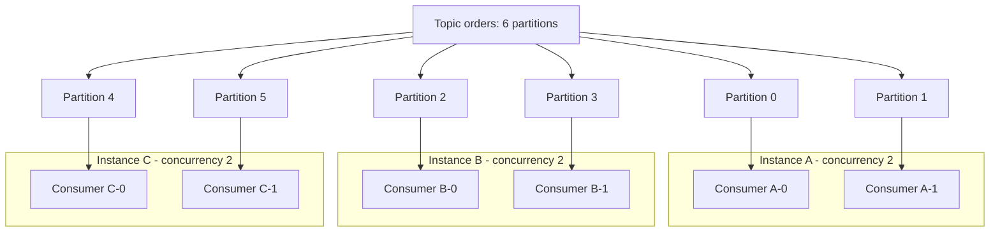

# Multi-Instance Deployment

When a Spring Kafka application is deployed across multiple instances, those instances can join the same consumer group to share partition processing while each instance's producer publishes events to the same topics. This deployment model increases consumption capacity and fault tolerance, but only works smoothly when partition counts, concurrency, producer identities, downstream resources, and rollout procedures are configured consistently.

A common mistake is scaling replica counts without checking partition counts, or letting every replica share the same `transactionIdPrefix`. The former leaves surplus consumers with no partitions to process; the latter can cause transactional producers to fence one another. This lesson covers designing multi-instance deployments, Spring Boot configuration, scaling consumer groups, and operating safe rolling updates.

## 1. Multiple instances joining the same consumer group

Kafka distributes a subscription's partitions across consumers belonging to the same consumer group. Within a group, a partition is assigned to at most one consumer at a time. When an instance joins or leaves, the group can rebalance to redistribute partitions.

Suppose there are three `order-service` instances, each running a listener container with concurrency set to two. Total consumers in the group are up to six:



In this example, six partitions can be distributed across six consumers. If the topic only had four partitions, at most four consumers would receive partitions; the remaining two consumers would have no data to consume in that group. Hence, replica count alone does not dictate throughput. Parallelism limits also depend on partition count and per-partition processing capacity.

| Instances | Concurrency per instance | Max total consumers | Partitions | Consumers assignable to partitions |
|---:|---:|---:|---:|---:|
| 1 | 2 | 2 | 6 | 2 |
| 2 | 2 | 4 | 6 | 4 |
| 3 | 2 | 6 | 6 | 6 |
| 4 | 2 | 8 | 6 | 6 |

When multiple instances share processing of a subscription, they must use the same `group.id` if the goal is load sharing. If each instance uses a different group ID, every group receives the entire stream independently; that is fan-out, not scaling out a single consumer group.

## 2. Choosing instance count and concurrency

Spring Kafka's `ConcurrentMessageListenerContainer` spawns multiple child consumers according to `concurrency`. This setting applies per listener container on each instance. Total consumers in the group roughly equal:

\[
C_{total} = N_{instances} \times C_{per\ instance}
\]

Active consumers on the subscription are bounded by the partition count:

\[
C_{active} \leq \min(C_{total}, P)
\]

Here `P` is the total number of partitions across the topics used by the subscription. If multiple listener containers share the same group and subscription, count all of their consumers, not just one `@KafkaListener` annotation.

Example configuring concurrency in Spring Boot:

```yaml
spring:
  kafka:
    consumer:
      group-id: order-service
    listener:
      concurrency: 2
```

Or configuring a dedicated factory:

```java
@Bean
ConcurrentKafkaListenerContainerFactory<String, OrderEvent>
        orderListenerFactory(ConsumerFactory<String, OrderEvent> consumerFactory) {

    var factory = new ConcurrentKafkaListenerContainerFactory<String, OrderEvent>();
    factory.setConsumerFactory(consumerFactory);
    factory.setConcurrency(2);
    return factory;
}
```

Do not raise concurrency merely because CPU has headroom. Identify the bottleneck first: partition count, listener processing time, database connection pool, downstream rate limits, CPU, heap, or consumer lag. If all partitions already have active consumers and the database is saturated, adding instances may raise contention without raising throughput.

## 3. Shared vs. per-instance configuration

Instances of the same service typically share configurations defining business logic and the consumer group:

- Listener `group.id` must match across instances sharing load.
- Topic lists, deserializers, schemas, and processing rules must be compatible.
- Security principals can be shared across the same workload and permission scope, or separated per instance if operational policy requires.
- `concurrency` and resource limits can vary by workload type or instance sizing, as long as total consumers in the group are accounted for.

Certain values must be unique per instance or per producer factory:

- `transactionIdPrefix` for Spring Kafka transactional producers.
- `group.instance.id` if static membership is enabled; every consumer member must have a unique identity in the group.
- Admin ports, local state directories, or temp files if instances share a host/volume.

Example configuration using environment variables:

```yaml
spring:
  kafka:
    bootstrap-servers: ${KAFKA_BOOTSTRAP_SERVERS}
    consumer:
      group-id: order-service
      enable-auto-commit: false
    producer:
      transaction-id-prefix: ${INSTANCE_ID}-order-service-
    listener:
      concurrency: ${KAFKA_LISTENER_CONCURRENCY:2}
```

`INSTANCE_ID` must differ across concurrently running instances when using transactional producers. In Kubernetes, the pod name can serve as the instance ID provided it is unique across the deployment. Never set a fixed prefix such as `order-service-` across all replicas.

If the service does not use Kafka transactions, omit `transactionIdPrefix`. If using transactional listeners or `KafkaTemplate` inside transactions, ensure producer factories are properly configured with unique prefixes.

## 4. Preventing producer fencing across multiple replicas

Kafka uses `transactional.id` to identify transactional producers. Spring Kafka constructs this ID from `transactionIdPrefix` plus a suffix managed by the producer factory. If two instances can generate the same transactional ID, the newer producer can fence the older one; in-flight transactions can abort and sends can fail.

For example, three pods should have distinct prefixes:

| Instance | `transactionIdPrefix` |
|---|---|
| `order-service-a` | `order-service-a-` |
| `order-service-b` | `order-service-b-` |
| `order-service-c` | `order-service-c-` |

In Kubernetes:

```yaml
spring:
  kafka:
    producer:
      transaction-id-prefix: ${HOSTNAME}-orders-
```

`HOSTNAME` is normally set to the pod name. During a rolling update, new pods get names distinct from old pods so transactional ID ranges never collide. When a logical instance restarts with the same identity after the old instance stopped, Kafka can fence any lingering old producer; this is an intended safeguard of transactional IDs.

If a service defines multiple transactional producer factories, include the factory role in the prefix—for example `${HOSTNAME}-orders-outbound-` and `${HOSTNAME}-orders-audit-`. Verify which producer factory `KafkaTemplate` and `KafkaTransactionManager` actually use.

## 5. Deploying on Kubernetes

A Kubernetes Deployment typically manages replica counts and application rollouts. Each pod runs one Spring Boot instance and joins the consumer group using the same group ID.

Condensed example manifest:

```yaml
apiVersion: apps/v1
kind: Deployment
metadata:
  name: order-service
spec:
  replicas: 3
  strategy:
    type: RollingUpdate
    rollingUpdate:
      maxSurge: 1
      maxUnavailable: 0
  selector:
    matchLabels:
      app: order-service
  template:
    metadata:
      labels:
        app: order-service
    spec:
      terminationGracePeriodSeconds: 60
      containers:
        - name: app
          image: example/order-service:1.0.0
          env:
            - name: INSTANCE_ID
              valueFrom:
                fieldRef:
                  fieldPath: metadata.name
            - name: KAFKA_BOOTSTRAP_SERVERS
              value: kafka-bootstrap:9092
            - name: KAFKA_LISTENER_CONCURRENCY
              value: "2"
          readinessProbe:
            httpGet:
              path: /actuator/health/readiness
              port: 8080
            periodSeconds: 10
          livenessProbe:
            httpGet:
              path: /actuator/health/liveness
              port: 8080
            periodSeconds: 10
```

This is a structural example; add your image, service account, resource requests/limits, secrets, network policies, and health group settings per environment. `maxSurge: 1` allows one extra pod during rollout; `maxUnavailable: 0` keeps available pods up per Deployment policy. With Kafka consumers, a new pod joining the group can trigger a rebalance even while old pods remain running.

Do not treat the readiness probe as a direct control for Kafka partition assignment. Readiness only governs whether a pod receives traffic from a Kubernetes Service; consumer containers may already be running and joining the group. If record consumption must wait until the app is ready, manage listener container lifecycle explicitly or use appropriate startup mechanisms.

## 6. Readiness, liveness, and consumer state

Readiness and liveness serve distinct purposes:

- **Liveness:** whether the application is alive and able to keep running. Do not fail liveness merely because Kafka temporarily loses connectivity if restarting pods repeatedly will not help recovery.
- **Readiness:** whether the application is ready to accept synchronous traffic. For primarily Kafka-consuming services, define explicitly whether readiness depends on broker connectivity, listener container state, or business dependencies.
- **Consumer health:** connectivity state, group membership, partition assignments, lag, and processing errors. These are separate operational signals that an HTTP health endpoint cannot fully replace.

If readiness is tightly coupled to Kafka reachability, a broker outage can mark every pod unready without fixing the broker issue. If liveness is tied to consumer lag, pods can enter crash loops under traffic spikes, causing even more rebalances and worsening the situation. Design health indicators around recovery goals rather than turning a dependency outage into a restart loop.

For applications exposing both HTTP APIs and Kafka listeners, manage the two readiness concerns separately: request serving readiness and event consumption readiness. This keeps status or admin APIs available even if consumers are temporarily paused.

## 7. Rolling updates and graceful shutdown

When a pod stops, its Kafka consumer leaves the group and partitions are redistributed. If the application terminates abruptly while a listener is processing, uncommitted records can be redelivered. This is normal under at-least-once semantics; listeners should be idempotent to handle redelivery safely.

A shutdown sequence should:

1. Stop accepting new traffic if the service has HTTP endpoints to drain.
2. Stop listener containers via Spring's lifecycle so consumers stop fetching new records and leave the group cleanly.
3. Let in-flight listeners finish within the allocated shutdown window.
4. Commit/ack offsets only after processing finishes per `AckMode` and transaction policy.
5. Close producers, consumers, and dependencies via Spring lifecycle.

Spring Kafka containers support graceful shutdown and wait up to the configured shutdown timeout. Spring Boot also provides a per-phase graceful shutdown timeout via `spring.lifecycle.timeout-per-shutdown-phase`. Kubernetes `terminationGracePeriodSeconds` must exceed the time needed for draining and shutting down, with margin for the JVM to exit cleanly.

Example Spring Boot configuration:

```yaml
server:
  shutdown: graceful

spring:
  lifecycle:
    timeout-per-shutdown-phase: 40s
  kafka:
    listener:
      ack-mode: record
```

`server.shutdown: graceful` applies to the web server; lifecycle timeout applies to Spring bean phases. Kafka listener containers have their own lifecycle, so verify container shutdown behavior and timeouts for your Spring Kafka version. Do not simply raise `terminationGracePeriodSeconds` while ignoring actual container stop durations.

If a pod is killed before processing finishes, uncommitted records are redelivered after a rebalance. If the listener already wrote to a database without committing the offset, the same record may run again; use unique event IDs, an inbox table, or idempotent operations to avoid duplicate updates.

## 8. Rebalancing during scaling and deployments

When adding or removing consumers, Kafka must redistribute partitions. Rebalances can pause consumption briefly or shift which consumer owns which partition. Common triggers include:

- Deployment scaling replicas up or down.
- Rolling updates starting new pods and stopping old ones.
- Consumers failing to call `poll()` within `max.poll.interval.ms`.
- Disconnections or missed heartbeats causing the broker to drop a member.
- Subscription or group configuration changes.

To reduce impact:

- Size partition counts and concurrency to match anticipated replica scale.
- Keep listener processing within poll bounds; oversized batches or slow downstream calls can evict consumers from the group.
- Consider cooperative sticky assignment when all clients and brokers support it compatibly; this assignor minimizes partitions revoked during a rebalance.
- Avoid thrashing replicas up and down on noisy metrics; use stabilization windows and sensible autoscaling thresholds.
- Monitor rebalance rate, rebalance duration, and partition assignments after rollouts.
- Design idempotent listeners since rebalances can redeliver uncommitted records.

Static membership via `group.instance.id` can reduce rebalances when a member restarts quickly with the same identity, provided every member has a unique ID in the group. Never configure the same static `group.instance.id` across all replicas. Static membership also requires matching timeouts and rollout procedures; if an old instance has not left before a new instance reuses its ID, the member can be fenced.

## 9. Scaling by partitions and downstream capacity

Before increasing replicas, calculate useful consumer counts and verify downstream capacity. For a 12-partition topic with concurrency 2 per pod:

| Replicas | Total consumers | Max consumers with partitions | Idle consumers |
|---:|---:|---:|---:|
| 2 | 4 | 4 | 0 |
| 4 | 8 | 8 | 0 |
| 6 | 12 | 12 | 0 |
| 8 | 16 | 12 | 4 |

If throughput stays low with 12 active consumers, inspect per-record processing time, hot partitions, database pools, downstream rate limits, and broker fetches. Scaling to eight replicas adds no parallelism when the topic only has 12 partitions and concurrency is already saturated.

Partition count also does not guarantee uniform load distribution. A hot key can drive high lag on one partition while others stay idle. Check per-partition lag, key distribution, and per-partition processing duration before adding replicas or partitions.

Autoscaling on consumer lag can help, provided min/max replicas are bounded by partition count and downstream capacity. Combine lag with throughput, CPU, processing latency, and backlog age; never scale on a single instantaneous lag reading. Scaling replicas triggers group rebalances, so allow stabilization time before evaluating results.

## 10. Separating consumer groups by processing purpose

Independent services needing the same events should use separate group IDs. Replicas of the same service share one group ID to split workload.

Example:

| Service | Consumer group | Purpose |
|---|---|---|
| `order-projection` | `order-projection` | Updates read models. |
| `notification-service` | `notification-service` | Sends emails or notifications. |
| `analytics-service` | `analytics-service` | Processes analytics data. |

Each group receives an independent stream tracked by its own offsets. Within each group, replicas divide partitions among themselves. Never reuse the same group ID across services executing independent business workflows on the same event, because Kafka will split records across them instead of broadcasting to each service.

## 11. Observing multi-instance deployments

Monitor signals at both the instance level and consumer group level:

| Category | Metrics to watch | Purpose |
|---|---|---|
| Deployment | Desired/ready replicas, restart count, rollout duration | Detect missing pods, restarts, or stalled rollouts. |
| Consumer group | Member count, partition assignments, rebalance count/duration | Detect unstable groups or unassigned consumers. |
| Throughput | Records consumed rate by group/partition | Verify scaling actually raises effective capacity. |
| Backlog | Consumer lag and oldest record age | Spot consumers falling behind producers. |
| Listener | Processing latency p95/p99, failure and retry rates | Detect slow batches or downstream issues. |
| Producer | Send failures, transaction aborts, producer fencing | Detect identity collisions or broker auth errors. |
| Runtime | CPU, heap, GC, threads, and connection pools | Identify per-instance resource ceilings. |
| Downstream | Database latency, pool saturation, HTTP rate limits | Avoid scaling consumers past dependency capacity. |

Logs should include service name, instance/pod ID, listener ID, group ID, topic, partition, and offset. When rebalances or transactional producer errors strike, these fields pinpoint which instance left the group or used an invalid prefix.

## 12. Pre- and post-deployment multi-instance checklist

**Before deployment:**

1. Decide which consumer groups share load and which need independent fan-out.
2. Check partition count, per-instance concurrency, and expected total consumers.
3. Configure a consistent `group.id` across replicas of the same workload.
4. Generate unique `transactionIdPrefix` values per instance and producer factory if using transactions.
5. Verify security principals and ACLs for all instances.
6. Size CPU, heap, connection pools, and downstream capacity for maximum replica count.
7. Configure readiness/liveness, graceful shutdown, and termination grace periods properly.
8. Ensure listeners are idempotent and retry/offset policies handle rebalances safely.

**After deployment:**

1. Verify all replicas connect to the right cluster and join the right group.
2. Check partition assignments, active consumer counts, and idle consumers.
3. Monitor rebalances during rollout and confirm group stability afterward.
4. Measure throughput, lag, processing latency, CPU, heap, and downstream saturation.
5. Check for producer fencing, transaction aborts, and authorization failures.
6. Test scaling up/down and stopping one pod to verify partitions redistribute cleanly.
7. Reconcile uncommitted records and duplicate handling after restarts.

Multi-instance Spring Kafka deployments work best when group IDs, partitions, concurrency, and downstream resources are planned as one cohesive system. Every replica needs a unique identity for transactional producers, shutdown procedures must give listeners time to finish, and metrics must confirm that scaling genuinely increases throughput rather than merely adding idle consumers and rebalances. When these conditions are controlled, services can scale horizontally while preserving event-stream correctness.
