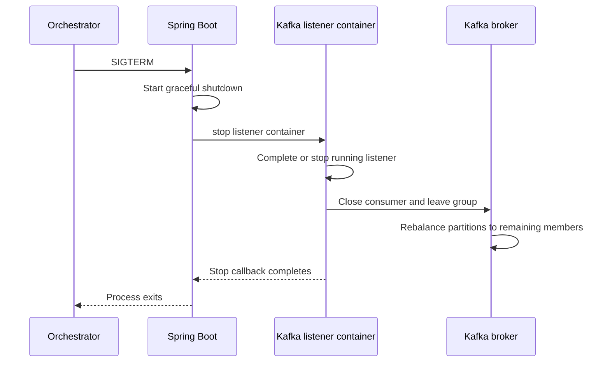

# Safe Shutdown and Rebalancing

A Spring Kafka application must stop its consumers in an orderly manner when receiving a termination signal, deploying a new release, or updating configuration. If containers stop too abruptly, in-flight records may remain unacknowledged and get redelivered. If a consumer leaves the group unexpectedly, Kafka must rebalance partitions to the remaining members.

Safe shutdown therefore requires coordinating the Spring lifecycle, listener containers, acknowledgments/transactions, and the deployment platform's termination window. The goal is to finish in-flight work within bounded time so uncommitted records can be reprocessed safely and the consumer group stabilizes quickly.

## 1. What happens when the application receives SIGTERM?

In environments like Kubernetes or process managers, applications typically receive `SIGTERM` before forced termination. In Spring Boot, this signal triggers closing the `ApplicationContext`; Spring-managed listener containers are stopped according to their lifecycle.



Containers declared via `@KafkaListener` are managed by `KafkaListenerEndpointRegistry`. When the application context closes, Spring Kafka stops these containers. Never spawn a separate thread calling `KafkaConsumer.close()` directly; the consumer is owned by the container and must be managed through the container lifecycle.

If your application manually creates containers using `ConcurrentKafkaListenerContainerFactory.createContainer(...)`, keep references and explicitly stop/destroy them along the proper lifecycle. Avoid letting manually created containers outlive the service managing them.

## 2. Configuring shutdown wait timeouts

`ContainerProperties` provides `shutdownTimeout` to cap how long the container waits for consumers to stop. The API unit is milliseconds. Choose a value based on the longest acceptable record processing time and flushing related resources:

```java
@Bean
public ConcurrentKafkaListenerContainerFactory<String, OrderEvent>
        kafkaListenerContainerFactory(
            ConsumerFactory<String, OrderEvent> consumerFactory) {
    var factory =
        new ConcurrentKafkaListenerContainerFactory<String, OrderEvent>();
    factory.setConsumerFactory(consumerFactory);
    factory.getContainerProperties().setShutdownTimeout(15_000L);
    return factory;
}
```

Spring Boot also provides a timeout per lifecycle shutdown phase:

```properties
spring.lifecycle.timeout-per-shutdown-phase=30s
server.shutdown=graceful
```

`server.shutdown=graceful` controls graceful shutdown of the web server. `spring.lifecycle.timeout-per-shutdown-phase` limits how long one Spring lifecycle phase waits. Verify your Spring Boot version and server config; Kafka container timeouts and lifecycle phase timeouts cover different scopes.

In Kubernetes, `terminationGracePeriodSeconds` must be large enough for the application to complete all shutdown phases. If the orchestrator sends SIGKILL before the container finishes, internal application timeouts cannot guarantee graceful shutdown.

Do not set huge timeouts to mask hung listeners. Put explicit timeouts on HTTP/database calls inside listeners, handle cancellation intentionally, and alert when shutdown exceeds expected duration.

## 3. Stopping containers with a completion callback

To stop a specific listener, retrieve its container from the registry and call `stop(Runnable callback)`. The callback runs once the container has stopped, making it suitable for logging state or running follow-up cleanup:

```java
@Service
public class ListenerLifecycleService {
    private final KafkaListenerEndpointRegistry registry;

    public ListenerLifecycleService(KafkaListenerEndpointRegistry registry) {
        this.registry = registry;
    }

    public void stopOrdersListener() {
        MessageListenerContainer container =
            registry.getListenerContainer("orders-listener");
        if (container == null || !container.isRunning()) {
            return;
        }

        container.stop(() ->
            log.info("orders-listener stopped"));
    }
}
```

Use `stop()` when you want to shut down the consumer; use `pause()` when you only need to pause receiving records while keeping the consumer in the group. Do not call `unregisterListenerContainer()` before stopping completes: unregistering only removes the reference from the registry without stopping the consumer.

For Spring-managed containers, normally let the application context orchestrate shutdown. Stop manually only for specific operational needs, such as disabling a tenant or draining one listener before a configuration change.

## 4. How are in-flight records handled?

Stopping a container does not automatically turn every in-flight record into a success. The outcome depends on when the listener finishes and the acknowledgment mode:

- **`RECORD`:** the container confirms progress after each record succeeds per commit configuration.
- **`BATCH`:** the container confirms batch progress once the listener finishes the full batch.
- **`MANUAL` / `MANUAL_IMMEDIATE`:** the listener must acknowledge after business logic completes under the app's contract.
- **Kafka transaction:** if the listener fails and the transaction rolls back, neither Kafka outputs nor offsets in that transaction are committed.

If the process exits before offsets are committed, records can be redelivered once another consumer takes the partition or when the app restarts. This is normal Kafka behavior. Listeners must be idempotent so redelivery never produces duplicate side effects.

Never acknowledge at the start of a listener just to avoid redelivery on shutdown. Acknowledge only after business changes are durably persisted. When business logic writes to a database before committing Kafka offsets, use an inbox/deduplication mechanism or proper transaction coordination to handle crashes between the two steps.

## 5. Coordinating shutdown with producers and external resources

A listener may process records and publish downstream events via `KafkaTemplate`. When using container-managed Kafka transactions, let the transaction finish with the listener: commit on success, roll back on exception. Never manually commit an offset or close a producer participating in the container's transaction.

If the application runs standalone producers, ensure critical sends are acknowledged before the process exits. Use `KafkaTemplate.send()` futures to track completion and `flush()` inside a controlled shutdown step when appropriate. Avoid blocking indefinitely; enforce timeouts and handle incomplete sends explicitly.

For application-managed HTTP clients, database connection pools, or executors, stop accepting new work first, wait for running work within a bound, then close resources. Never leave consumer threads waiting on an executor that was already shut down earlier.

## 6. When do rebalances occur?

Kafka rebalancing redistributes partitions among consumers in the same group. Common causes:

- A consumer starts, stops, or loses connectivity.
- A consumer fails to call `poll()` within the allowed window and is considered inactive.
- `max.poll.interval.ms` is exceeded due to slow processing.
- Topic subscriptions or partition counts change.
- Rolling updates cause members to leave and rejoin the group sequentially.

When a consumer leaves a group cleanly, its partitions are revoked and reassigned to remaining members. If a consumer disappears abruptly, the broker may wait for timeouts to expire before reassigning. Rebalances can pause listener processing briefly and redeliver uncommitted records.

## 7. Handling partition revocation and assignment

When partitions are about to be revoked, the application may need to flush local state, wrap up partition-scoped tasks, or release resources. Spring Kafka supports `ConsumerAwareRebalanceListener` for callbacks before/after commit and when partitions are assigned or lost.

```java
factory.getContainerProperties().setConsumerRebalanceListener(
    new ConsumerAwareRebalanceListener() {
        @Override
        public void onPartitionsRevokedBeforeCommit(
                Consumer<?, ?> consumer,
                Collection<TopicPartition> partitions) {
            stateStore.flush(partitions);
        }

        @Override
        public void onPartitionsAssigned(
                Consumer<?, ?> consumer,
                Collection<TopicPartition> partitions) {
            stateStore.load(partitions);
        }

        @Override
        public void onPartitionsLost(
                Consumer<?, ?> consumer,
                Collection<TopicPartition> partitions) {
            stateStore.discardLocalOwnership(partitions);
        }
    });
```

`onPartitionsRevokedBeforeCommit` is suited for finalizing required state prior to the container's commit step; do not manually commit offsets here when the container already manages acknowledgments. `onPartitionsAssigned` loads state for newly assigned partitions. Once partitions are lost, ownership no longer belongs to the consumer; do not attempt to commit offsets or execute side effects assuming you still own those partitions.

Rebalance callbacks run on the consumer thread and must finish quickly. Avoid slow remote calls or unbounded lock waits inside callbacks, as they can prolong rebalances and destabilize the group.

## 8. Minimizing disruption during rolling deployments

When deploying multiple replicas, avoid stopping all consumers at once. Rolling deployments replace instances one at a time so remaining members keep processing while one shuts down and a new member joins.

A typical rollout sequence:

1. Remove the stopping instance from readiness for new requests.
2. Stop accepting new work from external sources and let in-flight requests finish.
3. Stop listener containers cleanly.
4. Wait for listeners, transactions, and critical sends to complete within the shutdown window.
5. Close consumers to leave the group; partitions rebalance to remaining members.
6. Start the new instance and wait for listeners to join the group steadily.

For applications serving HTTP while consuming Kafka, HTTP readiness and consumer state are distinct signals. Avoid marking the entire service unhealthy just because one listener is intentionally paused; align readiness/liveness with operational goals.

Consider cooperative sticky assignment to reduce the number of partitions moved during certain rebalances. Static membership via `group.instance.id` can also cut rebalances on fast restarts, provided IDs are unique across the group; duplicate IDs or prolonged instance outages can delay redistribution.

## 9. Avoiding repeated rebalances from slow listeners

If processing time between two `poll()` calls exceeds `max.poll.interval.ms`, the consumer can leave the group and trigger a rebalance. When increasing batch sizes or calling slow dependencies, budget for total batch processing time rather than average single-record duration.

Common safeguards:

- Enforce timeouts on HTTP, database, and other dependencies.
- Tune `max.poll.interval.ms` to match bounded maximum processing duration.
- Lower `max.poll.records` or batch size if one poll delivers too much work.
- Size concurrency appropriately for partition count and downstream capacity.
- Use controlled pause/backpressure when throttling incoming records.
- Offload long-running work to an executor or durable workflow, ensuring acknowledgments never confirm records before work truly finishes.

Setting `max.poll.interval.ms` excessively high delays detecting hung consumers. Monitor rebalances and processing times to choose data-driven values.

## 10. Observing shutdown and rebalancing

Emit structured logs for shutdown start, listener stop start, stop callback completion, partition revoked/assigned/lost events, and consumer group stabilization. Include `application`, `listenerId`, `groupId`, `topic`, `partition`, and shutdown reason whenever available.

Track these metrics and signals:

- Time from SIGTERM until process exit.
- Stop duration per listener container.
- Rebalance count and rebalance completion duration.
- Counts of revoked, assigned, or lost partitions.
- Consumer lag before, during, and after deployments.
- Retry or redelivery counts following shutdown.
- Offset commit errors, transaction rollbacks, and consumer close failures.

If rebalances spike after every deployment, check shutdown duration, `max.poll.interval.ms`, dependency timeouts, rolling update policy, and whether new instances join the group too early.

## 11. Testing shutdown and rebalancing

An integration test should run at least two consumers in the same group against a multi-partition topic. Send records continuously, stop one container mid-processing, and verify partitions move to the remaining member while uncommitted records are redelivered.

Additional scenarios to test:

- Listener finishes and commits before shutdown timeout expires.
- Listener exceeds timeout and the process terminates.
- Listener throws an exception during shutdown.
- Manual acknowledgment is invoked only after side effects complete.
- Partition revocation and partition loss occur mid-processing.
- Rolling restart across multiple replicas with the consumer group returning to stability.
- Producer has pending unacknowledged sends when the application context closes.

Use Embedded Kafka for basic lifecycle, listener, and offset tests; use Testcontainers or a multi-broker cluster when testing group/rebalance behavior closer to production. Do not assert only that `isRunning()` returns `false`; verify stop callbacks, committed offsets, record redelivery, and partition handoff to another consumer.

## 12. Safe shutdown checklist

- Use Spring lifecycle to stop listener containers; never close `KafkaConsumer` manually from another thread.
- Set `shutdownTimeout` and lifecycle timeouts based on actual processing durations.
- Ensure the platform's termination grace period exceeds total required shutdown time.
- Acknowledge only after business work is durably complete.
- Design idempotent listeners since uncommitted records can be redelivered.
- Flush or await critical producer sends with bounded timeouts.
- Keep rebalance callbacks brief to flush state and release ownership.
- Monitor rebalances, consumer lag, shutdown duration, and commit errors.
- Test rolling deployments and in-flight record handling before release.

Safe shutdown and rebalancing are integral to reliable messaging. By coordinating Spring lifecycle, listener container timeouts, timely acknowledgments, and partition callbacks, applications can leave consumer groups cleanly. Uncommitted records can still be redelivered by Kafka, making idempotency and observability essential for stable deployments and operations.
