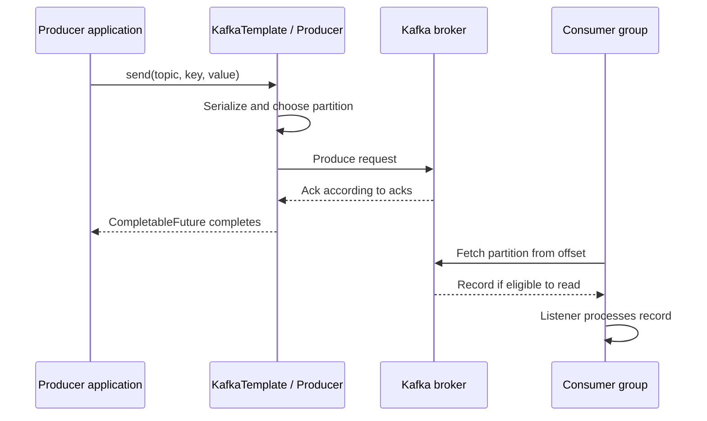
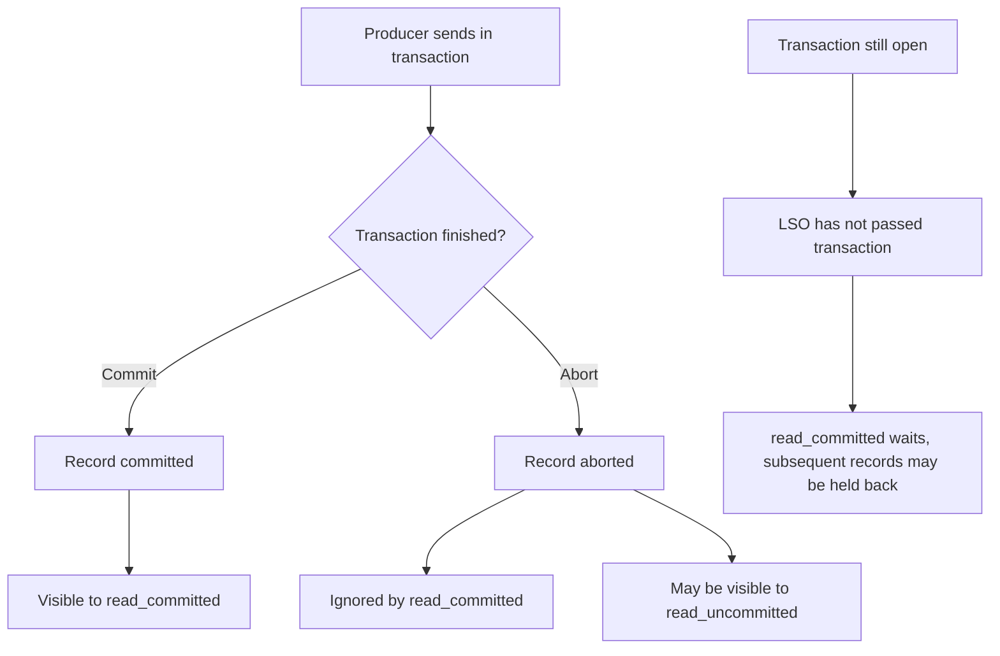

# Producer Sends but Data Is Not Seen

When an application calls `KafkaTemplate.send()` yet the consumer sees no records, first determine whether **the producer received acknowledgement from the broker or only queued the record into the asynchronous send pipeline**. Next, check the topic, cluster, partitions, transactions, and consumer group state. A successful send on the producer side does not mean the listener processed the record; conversely, the consumer not seeing the record does not prove the producer failed to send.

Spring Kafka wraps the Kafka producer with `KafkaTemplate` and returns `CompletableFuture<SendResult<K, V>>`. The future reports the send outcome according to `acks`; on success, `SendResult` provides `RecordMetadata` with the topic, partition, and offset. This is useful evidence to pinpoint where the broker recorded the message.

## 1. Distinguish Successful Send from Successful Processing

The basic flow has two independent stages:

1. The producer serializes key/value, selects a partition, and sends a Produce request to the broker.
2. The broker processes the request and returns an acknowledgement according to `acks`; only afterward does the consumer fetch the record by partition and offset.



If the future fails, investigate the producer, serializer, network, broker, topic, or write permissions. If the future succeeds with valid metadata, shift focus to the consumer: topic subscription, partition assignment, committed offsets, transaction isolation, deserializer, filters, and error handler.

Do not treat a log like `send() called` as proof the record was persisted. That log line usually only shows the application invoked the API; the actual result arrives later when the callback/future completes.

## 2. Inspect `CompletableFuture` and `RecordMetadata`

`KafkaTemplate.send()` is an asynchronous API. In modern Spring Kafka, it returns `CompletableFuture<SendResult<K, V>>`. If you do not observe the future, send failures may only appear in producer callbacks or logs.

Example recording the send outcome:

```java
@Service
class OrderEventPublisher {

    private static final Logger log = LoggerFactory.getLogger(OrderEventPublisher.class);

    private final KafkaTemplate<String, String> kafkaTemplate;

    OrderEventPublisher(KafkaTemplate<String, String> kafkaTemplate) {
        this.kafkaTemplate = kafkaTemplate;
    }

    void publish(String orderId, String payload) {
        CompletableFuture<SendResult<String, String>> future =
                kafkaTemplate.send("orders", orderId, payload);

        future.whenComplete((result, exception) -> {
            if (exception != null) {
                log.error("Kafka send failed: topic=orders, key={}", orderId, exception);
                return;
            }

            RecordMetadata metadata = result.getRecordMetadata();
            log.info("Kafka send acknowledged: topic={}, partition={}, offset={}, key={}",
                    metadata.topic(), metadata.partition(), metadata.offset(), orderId);
        });
    }
}
```

When the callback succeeds, log `topic`, `partition`, `offset`, key, and correlation ID to cross-check with the consumer. On failure, log the full exception and root cause; do not just log a generic message like `cannot send`.

In tests or manual diagnostics, you can await the future with a timeout:

```java
SendResult<String, String> result = kafkaTemplate
        .send("orders", "order-42", "created")
        .get(10, TimeUnit.SECONDS);

RecordMetadata metadata = result.getRecordMetadata();
assertThat(metadata.topic()).isEqualTo("orders");
log.info("Written to {}-{} at offset {}",
        metadata.topic(), metadata.partition(), metadata.offset());
```

This synchronous wait is useful for tests or diagnostic tools. Avoid blocking business threads with `get()` on every send in production without a clear reason; use callbacks/futures to handle outcomes asynchronously. If `get()` throws `ExecutionException`, inspect `getCause()` for the underlying error. `TimeoutException` means no result arrived within the wait window—it does not by itself prove the broker did not write the record.

By default, `KafkaTemplate` uses `LoggingProducerListener`: send errors are logged, while the default success callback does nothing. You can configure a custom `ProducerListener` to capture metadata or emit metrics.

The producer batches records. If `linger.ms` is greater than `0`, an unfilled batch may wait until the linger window expires before being sent. In tests or diagnostic utilities that require immediate dispatch, call `kafkaTemplate.flush()` before awaiting the result or use a template configured with `autoFlush`. Only flush when you want to push partial batches early; flushing does not fix a wrong topic, ACL error, or uncommitted transaction.

## 3. Confirm the Right Cluster and Topic

An easy-to-miss mistake is the producer and consumer connecting to two different Kafka clusters due to mismatched profiles, environment variables, ConfigMaps, or secrets. Compare `bootstrap.servers` on both sides and check the actual configuration after Spring Boot binds properties.

Points to confirm:

- Producer and consumer use the exact cluster address for the environment under test.
- Topic names match strictly, including letter casing and environment prefixes like `dev-`, `staging-`, `prod-`.
- Consumer subscribes to the right topic or pattern; `@KafkaListener` is not attached to the wrong `containerFactory`.
- Producer does not send to a topic name built from an empty config variable or wrong profile.
- Broker addresses advertised via `advertised.listeners` are reachable from the client machine/container.

`bootstrap.servers` is only used to establish the initial connection and fetch cluster metadata. After bootstrapping, the client connects to the brokers advertised in metadata. Thus, it is possible to reach the bootstrap broker yet still fail when sending if `advertised.listeners` returns a hostname/IP the application cannot reach.

Inspect topics and partitions via Kafka CLI:

```bash
kafka-topics.sh --bootstrap-server broker1:9092 --describe --topic orders
```

Confirm the topic exists, has partitions, a valid leader, and expected replica/ISR state. If Kafka runs in Docker, check internal vs. host listeners; `localhost:9092` inside a producer container does not necessarily point to the broker container.

In Spring, you can check topic metadata via the template:

```java
List<PartitionInfo> partitions = kafkaTemplate.partitionsFor("orders");
if (partitions.isEmpty()) {
    throw new IllegalStateException("Topic orders has no partition metadata");
}
```

If the application sends right at startup and topics are created by `NewTopic` beans, avoid sending inside `@PostConstruct`. At that point, the Spring context may not have finished running `KafkaAdmin` topic creation, leading to `UnknownTopicOrPartitionException`. Send after context refresh, use an appropriate `SmartLifecycle`, or pre-create topics in the deployment pipeline.

## 4. Check Outcomes Against `acks` and Producer Errors

The producer can only report the level of acknowledgement requested by `acks`:

| `acks` | Meaning | Interpretation |
|---|---|---|
| `0` | Do not wait for broker acknowledgement | Future does not prove the broker received the record; offset metadata may be `-1` |
| `1` | Leader acknowledges after writing to its local log | Leader could fail before followers replicate the record |
| `all` (`-1`) | Leader waits for in-sync replicas to acknowledge | Strongest acknowledgement among the three options |

Example producer configuration for higher durability:

```yaml
spring:
  kafka:
    producer:
      acks: all
      properties:
        "[enable.idempotence]": true
```

`acks=all` combined with an appropriate `min.insync.replicas` lets the broker reject writes when ISR is insufficient rather than acknowledging a record with lower durability than expected. Idempotence prevents duplicates from producer retries under supported conditions; it does not guarantee the consumer will automatically see or process the record.

Common producer errors:

| Exception/symptom | Where to investigate |
|---|---|
| `TimeoutException` | Check network, overloaded broker, leader/ISR, request timeout, and `delivery.timeout.ms` |
| `UnknownTopicOrPartitionException` | Wrong topic name, uncreated topic, stale metadata, or unready leader |
| `NotEnoughReplicasException` / `NotEnoughReplicasAfterAppendException` | Check ISR and `min.insync.replicas` |
| `RecordTooLargeException` | Check record size and producer, topic, and broker limits |
| `SerializationException` | Serializer cannot process key/value or invalid schema/payload |
| `TopicAuthorizationException` | Producer principal lacks write ACL on the topic |
| `SaslAuthenticationException` / `SSLHandshakeException` | Check credentials, SASL mechanism, truststore, hostname, and TLS |
| `NotLeaderOrFollowerException` | Metadata/leader changed; inspect retries, broker health, and partition state |

`delivery.timeout.ms` caps the total time the producer waits for a send to succeed or fail, including batching, acknowledgements, and transient error retries. When timeouts occur, inspect producer logs and metrics to see whether requests are waiting on brokers, retrying, or hitting non-retryable errors.

## 5. Verify Independently with a New Consumer Group

If the producer received an acknowledgement, read the topic using a brand-new diagnostic consumer group. Using a new group separates the question “does the record exist in the log?” from the running application's committed offsets.

```bash
kafka-console-consumer.sh \
  --bootstrap-server broker1:9092 \
  --topic orders \
  --group diagnose-orders-001 \
  --from-beginning
```

Use an unused group ID and `--from-beginning` to read existing data within retention. If the topic uses JSON or binary key/value formats, the console consumer may print unreadable bytes/strings; that does not mean the record is missing. Cross-check with the serializer and decoding format.

If the diagnostic consumer sees the record while the application does not, the producer and broker are likely working. Shift investigation to the consumer group, listener container, partition assignment, offsets, isolation level, and deserialization.

## 6. Check Committed Offsets of the Consumer Group

The consumer group might have read the record earlier, with its committed offset already past the offset the producer just wrote. In that case, the listener not being re-invoked for older records is expected behavior.

Inspect the group:

```bash
kafka-consumer-groups.sh \
  --bootstrap-server broker1:9092 \
  --describe \
  --group order-service
```

Key columns:

| Column | Meaning |
|---|---|
| `CURRENT-OFFSET` | Next offset the group will read on the partition |
| `LOG-END-OFFSET` | Next offset after the last record currently in the log |
| `LAG` | Difference between log end and committed offset |
| `CONSUMER-ID` / `HOST` | Consumer member currently holding the partition |

For example, the producer writes at offset `125`, yet the group already has `CURRENT-OFFSET=126`. The consumer group has moved past that record; the listener will not receive it again unless a new record arrives beyond the current position.

`auto.offset.reset` is used only when a group has no valid committed offset or its current offset no longer exists. Setting `earliest` does not rewind a group that already holds a valid offset back to the beginning of the topic. If replay is needed, use a new diagnostic group or intentionally reset offsets under a controlled operational procedure; never reset a production group just to inspect.

## 7. Check Transactions and `isolation.level`

If the producer sends inside a Kafka transaction, records are not exposed to `read_committed` consumers until the transaction commits. If the transaction rolls back/aborts, those records are not returned to `read_committed` consumers.



`isolation.level` has two main values:

- `read_uncommitted`: reads both committed and aborted transactional records; this is the Kafka consumer default.
- `read_committed`: reads only non-transactional records and committed transactional records up to the Last Stable Offset (LSO). Records after an open transaction may not be returned until that transaction finishes.

If the application uses `read_committed`, verify the producer committed the transaction. With `KafkaTemplate.executeInTransaction()`, the callback must complete normally for the transaction to commit; an exception aborts the transaction. With container transactions, the listener must finish and the container must commit successfully. Check transaction logs, `transactional.id`, and fencing/timeout errors if records do not appear.

## 8. Check Serializer, Deserializer, and `ErrorHandlingDeserializer`

A producer can successfully send a byte sequence that the consumer fails to decode into the expected Java type. Both sides must agree on key/value serializers and deserializers, schemas, encodings, and type mappings.

Example producer using JSON:

```yaml
spring:
  kafka:
    producer:
      key-serializer: org.apache.kafka.common.serialization.StringSerializer
      value-serializer: org.springframework.kafka.support.serializer.JacksonJsonSerializer
```

The consumer must use a deserializer compatible with the payload and target type. If the producer sends JSON while the consumer uses `StringDeserializer` when the listener expects a POJO, or the producer uses Java serialization while the consumer expects JSON, errors can occur before the listener is invoked.

Deserialization happens during `poll()`, before records are passed to the listener. `ErrorHandlingDeserializer` wraps the real deserializer to store the exception and raw bytes in headers so the container error handler can process the failed record or route it to a DLT. Without this setup, deserialization failures can fail consumer polling and keep the record out of `@KafkaListener`.

When suspecting deserialization errors:

1. Check consumer logs prior to any listener log lines.
2. Confirm key/value serializer/deserializer classes and target types on both sides.
3. Verify JSON/schema, type headers, encoding, and payload version.
4. Inspect `ErrorHandlingDeserializer`, the error handler, and the DLT.
5. Read raw records with an appropriate tool if payloads are non-text.

## 9. Check Filters and Listener Container State

Records may reach the consumer yet never enter the business listener because the container is not running, has no partition assignment, or a filter discards them.

Check the following:

- Has the listener container started? Inspect startup logs, `autoStartup`, `KafkaListenerEndpointRegistry`, and container lifecycle.
- Does the consumer group have active members and partition assignments?
- Does `@KafkaListener` specify the right `topics`, `topicPattern`, `groupId`, and `containerFactory`?
- Is a `RecordFilterStrategy` or `RecordInterceptor` returning `null`/filtering records?
- Is the listener throwing exceptions and the error handler retrying, recovering, or routing records to a DLT?
- Are records sent to a retry topic or DLT by another error handler?

If a filter returns `true` to discard a record, the listener will not receive it. Log filter discard reasons or track filtered-record metrics; avoid logging only inside the business listener since filtered records never reach it.

With `@KafkaListener(autoStartup = "false")`, the container does not start automatically at application startup. The application must start it explicitly via `KafkaListenerEndpointRegistry` once conditions are ready. Check lifecycle state before concluding the consumer cannot see data.

## 10. Check Retention, Compaction, and Read Timing

Records may have been removed from the log by retention before a new consumer started reading. On compacted topics, Kafka retains the latest value per key and may remove older entries during compaction; tombstones can also lead to key deletion after the configured window.

Check topic settings and offset ranges if records were sent long ago. If a committed offset lies before the log start offset, the consumer cannot read deleted records; `auto.offset.reset` determines how the invalid offset is handled.

Additionally, if a consumer starts with `latest` and has no committed offset, it places its read position at the end of the log. Records sent before the consumer subscribed will not be read by that new group. For scenarios needing older data, use `earliest` on a new group or create a dedicated diagnostic group.

## 11. Isolation Workflow Based on Findings

| Observed outcome | Area to check next |
|---|---|
| Future fails or times out | Serializer, bootstrap/network, TLS/SASL, topic, leader/ISR, ACLs, broker quotas, and producer config |
| Future succeeds without valid metadata (`acks=0`) | Cannot conclude broker received it; switch to an appropriate ack setting for diagnosis |
| Future succeeds, new diagnostic consumer sees record | Application consumer group, offsets, listener container, filters, transaction isolation, or deserializer |
| New diagnostic consumer also sees nothing | Confirm cluster/topic, retention, transaction state, record format, and broker logs |
| `read_uncommitted` sees it, `read_committed` does not | Transaction aborted or still open/LSO has not advanced past the open transaction |
| Console consumer reads it, listener is not called | Assignment, `autoStartup`, filters, deserializer, error handler, or retry/DLT |
| Listener logs show processing, users see no data | Inspect downstream business logic, database transactions, caches, APIs, or target systems |

Proceed in this order to avoid changing multiple configs at once:

1. Capture how the future finished and obtain `RecordMetadata` if it succeeded.
2. Compare cluster, topic, partition, and timestamp against environment configuration.
3. Read the topic from the start with a new diagnostic group.
4. Check committed offsets, lag, and partition assignments of the application group.
5. Check transaction isolation and commit state.
6. Check deserializer, filters, listener lifecycle, error handler, and DLT.
7. Only after pinpointing the root cause should you adjust producer or consumer configs.

## 12. Troubleshooting Checklist

- [ ] The future from `KafkaTemplate.send()` completed with no exceptions.
- [ ] On success, topic, partition, and offset from `RecordMetadata` are recorded.
- [ ] Producer and consumer connect to the right Kafka cluster and advertised listeners are reachable.
- [ ] Topic exists with partitions, valid leaders, and healthy ISR.
- [ ] `acks` matches the verification level needed; `acks=0` is not used to confirm broker persistence.
- [ ] Producer has `WRITE` permission; consumer has `READ` permission on topic and group.
- [ ] A diagnostic consumer with a new group and `earliest` can read the record.
- [ ] Production consumer group has expected offsets, lag, and assignments.
- [ ] Transactions are committed if the consumer uses `read_committed`.
- [ ] Serializers/deserializers match; deserialization errors and DLT are checked.
- [ ] No filter or listener container lifecycle state skips records.
- [ ] Retention, compaction, and log start offset have not removed the target records.

## 13. Key Takeaways

- `KafkaTemplate.send()` is asynchronous; observe `CompletableFuture` or `ProducerListener` to know the outcome.
- `SendResult.getRecordMetadata()` provides topic, partition, and offset once the broker acknowledges per `acks`.
- `acks=0` waits for no broker acknowledgement; `acks=1` waits for leader; `acks=all` waits for ISR.
- A successful future does not mean the consumer processed the record; inspect consumer groups and offsets.
- `auto.offset.reset=earliest` applies only when a group has no valid committed offset or its offset no longer exists.
- `read_committed` skips aborted transactions and reads only up to LSO; records in uncommitted transactions remain hidden.
- Deserialization errors occur before the listener; `ErrorHandlingDeserializer` lets the error handler deal with bad records.
- Filters, unstarted listeners, retry/DLT routing, retention, and compaction can all prevent the application from seeing records as expected.
- Use a fresh diagnostic consumer group to separate producer/broker issues from production consumer offset or config issues.

## References

- [Spring for Apache Kafka — Sending Messages with KafkaTemplate](https://docs.spring.io/spring-kafka/reference/kafka/sending-messages.html)
- [Spring for Apache Kafka — Serialization, Deserialization and Message Conversion](https://docs.spring.io/spring-kafka/reference/kafka/serdes.html)
- [Spring for Apache Kafka — Handling Exceptions](https://docs.spring.io/spring-kafka/reference/kafka/annotation-error-handling.html)
- [Apache Kafka — Producer Configurations](https://kafka.apache.org/41/configuration/producer-configs/)
- [Apache Kafka — Consumer Configurations](https://kafka.apache.org/41/configuration/consumer-configs/)
- [Apache Kafka — Basic Operations](https://kafka.apache.org/41/operations/basic-kafka-operations/)
