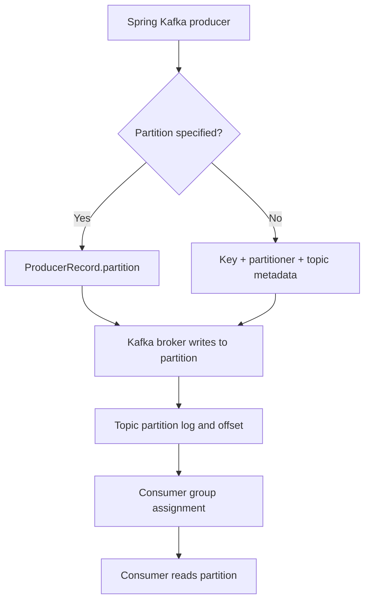

# Record Routed to Wrong Partition

When a record shows up in an unexpected partition, determine whether the partition was chosen on the producer side or the record is simply being processed by a different consumer instance. Kafka chooses the partition when the producer sends the record based on an explicit partition, the key, and the partitioner. A consumer group only distributes existing partitions across consumers; it never moves a record from one partition to another.

Common causes include producers sending records without keys, unstable keys, buggy custom partitioners, increased topic partition counts, or applications confusing consumer assignment with record partition. This lesson provides a diagnostic workflow from send metadata, keys, partitioners, and topic configuration to processing order in Spring Kafka.

## 1. Distinguish Record Partition from Consumer Assignment

A record is written to a specific partition of a topic. Record metadata includes topic, partition, offset, and timestamp. Once written, the consumer group distributes partitions among consumer members. Assignment decides which consumer reads a partition; it never changes where the record was stored.



For example, topic `orders` has three partitions. The producer picks partition 2 and the broker appends the record at offset 145. When the consumer group rebalances, partition 2 may shift from consumer A to consumer B. The record remains at partition 2, offset 145; only the consumer owning that partition changed.

To diagnose, always record two pieces separately:

- **Record metadata:** `topic`, `partition`, `offset`, key, and event ID of the actual record.
- **Consumer assignment:** which consumer member holds which partition at inspection time.

If `ConsumerRecord.partition()` shows the record is in partition 2, consumer B receiving it does not mean the record changed partitions. Do not alter `concurrency` or consumer groups to fix a producer-side partition routing issue.

## 2. Check Metadata Returned After Send

In Spring Kafka, `KafkaTemplate.send(...)` returns a future holding `SendResult`. Once the broker acknowledges the send, `RecordMetadata` reveals the actual partition and offset.

```java
public RecordMetadata publish(OrderEvent event) throws Exception {
    SendResult<String, OrderEvent> result = kafkaTemplate
            .send("orders", event.orderId(), event)
            .get(10, TimeUnit.SECONDS);

    RecordMetadata metadata = result.getRecordMetadata();
    log.info("Published eventId={} key={} topic={} partition={} offset={}",
            event.eventId(), event.orderId(), metadata.topic(),
            metadata.partition(), metadata.offset());
    return metadata;
}
```

In this example, `orderId` is the key. Logging the partition and offset returned by the broker is exact proof of where the record landed. Never infer the partition from the key by re-computing a hash in application code; the producer's partitioner algorithm and topic metadata determine the actual result.

On the listener side, accept `ConsumerRecord` to log matching metadata:

```java
@KafkaListener(topics = "orders", groupId = "order-service")
public void consume(ConsumerRecord<String, OrderEvent> record) {
    log.info("Consumed eventId={} key={} topic={} partition={} offset={}",
            record.value().eventId(), record.key(), record.topic(),
            record.partition(), record.offset());

    orderService.process(record.value());
}
```

Compare metadata between producer and consumer by `eventId`. If the same event ID appears on different partitions, check which producer sent it, which send was a replay, and whether the topic changed partition count. If producer and consumer report the same partition yet completion logs show out-of-order execution, the cause may lie in concurrent listener processing.

## 3. Check the Record Key

With Kafka's default partitioner, keyed records are typically routed based on a hash of the key and the topic's partition count. Therefore, records sharing the same key normally land on the same partition as long as partition count and partitioner remain unchanged.

For example, events for the same order should share `orderId`:

```java
kafkaTemplate.send("orders", "order-42", new OrderCreated("order-42"));
kafkaTemplate.send("orders", "order-42", new OrderPaid("order-42"));
kafkaTemplate.send("orders", "order-42", new OrderShipped("order-42"));
```

If one send uses `orderId`, another uses `eventId`, or one code branch sends a null key, events can scatter across different partitions. Kafka can then no longer maintain a shared ordering for that order's events.

Check keys both where events are built and where the producer is called:

| Symptom | Common cause | How to verify |
|---|---|---|
| Same order, different partitions | Producers use different keys or one record has a null key | Log key, event ID, and event type right before sending. |
| Uneven record distribution | Low-cardinality keys or a few very hot keys | Count records per key/partition and identify key skew. |
| Non-null key still hits wrong partition | Custom partitioner, explicit partition, or differing topic metadata | Check producer config and partition count at send time. |
| Same key lands on new partition after infra change | Topic partition count increased or partitioner changed | Correlate topic modification time and producer version. |

Unkeyed records have no guarantee that the same entity will stick to one partition. The default partitioner may use sticky batching to group unkeyed records onto a partition over a send window; exact behavior depends on the Kafka client and config. Never rely on fixed round-robin distribution for unkeyed records.

## 4. Check Explicit Partitions and Custom Partitioners

Producers can specify a partition directly. When `ProducerRecord` includes a partition, that choice takes precedence over computing one from the key.

Example sending to partition 1:

```java
ProducerRecord<String, OrderEvent> record = new ProducerRecord<>(
        "orders",
        1,
        event.orderId(),
        event);

SendResult<String, OrderEvent> result = kafkaTemplate.send(record)
        .get(10, TimeUnit.SECONDS);

assert result.getRecordMetadata().partition() == 1;
```

Explicit partitions are handy for specialized flows or deterministic tests, yet they couple the producer to topic topology. If a topic shrinks partitions or another environment has fewer partitions, the producer may send to an invalid partition. Use this only when the application explicitly owns that distribution rule.

If `partitioner.class` configures a custom partitioner, inspect:

- Handling of null keys and unusually formatted keys.
- Partition count read from topic metadata.
- Whether the math always returns a partition in the valid range `0` to `partitionCount - 1`.
- Whether all producer instances run the same version and partitioner config.
- Whether partition-count changes alter routing results.

Custom partitioners should have unit tests covering various keys, null keys, varying partition counts, and edge cases. Then use integration tests to verify actual partitions via `RecordMetadata`, because unit tests validate the algorithm without proving the producer loads the right configuration.

## 5. Check Topic Partition Count

The partitioner picks partitions based on the topic metadata known to the producer. If a topic's partition count increases, the same key can map to a different partition than before. For instance, a key that mapped to partition 1 in a 3-partition topic can map to a different partition when the topic expands to 6 partitions.

Verify actual topology with Kafka tools:

```bash
bin/kafka-topics.sh \
  --bootstrap-server kafka.example.com:9092 \
  --describe \
  --topic orders
```

Compare partition counts across environments and against the incident timeline. Do not assume topic settings in an application's YAML file are the source of truth; topics may have been created or altered independently by Kafka administration processes.

Increasing partition count does not migrate older records to new partitions. Old records stay in their original partitions; new records may route according to the new partition count. Consequently, a single key can have older history in one partition and newer events in another. Kafka provides no global ordering across partitions to stitch that history together.

If business logic requires continuous per-aggregate ordering, plan a migration or embed sequence/version numbers in payloads so consumers detect out-of-order arrivals. Never expand partition counts in production without assessing key routing and ordering impacts.

## 6. Distinguish Routing Errors from Concurrent Consumer Processing

Sometimes records land in the right partition yet business outcomes appear out of order. For instance, `OrderCreated` and `OrderPaid` sit on the same partition, the consumer receives them in offset order, yet the listener submits both tasks to an executor. The worker handling `OrderPaid` finishes faster and updates the database first.

```java
@KafkaListener(topics = "orders")
public void consume(OrderEvent event) {
    workerPool.submit(() -> orderService.process(event));
}
```

This code returns from the listener immediately after submitting. Kafka can continue delivering the next record while the earlier worker is still running. When per-key ordering matters, process sequentially inside the listener or shard worker lanes sequentially by key. Sequence/version numbers can also reject or defer out-of-order events.

Check layer by layer:

1. Compare record partition and offset at producer vs. consumer.
2. Confirm the listener receives records in partition offset order.
3. Log processing start and end timestamps per event.
4. Check whether an executor, reactive pipeline, or async callback reorders completion.
5. Compare database update order or downstream side effects.

If partitions and offsets are right yet completion order is wrong, raising concurrency or changing the partitioner will not fix the root cause. Fix async execution or add versioning/idempotency.

## 7. Check Metadata and Assignments in Spring Kafka

To see which partitions a consumer group owns, inspect the listener container or rebalance/assignment logs. Spring Kafka provides `KafkaListenerEndpointRegistry` to look up containers by listener ID; exact APIs for assigned partitions depend on version. You can use rebalance callbacks or consumer group tooling to observe assignments.

Command to describe a consumer group:

```bash
bin/kafka-consumer-groups.sh \
  --bootstrap-server kafka.example.com:9092 \
  --describe \
  --group order-service
```

The output shows which partitions each group member handles alongside offsets and lag. That reflects assignment and progress—not the rule the producer used to assign the record to a partition.

If partition 2 is currently owned by consumer B, that is the active assignment state. If a specific record has `ConsumerRecord.partition() == 1`, that record still resides in partition 1; consumer assignments must be read for the matching timestamp and group.

## 8. Wrong-Partition Diagnostic Checklist

| Step | Question | Evidence to collect |
|---|---|---|
| 1. Identify record | Which event ID and key went to the wrong place? | Payload, event ID, key, topic, and timestamp. |
| 2. Check send result | Which partition did the producer actually write to? | `SendResult.getRecordMetadata()` with topic, partition, offset. |
| 3. Check key | Do events for the same aggregate share the same key? | Log the key right before calling `KafkaTemplate.send`. |
| 4. Check explicit partition | Does any code pass a partition directly? | `ProducerRecord.partition()` and the send overload used. |
| 5. Check partitioner | Is there a custom partitioner or config drift across instances? | Producer properties, `partitioner.class`, and app versions. |
| 6. Check topic metadata | Did partition count change? | `kafka-topics.sh --describe` output and topic change history. |
| 7. Check consumer | Which partitions are assigned to which consumers? | `kafka-consumer-groups.sh --describe` and assignment logs. |
| 8. Check processing | Does the listener offload work to other threads? | Processing start/end times, executors, and downstream logs. |

## 9. Testing Partition Routing with Embedded Kafka

Integration tests should verify actual partitions rather than just testing a partitioning function in isolation. Create a topic with a known partition count, send events with the same key, and check broker-returned metadata:

```java
@SpringBootTest
@EmbeddedKafka(
        partitions = 4,
        topics = "orders",
        bootstrapServersProperty = "spring.kafka.bootstrap-servers")
class OrderPartitionRoutingTest {

    @Autowired
    private KafkaTemplate<String, String> kafkaTemplate;

    @Test
    void sameKeyUsesSamePartition() throws Exception {
        var first = kafkaTemplate.send("orders", "order-42", "CREATED")
                .get(10, TimeUnit.SECONDS);
        var second = kafkaTemplate.send("orders", "order-42", "PAID")
                .get(10, TimeUnit.SECONDS);

        assertEquals(first.getRecordMetadata().partition(),
                second.getRecordMetadata().partition());
        assertTrue(second.getRecordMetadata().offset()
                > first.getRecordMetadata().offset());
    }
}
```

This test verifies behavior with the default partitioner, same topic, and constant partition count. Do not hardcode a specific partition number unless testing a custom routing contract; the goal is proving two same-key records land on the same partition with increasing offsets.

Additional test cases to cover:

- Send records with a null key and verify the application does not rely on a fixed partition.
- Send `ProducerRecord` with an explicit partition and verify metadata matches the requested partition.
- Exercise custom partitioners with valid keys, null keys, and different partition counts.
- Verify producer instances use identical partitioner configurations.
- Simulate partition count expansion and verify the application does not assume keys keep their old partitions forever.
- Send multiple events for the same aggregate and verify listeners/workers maintain required business ordering.

## 10. Remediation by Root Cause

| Identified cause | Remediation |
|---|---|
| Null or inconsistent keys | Standardize keys from business identifiers and require keys for event types needing ordering. |
| Wrong explicit partition | Drop explicit partition to use key partitioning, or align mapping with current topology. |
| Buggy custom partitioner | Fix algorithm, add boundary tests, and deploy uniformly across all producer instances. |
| Partition count changed | Reassess key mapping, add sequence/version checks, or plan migration for aggregates needing ordering. |
| Producer instances have mismatched configs | Align serializers, partitioners, and topic metadata; inspect deployment versions. |
| Concurrent listener processing reorders completion | Process sequentially per key, use ordered worker lanes, or check aggregate version. |
| Confusing consumer assignment with record partition | Log `ConsumerRecord.partition()` and producer metadata; use group describe only for assignments. |

Do not manually move records to another partition just to make dashboards look right. Replaying to a new partition creates a new record and can break per-key ordering. Before fixing data, determine which side effects already occurred, whether idempotency or sequence checks are required, and ensure the replay procedure is controlled.

Records landing on the wrong partition usually trace back to keys, partitioners, explicit partitions, or topic topology changes. Start from actual metadata received by the producer, then compare keys, partitioner config, partition count, and consumer assignments. If records already reside on the right partition while business operations finish out of order, shift investigation to listener concurrency and side effects. This layered approach fixes the real cause without unnecessary consumer group or topology changes.
