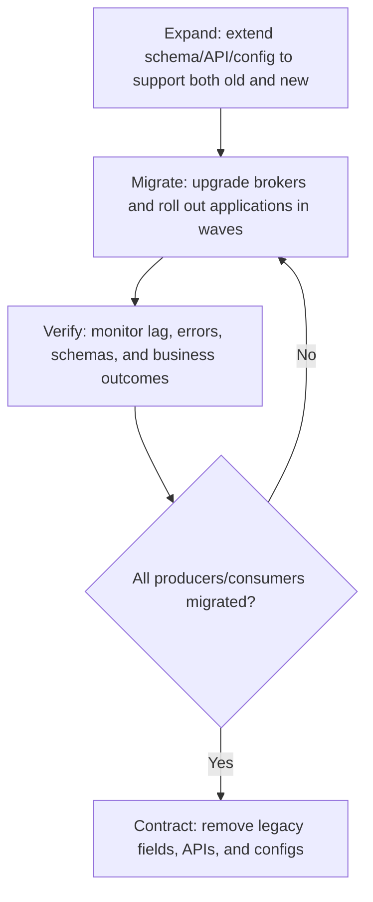

# Zero-Downtime Upgrade Strategies for Kafka and Spring Kafka

A zero-downtime upgrade is the process of changing broker, Kafka client, Spring Kafka, Spring Boot, or schema versions while the system continues ingesting and processing events throughout deployment. The practical goal is to maintain service availability within agreed limits, minimize rebalance duration, prevent data loss, and keep duplicates/redeliveries under control. "Zero downtime" should not be misunderstood as an absolute guarantee of zero retries, zero rebalances, or zero duplicate processing.

A safe upgrade must preserve compatibility among components running simultaneously. During a transition window, new producers may send to upgrading brokers; old consumers may read records produced by new producers; new consumers may read pre-existing records from old schemas. Therefore, deployment ordering matters more than simply bumping all dependencies to newer versions.

## 1. Defining the scope of an upgrade

A Spring Kafka system spans multiple version layers:

| Layer | Component | Compatibility question |
|---|---|---|
| Runtime | JDK/JVM | Is the new Java version supported by Spring Boot and Spring Kafka? |
| Framework | Spring Boot, Spring Framework | Which Spring Kafka version does the Boot version manage? |
| Messaging library | Spring Kafka | Have APIs, container lifecycles, error handlers, or converters changed? |
| Kafka client | kafka-clients | Is the client compatible with the broker and Java runtime? |
| Broker | Apache Kafka or distribution | Are the upgrade path, protocol, and metadata version appropriate? |
| Contract | JSON, Avro, Protobuf, Schema Registry | Can old/new producers and consumers read each other's data? |
| Application | Producer, consumer, retry/DLT, connectors | Are side effects, offsets, transactions, and topic subscriptions compatible? |
| Infrastructure | Kubernetes, storage, network, security | Are readiness, graceful shutdown, certificates, and ACLs still valid? |

Do not bundle all layers into one massive change without compelling reasons. If you upgrade JDK, Spring Boot, Spring Kafka, Kafka client, and broker simultaneously, isolating the culprit and rolling back becomes much harder when errors occur.

## 2. Distinguishing broker upgrades from application upgrades

Broker upgrades change Kafka infrastructure: binaries, controllers, protocol capabilities, metadata formats, or storage engines. Application upgrades change producer/consumer clients and processing logic. These two activities can follow separate schedules.

A common strategy:

1. Verify whether the current broker supports the target client version.
2. Upgrade brokers following the upgrade path documented for the exact versions.
3. Keep protocol/metadata compatibility at the old level while broker binaries are being upgraded, if that release's procedure requires it.
4. Roll out the new application via rolling or blue-green deployment.
5. Enable new capabilities or schemas only after all required consumers are ready.

Exact ordering depends on the Kafka version, KRaft vs. ZooKeeper, distribution, and vendor upgrade guide. Never extrapolate a single universal sequence for all clusters.

## 3. Building a compatibility matrix before changing anything

Before cutting a release, document current versions, target versions, and verified compatibility ranges:

| Component | Current | Target | Required evidence |
|---|---|---|---|
| Java | Running JDK | Target JDK | Spring Boot support matrix and runtime tests |
| Spring Boot | Current version | Target version | Release notes, dependency management |
| Spring Kafka | Boot-managed version | Boot-managed or intentionally upgraded version | Spring Kafka compatibility/release notes |
| kafka-clients | Actual version in dependency tree | Version matching target stack | Client/broker compatibility and dependency tree |
| Broker | Current Kafka version | Target Kafka version | Step-by-step upgrade guide |
| Schema | Current subject/version | New schema | Compatibility mode and consumer tests |

Inspect actual resolved dependencies in build output rather than just reading declared versions. The Spring Boot BOM manages versions of Spring Kafka and the Kafka client. Manually overriding a dependency can produce an untested combination.

## 4. Using dependency management consistently

With Spring Boot, prefer letting Boot dependency management choose matching Spring Kafka and Kafka client versions. Gradle example:

```groovy
dependencies {
    implementation("org.springframework.boot:spring-boot-starter")
    implementation("org.springframework.kafka:spring-kafka")

    testImplementation("org.springframework.kafka:spring-kafka-test")
}
```

If a project uses the Spring Boot plugin/BOM, do not specify explicit versions for BOM-managed dependencies. When an override is necessary, document the reason, check the compatibility matrix, and test against a real broker or corresponding test container.

Inspect the dependency tree:

```bash
./gradlew dependencies --configuration runtimeClasspath
```

Check the actual resolved versions of:

- `org.springframework.boot` and `org.springframework`.
- `org.springframework.kafka:spring-kafka`.
- `org.apache.kafka:kafka-clients`.
- Serializers/deserializers and Schema Registry client.

Prevent multiple Kafka client versions from sneaking in transitively via connectors or other libraries. Resolve dependency conflicts before deploying.

## 5. Reading release notes and migration guides in order

Do not rely on abbreviated changelogs or old blog posts to upgrade frameworks. For each step, read:

1. Spring Boot release notes and migration guides.
2. Spring Kafka change history/release notes.
3. Apache Kafka client release notes.
4. Kafka broker upgrade guides for the exact source and target versions.
5. Release notes for serializers, Schema Registry, connectors, and observability agents.

Flag changes falling into these categories:

- Compile-time API: methods with changed return types, moved packages/classes, or removed APIs.
- Runtime behavior: listener lifecycles, retries, acknowledgments, transactions, or default config changes.
- Configuration: renamed properties, relocated namespaces, or changed defaults.
- Protocol/data: schemas, serialization, metadata versions, or consumer group protocols.
- Operational: metrics, logs, CLI flags, health checks, or shutdown behavior.

Do not stop at fixing compile errors. An application may build cleanly while silently changing offset, retry, or transaction semantics at runtime.

Concrete API migration example: since Spring Kafka 3.0, `KafkaTemplate.send(...)` methods switched from `ListenableFuture` to `CompletableFuture`. Code registering callbacks, composing futures, and publisher tests must be updated for the new return type. When upgrading from 2.x, search for all usages of `addCallback`, `ListenableFuture`, and related APIs instead of just bumping dependency versions.

## 6. The expand–migrate–contract principle

Expand–migrate–contract lets old and new versions coexist safely during deployment:



Example evolving an `OrderCreated` event:

- Expand phase: add an optional `salesChannel` field; old consumers ignore unknown fields or deserialize according to the selected schema compatibility mode.
- Migrate phase: deploy consumers capable of reading both old and new events.
- Producer phase: start writing `salesChannel` after consumers needing the field are ready.
- Contract phase: remove old fields or drop support for old schemas only after all producers, consumers, replay tools, and backup workflows have transitioned.

Do not remove fields or change data types in the same release as rolling out consumers. Old consumers may still be running on instances not yet replaced.

## 7. Designing backward- and forward-compatible schemas

Schema compatibility determines which consumer versions can read data produced by which producer versions.

| Mode | General meaning | Upgrade question |
|---|---|---|
| BACKWARD | New schema can read data written with old schema | Can new consumers read old records still within retention? |
| FORWARD | Old schema can read data written with new schema | Can still-running old consumers read new records? |
| FULL | Supports both backward and forward per registry rules | Can two generations of producers/consumers coexist? |
| NONE | No compatibility checks enforced | Must manually prove all consumers/producers are compatible |

Mode names and validation rules depend on your serializer/Schema Registry. For JSON without a registry, compatibility also depends on Jackson configuration, constructors, required fields, and domain logic.

Common safety rules include:

- Add new fields as optional or with defaults that old/new consumers can handle.
- Do not change the meaning of an existing field even if the data type stays the same.
- Do not change key/partitioning semantics in a single step if key-based ordering matters.
- Do not delete enum values or rename fields while old consumers are still active.
- Test against data written under every schema version still present in retention.

Schema Registry compatibility checks are valuable, yet do not replace integration tests with actual consumers.

## 8. Deploying consumers before producers when adding new data

When producers are about to emit new fields needed by consumers for business processing, the safest sequence is usually:

1. Deploy consumers capable of reading both old and new events.
2. Confirm all consumer instances are updated and lag is not growing abnormally.
3. Enable producers writing the new field via feature flag or rollout config.
4. Monitor deserialization errors, validation, business processing, and DLT.
5. Remove legacy handling branches in consumers only after a stabilization window.

If old consumers ignore unknown JSON fields, adding a field can be compatible. However, if a producer changes types, renames fields, or consumers enforce strict unknown-property handling, old consumers can fail. Always verify actual runtime configuration.

When an incompatible format change is unavoidable, consider a new topic version or a controlled migration event instead of writing two formats into the same topic without a clear discriminator.

## 9. Broker rolling upgrades

A rolling upgrade replaces brokers one at a time while remaining brokers continue serving traffic. Before starting:

- Verify replication factors, ISR, and `min.insync.replicas`.
- Ensure the cluster has no persistent under-replicated partitions.
- Check controller/quorum health, disk, network, and capacity.
- Check leader distribution and tolerance for losing one broker.
- Verify client retry/metadata refresh settings and appropriate timeouts.
- Prepare a per-node upgrade schedule, checkpoints, and rollback conditions.

During the upgrade:

1. Upgrade one broker following the official procedure.
2. Wait for the broker to come online, replicas to catch up, and ISR to stabilize.
3. Verify produce/consume, request latency, and controller health.
4. Proceed to the next broker only when stability criteria are met.

Do not upgrade more brokers simultaneously than the cluster can afford to lose. With low replication factors or partitions already missing replicas, rolling restarts can make partitions unavailable or degrade durability.

## 10. Protocol version and metadata version

Some Kafka upgrade procedures require separating broker binary upgrades from enabling new protocol/metadata capabilities. During a rolling upgrade, newer broker versions can run at an older compatibility level so older brokers can still communicate.

Only advance `inter.broker.protocol.version` or `metadata.version` per the exact release's instructions. Modern Kafka releases change configuration/metadata versioning mechanisms and no longer use legacy properties the same way.

Before finalizing new capabilities:

- All brokers/controllers must run compatible versions.
- Clients and admin tools must be verified.
- No nodes remain that require rollback along a supported downgrade path.
- Backups, metadata, and recovery procedures are ready.

Finalizing metadata/protocol versions can make downgrades difficult or unsupported. Do not treat broker rollback as simple as rolling back an application deployment.

## 11. Differences between KRaft and ZooKeeper clusters

Kafka clusters may use ZooKeeper in older versions or KRaft in newer versions. Upgrade procedures, controller quorums, and migrations differ.

- In ZooKeeper mode, monitor both brokers and the ZooKeeper ensemble; do not guess their upgrade ordering.
- In KRaft mode, monitor the controller quorum, voter membership, and metadata log health.
- Migrating from ZooKeeper to KRaft is a separate project with its own prerequisites and official procedure; do not bundle it into a routine rolling upgrade.
- Check version support for your distribution, operator, and tooling before switching modes.

Do not apply KRaft controller instructions to a ZooKeeper cluster or vice versa. Always follow the official upgrade guide for your exact source/target and topology.

## 12. Rolling deployments for Spring Kafka consumers

A rolling deployment gradually replaces consumer instances. During rollout, consumer groups may rebalance as members leave or join.

To minimize disruption:

- Use readiness/liveness probes properly; readiness should reflect whether the instance is ready to serve as designed.
- Configure graceful shutdown so listener containers stop cleanly.
- Set termination grace periods long enough for in-flight processing and container shutdown per SLA.
- Avoid rolling too many instances at once.
- Monitor rebalances, assignments, lag, and processing latency.
- Ensure consumers are idempotent because uncommitted records can be redelivered.

Do not assume rolling deployments keep partition assignments unchanged. Rebalances are normal behavior when membership changes; the goal is to reduce their frequency and impact window.

## 13. Graceful shutdown and handling in-flight records

When an application receives a shutdown signal, listener containers need time to stop consumers and complete lifecycle hooks per configuration. Define:

- Maximum time allowed to finish processing current records.
- AckMode and commit behavior.
- Whether active error handlers/retries could prolong shutdown.
- Whether downstream calls have bounded timeouts.
- Whether Kubernetes/container runtimes will kill the process before stop callbacks finish.

Spring Boot configuration example:

```yaml
spring:
  lifecycle:
    timeout-per-shutdown-phase: 30s
```

The value above is illustrative. Choose timeouts based on actual stop times of lifecycle beans and business processing duration. If the platform termination grace period is shorter than the application timeout, the process can still be killed mid-shutdown.

Do not increase shutdown timeouts indefinitely. A record blocked on a downstream call without a timeout can stall rollouts; fix dependency timeouts and monitor shutdown duration.

## 14. Consumer group protocol and rebalances

When upgrading the Kafka client, the group protocol and assignor can affect how consumers join groups and distribute partitions.

Check:

- Which consumer group protocol the broker/client supports.
- `partition.assignment.strategy` and cooperative vs. eager rebalance behavior.
- Static membership (`group.instance.id`) if used by the application.
- Number of consumer instances, concurrency, and partition counts.
- Revoke/assign duration and offset handling during rebalances.

Cooperative assignors can reduce how many partitions are revoked in some rebalances, though they do not eliminate all rebalances or pauses. Changing assignors during a rollout requires ensuring all members are compatible per your Kafka version's rules.

Static membership can reduce rebalances from brief restarts, yet each member requires a unique identity. If multiple pods share the same `group.instance.id`, members can fence or displace one another. With Spring Kafka concurrency, ensure client instance IDs remain distinct in the way the framework supports.

## 15. Deploying new producers safely

New producers must be compatible with current brokers and running consumers:

- Verify serializers and schemas before releasing.
- Keep key semantics stable if consumers depend on key-based ordering.
- Maintain idempotence/acks/retries matching durability requirements.
- Do not enable transactions or change transactional ID strategies without testing fencing/recovery.
- Monitor send latency, error rates, timeouts, and record sizes.

Producer idempotence protects producer retries within Kafka's supported semantics; it does not eliminate duplicates caused by the application re-sending the same event as a new request. Consumers still need business-level idempotency.

If using transactional producers, transactional IDs must be managed carefully per instance and lifecycle. Multiple producer instances using the same ID can fence each other; generating a new ID on every restart does not automatically guarantee correct transaction workflows.

## 16. Blue-green deployments and consumer groups

Blue-green can reduce rollout risk, but consumer group usage must be designed explicitly:

| Blue/green setup | Behavior |
|---|---|
| Blue and green share the same group ID | Partitions are split across both sets of members; they are not two independent copies each reading the whole topic |
| Blue and green use different group IDs | Both groups can read the entire topic; side effects can execute twice |
| Green uses a separate group with side effects disabled/isolated | Suitable for shadow validation and comparing results |
| Switching producer traffic to green | Must confirm consumers/schemas/side effects are ready before enabling new event formats |

Do not run blue and green with separate group IDs both writing to the production database during testing without deduplication. They are two independent consumers and each will process every event.

When switching production group IDs, the new group has its own offsets. Define `auto.offset.reset`, initial committed offsets, and replay strategy clearly; do not treat a new group as an automatic transparent replacement.

## 17. Shadow consumers and pre-cutover validation

A shadow consumer uses a separate group ID to read the same data without executing production side effects. It is useful for validating the new version's serializers, schemas, logic, and performance.

Workflow:

1. Create a dedicated shadow group ID.
2. Disable or isolate side effects; write outputs to a test environment.
3. Have the shadow consumer read representative data, including older records still in retention.
4. Compare processing results against the current consumer.
5. Measure throughput, lag, error rate, allocations, and latency.
6. Cut over only after all discrepancies are explained.

Shadow consumers add load to brokers and downstream systems. Set limits on concurrency, rates, and run duration; do not let a shadow group overload the cluster.

## 18. Keeping topics, partitions, and keys stable during upgrades

Changing partition counts can alter which partition a given key maps to based on the partitioner and new partition count. This can break key-based ordering between old and new records.

During an application upgrade:

- Do not increase partition counts at the same time without evaluating key ordering.
- Do not change key serialization or partitioners without a migration plan.
- Do not change topic names/subscriptions and group IDs simultaneously unless necessary.
- Keep retention long enough for rollback and replay per data policy.
- Check topic configs, replication factors, and ACLs for retry/DLT topics.

If you must change partitioning strategies, consider a new topic version and a reconciled dual-read/cutover process rather than silently altering the existing topic.

## 19. Retry, DLT, and offsets during rollout

Upgrades can alter error handling or retry behavior. Verify:

- Whether blocking retries cause time between polls to exceed `max.poll.interval.ms`.
- Whether non-blocking retry topics are created with proper ACLs and retention.
- Whether the DLT recoverer can serialize records from both old and new schemas.
- Whether exception classification changed across versions.
- Whether offset commits still match AckMode and transaction strategies.
- Whether records sitting in retry/DLT topics can be read by the new consumer version.

Do not delete retry topics or DLTs during an upgrade to "clean up." Those topics may hold unprocessed business records. Before renaming or restructuring retry topics, drain, replay, or migrate records as planned.

## 20. Database migrations alongside event migrations

Consumers often write to databases. If database schemas change incompatibly, old and new consumers cannot run together during a rolling deployment.

Use expand–migrate–contract for databases:

1. Expand: add columns/tables/indexes compatible with the old application.
2. Deploy application versions able to read/write both old and new structures.
3. Backfill data if needed, tracking progress.
4. Switch logic to the new structure.
5. Confirm no instances or jobs still use the old structure.
6. Contract: drop old columns/tables in a later release.

Do not drop columns in the same deployment as the new consumer. Old pods may still be running and querying those columns.

If consumers use transactional outbox/inbox tables, verify migrations preserve unique constraints, publish states, and deduplication keys. Never truncate outbox/inbox tables just to deploy a new version.

## 21. Feature flags for behavioral changes

Feature flags decouple code deployment from enabling new behavior:

- Deploy consumers containing logic to read both old and new schemas.
- Enable new-field processing for a subset of topics/tenants first.
- Shift producers to the new event version by percentage or business group.
- Monitor errors and turn off the flag if the new logic causes issues.

Feature flags cannot make old consumers understand incompatible schemas. Before enabling a new producer format, all required consumers must still be able to read those records.

Flags tied to event contracts need an owner, safe defaults, metrics, and a removal date. Do not leave dual processing branches in place indefinitely without ownership.

## 22. Pre-production compatibility testing

The test matrix must validate producer/consumer pairs:

| Producer | Consumer | Outcome to verify |
|---|---|---|
| Old | Old | Baseline unchanged |
| Old | New | New consumer reads old records |
| New | Old | Acceptable only if the contract guarantees forward compatibility |
| New | New | Target flow works completely |

Tests to include:

- Deserializing stored data from older schema versions.
- Deserializing new events with old consumers if the rollout requires it.
- Publishing/consuming against both current and target broker versions.
- Retries, DLT, transactions, offset commits, and rebalances.
- Restarting consumers mid-processing and verifying redelivery/idempotency.
- Rolling broker restarts in a staging environment with production-like topology.
- Graceful shutdown, readiness, and termination grace periods.
- Load testing with realistic throughput, payload sizes, and partition distributions.

Unit tests do not replace integration tests because many bugs appear only when clients, brokers, and the group coordinator interact.

## 23. Canary deployments and phased rollouts

A rollout can be structured as:

1. Dev: verify compilation, unit tests, and API migrations.
2. Integration: run the broker/client matrix and schema compatibility tests.
3. Staging: test rebalances, rolling restarts, retry/DLT, failover, and load.
4. Canary: upgrade one instance or a small group and monitor for a defined window.
5. Progressive rollout: increase instance percentage as metrics stay within thresholds.
6. Full rollout: complete once no old instances remain and backlogs stabilize.
7. Contract: remove compatibility code/old schemas only after a safe waiting period.

Each phase requires explicit go/no-go criteria. Do not advance a rollout solely because new pods report Ready; verify consumer groups and business outcomes are actually progressing.

## 24. Go/no-go criteria and post-upgrade observability

Establish a baseline before upgrading and compare during/after rollout:

| Metric | Continuation criteria |
|---|---|
| Broker availability/controller quorum | Stable, no quorum loss |
| Under-replicated partitions | Return to acceptable thresholds before the next step |
| Produce/consume error rate | Does not exceed threshold |
| Consumer lag | Does not grow continuously beyond projections |
| Rebalances | No rebalance storms or abnormal disruption windows |
| Listener latency | p95/p99 within SLA |
| Retry/DLT rate | No abnormal spikes |
| Authentication/authorization | No widespread errors |
| Business correctness | No lost events, broken ordering, or unintended duplicate side effects |

Track both absolute numbers and trends. High lag that is steadily decreasing may mean a backlog is draining; small lag that keeps climbing may signal insufficient capacity.

## 25. Application rollback

Application rollback is usually feasible if the new version preserved compatibility with the old version's contracts:

- New code has not emitted event schemas unreadable by old consumers.
- New producers have not removed fields or changed semantics required by old consumers.
- Database migrations retained the old structure during the rollback window.
- Topics, keys, group IDs, and offsets were not irreversibly altered.
- New retry/DLT records can still be read by old consumers.

If new producers already emitted incompatible records, simply rolling back consumers can cause deserialization failures in old consumers. You may need to stop new producers, keep compatible consumers running, or transform data via a controlled migration tool.

Rolling back a deployment does not revert committed offsets to an earlier state. Offsets track recorded consumer group progress; replaying requires an explicit reset/reprocess plan and side-effect evaluation.

## 26. Broker rollback and downgrade limits

Broker rollback is more complex than application rollback:

- Metadata/protocol versions may have been bumped and no longer support downgrades.
- New log formats or features may make data unreadable to older brokers.
- KRaft metadata/quorums have specific constraints.
- Distributions may only support downgrades along specific paths.
- Cluster metadata and data backups must match recovery procedures.

Before upgrading brokers, identify the point of no return in the upgrade guide. If no downgrade path is supported, recovery plans may rely on forward fixes, cluster restoration, or failing over to a standby cluster rather than downgrading binaries.

Do not manually copy log segments or edit metadata to force old brokers to run. Use supported backup/restore procedures and tooling.

## 27. Common upgrade pitfalls

**Upgrading every dependency simultaneously:** makes isolating root causes hard. Split runtime, framework, client, broker, and schema into verifiable steps.

**Overriding kafka-clients outside the BOM:** can create combinations untested by Spring Kafka/Boot. Only override with a verified compatibility matrix and integration tests.

**Deploying new producers before consumers:** old consumers may fail to deserialize new events. Upgrade compatible consumers first, then enable producers.

**Changing schemas and removing fields in the same release:** old instances are still running during rollout. Use expand–migrate–contract.

**Running blue and green with separate group IDs both writing to the database:** both groups read the whole topic and cause duplicate side effects. Shadow consumers must isolate side effects.

**Increasing partition counts alongside key changes:** key-to-partition mapping can shift and affect ordering.

**Restarting multiple brokers at once:** risks losing quorum or replica availability. Perform rolling upgrades per topology and upgrade guide.

**Advancing metadata/protocol versions too early:** can close off downgrade support. Finalize only after the entire cluster and clients are ready.

**Not waiting for consumer lag to stabilize:** continuing rollout can compound backlogs and lengthen recovery time.

**Assuming deployment rollback reverts offsets:** committed offsets do not roll back automatically. Replays require a separate procedure.

## 28. Zero-downtime upgrade runbook

**Before upgrading**

- Finalize target, source/destination versions, and official upgrade paths.
- Build a compatibility matrix for Java, Boot, Spring Kafka, kafka-clients, broker, and schemas.
- Audit dependency trees, API migrations, and configuration changes.
- Verify RF, ISR, controller/quorum, disk, network, and ACLs.
- Verify schema compatibility, retry/DLT, and database migrations.
- Run the old/new producer/consumer test matrix.
- Record baseline lag, throughput, latency, rebalances, and error rates.
- Prepare canaries, go/no-go criteria, rollback plans, and downgrade limits.

**During upgrade**

- Change only one major layer per phase.
- Upgrade brokers via rolling procedures and wait for cluster stability between nodes.
- Keep protocol/metadata compatibility per guide instructions.
- Roll out compatible consumers before enabling new producers/schemas.
- Monitor group membership, assignments, lag, retries, and DLT.
- Halt rollout immediately if metrics breach thresholds or business correctness fails.

**After upgrading**

- Verify broker/client versions and effective configurations.
- Verify producer acknowledgments, consumer processing, and offset progression.
- Check lag, rebalances, error rates, latency, and DLT.
- Reconcile critical events and business side effects.
- Keep the compatibility window open long enough before contracting.
- Update operational documentation, version inventories, and plans to retire legacy configs.

A zero-downtime upgrade strategy relies on transition-phase compatibility. Verify the version matrix, expand contracts first, upgrade brokers along the proper upgrade path, deploy consumers before producers for schema changes, and remove legacy parts only after the entire system has transitioned. Base rollback plans on the real constraints of offsets and broker metadata; use metrics and business reconciliation as completion criteria.

## References

- [Spring Boot – Upgrading](https://docs.spring.io/spring-boot/reference/upgrading.html)
- [Spring for Apache Kafka – Change History](https://docs.spring.io/spring-kafka/reference/appendix/change-history.html)
- [Apache Kafka – Upgrade Guide](https://kafka.apache.org/documentation/#upgrade)
- [Apache Kafka – Broker Configs](https://kafka.apache.org/documentation/#brokerconfigs)
- [Apache Kafka – Consumer Configs](https://kafka.apache.org/documentation/#consumerconfigs)
