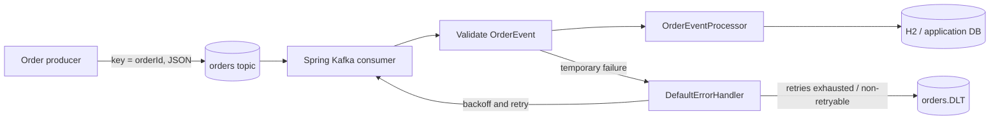

# Building a Consumer to Process OrderEvent

This hands-on lab builds a Spring Kafka consumer that receives `OrderEvent` messages from the `orders` topic, deserializes JSON into a Java object, validates the data, persists the result to a database, and handles errors using retry and a dead-letter topic (DLT).

The expected outcome is a standalone consumer that processes records by key, tolerates redelivery of the same event, and includes integration tests to prove that behavior. This is a comprehensive lab in the Spring Kafka Messaging module combining `KafkaTemplate`, `@KafkaListener`, topics, partitions, consumer groups, serialization, retry, DLT, and idempotency.

## 1. Objectives and Business Requirements

Build an `order-consumer` service with the following flow:

1. Receive `OrderEvent` from the `orders` topic.
2. Use `orderId` as the Kafka key so events for the same order go to the same partition.
3. Deserialize JSON into the `OrderEvent` DTO.
4. Validate `eventId`, `orderId`, `amount`, and order status.
5. Persist the processed event to the database.
6. If the same `eventId` is redelivered, do not record a second side effect.
7. For transient errors, retry with a bounded limit and backoff.
8. For unrecoverable data errors, route the record to `orders.DLT`.
9. Include integration tests verifying consumption, persistence, duplicate handling, and DLT behavior.

**Lab outcome:** After this lab, you will have a consumer that can run against a local Kafka broker, observe consumer groups, inspect persisted data, and verify that failed records land in the DLT.

## 2. Overall Architecture



Within the same consumer group, Kafka distributes partitions across consumer members. If a topic has three partitions and the service runs three consumer members, each member can receive one partition. Kafka preserves record ordering within each partition; using `orderId` as the key helps route events for an order to the same partition.

This lab uses blocking retry with `DefaultErrorHandler` so retries can be easily observed directly on the source partition. Failed records are sent to `orders.DLT` after retries are exhausted or when an exception classified as non-retryable occurs.

## 3. Preparing the Environment and Dependencies

Prerequisites:

- Java 17 or higher.
- Maven or Gradle.
- A Spring Boot project with dependency management.
- A Kafka broker accessible at `localhost:9092`.
- H2 to run the lab without installing a separate database.

You can start a local Kafka instance using Docker with the Apache Kafka image:

```bash
docker run -d --name kafka \
  -p 9092:9092 \
  apache/kafka:4.1.1
```

If your machine already has a Kafka broker, use it and update `bootstrap-servers` accordingly. The image version is only an example; in real projects, pin a broker version compatible with your deployment environment.

Add the following dependencies to `pom.xml`. Versions are managed by the project's Spring Boot parent/BOM:

```xml
<dependencies>
    <dependency>
        <groupId>org.springframework.boot</groupId>
        <artifactId>spring-boot-starter</artifactId>
    </dependency>

    <dependency>
        <groupId>org.springframework.kafka</groupId>
        <artifactId>spring-kafka</artifactId>
    </dependency>

    <dependency>
        <groupId>org.springframework.boot</groupId>
        <artifactId>spring-boot-starter-jdbc</artifactId>
    </dependency>

    <dependency>
        <groupId>org.springframework.boot</groupId>
        <artifactId>spring-boot-starter-json</artifactId>
    </dependency>

    <dependency>
        <groupId>com.h2database</groupId>
        <artifactId>h2</artifactId>
        <scope>runtime</scope>
    </dependency>

    <dependency>
        <groupId>org.springframework.boot</groupId>
        <artifactId>spring-boot-starter-test</artifactId>
        <scope>test</scope>
    </dependency>

    <dependency>
        <groupId>org.springframework.kafka</groupId>
        <artifactId>spring-kafka-test</artifactId>
        <scope>test</scope>
    </dependency>

    <dependency>
        <groupId>org.awaitility</groupId>
        <artifactId>awaitility</artifactId>
        <scope>test</scope>
    </dependency>
</dependencies>
```

Do not declare an independent `spring-kafka` version if the Spring Boot BOM already manages this dependency. Keep Spring Kafka, the Kafka client, and Spring Boot on a compatible version set.

## 4. Creating the Project Structure

You can organize the source code as follows:

```text
src/
  main/
    java/com/example/orders/
      OrderConsumerApplication.java
      config/
        KafkaTopicConfiguration.java
        KafkaErrorHandlerConfiguration.java
      model/
        OrderEvent.java
        OrderStatus.java
      listener/
        OrderEventListener.java
      service/
        OrderEventProcessor.java
        InvalidOrderEventException.java
      repository/
        JdbcOrderEventRepository.java
    resources/
      application.yml
      schema.sql
  test/
    java/com/example/orders/
      OrderEventConsumerIntegrationTest.java
```

Package names can be adjusted to match your project. When configuring the JSON deserializer, use the exact fully qualified class name of `OrderEvent`.

## 5. Defining the OrderEvent Contract

Create the order status enum:

```java
package com.example.orders.model;

public enum OrderStatus {
    CREATED,
    PAID,
    CANCELLED
}
```

Create a record as the payload contract:

```java
package com.example.orders.model;

import java.math.BigDecimal;
import java.time.Instant;

public record OrderEvent(
        String eventId,
        String orderId,
        String customerId,
        BigDecimal amount,
        OrderStatus status,
        Instant occurredAt
) {
}
```

Meaning of the fields:

| Field | Purpose | Rule |
|---|---|---|
| `eventId` | Uniquely identifies a business event | Kept unchanged on retry or replay |
| `orderId` | Order that originated the event | Used as the Kafka key |
| `customerId` | Associated customer | Not blank |
| `amount` | Order amount | Greater than 0 |
| `status` | Order status | Belongs to the defined enum |
| `occurredAt` | Timestamp when the event occurred | ISO-8601 UTC |

Do not use `double` for monetary values because floating-point precision errors can skew values. `BigDecimal` is more suitable for `amount`.

A valid JSON payload:

```json
{
  "eventId": "evt-10001",
  "orderId": "order-10001",
  "customerId": "customer-88",
  "amount": 129000.00,
  "status": "CREATED",
  "occurredAt": "2026-11-17T08:30:00Z"
}
```

`eventId` is the ID of the event, not the Kafka offset. A republished event may receive a different offset, but must keep the same event ID if it represents the same business event.

## 6. Configuring Consumer, Producer, and Database

Create `src/main/resources/application.yml`:

```yaml
spring:
  kafka:
    bootstrap-servers: localhost:9092

    consumer:
      group-id: order-consumer
      auto-offset-reset: earliest
      enable-auto-commit: false
      key-deserializer: org.apache.kafka.common.serialization.StringDeserializer
      value-deserializer: org.springframework.kafka.support.serializer.ErrorHandlingDeserializer
      properties:
        spring.deserializer.value.delegate.class: org.springframework.kafka.support.serializer.JsonDeserializer
        spring.json.value.default.type: com.example.orders.model.OrderEvent
        spring.json.trusted.packages: com.example.orders.model
        spring.json.use.type.headers: false

    producer:
      key-serializer: org.apache.kafka.common.serialization.StringSerializer
      value-serializer: org.springframework.kafka.support.serializer.JsonSerializer

    listener:
      ack-mode: record

  datasource:
    url: jdbc:h2:mem:orders;DB_CLOSE_DELAY=-1
    username: sa
    password: ""
    driver-class-name: org.h2.Driver

  sql:
    init:
      mode: always

app:
  kafka:
    topics:
      orders: orders
```

Key points to understand:

- `group-id` identifies the consumer group that stores committed offsets.
- `auto-offset-reset: earliest` only takes effect when the group has no valid committed offset yet.
- `enable-auto-commit: false` lets the listener container manage offset commits.
- `ErrorHandlingDeserializer` wraps the JSON deserializer so deserialization failures can be handed to Spring Kafka's error handling.
- `spring.json.value.default.type` declares the default DTO type for the value.
- `spring.json.use.type.headers: false` makes the example use the fixed `OrderEvent` contract instead of relying on type headers from the producer.
- The producer uses `JsonSerializer` to send DTOs during tests or when publishing from the application.

This lab tests retry/DLT for exceptions thrown after the DTO has already been deserialized successfully. If you also want to forward malformed JSON payloads into the DLT, configure the DLT producer with a serializer supporting raw `byte[]`; `JsonSerializer` alone is not sufficient for every malformed payload type.

## 7. Creating the Source Topic and DLT

Use Spring Boot's `KafkaAdmin` to create topics on application startup:

```java
package com.example.orders.config;

import org.apache.kafka.clients.admin.NewTopic;
import org.springframework.context.annotation.Bean;
import org.springframework.context.annotation.Configuration;
import org.springframework.kafka.config.TopicBuilder;

@Configuration
public class KafkaTopicConfiguration {

    @Bean
    NewTopic ordersTopic() {
        return TopicBuilder.name("orders")
                .partitions(3)
                .replicas(1)
                .build();
    }

    @Bean
    NewTopic ordersDltTopic() {
        return TopicBuilder.name("orders.DLT")
                .partitions(3)
                .replicas(1)
                .build();
    }
}
```

The lab uses a single-node broker, so the replication factor is 1. Production needs a replication factor suited to the broker count, `min.insync.replicas`, retention, and the cluster's durability policy.

The DLT is created with the same partition count as the source topic because the recoverer in the next step preserves the partition. If you change partition routing, adjust the topic configuration accordingly.

You can verify the topics:

```bash
kafka-topics.sh \
  --bootstrap-server localhost:9092 \
  --describe \
  --topic orders

kafka-topics.sh \
  --bootstrap-server localhost:9092 \
  --describe \
  --topic orders.DLT
```

If using the official Docker image, you can run the CLI inside the container with `docker exec` and the image's corresponding script path.

## 8. Creating the Schema to Store Processed Events

Create `src/main/resources/schema.sql`:

```sql
CREATE TABLE IF NOT EXISTS processed_orders (
    event_id VARCHAR(100) PRIMARY KEY,
    order_id VARCHAR(100) NOT NULL,
    customer_id VARCHAR(100) NOT NULL,
    amount DECIMAL(19, 2) NOT NULL,
    status VARCHAR(30) NOT NULL,
    occurred_at TIMESTAMP NOT NULL,
    processed_at TIMESTAMP NOT NULL
);
```

The primary key on `event_id` is the database-level idempotency barrier. If the same event is processed again, the database rejects the duplicate insert and the application ignores that duplicate.

In a real system, the inbox/processed-event table and business state changes must reside in the same database transaction. This example inserts the processed event directly to demonstrate insert atomicity; when extending it to update an orders table, perform both inside the same transaction.

## 9. Writing a Transactional Repository

Create the repository to persist events:

```java
package com.example.orders.repository;

import java.sql.Timestamp;
import java.time.Instant;

import org.springframework.jdbc.core.JdbcTemplate;
import org.springframework.stereotype.Repository;
import org.springframework.transaction.annotation.Transactional;

import com.example.orders.model.OrderEvent;

@Repository
public class JdbcOrderEventRepository {

    private final JdbcTemplate jdbcTemplate;

    public JdbcOrderEventRepository(JdbcTemplate jdbcTemplate) {
        this.jdbcTemplate = jdbcTemplate;
    }

    @Transactional
    public void insert(OrderEvent event) {
        jdbcTemplate.update("""
                INSERT INTO processed_orders (
                    event_id,
                    order_id,
                    customer_id,
                    amount,
                    status,
                    occurred_at,
                    processed_at
                )
                VALUES (?, ?, ?, ?, ?, ?, ?)
                """,
                event.eventId(),
                event.orderId(),
                event.customerId(),
                event.amount(),
                event.status().name(),
                Timestamp.from(event.occurredAt()),
                Timestamp.from(Instant.now())
        );
    }
}
```

Each insert runs in its own repository transaction. If the unique constraint reports a duplicate, that transaction rolls back before the exception is handled in the calling service. Other database errors continue to propagate so the Kafka error handler can retry them.

Do not catch `DuplicateKeyException` directly inside the method executing the transactional insert and then continue business logic. Moving duplicate handling outside the repository call ensures the insert transaction completes its rollback properly before handling the duplicate case.

## 10. Writing the Exception and Business Processor Service

Create an exception for invalid data:

```java
package com.example.orders.service;

public class InvalidOrderEventException extends RuntimeException {

    public InvalidOrderEventException(String message) {
        super(message);
    }
}
```

Create the processor:

```java
package com.example.orders.service;

import org.springframework.dao.DuplicateKeyException;
import org.springframework.stereotype.Service;

import com.example.orders.model.OrderEvent;
import com.example.orders.repository.JdbcOrderEventRepository;

@Service
public class OrderEventProcessor {

    private final JdbcOrderEventRepository repository;

    public OrderEventProcessor(JdbcOrderEventRepository repository) {
        this.repository = repository;
    }

    public void process(OrderEvent event) {
        validate(event);

        try {
            repository.insert(event);
        }
        catch (DuplicateKeyException duplicate) {
            // Event ID was already processed in an earlier transaction.
            // Ignore the duplicate to avoid repeating side effects.
        }
    }

    private void validate(OrderEvent event) {
        if (event == null
                || event.eventId() == null
                || event.eventId().isBlank()) {
            throw new InvalidOrderEventException(
                    "eventId is required"
            );
        }

        if (event.orderId() == null || event.orderId().isBlank()) {
            throw new InvalidOrderEventException(
                    "orderId is required"
            );
        }

        if (event.customerId() == null || event.customerId().isBlank()) {
            throw new InvalidOrderEventException(
                    "customerId is required"
            );
        }

        if (event.amount() == null || event.amount().signum() <= 0) {
            throw new InvalidOrderEventException(
                    "amount must be greater than zero"
            );
        }

        if (event.status() == null || event.occurredAt() == null) {
            throw new InvalidOrderEventException(
                    "status and occurredAt are required"
            );
        }
    }
}
```

`InvalidOrderEventException` is a data error that cannot recover automatically by retrying. `DuplicateKeyException` is handled as a duplicate event that already completed previously. Database connection failures or other infrastructure errors are not caught here, so they propagate to the listener for the error handler to retry.

In a real-world implementation, emit structured logs for duplicate events and track duplicate counts. Do not log sensitive payloads.

## 11. Configuring Retry and Dead-Letter Recoverer

Create `KafkaErrorHandlerConfiguration`:

```java
package com.example.orders.config;

import org.apache.kafka.common.TopicPartition;
import org.springframework.context.annotation.Bean;
import org.springframework.context.annotation.Configuration;
import org.springframework.kafka.core.KafkaTemplate;
import org.springframework.kafka.listener.DefaultErrorHandler;
import org.springframework.kafka.listener.DeadLetterPublishingRecoverer;
import org.springframework.util.backoff.FixedBackOff;

import com.example.orders.service.InvalidOrderEventException;

@Configuration
public class KafkaErrorHandlerConfiguration {

    @Bean
    DefaultErrorHandler orderErrorHandler(
            KafkaTemplate<Object, Object> kafkaTemplate) {

        DeadLetterPublishingRecoverer recoverer =
                new DeadLetterPublishingRecoverer(
                        kafkaTemplate,
                        (record, exception) -> new TopicPartition(
                                record.topic() + ".DLT",
                                record.partition()
                        )
                );

        recoverer.setFailIfSendResultIsError(true);

        DefaultErrorHandler handler =
                new DefaultErrorHandler(
                        recoverer,
                        new FixedBackOff(1_000L, 2L)
                );

        handler.addNotRetryableExceptions(
                InvalidOrderEventException.class
        );

        handler.setDeliveryAttemptHeader(true);

        return handler;
    }
}
```

Configuration explanation:

- `DeadLetterPublishingRecoverer` sends failed records to a topic with the `.DLT` suffix.
- The DLT partition is kept identical to the source partition.
- `setFailIfSendResultIsError(true)` causes DLT send failures to be reported back to error handling instead of silently treating recovery as successful.
- `FixedBackOff(1_000L, 2L)` waits one second between retries and retries at most twice after the initial processing attempt.
- `InvalidOrderEventException` is not retried and goes straight to the recoverer.
- The delivery attempt header makes it easier to observe delivery counts within the error handler scope.

For transient errors, the listener is invoked at most three times: once initially and two retries. For non-retryable data errors, the record is moved to the DLT without waiting through two retries.

A single `CommonErrorHandler` bean is normally attached by Spring Boot to the default listener container factory. If your project creates factories manually or defines multiple factories, explicitly attach the handler via `factory.setCommonErrorHandler(orderErrorHandler)` on the factory used by the listener.

This example uses a `KafkaTemplate` with a JSON serializer for already-deserialized `OrderEvent` objects. If you also need to send deserialization failures whose value is still raw `byte[]` to the DLT, configure a type-aware producer serializer supporting both DTOs and byte arrays.

## 12. Writing @KafkaListener

Create the listener:

```java
package com.example.orders.listener;

import org.slf4j.Logger;
import org.slf4j.LoggerFactory;
import org.springframework.kafka.annotation.KafkaListener;
import org.springframework.kafka.support.KafkaHeaders;
import org.springframework.messaging.handler.annotation.Header;
import org.springframework.stereotype.Component;

import com.example.orders.model.OrderEvent;
import com.example.orders.service.OrderEventProcessor;

@Component
public class OrderEventListener {

    private static final Logger log =
            LoggerFactory.getLogger(OrderEventListener.class);

    private final OrderEventProcessor processor;

    public OrderEventListener(OrderEventProcessor processor) {
        this.processor = processor;
    }

    @KafkaListener(
            id = "orderEventListener",
            topics = "${app.kafka.topics.orders}",
            groupId = "order-consumer"
    )
    public void consume(
            OrderEvent event,
            @Header(KafkaHeaders.RECEIVED_KEY) String key,
            @Header(KafkaHeaders.RECEIVED_PARTITION) int partition,
            @Header(KafkaHeaders.OFFSET) long offset,
            @Header(
                    name = KafkaHeaders.DELIVERY_ATTEMPT,
                    required = false
            ) Integer deliveryAttempt) {

        log.info(
                "Received order eventId={}, orderId={}, key={}, partition={}, offset={}, attempt={}",
                event.eventId(),
                event.orderId(),
                key,
                partition,
                offset,
                deliveryAttempt
        );

        processor.process(event);
    }
}
```

The listener only coordinates receiving the record and calling the processor. Validation/persistence logic lives in the service for easier unit testing and to avoid mixing transport concerns with business logic.

`KafkaHeaders.RECEIVED_KEY` provides the Kafka key, while partition and offset help trace the record at the transport layer. `DELIVERY_ATTEMPT` may be absent on a normal delivery; therefore the header is marked `required = false`.

If the listener uses the group ID from Boot configuration, `groupId` on the annotation can be omitted. In the lab, it is declared explicitly so learners can see which group ID the listener joins.

## 13. Starting the Application and Sending OrderEvent

Create the Spring Boot application class:

```java
package com.example.orders;

import org.springframework.boot.SpringApplication;
import org.springframework.boot.autoconfigure.SpringBootApplication;

@SpringBootApplication
public class OrderConsumerApplication {

    public static void main(String[] args) {
        SpringApplication.run(
                OrderConsumerApplication.class,
                args
        );
    }
}
```

Run the application:

```bash
./mvnw spring-boot:run
```

On Windows:

```powershell
.\mvnw.cmd spring-boot:run
```

After the listener starts, send a JSON record to the `orders` topic. Use the Kafka console producer with key parsing enabled:

```bash
kafka-console-producer.sh \
  --bootstrap-server localhost:9092 \
  --topic orders \
  --property parse.key=true \
  --property key.separator=:
```

Enter a line:

```text
order-10001:{"eventId":"evt-10001","orderId":"order-10001","customerId":"customer-88","amount":129000.00,"status":"CREATED","occurredAt":"2026-11-17T08:30:00Z"}
```

The producer CLI sends `order-10001` as the key and the remaining JSON as the value. In the consumer logs, inspect the event ID, order ID, key, partition, and offset.

You can send additional events for the same order ID with different event IDs. They should be written to the same partition if default key partitioning and topic metadata remain unchanged.

## 14. Observing Data and Consumer Group

Inspect the data in H2 via the H2 Console if the project exposes it, or query it via tests/repository. SQL example:

```sql
SELECT
    event_id,
    order_id,
    customer_id,
    amount,
    status,
    occurred_at,
    processed_at
FROM processed_orders
ORDER BY processed_at;
```

Check consumer group state:

```bash
kafka-consumer-groups.sh \
  --bootstrap-server localhost:9092 \
  --describe \
  --group order-consumer
```

Inspect members and partition assignment:

```bash
kafka-consumer-groups.sh \
  --bootstrap-server localhost:9092 \
  --describe \
  --group order-consumer \
  --members \
  --verbose
```

Inspect the DLT:

```bash
kafka-console-consumer.sh \
  --bootstrap-server localhost:9092 \
  --topic orders.DLT \
  --from-beginning \
  --property print.key=true \
  --property print.headers=true
```

A group can be in a stable state even with large lag; therefore examine assignment, committed offsets, lag, and listener logs together. If the group has no committed offset yet, `auto-offset-reset` determines the starting position when the consumer needs to initialize its offset.

## 15. Testing Retry and DLT

Send an event with a negative amount:

```text
order-invalid-01:{"eventId":"evt-invalid-01","orderId":"order-invalid-01","customerId":"customer-88","amount":-10.00,"status":"CREATED","occurredAt":"2026-11-17T08:35:00Z"}
```

The processor throws `InvalidOrderEventException`. Because this exception is marked non-retryable, the record must be forwarded to `orders.DLT`. Check the DLT consumer to confirm the key, payload, and source headers.

Next, test transient errors by temporarily making the repository throw an infrastructure exception in a test environment, such as `TransientDataAccessResourceException`. Do not use a deterministic data error for a retryable scenario because retrying cannot make invalid data valid.

Observe:

- Listener logs show re-invocation with the same topic/partition/offset.
- Delivery attempt increments within the error handler scope.
- Backoff occurs between retry attempts.
- After retries are exhausted, the record is published to the DLT.
- If the DLT broker/topic is unavailable, the recoverer reports an error and recovery is not considered successful.

Never inject faults against a production database to test retries. Only inject faults in a local environment or integration tests.

## 16. Testing Idempotency When the Same Event Is Sent Twice

Send two records with the same `eventId` and payload, while the producer creates two separate Kafka records. The two records have different offsets, yet the `processed_orders` table must contain only one row for that event ID.

Integration test example:

```java
package com.example.orders;

import static org.assertj.core.api.Assertions.assertThat;
import static org.awaitility.Awaitility.await;

import java.math.BigDecimal;
import java.time.Duration;
import java.time.Instant;
import java.util.Map;
import java.util.concurrent.TimeUnit;

import org.apache.kafka.clients.admin.AdminClient;
import org.apache.kafka.clients.admin.AdminClientConfig;
import org.apache.kafka.clients.consumer.OffsetAndMetadata;
import org.apache.kafka.clients.producer.RecordMetadata;
import org.apache.kafka.common.TopicPartition;
import org.junit.jupiter.api.Test;
import org.springframework.beans.factory.annotation.Autowired;
import org.springframework.beans.factory.annotation.Value;
import org.springframework.boot.test.context.SpringBootTest;
import org.springframework.jdbc.core.JdbcTemplate;
import org.springframework.kafka.core.KafkaTemplate;
import org.springframework.kafka.test.context.EmbeddedKafka;
import org.springframework.test.annotation.DirtiesContext;

import com.example.orders.model.OrderEvent;
import com.example.orders.model.OrderStatus;

@SpringBootTest
@EmbeddedKafka(
        partitions = 3,
        topics = {"orders", "orders.DLT"},
        bootstrapServersProperty = "spring.kafka.bootstrap-servers"
)
@DirtiesContext
class OrderEventConsumerIntegrationTest {

    @Autowired
    KafkaTemplate<Object, Object> kafkaTemplate;

    @Autowired
    JdbcTemplate jdbcTemplate;

    @Value("${spring.kafka.bootstrap-servers}")
    String bootstrapServers;

    @Test
    void duplicateEventIsPersistedOnlyOnce() throws Exception {
        OrderEvent event = new OrderEvent(
                "evt-test-100",
                "order-test-100",
                "customer-test-1",
                new BigDecimal("125000.00"),
                OrderStatus.CREATED,
                Instant.now()
        );

        kafkaTemplate.send("orders", event.orderId(), event)
                .get(10, TimeUnit.SECONDS);

        RecordMetadata secondRecord = kafkaTemplate
                .send("orders", event.orderId(), event)
                .get(10, TimeUnit.SECONDS)
                .getRecordMetadata();

        try (AdminClient admin = AdminClient.create(
                Map.of(
                        AdminClientConfig.BOOTSTRAP_SERVERS_CONFIG,
                        bootstrapServers
                )
        )) {
            await()
                    .atMost(Duration.ofSeconds(10))
                    .untilAsserted(() -> {
                        Map<TopicPartition, OffsetAndMetadata> committed =
                                admin.listConsumerGroupOffsets("order-consumer")
                                        .partitionsToOffsetAndMetadata()
                                        .get();

                        OffsetAndMetadata offset = committed.get(
                                new TopicPartition(
                                        "orders",
                                        secondRecord.partition()
                                )
                        );

                        assertThat(offset).isNotNull();
                        assertThat(offset.offset())
                                .isGreaterThan(secondRecord.offset());
                    });
        }

        Integer count = jdbcTemplate.queryForObject(
                """
                SELECT COUNT(*)
                FROM processed_orders
                WHERE event_id = ?
                """,
                Integer.class,
                event.eventId()
        );

        assertThat(count).isEqualTo(1);
    }
}
```

The test uses `@EmbeddedKafka` to run a broker for integration testing. `Awaitility` waits for the database/offset condition instead of using a fixed sleep. If tests run in parallel, ensure each test uses its own event ID and that databases/contexts do not share unintended state.

This test proves that two Kafka records with the same event ID do not create two business rows. It does not prove Kafka delivered the record only once; in fact both records were consumed, and consumer idempotency eliminated the duplicate side effect.

## 17. Adding Tests for Validation and DLT

Create additional test cases:

| Test case | Data/condition | Expected result |
|---|---|---|
| Valid event | Positive amount, all fields present | One row in `processed_orders` |
| Event missing event ID | Blank `eventId` | Sent to DLT, no retry |
| Negative amount | `amount` less than or equal to 0 | Sent to DLT, not written to DB |
| Transient DB error | Repository fails first, then succeeds | Listener retries and eventually writes one row |
| Persistent DB error | Repository always fails | Retries up to the limit, then moves to DLT |
| Duplicate event ID | Two Kafka records with the same ID | Only one business row |
| DLT publish failure | DLT broker/topic unavailable | Recovery fails; do not assume the record was handled |
| Invalid JSON | Payload cannot be deserialized | `ErrorHandlingDeserializer` forwards the error to error handling; requires a DLT serializer supporting raw bytes to store the original payload |

For DLT tests, create a test consumer with a separate group ID to read `orders.DLT` and assert source headers such as original topic, partition, offset, and exception. Do not reuse the main listener's group ID to read the DLT because that would alter assignment and test results.

## 18. Common Mistakes During the Lab

| Symptom | Cause | How to check |
|---|---|---|
| Listener does not receive records | Wrong broker address, wrong topic, or listener container not started | Check bootstrap server, topic, and startup logs |
| JSON deserialization fails | Field/type mismatch with DTO, invalid enum, or bad timestamp format | Check JSON contract and deserializer |
| Topics cannot be created | `KafkaAdmin` cannot connect or broker disallows creation | Check broker and topic creation permissions |
| Listener is invoked repeatedly | Exception keeps occurring or retry is unbounded | Check `DefaultErrorHandler`, backoff, and exceptions |
| No records appear in DLT | Recoverer not attached to the right factory or DLT publish failed | Check error handler and producer send result |
| DLT send fails with serializer error | Value is raw `byte[]` while template only supports DTOs | Configure a type-aware serializer or dedicated template |
| Consumer group has no members | Listener not running, different group ID, or initialization failure | Run `kafka-consumer-groups.sh` to describe the group |
| Database has duplicate rows | No unique constraint on event ID or side effect outside transaction | Check schema and transaction boundaries |
| Events for the same order go to different partitions | Producer did not use `orderId` as key or partitioner differs | Check key at producer and partition metadata |

When debugging, record the group ID, topic, partition, offset, and event ID. Never log passwords, tokens, or full payloads containing sensitive data.

## 19. Lab Completion Criteria

The lab is considered complete when all of the following criteria are met:

- [ ] Local Kafka broker is running and the application connects to it.
- [ ] Topics `orders` and `orders.DLT` have three partitions in the lab.
- [ ] Valid JSON is deserialized into `OrderEvent`.
- [ ] Listener logs event ID, key, partition, and offset.
- [ ] Valid events are persisted to the database.
- [ ] Sending the same event ID twice results in only one database row.
- [ ] Data errors are not retried and are routed to the DLT.
- [ ] Transient errors are retried according to the configured backoff.
- [ ] Consumer group shows the expected members and assignments.
- [ ] Duplicate event integration test passes.

If any criterion is not met, record the relevant logs and record metadata, identify the failing layer, and fix it before moving to the extensions.

## 20. Extension Exercises

After completing the basic flow, work through the following:

1. **Increase concurrency:** configure listener concurrency to 2 or 3, observe partition assignment, and compare with the partition count.
2. **Add retry topics:** switch to `@RetryableTopic` and observe processing order when failed records move to retry topics.
3. **Add event versioning:** add `schemaVersion` and handle DTO compatibility when the producer bumps the version.
4. **Add metrics:** measure listener processing time, retry count, DLT count, and consumer lag.
5. **Add tracing:** propagate correlation ID/trace ID in Kafka headers and logs.
6. **Replace H2 with PostgreSQL:** keep the unique constraint on event ID and run integration tests with Testcontainers.
7. **Add outbox:** create a producer flow that writes the order and outbox event in the same database transaction.

When switching to non-blocking retry, remember that subsequent records may be processed ahead of a record waiting in a retry topic. If the business domain requires strict per-order ordering, design state transitions and idempotency using order version/sequence numbers.

This lab combined consumers, DTOs, JSON deserialization, partition keys, groups, persistence, retry, DLT, and integration tests into a complete `OrderEvent` pipeline. Keep event IDs stable and place business side effects inside idempotent transactions so the consumer can recover safely whenever Kafka redelivers records.
