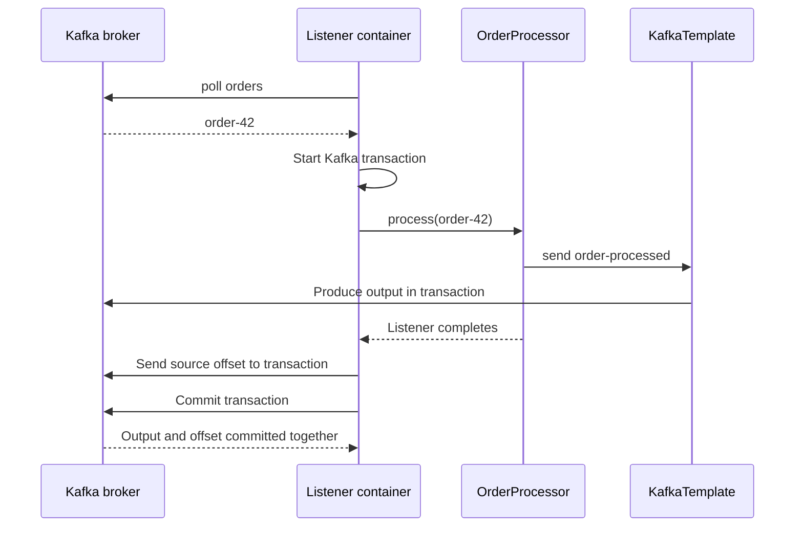
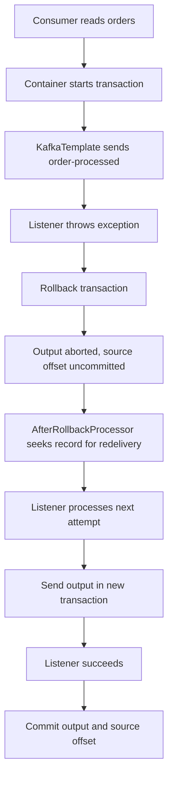

# Adding Transactions for Read-Process-Write

In this hands-on lab, we build a **read-process-write** pipeline with Spring Kafka: the consumer reads an event from the `orders` topic, processes the data, and sends the result to the `order-processed` topic. Both sending the output and committing the source offset must occur within the same Kafka transaction. If the listener fails after sending the output, the transaction rolls back both; when the record is redelivered and processed successfully, both the output and the source offset are committed together.

The goal is to verify atomicity between Kafka input and Kafka output. The listener may be invoked multiple times; the guarantee to verify is that a `read_committed` consumer only sees the output of committed transactions, and the source offset only advances alongside that transaction.

## 1. Lab Model

We use two topics:

| Topic | Role | Example |
|---|---|---|
| `orders` | Input topic | `order-42` |
| `order-processed` | Output topic after processing | `processed:order-42` |

Success flow:



Flow when the listener fails after sending output:



## 2. Preparing Dependencies and Kafka Broker

Add the test dependency if using Maven. Versions should be managed by Spring Boot dependency management or the Spring Kafka BOM to avoid version mismatches:

```xml
<dependency>
    <groupId>org.springframework.kafka</groupId>
    <artifactId>spring-kafka</artifactId>
</dependency>

<dependency>
    <groupId>org.springframework.kafka</groupId>
    <artifactId>spring-kafka-test</artifactId>
    <scope>test</scope>
</dependency>
```

You can run against a local Kafka broker or use `@EmbeddedKafka` in tests. The broker must support transactions. With Spring Kafka 3.x and above, EOS V2 is the supported mode and requires Kafka broker 2.5 or newer.

In this lab, use one partition per topic to make offsets easy to track. In real environments, choose a partition count matching your desired parallelism and throughput.

## 3. Enabling Kafka Transactions in Spring Boot

Declare `transaction-id-prefix` for the producer. When this property is configured, Spring Boot can create a `KafkaTransactionManager` and attach the transaction manager to the default listener container factory.

```yaml
spring:
  kafka:
    bootstrap-servers: localhost:9092
    producer:
      transaction-id-prefix: order-service-${INSTANCE_ID:local}-
      key-serializer: org.apache.kafka.common.serialization.StringSerializer
      value-serializer: org.apache.kafka.common.serialization.StringSerializer
    consumer:
      group-id: order-processor
      auto-offset-reset: earliest
      key-deserializer: org.apache.kafka.common.serialization.StringDeserializer
      value-deserializer: org.apache.kafka.common.serialization.StringDeserializer
      properties:
        "[isolation.level]": read_committed
```

Explanation:

- `transaction-id-prefix` causes the producer factory to create transactional producers. Each concurrently running application instance needs a unique prefix to avoid duplicate transactional IDs and mutual fencing.
- `group-id` identifies the consumer group processing the `orders` topic.
- `auto-offset-reset: earliest` lets a new group read existing records when it has no valid committed offset yet. This property does not reset a group that already has valid offsets.
- `isolation.level: read_committed` ensures the consumer only receives committed transactional records. This is also the mode to use when downstream applications must only process outputs of completed transactions.

If configuring manually instead of using Boot auto-configuration, `KafkaTransactionManager` and `KafkaTemplate` must share the same transaction-capable `ProducerFactory`. The listener container must be configured with that transaction manager. Do not create a separate producer factory for the template that the listener container does not manage.

## 4. Creating Data and the Processing Listener

To stay focused on transactions, the lab uses String payloads. The producer sends an order ID; the listener produces a result string and writes it to the output topic.

```java
@Component
public class OrderProcessor {

    private final KafkaTemplate<String, String> kafkaTemplate;
    private final AtomicBoolean failFirstAttempt = new AtomicBoolean(true);
    private final AtomicInteger attempts = new AtomicInteger();

    public OrderProcessor(KafkaTemplate<String, String> kafkaTemplate) {
        this.kafkaTemplate = kafkaTemplate;
    }

    @KafkaListener(topics = "orders", groupId = "order-processor")
    public void process(String orderId) throws Exception {
        attempts.incrementAndGet();

        // The send participates in the transaction started by the listener container.
        kafkaTemplate.send(
                "order-processed",
                orderId,
                "processed:" + orderId
        ).get(10, TimeUnit.SECONDS);

        // Simulate failure only once, after the output has been sent.
        if ("order-fail-once".equals(orderId)
                && failFirstAttempt.compareAndSet(true, false)) {
            throw new IllegalStateException("Simulated failure after output send");
        }
    }

    public int getAttempts() {
        return attempts.get();
    }
}
```

Key points in the example:

- The container starts a Kafka transaction before invoking `process()`.
- `KafkaTemplate` uses a transaction-capable producer factory, so `send()` joins the active transaction.
- `send().get()` makes the example wait for the send result and surfaces any send failure immediately inside the listener. This is easy to observe in a lab; high-throughput applications may use asynchronous APIs as long as the send result stays within the transaction and errors are handled before the transaction commits.
- The exception is thrown out of the listener. Do not catch and swallow it, because the container needs to know the listener failed in order to roll back.
- `AtomicBoolean` causes `order-fail-once` to fail only on the first attempt. When the record is redelivered, the listener sends the output in a new transaction and completes normally.

In a real application, replace the simulated condition with real business errors or reproducible dependency errors. Never leave fault-injection flags in production; this is strictly for testing.

## 5. Sending Input in a Separate Transaction

To prepare input data in tests or another producer, send a record to `orders` and commit the source transaction before the listener processes it:

```java
kafkaTemplate.executeInTransaction(operations -> {
    operations.send("orders", "order-fail-once", "order-fail-once");
    return null;
});
```

`executeInTransaction()` creates a local transaction for the callback. When the callback finishes normally, the source transaction commits and consumers can read the record. If the callback throws an exception, the source transaction aborts.

This transaction belongs to the producer preparing input data. It is separate from the transaction opened by the listener container to process the record. When the listener calls `KafkaTemplate.send()`, the template joins the container's transaction rather than opening a nested transaction.

## 6. Understanding What Happens After the Listener Throws an Exception

On the first delivery of `order-fail-once`:

1. The container opens a processing transaction.
2. The listener sends `processed:order-fail-once` to `order-processed`.
3. The broker may already have received the output record, but it still belongs to an uncommitted transaction.
4. The listener throws `IllegalStateException`.
5. The container rolls back the transaction. The output is marked aborted; the source offset is not committed.
6. `DefaultAfterRollbackProcessor` seeks by default so the source record is redelivered.

On the next delivery:

1. The container opens a new transaction.
2. The listener sends the output again.
3. `failFirstAttempt` is now `false`, so the listener completes normally.
4. The container sends the source offset to the transaction via `sendOffsetsToTransaction()` and commits.
5. Both the new output and the source offset become committed.

Physically in the output log, there may be two records: one belonging to the aborted transaction and one belonging to the committed transaction. A `read_committed` consumer only sees the committed record. Thus, the listener can execute twice while the committed Kafka effect appears only once.

## 7. Writing an Integration Test with Embedded Kafka

`@EmbeddedKafka` starts a broker for testing. With a single broker, you must set the replication factor of the transaction state log and offsets topic to `1` so the broker can start transactions.

```java
@SpringBootTest(properties = {
        "spring.kafka.producer.transaction-id-prefix=orders-test-${random.uuid}-",
        "spring.kafka.consumer.group-id=order-processor",
        "spring.kafka.consumer.auto-offset-reset=earliest"
})
@EmbeddedKafka(
        partitions = 1,
        topics = {"orders", "order-processed"},
        brokerProperties = {
                "offsets.topic.replication.factor=1",
                "transaction.state.log.replication.factor=1",
                "transaction.state.log.min.isr=1"
        }
)
class ReadProcessWriteTransactionTest {

    @Autowired
    private EmbeddedKafkaBroker embeddedKafka;

    @Autowired
    private KafkaTemplate<String, String> kafkaTemplate;

    @Autowired
    private OrderProcessor orderProcessor;

    @Test
    void shouldCommitOutputAndSourceOffsetTogetherAfterRetry() throws Exception {
        Map<String, Object> consumerProps = KafkaTestUtils.consumerProps(
                embeddedKafka, "verify-order-processed", false);
        consumerProps.put(ConsumerConfig.ISOLATION_LEVEL_CONFIG, "read_committed");

        try (Consumer<String, String> consumer =
                     new DefaultKafkaConsumerFactory<String, String>(
                             consumerProps,
                             new StringDeserializer(),
                             new StringDeserializer()).createConsumer()) {

            embeddedKafka.consumeFromAnEmbeddedTopic(consumer, "order-processed");

            kafkaTemplate.executeInTransaction(operations -> {
                operations.send("orders", "order-fail-once", "order-fail-once");
                return null;
            });

            ConsumerRecord<String, String> output = KafkaTestUtils.getSingleRecord(
                    consumer, "order-processed", Duration.ofSeconds(20));

            assertThat(output.key()).isEqualTo("order-fail-once");
            assertThat(output.value()).isEqualTo("processed:order-fail-once");
            assertThat(orderProcessor.getAttempts()).isEqualTo(2);

            // Transaction committed; there is no second committed output.
            assertThat(consumer.poll(Duration.ofMillis(500)).count()).isZero();
        }
    }
}
```

Imports and package configuration are omitted to stay focused on the transaction logic. The test uses `KafkaTestUtils.consumerProps()` with a dedicated verification group and overrides `isolation.level=read_committed`. `consumeFromAnEmbeddedTopic()` assigns the consumer to the topic and seeks to the beginning to read test output.

`getSingleRecord()` waits up to 20 seconds for the listener to finish retrying and commit the transaction. If the first transaction was properly aborted, the `read_committed` consumer receives only one output. Asserting `attempts == 2` confirms the listener was invoked again; a subsequent poll finds no second committed output.

## 8. Verifying the Committed Source Offset

To confirm the source offset was committed along with the output, you can read the committed offset of the `order-processor` group via `AdminClient`. For an input record at partition `orders-0` with offset `0`, the next offset after successful processing must be `1`:

```java
try (AdminClient admin = AdminClient.create(Map.of(
        AdminClientConfig.BOOTSTRAP_SERVERS_CONFIG,
        embeddedKafka.getBrokersAsString()))) {

    Map<TopicPartition, OffsetAndMetadata> offsets = admin
            .listConsumerGroupOffsets("order-processor")
            .partitionsToOffsetAndMetadata()
            .get(10, TimeUnit.SECONDS);

    assertThat(offsets.get(new TopicPartition("orders", 0)).offset())
            .isEqualTo(1L);
}
```

In a full test, run the offset assertion only after receiving the committed output. Do not infer the source committed offset from the output record's offset: the two topics have independent offsets. Offsets in `orders` and `order-processed` do not need to match.

Three observations should align:

| Observation | Expected result | Meaning |
|---|---|---|
| Listener invocation count | 2 | First attempt rolled back, second succeeded |
| Output with `read_committed` | 1 record | Only the committed transaction's output is visible |
| Committed offset of `orders-0` | `1` | Source offset was committed after successful processing |

You can create an additional `read_uncommitted` consumer to observe records belonging to aborted transactions in a test environment. That consumer may see both the first attempt's output and the retry's output; that is uncommitted reading behavior, not two outputs published to `read_committed`-compliant downstream applications.

## 9. Configuring Retry and Recovery for Persistent Errors

In the example, the error only happens once so the next redelivery succeeds. In production, errors may persist due to invalid data or an unavailable dependency. In that case, configure explicit retry/backoff and recovery.

With container transactions, exceptions must propagate out of the listener to trigger rollback. `DefaultAfterRollbackProcessor` manages seeking and redelivery after rollback. You can configure bounded retries, backoff, and a recoverer to send unprocessable records to a DLT. If recovery needs to send to the DLT and commit the source offset in a new transaction, configure the processor with `commitRecovered=true` and an appropriate transactional `KafkaTemplate`.

Do not use `@RetryableTopic` as a drop-in replacement for container transaction rollback. Non-blocking retry forwards records to retry topics and does not combine with container transactions. For problems requiring atomic read-process-write inside Kafka, use after-rollback retry.

## 10. Requirements for Meaningful Transactions

- `KafkaTemplate` inside the listener uses the same transaction-capable `ProducerFactory` as the container's `KafkaTransactionManager`.
- `transaction-id-prefix` differs across concurrently running application instances.
- The listener does not swallow exceptions if container rollback is expected.
- Downstream consumers use `read_committed` if they must only see committed outputs.
- The Kafka broker meets transaction requirements; for Spring Kafka 3.x+ EOS V2, the broker needs to be version 2.5 or newer.
- Output and source offset must belong to the same Kafka transaction; never commit source offsets manually through a standalone API before the transaction completes.
- Databases, REST APIs, filesystems, or other non-Kafka systems do not automatically join Kafka transactions. Use outbox/inbox, idempotency, or separate coordination for external side effects.

## 11. Common Pitfalls in This Lab

| Symptom | Possible cause | Resolution |
|---|---|---|
| `No transaction is in process` when sending | Template uses a non-transactional producer factory or does not join the container transaction | Check `transaction-id-prefix`, `ProducerFactory`, and transaction manager |
| `ProducerFencedException` | Two instances share the same transactional ID/prefix | Assign a unique prefix per instance |
| Output consumer sees no records | Transaction aborted or consumer uses `read_committed` while transaction is still open | Check listener exceptions, transaction logs, and retries |
| `read_uncommitted` consumer sees two records | One record belongs to an aborted transaction, one to a committed one | Use `read_committed` for downstream services needing committed data |
| Listener is not invoked again | Exception was caught/swallowed or error handling did not trigger rollback | Let exceptions propagate to the container and check `AfterRollbackProcessor` |
| Test fails to start transactions | Embedded broker lacks transaction state log replication config | Set replication factor and min ISR to `1` for a single broker |
| Source offset advances while output is missing | Offset was committed independently or output did not join the same transaction | Check template/producer factory and offset commit path |
| Output send succeeds but test times out | Test consumer subscribed too late, wrong topic/group, or transaction has not finished | Assign consumer before sending, use a fresh group, and set an appropriate timeout |

## 12. Extending the Lab

Once the basic test passes, you can extend it in these directions:

1. Replace String payloads with `OrderCreated` and `OrderProcessed` using compatible JSON serializers/deserializers.
2. Add a `correlation-id` header and propagate its value to the output to trace a processing flow.
3. Inject failures after sending output across multiple attempts and confirm committed output still appears only once.
4. Configure `DefaultAfterRollbackProcessor` with bounded backoff and a DLT; verify DLT publishing alongside offset recovery.
5. Produce two outputs within the same listener and confirm both commit or both abort together.
6. Test stopping the application while a transaction is open using a process-controlled integration test; after restart, verify output and source offset are never left half-committed.
7. Add a database update to observe that Kafka transactions do not roll back databases automatically; then design outbox/inbox or idempotency for those side effects.

## 13. Key Takeaways

- The container transaction starts before the listener is invoked.
- A `KafkaTemplate` sharing the same `ProducerFactory` joins the active transaction.
- When the listener succeeds, the container sends the source offset into the transaction and commits output and offset together.
- When the listener throws an exception, the transaction rolls back; output is aborted and the source offset stays uncommitted.
- `AfterRollbackProcessor` puts the unfinished record back for redelivery.
- The listener may run multiple times; `read_committed` consumers only see outputs of committed transactions.
- `transaction-id-prefix` must be unique across application instances.
- Kafka exactly-once semantics does not automatically cover databases or services outside Kafka.

## References

- [Spring for Apache Kafka — Exactly Once Semantics](https://docs.spring.io/spring-kafka/reference/kafka/exactly-once.html)
- [Spring for Apache Kafka — Transactions](https://docs.spring.io/spring-kafka/reference/kafka/transactions.html)
- [Spring for Apache Kafka — After Rollback Processor](https://docs.spring.io/spring-kafka/reference/kafka/annotation-error-handling.html)
- [Spring for Apache Kafka — Testing Applications](https://docs.spring.io/spring-kafka/reference/testing.html)
- [Apache Kafka — Message Delivery Semantics](https://kafka.apache.org/documentation/#semantics)
