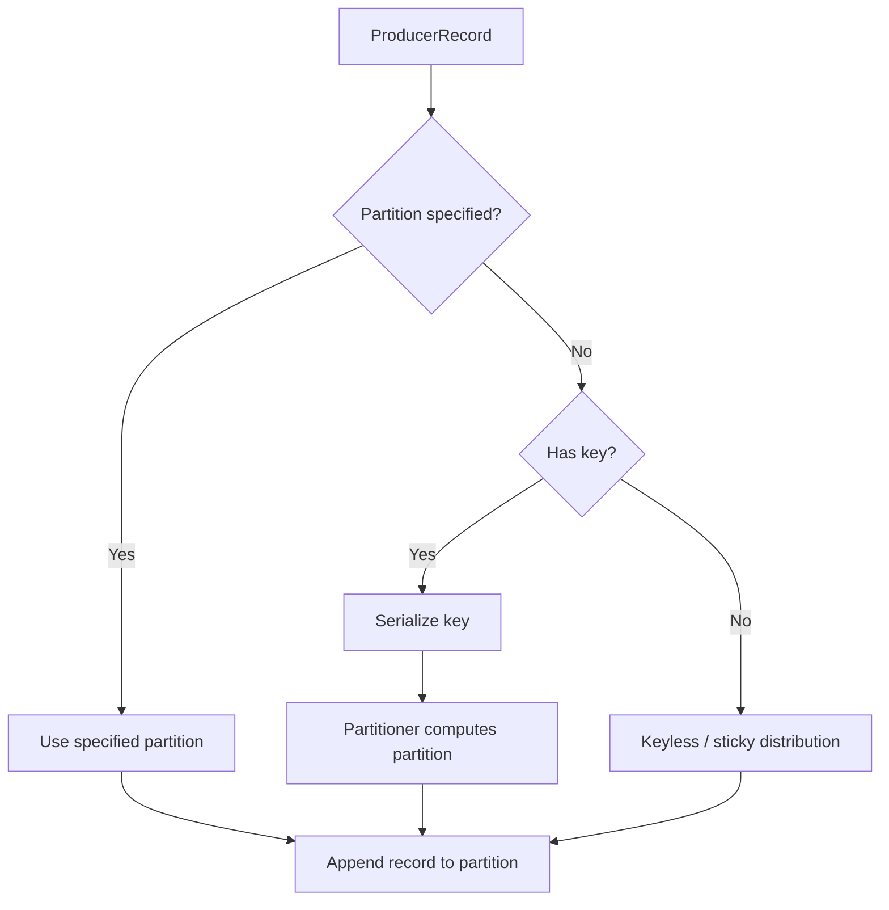

# Partition Key Selection Checklist

The partition key determines which partition a record is sent to and therefore directly affects processing order, parallelism, and Kafka load balance. Choosing a good key starts with business requirements: which records must strictly be processed in order? Only then should you evaluate data distribution, hot keys, how the key is serialized, and plans for changing the partition count.

No single key is optimal for every topic. A key suited to an order-state topic can differ from one suited to a telemetry topic. A single key for all records creates one hot partition; random keys spread load but can break per-entity ordering. The checklist below helps make an intentional decision.

## 1. Understand what the partition key affects

When a producer sends a record, Kafka needs to pick a target partition. If the application specifies a partition directly, that partition is used. If no partition is specified but a key is present, the default partitioner uses the serialized bytes of the key to determine the partition. The same key serialized consistently generally goes to the same partition as long as the partition count and partitioner remain unchanged.

If a record has no key, the producer uses a keyless distribution mechanism (modern defaults use sticky partitioning) to batch records into a partition over a send window for better batching; null-key records have no entity-affinity guarantee.



The partition key affects four factors:

- **Ordering:** records with the same key generally land in the same partition and are read in that partition's offset order.
- **Parallelism:** a consumer group processes partitions in parallel. A hot key is constrained by the processing capacity of the partition holding that key.
- **Load distribution:** skewed key distributions can create hot partitions even when the total partition count is large.
- **Compaction:** for compacted topics, the key is the identifier Kafka uses to retain the latest record per key; a tombstone uses the key with a null value to represent deletion.

Kafka only guarantees ordering within a single partition. Using the same key across two different topics does not establish global ordering between the two topics.

## 2. First checklist: define the required ordering scope

Before choosing a key, clearly answer: **which events must not be processed out of order?** Choose the identifier of the entity whose state-change sequence must be preserved.

| Business requirement | Typically suitable key | Reason |
|---|---|---|
| Events of the same order must be in order | `orderId` | All changes for one order go to the same partition |
| Transactions of the same account must be in order | `accountId` | Prevents two updates to the same account from running concurrently on two partitions |
| Events of the same device need ordering | `deviceId` | Isolates streams per device |
| All events of one customer must be in order | `customerId` | Groups a customer's events into the same partition |
| Only even distribution needed, no per-entity ordering | Evenly distributed key or null key | Prioritizes partition utilization and batching |

For example, an order emits `OrderCreated`, `PaymentAuthorized`, and `OrderShipped`. If the order of those events matters, use the same `orderId` as the key:

```java
kafkaTemplate.send("order-events", event.orderId(), event);
```

Do not choose a random `eventId` as the partition key in this case: each event has a different event ID so they can go to different partitions, causing consumers to process `OrderShipped` before `PaymentAuthorized`.

If ordering only needs to be kept per account while one account has many orders, `accountId` is more suitable than `orderId`. Conversely, an account with very high traffic can become a hot key. Choose the exact ordering boundary the business genuinely needs, and avoid lumping unrelated entities under the same key.

A partition key only groups records into the same partition; it does not sort by business timestamp and does not resolve ordering across multiple concurrent producers. If multiple threads or multiple services emit events for the same entity simultaneously, the broker append order may differ from the intended business order. When strict ordering is required, serialize emission per entity or carry a sequence/version in the event so consumers can detect out-of-order arrivals. Enable producer idempotence to protect send order during producer retries under Kafka-supported conditions, though idempotence does not reorder events generated by independent producers.

## 3. Checklist for key stability and generation

- [ ] The key has a stable value throughout the entity's lifecycle.
- [ ] The same entity always produces the same key string across all emitting services.
- [ ] The key does not depend on send time, process-local sequence numbers, or random values.
- [ ] Case, whitespace, Unicode, and ID formatting are normalized before serialization.
- [ ] If using a composite key, components are encoded unambiguously.
- [ ] The key does not contain secrets or unnecessary personal data.

Example composite key for a multi-tenant system:

```java
String key = tenantId + ":" + orderId;
kafkaTemplate.send("order-events", key, event);
```

Only use a simple delimiter if components cannot contain that delimiter or if escaping rules are enforced. Otherwise, two different component pairs could produce the same string. A well-structured format such as length-prefixing or standardized encoding is safer when components may contain delimiter characters.

Examples to avoid:

```java
// Emits a different key each time, breaking per-order ordering.
kafkaTemplate.send("order-events", UUID.randomUUID().toString(), event);

// Timestamp separates events of the same order.
kafkaTemplate.send("order-events", Instant.now().toString(), event);
```

## 4. Checklist for key distribution and hot partitions

A stable key can still cause imbalance if a few keys appear far more frequently than the rest. Do not look only at the number of distinct keys (cardinality); look at the record frequency of each key as well.

- [ ] There are enough distinct keys to distribute load across partitions.
- [ ] Key frequencies are not overly concentrated on a few entities.
- [ ] No single tenant, account, device, or customer generates the majority of traffic.
- [ ] Record/byte distribution per partition has been measured under realistic load.
- [ ] Consumer lag per partition has been checked to spot hot partitions.
- [ ] Key skew has been evaluated by both record count and payload size; a key sending large payloads can skew byte throughput even if record counts are balanced.

For example, a topic has 24 partitions, but one customer generates 60% of the traffic and the key is `customerId`. Most of that customer's records always land on one partition. Increasing concurrency to 24 cannot split this key across 24 consumers because doing so would break per-customer ordering.

If a hot key is an issue, consider:

1. Choosing a narrower ordering scope, such as `orderId` instead of `customerId`, if the business does not require customer-wide ordering.
2. Isolating high-volume workloads or large tenants onto a separate topic.
3. Splitting a hot key into multiple shards only if parallel processing is acceptable and ordering can be coordinated at the business layer.
4. Reducing payload size or optimizing the consumer processing the hot partition.

Do not append a random suffix to a hot key if per-entity ordering is still required. That spreads load by sacrificing the very ordering guarantee the key provides.

## 5. Checklist for null keys and random keys

A null key can be appropriate when:

- [ ] Records do not require per-entity ordering.
- [ ] Consumers only need to process independent events.
- [ ] Producer batching and load distribution take priority over key affinity.
- [ ] The topic does not require compaction by entity identifier.

With a null key, the producer cannot keep events of the same entity in the same partition. Sticky partitioning can group keyless records into the same partition for a window of time to build efficient batches, then switch to another partition. Do not assume null keys round-robin strictly record by record across partitions.

Random keys or unique event IDs are suitable when each record is independent and you want load distribution. However, if ordering per `orderId`, `accountId`, or `deviceId` is needed, keep the entity ID as the key and store the event ID in the payload/header for deduplication.

## 6. Checklist for serializers and cross-service consistency

The partitioner operates on the serialized key. Therefore, two services using the same business value but serializing it to different bytes can select different partitions.

- [ ] Producers across all services use the same key convention.
- [ ] Key serializers are standardized, e.g., `StringSerializer` for string IDs.
- [ ] If using Avro/Protobuf or binary keys, schemas and encodings are stable across producers.
- [ ] Do not change key formatting (e.g., `ORD-42` to `ord-42`) across service versions if preserving the same partition is required.
- [ ] Do not change serializers or canonicalization without evaluating the impact on routing.

Example String key configuration:

```yaml
spring:
  kafka:
    producer:
      key-serializer: org.apache.kafka.common.serialization.StringSerializer
      value-serializer: org.springframework.kafka.support.serializer.JacksonJsonSerializer
```

Sending a record:

```java
ProducerRecord<String, OrderEvent> record =
        new ProducerRecord<>("order-events", event.orderId(), event);
kafkaTemplate.send(record);
```

Do not inspect only `event.orderId()` in Java. When a producer switches serializers, key bytes can change even if the String object looks identical in logs. If multiple languages or multiple teams write to the topic, publish a clear key contract.

## 7. Checklist for partition count and topology changes

With the default partitioner, the partition for a key is typically computed from a hash of the serialized key and the current partition count. When the partition count increases, the modulo result can change; new records for the same key may land on a different partition than older records.

- [ ] Initial partition count is sized for throughput, consumer concurrency, and expected growth.
- [ ] There is a plan to scale partitions before the topic becomes a bottleneck.
- [ ] Evaluate whether increasing partitions will shift a key to a new partition.
- [ ] If ordering is required across a key's lifecycle, do not increase partitions casually without a migration/routing strategy.
- [ ] Do not assume reducing partitions is an equivalent operation; Kafka does not support decreasing a topic's partition count in the normal way.

For example, a topic scales from 12 to 24 partitions. A key previously hashed to partition 3 may be mapped to another partition once the partition count changes. Old records remain on partition 3 while new records may land on the new partition; consumers can process both streams in parallel and invert business order.

If you need to scale while preserving per-key ordering, plan separately—such as creating a new versioned topic and migrating traffic per entity, or using stable routing with virtual shards/a custom partitioner. These approaches require managing migration and offsets; no simple partition config change preserves ordering across every expansion automatically.

## 8. Checklist for compacted topics

If a topic uses `cleanup.policy=compact`, the key also serves as the identifier of the record to retain. Kafka compaction keeps the latest record per key in the compacted log; a record with a key and a null value is a tombstone indicating key deletion after an appropriate delay.

- [ ] The key accurately identifies the entity whose latest state must be retained.
- [ ] Every update to the same entity uses the exact same key and serialization.
- [ ] Tombstones use the entity's key and a null value.
- [ ] Do not use a null key if per-entity compaction is needed.
- [ ] Consumers understand that compaction is a background process; do not assume older records disappear immediately after an update is sent.

Example `account-state` topic storing the latest state per account:

```java
kafkaTemplate.send("account-state", accountId, accountSnapshot);

// Delete the account state with a tombstone:
kafkaTemplate.send("account-state", accountId, null);
```

Do not confuse a tombstone with a record having JSON payload `{"deleted": true}`. A tombstone is a record with a key and a null value; a payload marker is just a normal business event unless another convention is defined.

## 9. Test keys before deployment

A basic test should verify that events with the same key go to the same partition given a topic with a fixed partition count, the same serializer, and the same partitioner:

```java
Map<String, Integer> partitionByOrder = new HashMap<>();

for (OrderEvent event : events) {
    SendResult<String, OrderEvent> result = kafkaTemplate
            .send("order-events", event.orderId(), event)
            .get(10, TimeUnit.SECONDS);

    int partition = result.getRecordMetadata().partition();
    Integer previous = partitionByOrder.putIfAbsent(event.orderId(), partition);

    if (previous != null) {
        assertThat(partition).isEqualTo(previous);
    }
}
```

This test checks affinity for the same key; do not assert that two different keys are guaranteed to land on two different partitions, since hash collisions can happen. Nor should you hard-code partition 0, 1, or 2: the result depends on the partition count and partitioner.

Beyond unit/integration tests, run load tests with realistic key distributions. Generate data containing both common and rare keys to observe skew; a test dataset with only uniformly random keys can hide production hot keys.

## 10. Operational checklist after choosing a key

- [ ] Monitor record rate and byte rate per partition.
- [ ] Monitor consumer lag per partition, not only total group lag.
- [ ] Identify top keys by frequency or volume using controlled logs/metrics; do not put every key into metric labels.
- [ ] Check that partitions have stable leaders and ISRs.
- [ ] Monitor listener processing duration per partition or workload group if possible.
- [ ] Re-evaluate the key when business requirements change the ordering scope.
- [ ] Re-evaluate partition count and serializer before every major topology change.
- [ ] Have a replay/recovery procedure if a key or partition migration changes routing.

## 11. Quick decision matrix

| Question | If yes | If no |
|---|---|---|
| Must ordering be preserved per entity? | Use a stable entity ID as the key | A distributed key or null key can be used |
| Can one entity generate the majority of traffic? | Choose a narrower key scope or isolate the workload if business rules allow | Continue evaluating load distribution |
| Does the topic need a compacted log per entity? | Use the entity ID as the key and keep encoding stable | Choose the key for ordering/throughput |
| Do multiple services write to one topic? | Standardize key serialization and canonicalization as a contract | Still keep keys stable within the service |
| Are there plans to increase partitions? | Evaluate remapping and migration before changing | Document partition count as part of the operational contract |
| Do consumers need high parallelism? | Ensure enough partitions and sufficiently even key distribution | Favor ordering/simplicity if load is low |

## 12. Takeaways

- Choose the partition key based on business ordering scope first, then optimize load distribution.
- The same serialized key generally goes to the same partition when partition count and partitioner do not change.
- An entity ID key preserves ordering for that entity; random/null keys do not provide this affinity.
- Evaluate key frequency and hot partitions, not just the count of distinct keys.
- Key serializers and canonicalization must be consistent across all producers.
- Increasing partitions can route a key to a different partition and affect ordering between old and new records.
- For compacted topics, the key identifies state; a tombstone is a record with a key and a null value.
- Verify with RecordMetadata tests, key-distribution load tests, and per-partition lag/throughput monitoring before deployment.

## References

- [Apache Kafka — Producer Configurations](https://kafka.apache.org/documentation/#producerconfigs)
- [Apache Kafka — Design: Message Delivery Semantics and Ordering](https://kafka.apache.org/documentation/#semantics)
- [Apache Kafka — Log Compaction](https://kafka.apache.org/documentation/#compaction)
- [Spring for Apache Kafka — Sending Messages with KafkaTemplate](https://docs.spring.io/spring-kafka/reference/kafka/sending-messages.html)
- [Spring for Apache Kafka — Producer and Consumer Interceptors](https://docs.spring.io/spring-kafka/reference/kafka/interceptors.html)
