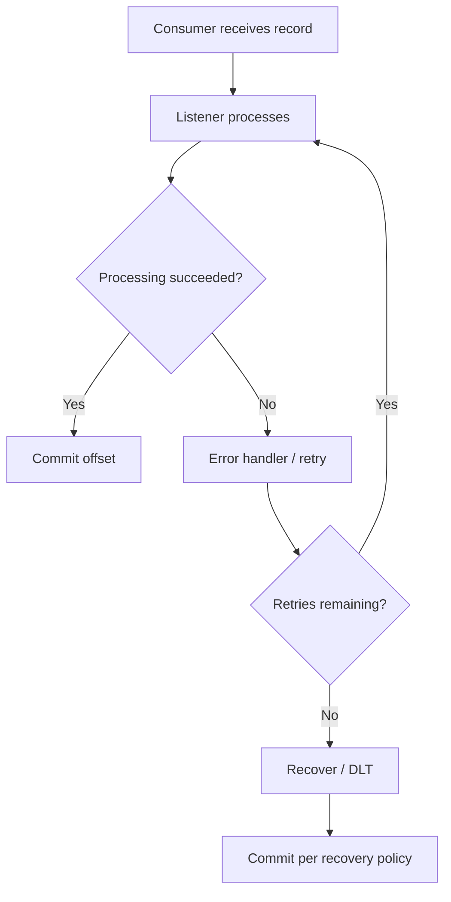

# Commit and Retry Checklist

Offset commits and retries determine when a record is considered processed and how an application reacts when a listener fails. If you commit too early, records can be lost from the processing flow before business work finishes. If retries are unbounded or lack idempotency, a record can produce side effects multiple times and stall the consumer group.

In Spring Kafka, you must design `AckMode`, error handlers, backoff, dead-letter topics (DLT), transactions, and how listeners execute side effects together. This checklist helps review configurations before deployment, select retry strategies by error type, and test restart, rebalance, DLT publish failure, and duplicate-handling scenarios.

## 1. Understand exactly when offsets are committed

A consumer reads a record at an offset within a partition. The consumer group stores committed offsets so the next read knows where to resume. Committing an offset does not mean the broker confirmed business completion; it is the consumer group signaling the processed position per the application's guarantee.

An at-least-once flow typically follows this order:

1. The consumer receives the record.
2. The listener executes business processing.
3. Processing succeeds.
4. The container commits the offset.

If the application dies after step 3 but before step 4, the record may be redelivered. This is a normal duplicate under at-least-once; the listener must be idempotent or have a mechanism to prevent applying side effects twice.

If committing before step 2, the application could die after committing but before finishing processing. Kafka will not redeliver committed records, resulting in lost processing. Therefore, for reliable business flows, never commit offsets before work has completed or been durably persisted as designed.



## 2. Disable auto commit and let the container manage offsets

With Spring Kafka listener containers, let the container manage commits via `AckMode`. Explicitly set `enable.auto.commit=false` so the Kafka client does not auto-commit on a timer independent of listener results:

```yaml
spring:
  kafka:
    consumer:
      enable-auto-commit: false
      group-id: order-service
    listener:
      ack-mode: record
```

Spring Kafka containers in modern versions disable auto commit by default unless overridden, but declaring it explicitly makes operational intent easy to audit. If auto commit is enabled, offsets may commit on a poll timer unrelated to whether business processing succeeded.

## 3. Choose `AckMode` based on the processing unit

`AckMode` decides when the container commits offsets. Common modes:

| Ack mode | When committed | Suitable when |
|---|---|---|
| `RECORD` | After each record listener completes successfully | Listener processes per record and needs clear commit boundaries. |
| `BATCH` | After all records from a poll complete successfully | Batch listeners or committing per poll batch. This is the common container default. |
| `TIME` | Once the configured commit interval elapses after records process | You want to group commits by time. |
| `COUNT` | Once the processed record count is reached | You want to bound commit frequency by count. |
| `COUNT_TIME` | Once either the count or time threshold is reached | Balances commit count and commit latency. |
| `MANUAL` | Listener calls `acknowledge()`; container commits per batch semantics | Application needs to control when confirmation happens after processing. |
| `MANUAL_IMMEDIATE` | Commits immediately when acknowledged on the consumer thread | Needs immediate commit control upon listener confirmation. |

Example configuring `RECORD`:

```java
factory.getContainerProperties()
        .setAckMode(ContainerProperties.AckMode.RECORD);
```

With `RECORD`, if the third record in a poll fails, previously succeeded records can be committed per container progression; the failing record is handled by the error handler per retry/recovery policy. With `BATCH`, committing is tied to completing the whole poll batch, so you must understand seek and commit behavior when only one record in a batch fails.

Do not choose `MANUAL_IMMEDIATE` simply because the name includes "immediate." If acknowledgment is called from another thread, commit behavior is dispatched back to the consumer thread and is not equivalent to calling directly on the listener thread. Pick the mode that matches how the listener actually runs.

## 4. Checklist for manual acknowledgment

When using `MANUAL` or `MANUAL_IMMEDIATE`, the listener receives `Acknowledgment` and calls `acknowledge()` only after work completes:

```java
@KafkaListener(topics = "orders", groupId = "order-service")
public void consume(OrderEvent event, Acknowledgment acknowledgment) {
    orderService.process(event);
    acknowledgment.acknowledge();
}
```

The factory must be configured with a manual ack mode:

```java
factory.getContainerProperties()
        .setAckMode(ContainerProperties.AckMode.MANUAL);
```

Before using manual acknowledgment, verify:

- [ ] `enable.auto.commit=false`.
- [ ] The listener acknowledges only after business logic succeeds or work is durably stored per contract.
- [ ] If processing throws an exception, the error path does not call acknowledgment as if it succeeded.
- [ ] With batch listeners, clarify whether acknowledgment applies to the whole batch or per record per the API used.
- [ ] Do not hold `Acknowledgment` too long or invoke it after a partition has been revoked without proper design.
- [ ] If acknowledging from worker threads, check `asyncAcks`, acknowledgment ordering, and Spring Kafka version constraints.
- [ ] Test restarts/rebalances while acknowledgments are pending.

Spring Kafka supports out-of-order acknowledgments via `asyncAcks` in certain manual modes. When enabled, the container may pause fetching more records until sufficient acknowledgments from the prior poll arrive. This mechanism alters commit progression and can cause redelivery after failures; do not enable it merely to bypass worker ordering design.

## 5. Synchronous vs. asynchronous commits

The container can commit offsets synchronously or asynchronously. Synchronous commits wait for broker responses and surface commit errors immediately in the execution flow, though they can increase processing time. Asynchronous commits reduce waiting time, but callback errors may surface after the listener has moved on.

In Spring Kafka, `ContainerProperties.setSyncCommits(...)` controls this option for the container. Before switching to async commits, confirm:

- [ ] Metrics or logs exist for commit failure callbacks.
- [ ] The team understands the possibility of failed offset commits causing redelivery.
- [ ] Listener return is not assumed to prove the broker confirmed the offset under every configuration.
- [ ] The impact of sync commit latency on throughput and poll intervals has been measured.
- [ ] Commit timeouts match broker latency and shutdown requirements.

Do not optimize commit frequency before assessing duplicate risk and reprocessing capability. Committing less often can raise throughput, but it also causes more records to be redelivered after a crash.

## 6. Classify errors before configuring retries

Retries are only helpful when an error is likely to clear after some time or after a dependency recovers. Retrying unrecoverable errors increases load, lengthens processing time, and stalls partition progress.

| Error category | Examples | Handling approach |
|---|---|---|
| Transient | Database timeout, HTTP 503, temporary broker/network blip | Bounded retry with backoff. |
| Rate limit | HTTP 429 or downstream backpressure | Backoff per `Retry-After` policy if present; limit concurrency. |
| Permanent data error | Payload missing required field, invalid enum value | Do not retry infinitely; send to DLT or quarantine for investigation. |
| Schema/deserialization error | Unreadable payload or incompatible schema | Handle at deserialization/error handler layer; keep raw payload/headers for investigation. |
| Config/permission error | Missing ACL, wrong topic, expired credential | Alert and fix configuration; short retry only if transient failure is plausible. |
| Programming error | Incorrect null handling, violated invariant | Stop infinite retry loops; fix code and replay in a controlled way. |

Rule of thumb: retry transient errors; classify permanent errors; never mask errors by catching an exception and returning normally. If a listener swallows an exception, the container may treat the record as succeeded and commit its offset.

## 7. Blocking retries with `DefaultErrorHandler`

`DefaultErrorHandler` handles exceptions from listeners and can retry a record with backoff before invoking a recoverer. Example using `FixedBackOff` and routing unprocessable records to a DLT:

```java
@Bean
DefaultErrorHandler orderErrorHandler(KafkaTemplate<Object, Object> template) {
    DeadLetterPublishingRecoverer recoverer =
            new DeadLetterPublishingRecoverer(template);

    // 2 retries after the initial processing attempt, 1 second apart.
    FixedBackOff backOff = new FixedBackOff(1_000L, 2L);
    DefaultErrorHandler handler = new DefaultErrorHandler(recoverer, backOff);

    handler.addNotRetryableExceptions(
            IllegalArgumentException.class,
            UnsupportedOperationException.class);
    return handler;
}
```

Attach the handler to the listener container factory:

```java
factory.setCommonErrorHandler(orderErrorHandler);
```

In this example, the record is processed once initially, followed by up to two retries. Once retries are exhausted, the recoverer is invoked to publish the record to the configured DLT. The retry count in `FixedBackOff` is the number of retries after the first attempt, not the total number of attempts.

Blocking retry holds the partition processing thread during backoff waits. This suits short transient errors and situations requiring per-partition ordering. Excessive backoff or too many retries can stall the consumer and hit `max.poll.interval.ms`; sum total processing time, backoff, and records per poll before choosing values.

In production, classify concrete exceptions and mark only unrecoverable errors as non-retryable. Do not add every exception to the non-retryable list just to shrink lag; conversely, do not retry every error many times without root-cause analysis.

## 8. Choose backoff and bound total retry duration

Fixed backoff is simple, but it can cause many consumers to retry at the exact same moment. Exponential backoff widens intervals between attempts, giving downstream systems time to recover. Jitter can be added at the retry policy layer if many workers run concurrently.

Example with increasing retry intervals:

```java
ExponentialBackOffWithMaxRetries backOff =
        new ExponentialBackOffWithMaxRetries(4);
backOff.setInitialInterval(500L);
backOff.setMultiplier(2.0);
backOff.setMaxInterval(5_000L);

DefaultErrorHandler handler =
        new DefaultErrorHandler(recoverer, backOff);
```

When choosing backoff, account for:

- [ ] Initial listener processing duration.
- [ ] Total wait time across retries.
- [ ] Reprocessing time after backoff.
- [ ] `max.poll.interval.ms` and the container's ability to keep polling.
- [ ] Business SLA and expected downstream recovery time.
- [ ] Volume of other records on the same partition queued behind a failing record.

If a failing record blocks a partition for a long time, consider retry topics or moving the record to a DLT after bounded attempts. Do not use retries as an indefinite waiting queue.

## 9. DLT and recovery after exhausting retries

A DLT retains unprocessable records for investigation and replay. By default, `DeadLetterPublishingRecoverer` typically forms the target topic name by appending `.DLT` to the source topic and preserves the source partition; thus the DLT needs matching partition counts. If using a custom resolver, verify that the target topic and partition exist.

DLT checklist:

- [ ] The DLT has long enough retention for investigation.
- [ ] DLT partition count matches how the resolver routes from the source topic.
- [ ] The producer publishing to the DLT has serializers supporting both normal payloads and raw bytes on deserialization failures.
- [ ] Records retain keys, event IDs, and source metadata needed for tracing.
- [ ] Error headers include exception details, source topic/partition/offset, and recovery timestamp per framework configuration.
- [ ] Metrics exist for DLT record count with alerts on abnormal spikes.
- [ ] An owner and procedures exist for triage, data repair, and replay.
- [ ] If DLT publishing fails, the record is not treated as successfully recovered; alerts and tests cover this error path.

Do not replay an entire DLT directly back to the source topic without filtering and controls. A permanent data error could loop through retries and land in the DLT again. Replay must record who executed it, why, how many times, and the outcome.

## 10. Blocking retries vs. non-blocking retry topics

Spring Kafka supports two common retry styles:

| Approach | Mechanism | Characteristics |
|---|---|---|
| Blocking retry | Error handler waits for backoff then retries on the partition processing thread | Preserves partition ordering more easily, but a failing record blocks subsequent records during retries. |
| Non-blocking retry | Moves the record to delayed retry topics for another consumer to process later | Source partition can keep advancing; ordering between the original record and retried records can change. |

Example retry topic annotation:

```java
@RetryableTopic(
        attempts = "4",
        backoff = @Backoff(delay = 1_000, multiplier = 2.0, maxDelay = 10_000),
        dltTopicSuffix = ".dlt")
@KafkaListener(topics = "orders", groupId = "order-service")
public void consume(OrderEvent event) {
    orderService.process(event);
}
```

In this example, `attempts` is the total number of attempts including the initial one; retry topics handle subsequent attempts, and the final failure can be routed to the DLT. Auto-created topic configs, suffixes, and partition counts must be verified against your Spring Kafka version and environment topology.

Non-blocking retry fits when failures require longer waits and the application accepts processing newer records ahead of retried ones. It is unsuitable if business rules demand strict per-partition ordering. Spring Kafka also has version-specific compatibility limits; verify compatibility especially when using batch listeners or container transactions before choosing retry topics.

## 11. Transactions and atomic offset commits

If a listener both reads input and publishes Kafka output, a transactional listener container can place output records and input offsets into the same Kafka transaction. When the transaction commits, both take effect together; when aborted, output is hidden from `read_committed` consumers and input can be redelivered.

For transactional listeners, exceptions roll back the transaction. Retry/recovery is typically controlled by `DefaultAfterRollbackProcessor`, rather than simply swapping `DefaultErrorHandler` as in non-transactional flows. You can configure a recoverer to send records to a DLT after retries:

```java
DefaultAfterRollbackProcessor<String, OrderEvent> processor =
        new DefaultAfterRollbackProcessor<>(
                new DeadLetterPublishingRecoverer(kafkaTemplate),
                new FixedBackOff(1_000L, 2L));

factory.setAfterRollbackProcessor(processor);
```

The container must use `KafkaTransactionManager`, and `KafkaTemplate` must use the same transactional producer factory. Downstream consumers need `isolation.level=read_committed` if they must read only committed output.

Kafka transactions do not automatically roll back database updates, emails, or HTTP calls. If a listener updates a database and the Kafka transaction aborts, database side effects may still persist. Use idempotency, inbox/outbox, or proper coordination when business flows span multiple systems.

## 12. Ensure idempotency on retries or redeliveries

At-least-once delivery can redeliver records after crashes, rebalances, commit failures, or retries. Therefore, consumers must handle duplicate deliveries safely.

Common techniques:

- Use a unique `eventId` and store it in an inbox table with a unique constraint.
- Use aggregate versions to apply only the next valid version.
- Use upserts or idempotent target-state updates rather than unguarded increments.
- Pass an idempotency key when calling downstream HTTP APIs.
- Record processing results in the same database transaction as business changes.

Example duplicate check at the service layer:

```java
@Transactional
public void process(OrderEvent event) {
    if (inboxRepository.existsByEventId(event.eventId())) {
        return;
    }

    orderRepository.apply(event);
    inboxRepository.save(new InboxEntry(event.eventId()));
}
```

This example illustrates the concept; to prevent race conditions, the database needs a unique constraint on `event_id` and transactional duplicate-key handling. Checking `exists` and then inserting without a unique constraint can let two concurrent consumers/processes apply the same event simultaneously.

## 13. Asynchronous processing and acknowledgment

If a listener merely enqueues a record into an in-memory queue and returns, the container may commit the offset before the worker finishes. If the application restarts, committed records whose in-memory queued work was not persisted can be lost.

Before using asynchronous handoff, verify:

- [ ] The queue is bounded and has an overflow policy.
- [ ] Offsets are confirmed only after work finishes or has been written to a durable store.
- [ ] Worker acknowledgments are not invoked on the wrong thread or out of order.
- [ ] `asyncAcks` is thoroughly understood if using out-of-order manual acks.
- [ ] Restarts/rebalances with in-flight tasks do not lose data.
- [ ] Duplicates after crashes are handled idempotently.

Unless there is a special need, synchronous processing in the listener is simpler for commit semantics. When separating workers is required, consider a dedicated work topic or durable handoff instead of relying solely on an in-memory queue.

## 14. Error and expected-behavior matrix

| Scenario | Expected offset state | Retry/recovery |
|---|---|---|
| Listener succeeds | Committed per AckMode | No retry. |
| Listener throws transient exception | Record not confirmed succeeded | Retried per configured backoff. |
| Retries exhausted and DLT publish succeeds | Recovery confirmed per error handler/transaction policy | Record lands in DLT and consumer continues per config. |
| DLT publish fails | Do not treat record as recovered | Log error, alert, and preserve ability to reprocess. |
| App dies after side effect, before commit | Offset uncommitted | Record may redeliver; idempotency prevents duplicate side effects. |
| App dies after commit, before side effect | Processing can be lost if committed too early | Fix commit and processing order; unacceptable for reliable flows. |
| Kafka transaction aborts | Output and offset in transaction do not commit | Retry/rollback processor reprocesses input. |
| Rebalance while record uncommitted | Record may be assigned to a new member | Idempotent listener handles redelivery. |

## 15. Pre-release testing checklist

**Commit and acknowledgment**

- [ ] `enable.auto.commit=false` and AckMode match the record/batch listener.
- [ ] Offsets commit only after listener completion or durable handoff succeeds.
- [ ] Manual acknowledgment is called only after successful processing.
- [ ] Commit failures and restarts before/after commit have been tested.

**Retry and DLT**

- [ ] Transient and permanent errors are classified.
- [ ] Retry count, backoff, and total retry time are bounded.
- [ ] DLT has appropriate partitions, serializers, retention, and ACLs.
- [ ] DLT publish failures have alerting and are never treated as successful recovery.
- [ ] Replay is controlled and cannot trigger infinite loops.

**Transactions and idempotency**

- [ ] Transactional producers use unique per-instance prefixes.
- [ ] Listener containers and KafkaTemplate share the same producer factory/transaction manager.
- [ ] Downstream consumers use `read_committed` when transactional visibility is required.
- [ ] Database/HTTP side effects use idempotency or appropriate outbox/inbox patterns.

**Operations**

- [ ] Metrics exist for retries, recoveries, DLT, commit failures, and consumer lag.
- [ ] Logs include topic, partition, offset, event ID, and exception class.
- [ ] Rebalances, shutdowns, and restarts mid-processing have been tested.
- [ ] Batch size, concurrency, and backoff do not breach `max.poll.interval.ms`.

## 16. Practice exercises

1. Create an `orders` listener with `AckMode.RECORD` and `enable.auto.commit=false`.
2. Write a test where the listener succeeds and verify the group offset advances.
3. Have the listener throw a transient exception twice then succeed; verify retry count.
4. Have the listener throw a permanent exception; verify no retries occur and the record goes to DLT.
5. Make the DLT producer fail; verify the record is not marked successfully recovered.
6. Stop the application after side effects complete but before commit; verify redelivery occurs and idempotency prevents business duplicates.
7. Test manual acknowledgment and verify an exception before ack does not commit the record as succeeded.
8. If using transactions, force listener rollback after sending output and verify `read_committed` consumers do not see aborted output.
9. Trigger a rebalance while a record is retrying and verify no record is lost.
10. Record lag, processing time, retry count, DLT count, and total recovery time.

## 17. Acceptance criteria

| Criterion | Passing condition |
|---|---|
| Commit | Offsets are confirmed only at the proper completion/durable handoff point. |
| Retry | Error classification, attempt limits, and bounded backoff are in place. |
| DLT | Failing records are retained with enough metadata for investigation and replay. |
| Duplicates | Side effects remain safe when records are redelivered. |
| Transactions | Output and input offsets commit/abort together if the flow requires Kafka EOS. |
| Observability | Metrics and logs explain retries, commits, recoveries, and lag. |
| Recovery | Restarts, rebalances, and DLT failures never silently drop records. |

Commits and retries must be designed as a unified policy: the listener defines when work is complete, the container manages offsets, the error handler governs retry/recovery, and idempotency protects side effects on redelivery. When every failure branch has tested and observable behavior, Spring Kafka streams can recover from errors without silently dropping events or duplicating business actions unintentionally.
