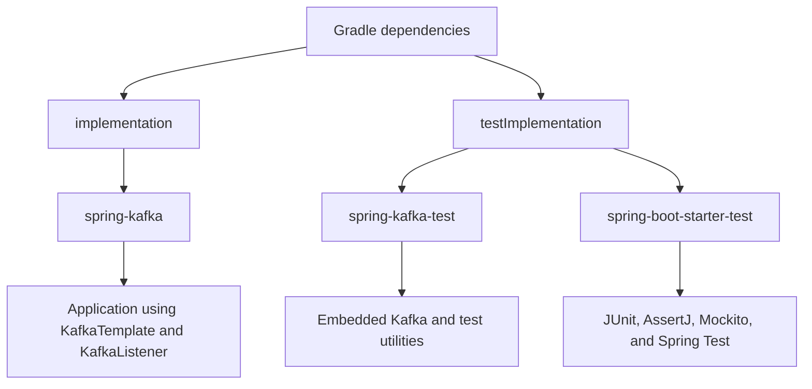

# Declaring spring-kafka in Gradle

To use `KafkaTemplate`, `@KafkaListener`, and Kafka integration components in Spring, a project needs to declare the **Spring for Apache Kafka** library. The main artifact is `org.springframework.kafka:spring-kafka`. For Spring Boot applications, let the Spring Boot BOM manage library versions so that Spring Kafka, Spring Framework, and related components are compatible with one another.

Besides the application runtime dependency, a project usually needs `spring-kafka-test` in the test scope. These two dependencies serve different purposes: `spring-kafka` provides the runtime messaging APIs; `spring-kafka-test` provides testing tools such as an embedded Kafka broker and test utilities.

## 1. Core Spring Kafka Dependencies

Libraries commonly used when building a Spring Kafka application:

| Dependency | Gradle Scope | Purpose |
|---|---|---|
| `org.springframework.kafka:spring-kafka` | `implementation` | Provides `KafkaTemplate`, `@KafkaListener`, listener containers, message converters, and Spring Kafka configuration classes. |
| `org.springframework.kafka:spring-kafka-test` | `testImplementation` | Provides Kafka testing utilities, such as `EmbeddedKafkaBroker` and the `@EmbeddedKafka` annotation. |
| `org.springframework.boot:spring-boot-starter-test` | `testImplementation` | Provides the Spring Boot testing foundation, JUnit Jupiter, AssertJ, and Mockito under Boot's dependency management. |

`spring-kafka` depends on the corresponding Kafka client. Therefore, in a typical Spring Kafka application, there is no need to declare `org.apache.kafka:kafka-clients` separately just to use `KafkaTemplate` or `@KafkaListener`. Only declare the Kafka client directly when your source code actively uses low-level Kafka APIs and you want to make that direct dependency explicit; still keep the version compatible with Spring Kafka.

## 2. Declaring in a Spring Boot Project Using Groovy DSL

If the project already has the Spring Boot Gradle plugin and dependency management plugin, simply add the dependencies to `build.gradle`:

```groovy
plugins {
    id 'java'
    id 'org.springframework.boot' version '<spring-boot-version>'
    id 'io.spring.dependency-management' version '<dependency-management-plugin-version>'
}

group = 'com.example'
version = '1.0.0'

repositories {
    mavenCentral()
}

dependencies {
    // Library used in main source code.
    implementation 'org.springframework.kafka:spring-kafka'

    // Libraries used for testing only.
    testImplementation 'org.springframework.boot:spring-boot-starter-test'
    testImplementation 'org.springframework.kafka:spring-kafka-test'
}

tasks.named('test') {
    useJUnitPlatform()
}
```

Replace the placeholders in the `plugins` section with the Spring Boot and dependency management plugin versions your project uses. The example above does not attach explicit versions to `spring-kafka` and `spring-kafka-test`: when the Spring Boot plugin is combined with `io.spring.dependency-management`, the Spring Boot BOM is imported automatically and manages the corresponding versions.

If the project already has `plugins`, `repositories`, and `dependencies` blocks, do not create duplicate blocks. Only add the three dependency lines into the existing `dependencies` block. A project already using `spring-boot-starter-web`, `spring-boot-starter-data-jpa`, or another starter also does not need `spring-boot-starter` added just to use Spring Kafka.

The example assumes the application already has an appropriate foundational Spring Boot dependency, such as `spring-boot-starter-web`. If you are creating a minimal Boot application and have no starter yet, add `implementation 'org.springframework.boot:spring-boot-starter'` (or a starter suited to the application type). The Spring Boot Gradle plugin assists with building and packaging; the plugin itself does not replace the application's runtime dependencies.

## 3. Declaring in a Project Using Kotlin DSL

If the build file is named `build.gradle.kts`, dependency syntax uses function calls:

```kotlin
plugins {
    java
    id("org.springframework.boot") version "<spring-boot-version>"
    id("io.spring.dependency-management") version "<dependency-management-plugin-version>"
}

group = "com.example"
version = "1.0.0"

repositories {
    mavenCentral()
}

dependencies {
    implementation("org.springframework.kafka:spring-kafka")

    testImplementation("org.springframework.boot:spring-boot-starter-test")
    testImplementation("org.springframework.kafka:spring-kafka-test")
}

tasks.withType<Test> {
    useJUnitPlatform()
}
```

Version management rules are the same as Groovy DSL. The main difference lies in Kotlin syntax; the Maven coordinates of the dependencies do not change.

## 4. Managing Versions with the Spring Boot BOM

A BOM (Bill of Materials) is a list of versions verified to be compatible together. When using Spring Boot, the BOM helps the project choose a synchronized set of versions for Spring Kafka, Spring Framework, and many other foundational libraries.

There are two common ways to import a BOM in Gradle:

**Approach A — Spring Boot plugin combined with the dependency management plugin.** This is the approach shown in the two examples above. The Spring Boot Gradle plugin automatically imports the BOM when `io.spring.dependency-management` is applied. Therefore, dependencies are declared without individual versions.

**Approach B — Using Gradle's native BOM support.** If the project does not use the dependency management plugin, you can import the BOM directly using `platform`:

```groovy
plugins {
    id 'java'
}

repositories {
    mavenCentral()
}

dependencies {
    implementation platform('org.springframework.boot:spring-boot-dependencies:<spring-boot-version>')

    implementation 'org.springframework.kafka:spring-kafka'

    testImplementation 'org.springframework.kafka:spring-kafka-test'
    testImplementation 'org.springframework.boot:spring-boot-starter-test'
}
```

In this case, replace `<spring-boot-version>` with the BOM version you want to use. If you use the Spring Boot Gradle plugin while choosing native BOM support, configure dependency management explicitly using one consistent mechanism; avoid importing the BOM multiple times or declaring explicit versions that conflict with the BOM.

### Why Avoid Choosing Versions Manually for Each Library?

Spring Kafka integrates with APIs from Spring Framework and the Kafka client. Upgrading `spring-kafka` or `kafka-clients` separately without considering the version set managed by Spring Boot can cause compatibility errors at compile time or startup.

For Spring Boot applications, choose a Boot version compatible with Java and project requirements, then let the BOM manage Spring Kafka. Only override versions when there is a specific technical reason, compatibility has been verified, and tests confirm it.

## 5. Distinguishing Application Runtime Dependencies from Test Dependencies

Gradle categorizes dependencies by configuration. Placing libraries in the right configuration keeps the runtime classpath lean and prevents test libraries from being packaged into the application.



- `implementation`: dependencies required when compiling and running main source code. `spring-kafka` belongs here because producer/consumer components need the library when the application runs.
- `testImplementation`: dependencies required only when compiling and running tests. `spring-kafka-test` and `spring-boot-starter-test` belong here.
- `runtimeOnly`: used only when a library is needed at runtime but source code does not reference its APIs at compile time. This is not a replacement configuration for `spring-kafka`, because applications typically import Spring Kafka classes.

Do not place `spring-kafka` in `testImplementation` if the main application has `KafkaTemplate` or `@KafkaListener`; when running the application, those classes will not be on the runtime classpath. Conversely, do not put `spring-kafka-test` in `implementation`, because test libraries are unnecessary in the production runtime artifact.

## 6. Configuring the Kafka Connection After Adding Dependencies

Declaring dependencies in Gradle only puts libraries on the classpath. It does not automatically create a Kafka broker, topics, or connection details. The application still needs broker addresses and producer/consumer properties suited to the environment.

Example minimal configuration in `src/main/resources/application.yml`:

```yaml
spring:
  kafka:
    bootstrap-servers: localhost:9092
    consumer:
      group-id: order-service
```

`bootstrap-servers` is the list of broker addresses for the client to initiate connections and discover cluster metadata. `group-id` identifies the default consumer group. When using multiple consumer flows for different purposes, separate group IDs can be set in configuration or directly on `@KafkaListener`.

Producers and consumers also need compatible serializers/deserializers for the key and value types. For example, if a producer sends a Java object as JSON, both sides need to agree on the JSON serializer/deserializer or message converter. The `spring-kafka` dependency provides the integration components, but cannot decide the application's schema and data contract on its own.

For Spring Boot applications with auto-configuration libraries on the classpath, auto-configuration can create factories and `KafkaTemplate` based on `spring.kafka.*` when dependencies and configuration are appropriate. For Spring Framework applications without Boot, you must manually configure the producer factory, consumer factory, `KafkaTemplate`, and listener container factory, and enable annotation processing with `@EnableKafka`.

## 7. Verifying Dependencies Resolved by Gradle

After updating the build file, run the Gradle Wrapper from the project root directory:

On Windows:

```powershell
.\gradlew.bat dependencies --configuration runtimeClasspath
.\gradlew.bat dependencies --configuration testRuntimeClasspath
```

On Linux or macOS:

```bash
./gradlew dependencies --configuration runtimeClasspath
./gradlew dependencies --configuration testRuntimeClasspath
```

In `runtimeClasspath`, check that `org.springframework.kafka:spring-kafka` and the Kafka client dependencies are resolved. In `testRuntimeClasspath`, check that `spring-kafka-test` and the testing libraries are present.

When you need to find out why a specific version was selected, use `dependencyInsight`:

```powershell
.\gradlew.bat dependencyInsight --dependency spring-kafka --configuration runtimeClasspath
.\gradlew.bat dependencyInsight --dependency kafka-clients --configuration runtimeClasspath
```

On Linux/macOS, the equivalent commands replace `gradlew.bat` with `./gradlew`. The output helps identify which dependency pulls the library in, which constraint or BOM selects the version, and whether any dependency requests a different version.

## 8. Common Errors

| Symptom | Common Cause | Resolution |
|---|---|---|
| Gradle reports missing version for `spring-kafka` | BOM not imported or dependency management not configured. | Check the Spring Boot plugin, dependency management plugin, or `platform(...)`. |
| Cannot find `KafkaTemplate` at compile time | Missing `spring-kafka`, or mistakenly declared in a test-only configuration. | Move `spring-kafka` into `implementation`. |
| Application fails at runtime with `ClassNotFoundException` for Spring Kafka classes | Dependency is missing from runtime classpath or excluded. | Check `runtimeClasspath`, exclusions, and multi-module configuration. |
| Tests cannot find `@EmbeddedKafka` | Missing `spring-kafka-test` on the test classpath. | Add `testImplementation` for `spring-kafka-test`. |
| Incompatible Kafka client version | `kafka-clients` overridden independently of Spring Kafka/BOM. | Remove unnecessary overrides or verify a compatible version set. |
| Gradle cannot download artifacts | Issue with Maven repository or network connection. | Check `mavenCentral()`, proxy, credentials if using a private repository, and Gradle error messages. |
| Build file has multiple dependency management declarations | Importing the BOM multiple times or mixing multiple version management mechanisms. | Pick one consistent version management approach and check dependency insight. |

## 9. Key Takeaways

- The primary runtime dependency for Spring Kafka is `org.springframework.kafka:spring-kafka` and is normally placed in `implementation`.
- The testing dependency is `org.springframework.kafka:spring-kafka-test` and is placed in `testImplementation`.
- With Spring Boot, prefer using the BOM to manage Spring Kafka and Kafka client versions in sync.
- Groovy DSL uses dependency strings; Kotlin DSL uses function calls. Artifact coordinates are the same.
- Adding dependencies does not replace configuring brokers, topics, serializers/deserializers, or consumer groups.
- Use `dependencies` and `dependencyInsight` to inspect the dependency graph when encountering version conflicts.

When declaring Spring Kafka in a new project, determine upfront whether the project uses Spring Boot or plain Spring Framework, choose one version management mechanism, add runtime and test dependencies to the proper scopes, and verify the dependency graph with the Gradle Wrapper. After this step, the project has the library foundation needed to start configuring producers and consumers.
