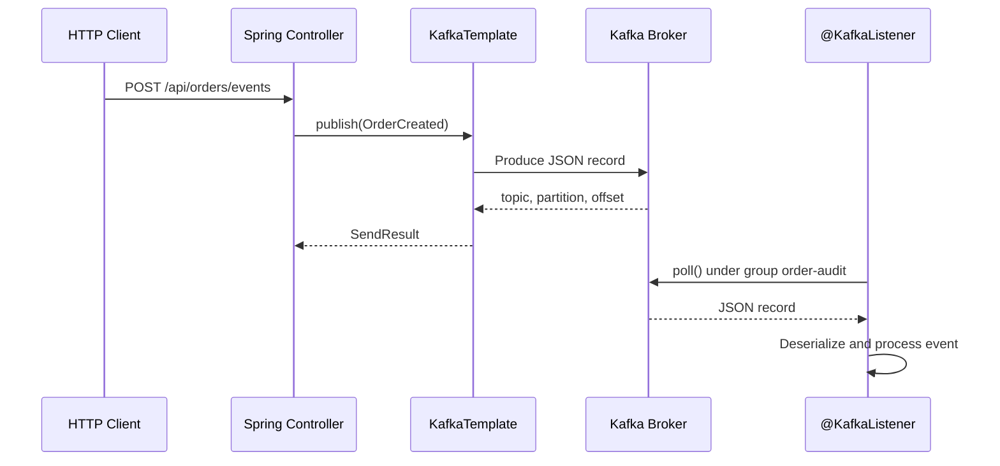

# Creating a Sample Application to Send and Receive Records

A minimal Spring Kafka application needs three parts: configuration to connect to Kafka, a component to send records, and a listener to receive records. Once these three parts work, the application can publish events to a topic and process events within a consumer group without manually writing Kafka polling loops.

This lesson builds a sample application that receives order-event creation requests over HTTP, sends events with `KafkaTemplate`, and reads them back with `@KafkaListener`. The example uses JSON to serialize Java objects, uses `orderId` as the key, and creates the topic through Spring configuration. The goal is to have a working small project to observe the full journey of a record.

## 1. Application Flow

The sample application has one producer and one consumer running together in Spring Boot:

1. A client sends an HTTP request containing event data.
2. The controller converts the data into `OrderCreated` and calls the Kafka publishing service.
3. `KafkaTemplate` serializes the object to JSON and sends the record to the `orders.events` topic.
4. The Kafka broker stores the record in a partition and assigns an offset.
5. The listener container uses a Kafka consumer to poll records under the `order-audit` group.
6. Spring Kafka deserializes JSON into `OrderCreated` and invokes the `@KafkaListener` method.



The producer only needs to know the topic and data contract. The consumer subscribes to the topic and reads according to its group offset. A successful send result from Kafka confirms the record was written according to producer settings; it does not mean the listener has finished processing the business logic.

## 2. Preparing the Spring Boot Project

The example uses Java 17 or later, Maven, and Spring Boot 3.x. Use the Spring Boot version managed by your project; Spring Boot dependency management will select a compatible Spring Kafka version. There is no need to pin a different `spring-kafka` version when already using the Spring Boot starter and BOM.

### 2.1. Declaring Dependencies

In `pom.xml`, add the required dependencies:

```xml
<dependencies>
    <dependency>
        <groupId>org.springframework.boot</groupId>
        <artifactId>spring-boot-starter-web</artifactId>
    </dependency>

    <dependency>
        <groupId>org.springframework.kafka</groupId>
        <artifactId>spring-kafka</artifactId>
    </dependency>

    <dependency>
        <groupId>org.springframework.boot</groupId>
        <artifactId>spring-boot-starter-test</artifactId>
        <scope>test</scope>
    </dependency>

    <dependency>
        <groupId>org.springframework.kafka</groupId>
        <artifactId>spring-kafka-test</artifactId>
        <scope>test</scope>
    </dependency>
</dependencies>
```

`spring-kafka` provides `KafkaTemplate`, `@KafkaListener`, listener containers, and integration abstractions for the Kafka client. `spring-kafka-test` provides testing utilities, including an embedded Kafka broker. If the project already has `spring-boot-starter-web` or test dependencies, do not declare duplicates.

### 2.2. Package Structure

A simple layout can look like this:

```text
src/main/java/com/example/messaging
├── MessagingApplication.java
├── config
│   └── KafkaTopicConfig.java
├── event
│   └── OrderCreated.java
├── producer
│   └── OrderEventPublisher.java
├── consumer
│   └── OrderCreatedListener.java
└── web
    └── OrderEventController.java

src/main/resources
└── application.yml

src/test/java/com/example/messaging
└── OrderMessagingIntegrationTest.java
```

Place the main class in the root package `com.example.messaging` so component scanning finds the sub-packages. Event classes use a stable shared package so serializers and deserializers can identify data types consistently.

## 3. Connecting to a Kafka Broker

The application needs a reachable bootstrap server address. In a local environment, the examples below assume Kafka is listening at `localhost:9092`. You can use an existing local cluster or Docker Compose. A single broker is suitable for learning and experimenting; production requires multiple brokers, replication, and security.

Docker Compose example for a simple KRaft single broker:

```yaml
services:
  kafka:
    image: apache/kafka:3.9.1
    hostname: kafka
    container_name: kafka-local
    ports:
      - "9092:9092"
    environment:
      KAFKA_CLUSTER_ID: 4L6g3nShT-eMCtK--X86sw
      KAFKA_NODE_ID: 1
      KAFKA_PROCESS_ROLES: broker,controller
      KAFKA_LOG_DIRS: /var/lib/kafka/data
      KAFKA_LISTENERS: PLAINTEXT://:9092,CONTROLLER://:9093
      KAFKA_ADVERTISED_LISTENERS: PLAINTEXT://localhost:9092
      KAFKA_CONTROLLER_LISTENER_NAMES: CONTROLLER
      KAFKA_LISTENER_SECURITY_PROTOCOL_MAP: CONTROLLER:PLAINTEXT,PLAINTEXT:PLAINTEXT
      KAFKA_CONTROLLER_QUORUM_VOTERS: 1@localhost:9093
      KAFKA_OFFSETS_TOPIC_REPLICATION_FACTOR: 1
      KAFKA_TRANSACTION_STATE_LOG_REPLICATION_FACTOR: 1
      KAFKA_TRANSACTION_STATE_LOG_MIN_ISR: 1
      KAFKA_GROUP_INITIAL_REBALANCE_DELAY_MS: 0
      KAFKA_NUM_PARTITIONS: 3
    volumes:
      - kafka-data:/var/lib/kafka/data

volumes:
  kafka-data:
```

Save the configuration to `compose.yml` in your local project, then start the broker:

```bash
docker compose up -d
docker compose logs -f kafka
```

If running the application inside a container on the same Docker network, `localhost` will point to the application container itself. In that case, use the Kafka service hostname and configure an advertised listener suited to the container network. Both the bootstrap server address and the broker address advertised by Kafka must be reachable from where the application runs.

## 4. Configuring the Producer, Consumer, and Topic

Create `src/main/resources/application.yml`:

```yaml
server:
  port: 8080

spring:
  kafka:
    bootstrap-servers: ${KAFKA_BOOTSTRAP_SERVERS:localhost:9092}
    producer:
      key-serializer: org.apache.kafka.common.serialization.StringSerializer
      value-serializer: org.springframework.kafka.support.serializer.JsonSerializer
      acks: all
    consumer:
      group-id: order-audit
      enable-auto-commit: false
      auto-offset-reset: earliest
      key-deserializer: org.apache.kafka.common.serialization.StringDeserializer
      value-deserializer: org.springframework.kafka.support.serializer.JsonDeserializer
      properties:
        spring.json.trusted.packages: com.example.messaging.event
    listener:
      ack-mode: record

app:
  kafka:
    topic:
      orders: orders.events
```

Meaning of the main properties:

| Configuration | Role |
| --- | --- |
| `bootstrap-servers` | Broker address used to initiate connections and fetch cluster metadata |
| `key-serializer` | Converts Java keys into bytes; the example uses `StringSerializer` |
| `value-serializer` | Converts event objects into JSON using `JsonSerializer` |
| `acks: all` | Producer waits for acknowledgment across Kafka's in-sync replica set |
| `group-id` | Consumer group identity for the default listener |
| `enable-auto-commit: false` | Lets the listener container manage commits according to the acknowledgment mode |
| `auto-offset-reset: earliest` | Chooses the starting position when the group has no valid offset yet |
| `value-deserializer` | Converts received JSON into Java objects using `JsonDeserializer` |
| `trusted.packages` | Restricts packages from which the JSON deserializer is allowed to instantiate objects |
| `ack-mode: record` | Commits offsets after each record is successfully processed by the listener, per container behavior |

`auto-offset-reset: earliest` does not make a group that already has a valid offset re-read from the beginning. It is only used when the group has no offset or the offset is no longer valid. `acks: all` alone also does not guarantee zero data loss in every situation; you must configure an appropriate replication factor and `min.insync.replicas` on the cluster.

### 4.1. Creating Topics with Spring Kafka

When the application starts, Spring Kafka can use `KafkaAdmin` to create topics declared as `NewTopic` beans:

```java
package com.example.messaging.config;

import org.apache.kafka.clients.admin.NewTopic;
import org.springframework.beans.factory.annotation.Value;
import org.springframework.context.annotation.Bean;
import org.springframework.context.annotation.Configuration;
import org.springframework.kafka.config.TopicBuilder;

@Configuration
public class KafkaTopicConfig {

    @Bean
    NewTopic ordersTopic(
            @Value("${app.kafka.topic.orders}") String topicName
    ) {
        return TopicBuilder.name(topicName)
                .partitions(3)
                .replicas(1)
                .build();
    }
}
```

Three partitions allow a group to have up to three consumers assigned partitions of this topic at a time. One replica is appropriate for a single local broker; in production, the replication factor must match the broker count and availability requirements. The application account needs topic-creation permissions if `KafkaAdmin` creates topics automatically; if infrastructure manages topics separately, pre-create the topic and omit the topic-creation bean from the application.

## 5. Declaring the Event Contract

Producer and consumer must agree on the data structure. This example uses a Java record to represent the `OrderCreated` event:

```java
package com.example.messaging.event;

import java.math.BigDecimal;
import java.time.Instant;

public record OrderCreated(
        String eventId,
        String orderId,
        BigDecimal total,
        Instant occurredAt
) {}
```

An event should have its own identifier `eventId`, an entity identifier `orderId`, and an occurrence timestamp. `eventId` supports logging, tracing, and idempotent processing on the consumer side. `orderId` is used as the Kafka key so events for the same order typically land in the same partition under the default partitioner.

JSON is the exchange format in this example. When multiple independent services consume an event, manage schemas and compatibility rules when adding, renaming, or removing fields. Do not treat Java package names or internal class names as durable contracts across multiple systems; consider using a schema registry with Avro/Protobuf or versioned JSON conventions.

## 6. Sending Records with KafkaTemplate

`KafkaTemplate` is Spring Kafka's abstraction for sending records. Spring Boot automatically configures a producer factory from `spring.kafka.producer` properties and provides the corresponding template.

Create `OrderEventPublisher.java`:

```java
package com.example.messaging.producer;

import com.example.messaging.event.OrderCreated;
import java.util.concurrent.CompletableFuture;
import org.springframework.beans.factory.annotation.Value;
import org.springframework.kafka.core.KafkaTemplate;
import org.springframework.kafka.support.SendResult;
import org.springframework.stereotype.Service;

@Service
public class OrderEventPublisher {

    private final KafkaTemplate<String, OrderCreated> kafkaTemplate;
    private final String topicName;

    public OrderEventPublisher(
            KafkaTemplate<String, OrderCreated> kafkaTemplate,
            @Value("${app.kafka.topic.orders}") String topicName
    ) {
        this.kafkaTemplate = kafkaTemplate;
        this.topicName = topicName;
    }

    public CompletableFuture<SendResult<String, OrderCreated>> publish(
            OrderCreated event
    ) {
        return kafkaTemplate.send(topicName, event.orderId(), event);
    }
}
```

The `send(topic, key, value)` parameters specify the topic, key, and payload. Here the key is `orderId` and the value is the `OrderCreated` object. `JsonSerializer` converts the value to JSON before sending. With Spring Kafka 3.x, `send` returns `CompletableFuture<SendResult<K,V>>`; the application can observe the result asynchronously.

`SendResult` contains `RecordMetadata`, including topic, partition, offset, and timestamp. Metadata indicates where the record was written according to Kafka's acknowledgment. If the future completes exceptionally, log/emit metrics and apply an appropriate send error-handling policy. Do not swallow send errors, because an API could report success even though the record was never written.

## 7. Receiving Records with @KafkaListener

Spring Kafka creates a listener container for methods annotated with `@KafkaListener`. The container manages the consumer, polls records, passes payloads through the deserializer, and invokes the listener method.

Create `OrderCreatedListener.java`:

```java
package com.example.messaging.consumer;

import com.example.messaging.event.OrderCreated;
import org.slf4j.Logger;
import org.slf4j.LoggerFactory;
import org.springframework.kafka.annotation.KafkaListener;
import org.springframework.kafka.support.KafkaHeaders;
import org.springframework.messaging.handler.annotation.Header;
import org.springframework.stereotype.Component;

@Component
public class OrderCreatedListener {

    private static final Logger log =
            LoggerFactory.getLogger(OrderCreatedListener.class);

    @KafkaListener(topics = "${app.kafka.topic.orders}")
    public void onOrderCreated(
            OrderCreated event,
            @Header(KafkaHeaders.RECEIVED_KEY) String key,
            @Header(KafkaHeaders.RECEIVED_PARTITION) int partition,
            @Header(KafkaHeaders.OFFSET) long offset
    ) {
        log.info(
                "Received eventId={}, orderId={}, key={}, partition={}, offset={}",
                event.eventId(), event.orderId(), key, partition, offset
        );

        // Replace with a business call, for example updating the order status.
    }
}
```

The listener does not need to call `poll()` itself. The container performs that work and dispatches records to the method. Because `groupId` is not declared directly on the annotation, the listener uses the default group ID `order-audit` from `application.yml`. Application replicas using the same group ID share partitions; a different group can read the topic independently.

In this example, the key is always `orderId`, so the received-key header is expected to have a value. If producers may send records without keys, declare the header as nullable or do not require it. You can add `@Header(KafkaHeaders.RECEIVED_TOPIC) String topic` to capture the topic when a listener subscribes to multiple topics.

## 8. Creating an API to Publish Test Events

To test quickly without writing a separate producer client, create a REST endpoint. The controller accepts an event JSON body and returns metadata after Kafka acknowledges the send:

```java
package com.example.messaging.web;

import com.example.messaging.event.OrderCreated;
import com.example.messaging.producer.OrderEventPublisher;
import java.util.Map;
import java.util.concurrent.CompletableFuture;
import org.apache.kafka.clients.producer.RecordMetadata;
import org.springframework.http.ResponseEntity;
import org.springframework.web.bind.annotation.PostMapping;
import org.springframework.web.bind.annotation.RequestBody;
import org.springframework.web.bind.annotation.RequestMapping;
import org.springframework.web.bind.annotation.RestController;

@RestController
@RequestMapping("/api/orders/events")
public class OrderEventController {

    private final OrderEventPublisher publisher;

    public OrderEventController(OrderEventPublisher publisher) {
        this.publisher = publisher;
    }

    @PostMapping
    public CompletableFuture<ResponseEntity<Map<String, Object>>> publish(
            @RequestBody OrderCreated event
    ) {
        return publisher.publish(event).thenApply(result -> {
            RecordMetadata metadata = result.getRecordMetadata();
            return ResponseEntity.accepted().body(Map.<String, Object>of(
                    "eventId", event.eventId(),
                    "topic", metadata.topic(),
                    "partition", metadata.partition(),
                    "offset", metadata.offset()
            ));
        });
    }
}
```

The controller returns HTTP 202 after the send future completes successfully. If sending fails, the future completes exceptionally and Spring MVC handles the error via the application's exception handling mechanism. In production, add `@RestControllerAdvice` to map Kafka errors to clear HTTP responses while avoiding returning stack traces or internal details to clients.

Example request:

```http
POST http://localhost:8080/api/orders/events
Content-Type: application/json

{
  "eventId": "evt-1001",
  "orderId": "ORD-1001",
  "total": 125000.00,
  "occurredAt": "2026-11-17T02:00:00Z"
}
```

You can send it using curl:

```bash
curl -X POST http://localhost:8080/api/orders/events \
  -H "Content-Type: application/json" \
  -d '{"eventId":"evt-1001","orderId":"ORD-1001","total":125000.00,"occurredAt":"2026-11-17T02:00:00Z"}'
```

A successful response looks like:

```json
{
  "eventId": "evt-1001",
  "topic": "orders.events",
  "partition": 1,
  "offset": 0
}
```

The actual partition and offset are assigned by Kafka and may differ from the example. In the application logs, the listener will record `eventId`, `orderId`, `key`, `partition`, and `offset` when the record is received.

## 9. Running and Observing the Application

Follow this sequence:

1. Start the Kafka broker and confirm it is reachable at the configured address.
2. Run the Spring Boot application. Check logs to confirm the application context starts and the topic is created or already exists.
3. Send an HTTP request to `/api/orders/events`.
4. Check the response for the topic, partition, and offset confirmed by Kafka.
5. Check the consumer logs to confirm the listener received the expected `eventId` and `orderId`.
6. Send more events with the same `orderId` to observe key and partition; with the same partitioner and an unchanged partition count, that key is consistently routed to the same partition.

You can use Kafka command-line tools to inspect topics and consumer groups. Script names and invocations depend on how Kafka is installed; for example, with a distribution providing `kafka-topics.sh` and `kafka-consumer-groups.sh`:

```bash
kafka-topics.sh --bootstrap-server localhost:9092 --describe --topic orders.events

kafka-consumer-groups.sh --bootstrap-server localhost:9092 \
  --describe --group order-audit
```

The first command shows the topic's partition count and replication. The second displays assignments, offsets, and lag for the `order-audit` group. If the group has not polled or committed yet, offset information may not appear immediately.

## 10. Testing the Send and Receive Flow

Do not just verify that the controller returns HTTP 202. An integration test should confirm that a record actually travels through the broker and that a consumer can read and deserialize the payload. `spring-kafka-test` provides `@EmbeddedKafka` to run an embedded broker in tests without needing an external Kafka instance.

Example testing record publishing and reading with an independent test consumer:

```java
package com.example.messaging;

import static org.assertj.core.api.Assertions.assertThat;

import com.example.messaging.event.OrderCreated;
import java.math.BigDecimal;
import java.time.Instant;
import java.util.Map;
import java.util.concurrent.TimeUnit;
import org.apache.kafka.clients.consumer.Consumer;
import org.apache.kafka.clients.consumer.ConsumerConfig;
import org.apache.kafka.clients.consumer.ConsumerRecord;
import org.apache.kafka.common.serialization.StringDeserializer;
import org.junit.jupiter.api.Test;
import org.springframework.beans.factory.annotation.Autowired;
import org.springframework.boot.test.context.SpringBootTest;
import org.springframework.kafka.core.DefaultKafkaConsumerFactory;
import org.springframework.kafka.core.KafkaTemplate;
import org.springframework.kafka.test.EmbeddedKafkaBroker;
import org.springframework.kafka.test.context.EmbeddedKafka;
import org.springframework.kafka.test.utils.KafkaTestUtils;

@SpringBootTest(properties = {
        "spring.kafka.consumer.group-id=application-test-group"
})
@EmbeddedKafka(
        partitions = 3,
        topics = "orders.events",
        bootstrapServersProperty = "spring.kafka.bootstrap-servers"
)
class OrderMessagingIntegrationTest {

    @Autowired
    KafkaTemplate<String, OrderCreated> kafkaTemplate;

    @Autowired
    EmbeddedKafkaBroker embeddedKafka;

    @Test
    void publishesAndReadsOrderCreatedEvent() throws Exception {
        Map<String, Object> properties = KafkaTestUtils.consumerProps(
                "record-verification-group", "false", embeddedKafka
        );
        properties.put(ConsumerConfig.AUTO_OFFSET_RESET_CONFIG, "earliest");
        properties.put(ConsumerConfig.KEY_DESERIALIZER_CLASS_CONFIG,
                StringDeserializer.class);
        properties.put(ConsumerConfig.VALUE_DESERIALIZER_CLASS_CONFIG,
                org.springframework.kafka.support.serializer.JsonDeserializer.class);
        properties.put(
                org.springframework.kafka.support.serializer.JsonDeserializer.VALUE_DEFAULT_TYPE,
                OrderCreated.class.getName()
        );
        properties.put(
                org.springframework.kafka.support.serializer.JsonDeserializer.TRUSTED_PACKAGES,
                "com.example.messaging.event"
        );
        properties.put(
                org.springframework.kafka.support.serializer.JsonDeserializer.USE_TYPE_INFO_HEADERS,
                false
        );

        try (Consumer<String, OrderCreated> consumer =
                     new DefaultKafkaConsumerFactory<String, OrderCreated>(properties)
                             .createConsumer()) {
            embeddedKafka.consumeFromAnEmbeddedTopic(consumer, "orders.events");

            OrderCreated event = new OrderCreated(
                    "evt-test-1",
                    "ORD-TEST-1",
                    new BigDecimal("125000.00"),
                    Instant.parse("2026-11-17T02:00:00Z")
            );

            kafkaTemplate.send("orders.events", event.orderId(), event)
                    .get(10, TimeUnit.SECONDS);

            ConsumerRecord<String, OrderCreated> record =
                    KafkaTestUtils.getSingleRecord(
                            consumer, "orders.events", java.time.Duration.ofSeconds(10)
                    );

            assertThat(record.key()).isEqualTo("ORD-TEST-1");
            assertThat(record.value()).isEqualTo(event);
        }
    }
}
```

The test creates a separate consumer group to read records, so it does not depend on the offsets of the production listener `order-audit`. The test consumer disables auto-commit via the `consumerProps` helper and sets explicit deserializer and target type settings to verify JSON. `getSingleRecord` waits for a record within a bounded duration; if the producer fails to send or the consumer fails to deserialize, the test fails.

If the Spring Kafka version in the project does not have the `getSingleRecord` overload accepting `Duration`, use the overload corresponding to your managed version or poll with `KafkaConsumer.poll(Duration)` and assert the record. Keep the `spring-kafka-test` version aligned with the Spring Kafka version managed by Spring Boot.

## 11. Considerations Before Moving the Sample to Production

The sample application focuses on the basic journey of a record. When moving to production, add operational policies according to business requirements:

- **Authentication and connection encryption:** configure SASL/SSL, credentials, and ACLs per environment; do not use open plaintext listeners on production networks.
- **Replication and durability:** choose appropriate replication factor, `min.insync.replicas`, and `acks`; for example, a single broker with one replica cannot survive a broker failure.
- **Serialization and schema:** manage schema compatibility between producers and consumers; trust only required packages for JSON deserialization.
- **Consumer error handling:** define retries, backoff, dead-letter topics, and how unprocessable records are recorded. Avoid infinite retries that block partitions if business logic requires isolating bad records.
- **Commits and idempotency:** with `ack-mode: record`, the container commits after the listener completes successfully per configuration; if the process stops after processing but before committing, the record may be redelivered. Business logic must tolerate duplicate processing.
- **Transactions and exactly-once:** Kafka transactions can coordinate consume-transform-produce operations within supported Kafka boundaries. If the listener updates an external database, design an outbox, inbox, or idempotency mechanism to handle atomicity across both systems.
- **Observability:** track producer send failures, consumer lag, rebalances, retries, dead-letter rates, and processing duration.

Do not conclude that a system achieves exactly-once just because the producer sends successfully or the listener commits offsets. Evaluate the entire path, transaction boundaries, and side effects in target systems.

## 12. Common Errors When Running the Sample Application

| Symptom | Common Cause | How to Check |
| --- | --- | --- |
| Cannot connect to broker | Wrong `bootstrap-servers`, broker not running, or advertised listener unreachable | Check broker logs, listener addresses, and network from where the app runs |
| Topic is not created | KafkaAdmin cannot connect or account lacks topic-creation permission | Check startup logs and topic administration permissions |
| Producer fails with serialization error | Serializer is incompatible with value type or event contains non-serializable fields | Check `KafkaTemplate` generics and configured serializer |
| Consumer reports deserialization error | JSON does not match target type or package is not trusted | Check payload, type headers, and `spring.json.trusted.packages` |
| API sends successfully but no listener logs appear | Listener not subscribed to right topic, group has no partitions assigned, or failing in error handler | Check listener startup, group assignment, lag, and error handler logs |
| Resending the same event runs business logic twice | Consumer reprocessed due to uncommitted offset or producer sent duplicate event | Use `eventId` and design idempotent consumers |
| Multiple replicas all process every event | Replicas are using different group IDs | Check `group.id` across all replicas |

## 13. Self-Check

1. What is `KafkaTemplate` responsible for and what is `@KafkaListener` responsible for in the sample application?
2. Why does the producer use `orderId` as the key instead of sending keyless records?
3. How do `JsonSerializer` and `JsonDeserializer` coordinate to convert Java objects to JSON and back?
4. What does `acks: all` confirm? Why does it not prove the consumer has processed the event?
5. If a listener throws an exception before completing successfully, which component needs to be configured to decide retries or dead-letter routing?
6. Why should an integration test use a separate group ID for the record-verification consumer?
7. When scaling the application to multiple replicas, what must stay consistent so replicas share partitions within the same consumer group?

After this lesson, the project has a sample flow from an HTTP request to the Kafka broker and back to a Spring Kafka listener. You can use this structure as a starting point to dive deeper into serialization, retries, dead-lettering, transactions, exactly-once, concurrency, and failure-scenario testing.
