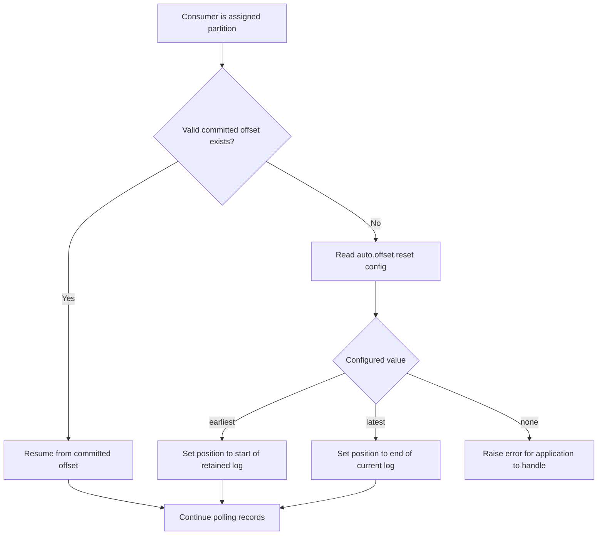

# auto.offset.reset and starting read position

A Kafka consumer does not always start reading from the very first record of a topic. When joining a consumer group, the consumer first looks up the group's **committed offset** for each partition. If a valid offset exists, the consumer resumes from that position. Only when no valid offset exists does Kafka use the `auto.offset.reset` configuration to decide the starting point.

Therefore, `auto.offset.reset` is not a rewind button for the topic on every application startup. This property mainly handles two situations: the group has no committed offset yet, or the current offset is no longer valid on the broker, such as when data at that offset has been deleted by retention. Understanding this rule prevents skipping data or accidentally replaying a huge volume of records.

## 1. How does a consumer choose its starting read position?

For each assigned partition, the consumer needs to determine the next position to read. The general process is as follows:



A consumer group's committed offset represents the **next offset to read**, not the offset of the last processed record. For example, if a group commits offset `42`, the next read starts from the record at offset 42 in that partition (if the record still exists and the offset is valid).

Kafka stores committed offsets per consumer group and topic-partition pair. Thus, a group can have different offsets across partitions. A new consumer group normally has no committed offsets yet, so `auto.offset.reset` decides the starting position for each partition.

## 2. Values of auto.offset.reset

The three most common values are `earliest`, `latest`, and `none`:

| Value | Starting point when reset is needed | Use case |
|---|---|---|
| `earliest` | Earliest offset still retained in the partition. | New consumer group needing to read existing retained data, build a projection, or initialize state. |
| `latest` | End of the log at the moment the consumer determines its starting position. | Only interested in new records written after the consumer begins monitoring. |
| `none` | Does not automatically pick an offset; consumer raises an error if no valid offset is found. | Wanting to detect groups with missing or lost offsets so operators can decide explicitly. |

### earliest — read from the beginning of retained data

`earliest` instructs the consumer to start at the partition's log start offset, which is the earliest position the broker still retains. If a topic has records starting from offset 0 that have not been deleted, the consumer can read from offset 0. If retention has deleted older segments, the starting point will be greater than 0.

Example configuration:

```yaml
spring:
  kafka:
    consumer:
      group-id: order-projection
      auto-offset-reset: earliest
```

This value fits creating a new projection that needs to process existing data. However, `earliest` does not mean recovering the entire history ever produced. Time-based retention topics may have deleted old records; compacted topics may have removed older versions of the same key. The consumer only reads records still present in the log.

### latest — monitor only new data

`latest` instructs the consumer to set its read position at the current end of the log when initializing offsets. Records already present before that position will not be read by the new group. The consumer proceeds to receive records appended after the starting point.

This value suits flows where historical data does not need processing, such as a consumer that only sends notifications for events occurring after a feature is turned on. Think carefully for payments, orders, inventory, or data synchronization workflows: if a group has no offset yet and uses `latest`, existing records in the topic may be skipped.

### none — require an existing offset

`none` tells the client to report an error when no valid committed offset is found, instead of automatically falling back to the start or end of the log. This suits operational workflows that want to detect new groups or lost offset conditions for manual intervention.

When using `none`, the application must have a plan to handle initialization or out-of-range offset errors. Without such a procedure, the consumer may fail to start or stop consuming. Define who will inspect the group, choose the offset, and restart the consumer.

## 3. When is auto.offset.reset applied?

This property is applied when the consumer has no valid read position for a partition. Two common cases:

1. **Group has not committed an offset:** new group, changed group ID, or an offset was never committed for that partition.
2. **Offset is no longer valid:** the committed offset falls outside the current log range, for example an offset older than the log start offset because retention deleted data, or log changes caused the committed position to no longer exist.

If the committed offset is still valid, Kafka resumes from that offset regardless of whether the setting is `earliest` or `latest`. For example, if a consumer committed offset 500 and restarts with `auto.offset.reset=earliest`, it still resumes from 500; the `earliest` setting does not automatically rewind the consumer to the start of the topic.

This is the most common source of confusion: changing `auto.offset.reset` in `application.yml` does not reset the offsets of an active consumer group. To replay intentionally, you need to reset committed offsets via administrative tools or seek within the application.

## 4. Configuration in Spring Boot and Spring Kafka

Spring Boot maps Kafka consumer settings from `spring.kafka.consumer.*` to consumer properties. Example:

```yaml
spring:
  kafka:
    bootstrap-servers: localhost:9092
    consumer:
      group-id: order-projection
      auto-offset-reset: earliest
      key-deserializer: org.apache.kafka.common.serialization.StringDeserializer
      value-deserializer: org.springframework.kafka.support.serializer.JsonDeserializer
      properties:
        spring.json.trusted.packages: com.example.orders.event
```

In this example:

- `group-id` identifies the consumer group used to store and restore committed offsets.
- `auto-offset-reset` chooses how to behave when a partition has no valid offset.
- `key-deserializer` converts key bytes into `String`.
- `value-deserializer` converts JSON values into objects; trusted packages should be restricted to data types permitted by the application.

The JSON deserializer also needs to determine the target type, such as via type headers sent by the producer or a default type configuration matching the data contract. The YAML snippet above focuses on illustrating the starting read position; ensure serializer/deserializer settings on producer and consumer align with the actual schema.

A listener can declare its own group ID:

```java
import org.springframework.kafka.annotation.KafkaListener;
import org.springframework.stereotype.Component;

@Component
public class OrderEventListener {

    @KafkaListener(
            topics = "orders.events",
            groupId = "order-projection"
    )
    public void onOrderEvent(OrderEvent event) {
        // Update projection from event.
    }
}
```

If `groupId` is specified on the listener, it sets the group for that listener. When omitted, the listener can use the default group ID from consumer factory configuration. Crucially, the group ID must remain stable across deployments if you want to continue from committed offsets.

For Spring Framework applications not using Spring Boot, you can set `auto.offset.reset` in the consumer factory configuration map:

```java
Map<String, Object> props = new HashMap<>();
props.put(ConsumerConfig.BOOTSTRAP_SERVERS_CONFIG, "localhost:9092");
props.put(ConsumerConfig.GROUP_ID_CONFIG, "order-projection");
props.put(ConsumerConfig.AUTO_OFFSET_RESET_CONFIG, "earliest");
```

Then pass `props` to `DefaultKafkaConsumerFactory` when configuring the listener container. The Kafka client-level property name is `auto.offset.reset`; Spring Boot uses the relaxed-binding name `auto-offset-reset` in YAML.

## 5. Examples of choosing the starting position by scenario

Suppose topic `orders.events` has data at offsets 100 through 199 in partition 0 and group `order-projection` has no committed offset yet:

| Configuration | Starting Position | Outcome |
|---|---:|---|
| `earliest` | 100 | Reads retained records from offset 100 onward. |
| `latest` | 200 | Skips existing data and waits for new records. |
| `none` | None chosen | Throws an error because the group has no valid offset. |

If the group already committed offset 150, none of the three settings alter the starting position as long as offset 150 remains valid: the consumer resumes from 150. If retention advances the log start offset to 160, offset 150 is now out of range; at that point the reset setting is evaluated to determine the next valid position (or raise an error with `none`).

### Choosing a value by objective

| Consumer Objective | Recommendation | Reason |
|---|---|---|
| Build a new projection from retained data | `earliest` | Needs to reconstruct state from the existing log. |
| New consumer only processes events produced after deployment | `latest` | Does not need to process data prior to startup. |
| Production workflow requires pre-initialized offsets | `none` | Wants to detect missing offsets so operators handle them explicitly. |
| Replay testing with a new group ID | `earliest` | Tests can read fixture data sent beforehand. |

No single value fits every topic. Base the choice on business requirements, retention, how groups are created, and the consequences of skipping or replaying records.

## 6. Intentional offset reset

When an existing consumer group needs to re-read data, use the consumer group administration tool. Kafka provides the `kafka-consumer-groups` command to inspect and reset offsets. Before resetting, stop all consumers belonging to that group so they do not keep committing offsets during the operation.

Example of inspecting group state:

```bash
kafka-consumer-groups.sh \
  --bootstrap-server localhost:9092 \
  --group order-projection \
  --describe
```

Preview resetting the entire topic to the earliest retained offset:

```bash
kafka-consumer-groups.sh \
  --bootstrap-server localhost:9092 \
  --group order-projection \
  --topic orders.events \
  --reset-offsets \
  --to-earliest \
  --dry-run
```

After verifying the preview output, execute with `--execute`:

```bash
kafka-consumer-groups.sh \
  --bootstrap-server localhost:9092 \
  --group order-projection \
  --topic orders.events \
  --reset-offsets \
  --to-earliest \
  --execute
```

You can replace `--to-earliest` with `--to-latest`, `--to-offset <offset>`, or other reset modes supported by your Kafka CLI version. On Windows, the script is typically named `kafka-consumer-groups.bat`. After resetting, describe the group again to confirm the offsets changed before restarting consumers.

Resetting offsets can cause consumers to replay many records and repeat side effects if the application is not idempotent. For workflows that create payments, send emails, or call external APIs, ensure idempotency keys or duplicate-prevention mechanisms are in place before replaying.

## 7. How does seek in the application differ from auto.offset.reset?

`auto.offset.reset` is a fallback policy when a consumer has no valid offset. `seek` is an explicit operation to set the read position for an assigned partition within the current consumer session.

For instance, with the Kafka Consumer API, after partitions are assigned, an application can call `seekToBeginning(...)`, `seekToEnd(...)`, or `seek(topicPartition, offset)` to set a specific position. Spring Kafka provides mechanisms such as `ConsumerSeekAware` and listener container seek callbacks to control this during the consumer lifecycle.

Seek does not automatically mean long-term committed offsets have been changed. If the application wants subsequent restarts to continue from the new position, it must commit the appropriate offset according to the active acknowledgment/commit strategy. Otherwise, old committed offsets may still be used on the next restart.

Therefore, choose the right tool:

- Configure `auto.offset.reset` when defining the default for a group without a valid offset.
- Reset the consumer group when changing stored committed offsets for an intentional replay.
- Use seek when controlling the read position within a consumer session or a specific processing flow.

## 8. Important operational considerations

### Keep group IDs stable

If `group-id` is accidentally changed, Kafka treats it as a different consumer group. The new group has no offsets, so `auto.offset.reset` takes effect. With `earliest`, the application may reprocess large volumes of data; with `latest`, it may skip existing data.

### Monitor retention and consumption speed

If a consumer falls behind the topic's data deletion rate, committed offsets may fall below the log start offset. The consumer will then reset according to configuration or stop with an error if set to `none`. Monitor consumer lag, retention, and recovery time to avoid this situation.

### Earliest does not guarantee full history

Topics using `cleanup.policy=delete` may delete older segments per retention settings. Compacted topics may discard older versions of the same key and tombstones after the retention window. A consumer starting from `earliest` only receives data remaining in the log and cannot reconstruct records Kafka has already purged.

### Testing with fresh group IDs

When writing integration tests, use a separate group ID per test or clean/reset offsets in a controlled way. Reusing an old group ID and offsets can cause a test to miss fixture records because the consumer resumes from previously committed positions. Even with `earliest`, ensure the test group has no committed offsets yet or has been properly reset.

## 9. Key takeaways

- Consumers prioritize valid committed offsets; `auto.offset.reset` is only used when no valid offset exists or the offset is outside the log range.
- A committed offset is the next position to read. Committing offset 42 means the next read starts from 42.
- `earliest` reads from the retained log start offset; `latest` starts at the current end of the log; `none` requires a valid offset and errors if missing.
- Changing `auto.offset.reset` does not automatically rewind a group that already has valid committed offsets.
- To replay an existing group, stop consumers, reset offsets in a controlled way, verify the result, and then restart.
- Seek controls the read position within a consumer session; persisting the new position across restarts requires committing appropriately.
- Retention and compaction can remove old data; `earliest` only reads what remains in the log.

Before choosing `auto.offset.reset`, answer two questions: should a new group re-read existing data or only track new data, and if committed offsets are lost, should the system automatically choose a position or halt for operators to decide? The answers will guide choosing `earliest`, `latest`, or `none` properly for your consumer's requirements.
