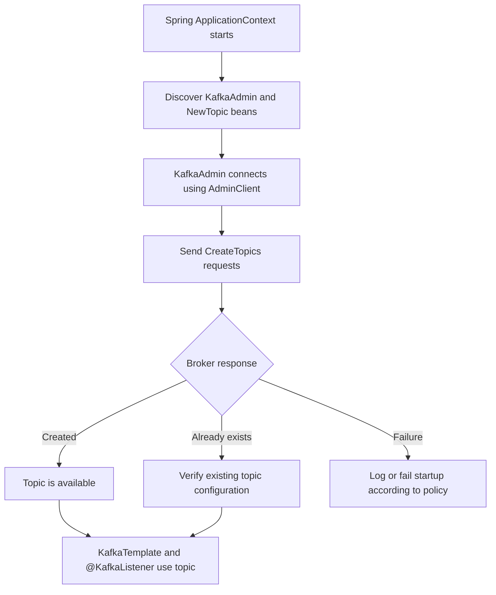

# KafkaAdmin and Automatic Topic Creation

A Kafka topic is where brokers store records for producers to write and consumers to read. When initializing a Spring Kafka application, topics need to exist with partition counts, replication factors, and configurations suited to how the system produces and consumes events. Spring Kafka provides `KafkaAdmin` so applications can declare topics using `NewTopic` beans; when the application context is initialized, `KafkaAdmin` uses the Kafka Admin API to create topics that do not yet exist.

In the `SPRING_KAFKA_MESSAGING` module, producers send records with `KafkaTemplate` and consumers receive records with `@KafkaListener`. Both must agree on topic names and data configuration. Understanding `KafkaAdmin`, `NewTopic`, and automatic topic creation helps avoid running applications against implicitly created topics with unintended default settings.

## 1. Where and When Are Topics Created?

Kafka has two mechanisms that are often confused:

1. **Broker auto-creation**: the broker can automatically create a topic upon receiving an access request to a non-existent topic if the `auto.create.topics.enable` setting allows it. The topic is created using the broker's default configuration.
2. **Application-driven topic creation via Admin API**: the application or an administrative tool sends a `CreateTopics` request to Kafka. Spring Kafka provides `KafkaAdmin` and `NewTopic` beans to declare this.

| Criterion | Broker auto-create | Spring Kafka `KafkaAdmin` |
|---|---|---|
| Where creation is decided | Broker configuration | Application or deployment environment configuration |
| Timing | When the broker receives a request involving a non-existent topic | When `KafkaAdmin` initializes topics from `NewTopic` beans in the application context |
| Partition/replica count | Per broker defaults | Explicitly declared in `NewTopic` |
| Topic config | Per broker defaults | Can be declared alongside `NewTopic` |
| Suitable for | Simple experimental environments | Applications requiring intentional topic provisioning |

Broker auto-create is convenient for experimentation but can create topics with unsuitable partition counts or replication factors. Therefore, in controlled environments, it is generally best to disable broker auto-create and manage topics with `KafkaAdmin` or platform provisioning tools. The two mechanisms are independent: disabling broker auto-create does not prevent a client with administrative permissions from calling the Admin API to create topics.

## 2. How Does `KafkaAdmin` Work?

`KafkaAdmin` is the Spring Kafka component that connects to brokers via the Kafka Admin API. It discovers `NewTopic` beans in the application context and sends topic creation requests when the application initializes. Actual topic creation takes place on the broker; a `NewTopic` bean is merely the application's desired declaration.

In a Spring Boot application, when `spring.kafka.bootstrap-servers` is configured, Spring Boot typically auto-configures `KafkaAdmin`. You only need to declare `NewTopic` beans if you want the application to manage topics. In Spring applications that do not use Boot auto-configuration, you must declare a `KafkaAdmin` bean manually.

Example connection configuration for Spring Boot:

```yaml
spring:
  kafka:
    bootstrap-servers: ${KAFKA_BOOTSTRAP_SERVERS:localhost:9092}
```

Example explicit `KafkaAdmin` declaration in a plain Spring application:

```java
import java.util.HashMap;
import java.util.Map;

import org.apache.kafka.clients.admin.AdminClientConfig;
import org.springframework.context.annotation.Bean;
import org.springframework.context.annotation.Configuration;
import org.springframework.kafka.core.KafkaAdmin;

@Configuration
public class KafkaAdminConfiguration {

    @Bean
    public KafkaAdmin kafkaAdmin() {
        Map<String, Object> configs = new HashMap<>();
        configs.put(
                AdminClientConfig.BOOTSTRAP_SERVERS_CONFIG,
                "localhost:9092"
        );

        KafkaAdmin admin = new KafkaAdmin(configs);
        admin.setFatalIfBrokerNotAvailable(true);
        return admin;
    }
}
```

In this example, `setFatalIfBrokerNotAvailable(true)` treats a failure to connect to the broker during topic initialization as a fatal error for context startup. If the application can start without needing Kafka immediately, consider an appropriate policy instead of enabling fail-fast mechanically. With Spring Boot, do not create a duplicate `KafkaAdmin` bean if auto-configuration already provides one; customize the existing bean according to the configuration mechanism of your Spring Boot version.

## 3. Declaring Topics with `NewTopic` and `TopicBuilder`

Spring Kafka detects beans of type `NewTopic` and uses them to ask the broker to create topics. `TopicBuilder` makes the configuration easier to read compared to instantiating `NewTopic` directly via its constructor.

```java
import org.apache.kafka.clients.admin.NewTopic;
import org.apache.kafka.common.config.TopicConfig;
import org.springframework.context.annotation.Bean;
import org.springframework.context.annotation.Configuration;
import org.springframework.kafka.config.TopicBuilder;

@Configuration
public class KafkaTopicConfiguration {

    @Bean
    public NewTopic ordersTopic() {
        return TopicBuilder.name("orders")
                .partitions(6)
                .replicas(3)
                .config(TopicConfig.RETENTION_MS_CONFIG, "604800000")
                .build();
    }

    @Bean
    public NewTopic customerStateTopic() {
        return TopicBuilder.name("customer-state")
                .partitions(6)
                .replicas(3)
                .config(
                        TopicConfig.CLEANUP_POLICY_CONFIG,
                        TopicConfig.CLEANUP_POLICY_COMPACT
                )
                .build();
    }
}
```

The `orders` topic retains records for seven days under the example retention policy. The `customer-state` topic uses log compaction to keep the latest state per key. For compacted topics, producers must provide stable keys; records with a key and a `null` value can act as tombstones representing state deletion.

Important methods of `TopicBuilder`:

| Method | Meaning |
|---|---|
| `name(...)` | Sets the topic name |
| `partitions(...)` | Initial partition count |
| `replicas(...)` | Replication factor |
| `config(key, value)` | Sets a topic-level configuration |
| `build()` | Creates the `NewTopic` object for Spring Kafka to manage |

You can declare one `NewTopic` bean per topic. This makes beans easy to find, easy to review, and allows naming beans according to their purpose. If the application has many topics, group the declarations into one or a few configuration classes by bounded context rather than creating one oversized class.

## 4. Choosing Partitions, Replication Factor, and Topic Config

Declaring a topic is not just picking a name. The initial parameters affect parallel processing capacity, data durability, and storage cost.

### 4.1. Partition Count

A partition is the unit of storage and parallel consumption for a topic. Each partition has its own offset order; Kafka does not guarantee global ordering across partitions. Partition count affects:

- Maximum parallelism of a consumer group for that topic: at any point in time, a partition is assigned to at most one consumer member within the same group.
- Distribution of write and read load.
- Ability to preserve per-key ordering when the partitioner routes records with the same key to the same partition.
- Metadata, log file, and management overhead when the partition count becomes too large.

There is no single right partition count for every topic. Estimate throughput, record size, expected consumer count, and growth, then benchmark load in a test environment. If ordering by `orderId` is required, choose an appropriate key and assess the impact of changing the partition count.

**Increasing the partition count can change the key-to-partition mapping.** With a partitioner based on hashing and the number of partitions, a key may be routed to a new partition after partitions are added; older records remain in the old partition. This can break ordering for an entity if consumers rely on a single partition. Kafka does not support decreasing the partition count of an existing topic.

### 4.2. Replication Factor

The replication factor determines the number of copies of each partition across different brokers. For instance, a replication factor of 3 means each partition has one leader replica and follower replicas according to ISR status. When a broker fails, an eligible replica can be elected as the new leader.

The replication factor cannot exceed the number of brokers available to store replicas. If a cluster has only one broker, declaring `replicas(3)` will cause topic creation to fail. Single-broker development environments typically use a replication factor of 1; multi-broker environments can choose a higher value depending on availability requirements and cost.

Replication factor must be considered alongside producer `acks` and topic `min.insync.replicas`. For example, with a replication factor of 3 and `min.insync.replicas=2`, a producer using `acks=all` only receives a success acknowledgement when the number of replicas in the ISR meets the minimum threshold. This increases durability but can cause writes to be rejected when the cluster lacks synchronized replicas. Choose values based on the system's durability and availability requirements.

### 4.3. Topic Configuration

Some common configurations:

| Configuration | Meaning | Use Case |
|---|---|---|
| `retention.ms` | Record retention duration under the delete policy | Event logs that need to be retained for a period of time |
| `retention.bytes` | Log size limit per partition | Controlling storage capacity |
| `cleanup.policy=delete` | Delete segments once expired per retention | Standard event topics |
| `cleanup.policy=compact` | Retain the latest record per key after compaction | Topics storing current state |
| `min.insync.replicas` | Minimum replicas in the ISR to satisfy `acks=all` | Topics requiring controlled write durability |
| `max.message.bytes` | Record batch size limit per broker/topic configuration | Controlling large payloads |

Do not copy every broker configuration into individual topics. Only set topic-level overrides when there is a specific requirement. Some configuration changes require appropriate administrative permissions and can affect a running topic's behavior.

## 5. Distinguishing Creating a Topic from Updating an Existing Topic

A `NewTopic` bean is a declaration for Spring Kafka to request topic creation. It should not be treated as a full state reconciler that automatically resolves every discrepancy between code configuration and an existing topic.

When a topic already exists, verify its actual configuration on the broker. Do not assume that changing `.partitions(6)` to `.partitions(12)` in a bean will automatically add partitions to an existing topic across all versions/configurations. Similarly, changing the replication factor is not as simple as editing a number in `NewTopic`; changing replica placement requires a reassignment procedure.

When you need to modify an existing topic:

1. Check the current partition count, replication factor, ISR, and topic configs.
2. Evaluate impacts on key ordering, consumer concurrency, retention, and storage capacity.
3. Use the Kafka Admin API or infrastructure management tools to apply supported changes.
4. Verify the result after the change and monitor consumers/producers.

The Kafka Admin API provides dedicated operations such as `createTopics`, `describeTopics`, `describeConfigs`, `incrementalAlterConfigs`, and `createPartitions`. Spring Kafka `KafkaAdmin` offers convenient topic creation integration; for dynamic administrative operations or finer control, you can use `AdminClient` directly. Provisioning should be performed in controlled pipelines or operational workflows rather than letting individual business requests create topics.

## 6. Automatically Creating Topics at Application Startup

An application can declare `NewTopic` beans in a configuration class and let `KafkaAdmin` process them when the application context refreshes. High-level sequence:



This keeps topic declarations close to the source code and is convenient for local/test environments. However, there are several points to note:

- Brokers must be ready and the application must be able to reach the bootstrap servers.
- The principal used by the application must have permissions to perform the required Admin API operations.
- The replication factor must match the broker count and cluster policies.
- If brokers are not yet ready, `KafkaAdmin` may fail to create topics. Consider `setFatalIfBrokerNotAvailable(true)` when the application cannot operate without the topics.
- Existing topics must be verified separately; declarations in code do not replace managing environment drift.

In production systems, there are two common deployment approaches:

| Management Approach | When Suitable | Characteristics |
|---|---|---|
| Application creates topics via `KafkaAdmin` | Small services or environments allowing services to manage their own topics | Declarations close to code; application needs topic-creation permissions |
| Pipeline/platform creates topics before deployment | Production clusters with centralized governance workflows | Separates provisioning permissions from runtime; better change control and auditing |

There is no single choice for every organization. What matters is having clear ownership for each topic and avoiding multiple systems managing the same topic with conflicting configurations.

## 7. Dynamically Creating Topics with `AdminClient` When Truly Needed

`KafkaAdmin` and `NewTopic` beans are suited for topics known before the application starts. If there is a need to create topics dynamically inside an administrative task, Kafka provides `AdminClient` to invoke the Admin API directly.

Conceptual example of creating a topic in an administrative task:

```java
import java.util.List;
import java.util.Map;
import java.util.Optional;
import java.util.concurrent.ExecutionException;

import org.apache.kafka.clients.admin.AdminClient;
import org.apache.kafka.clients.admin.AdminClientConfig;
import org.apache.kafka.clients.admin.NewTopic;

public class TopicProvisioningTask {

    public void createAuditTopic() throws Exception {
        Map<String, Object> config = Map.of(
                AdminClientConfig.BOOTSTRAP_SERVERS_CONFIG,
                "localhost:9092"
        );

        NewTopic topic = new NewTopic(
                "audit-events",
                Optional.of(3),
                Optional.of((short) 1)
        );

        try (AdminClient admin = AdminClient.create(config)) {
            admin.createTopics(List.of(topic)).all().get();
        } catch (ExecutionException ex) {
            // Inspect cause, e.g., topic already exists or insufficient permissions.
            throw ex;
        }
    }
}
```

This is an API illustration; in real applications, bootstrap servers, security settings, and topic parameters must come from environment configuration. Handle `TopicExistsException` explicitly if the operation may be invoked repeatedly, set appropriate timeouts, and log outcomes. Do not create topics from arbitrary user input, as this leads to uncontrolled topic proliferation and expands the permission surface.

For static topics, prefer `NewTopic` beans and `KafkaAdmin` so configurations can be reviewed alongside source code. Only use `AdminClient` directly when dynamic administration is required or when operations go beyond what the existing abstraction supports.

## 8. Topic Naming and Environment Management

Topic names should reflect the domain or data stream and stay consistent across services. Examples:

| Topic | Purpose |
|---|---|
| `orders.created` | Order-created event |
| `orders.events` | Order lifecycle events |
| `customer-state` | Latest customer state, potentially using compaction |
| `orders.created.dlt` | Dead-letter topic for unprocessable records, following application convention |

Do not embed environment names into topic names if clusters are already separated by environment. If dev, staging, and production share a single cluster, establish clear namespace/prefix conventions to prevent collisions. Avoid overly generic names such as `data`, `events`, or `test`, which make ownership and retention policies hard to determine.

Topic configs can vary across environments. For example, local uses one broker and replication factor 1; production uses multiple brokers with a higher replication factor. Values can be externalized into configuration or separate profiles, while ensuring topics are created with valid parameters for the target cluster.

## 9. Testing Topic Creation

Do not only verify that the Spring context starts successfully. You must verify that the topic actually exists and has the expected configuration.

Some testing approaches:

- **Unit tests**: verify that the `NewTopic` bean factory method produces the expected name, partitions, replicas, and configs.
- **Integration tests with Embedded Kafka**: verify whether the Spring context and `KafkaAdmin` create the topic in the embedded broker. Use a replication factor matching the test broker count.
- **Integration tests with Testcontainers**: verify provisioning and producer/consumer flows against a Kafka broker closer to a real runtime environment.
- **Deployment verification**: after provisioning, use the Admin API or operational tools to describe the topic and check partitions/configs.

When testing compacted topics, verify that the cleanup policy is `compact` and that keys/values have proper semantics. When testing topics with a replication factor greater than 1, the test cluster must have enough brokers; otherwise, topic creation failure is the expected outcome rather than a bug in `KafkaAdmin`.

## 10. Common Mistakes with Automatic Topic Creation

- **Confusing broker auto-create with `KafkaAdmin`:** disabling `auto.create.topics.enable` does not prevent the Admin API from creating topics, though producers/consumers cannot rely on the broker to auto-create missing topics.
- **Replication factor larger than broker count:** the topic creation request is rejected. Align configuration with the cluster.
- **Application lacks Create topic permission:** connecting successfully does not mean the principal has administrative permissions. Grant scoped permissions or move provisioning to the platform.
- **Not checking existing topics:** an older topic may have a different partition count, cleanup policy, or retention than the code expects.
- **Automatically increasing partitions without evaluating keys:** this can alter partition mapping and affect per-entity ordering.
- **Using `KafkaAdmin` fail-fast in every environment:** local setups or applications able to run in a Kafka-free mode will fail to start when the broker is temporarily unavailable.
- **Creating topics per request:** easily spawns duplicate topics, complicates auditing, and increases operational burden.
- **Not verifying config after deployment:** declaring desired state does not prove the broker applied the exact configuration.

## 11. Pre-Usage Topic Checklist

- [ ] Clearly chosen between broker auto-create, Spring Kafka `KafkaAdmin`, or pipeline/platform provisioning.
- [ ] Clear ownership established for each topic.
- [ ] Topic name reflects the domain and follows shared conventions.
- [ ] Partition count matches throughput, consumer parallelism, and ordering requirements.
- [ ] Replication factor does not exceed broker count and meets durability requirements.
- [ ] Retention, cleanup policy, and topic configs are defined.
- [ ] Producers/consumers use matching topic names and corresponding serializers/deserializers.
- [ ] Admin API permissions granted following the least-privilege principle.
- [ ] Fail-fast policy when brokers are unavailable matches the environment.
- [ ] Topic verified after creation or modification.
- [ ] Integration tests verify provisioning against a real or embedded broker.

When `KafkaAdmin` and `NewTopic` are used properly, topic creation becomes a manageable and testable part of application startup. Producers and consumers can rely on topics provisioned with explicit configurations, while operations teams have a solid basis to control partitions, replication, retention, and administrative permissions in each environment.
