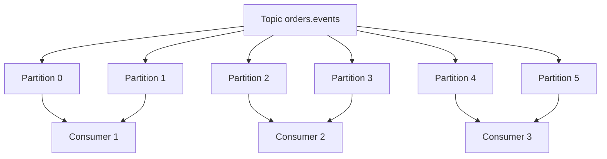

# Partition Count When Creating a Topic

When creating a Kafka topic, the number of partitions is a key architectural decision. Partitions determine the degree of parallelism a consumer group can utilize, affect producer load distribution, and govern how Kafka preserves ordering by key. Choosing too few partitions can bottleneck throughput; choosing too many increases broker resource usage, metadata management overhead, and operational complexity.

There is no single fixed number suited for every topic. You must determine expected load, consumer parallelism, ordering requirements, broker count, and cluster resource limits before creating a topic.

## 1. What Do Partitions Affect?

A topic is the logical name of a data stream. Each topic is divided into one or more partitions; each partition is a separate log to which records are appended sequentially with independent offsets.

Partition count directly impacts the following factors:

- **Parallel processing capability:** a consumer group can distribute partitions across multiple consumer members. For a single topic, the number of consumers that can concurrently receive partitions cannot exceed the number of assigned partitions.
- **Producer and consumer throughput:** multiple partitions allow multiple write/read streams to operate concurrently across different brokers and consumers, provided cluster and application resources support it.
- **Data ordering:** Kafka only guarantees ordering within each individual partition. Using keys routes related records to the same partition, enabling per-entity ordering.
- **Load and storage distribution:** partitions have leaders and replicas across brokers. More partitions increase the number of logs, files, metadata entries, and background tasks the cluster must manage.
- **Recovery and rebalance time:** a consumer group must reassign partitions when membership changes. Many partitions can increase coordination work and stabilization time after a rebalance.

Example topic `orders.events` with six partitions:



This is an example assignment for a consumer group with three members. Each partition is assigned to at most one member in the group at a time. A single consumer can receive multiple partitions; other consumer groups can still read the same topic independently.

## 2. Distinguishing Partition Count from Replication Factor

These two settings are often declared side by side, yet they solve two different problems:

| Configuration | Meaning | Primary Impact |
|---|---|---|
| `partitions` | Number of logical partitions of the topic. | Parallelism, key distribution, and number of read/write streams. |
| `replication-factor` | Number of copies of each partition across brokers. | Fault tolerance and broker storage/resource consumption. |

For example, a topic with 12 partitions and a replication factor of 3 will have 36 partition replicas across the cluster. Each partition has one leader handling read/write requests per configuration and follower replicas copying data. Replication factor does not give a consumer group 36 partitions to process; the logical partition count remains 12.

Replication factor should match the broker count and availability requirements. With a three-broker cluster, a replication factor of 3 typically allows each partition to have one copy on each broker if rack placement and configuration allow. Local single-broker environments typically use a replication factor of 1. Do not set a replication factor greater than the number of available brokers unless there is a matching broker expansion plan.

## 3. Factors for Choosing the Partition Count

### Expected Throughput

Estimate the volume of data producers write to the topic and the rate at which consumers must process it. You can use an initial calculation:

\[
P_{throughput} = \left\lceil\frac{T_{target}}{T_{partition}}\right\rceil
\]

Where:

- `T_target` is the target throughput of the topic, e.g. records/sec or MB/sec.
- `T_partition` is the sustained throughput measured for a single partition under near-production benchmark conditions.
- `P_throughput` is the estimated minimum partition count based on throughput.

Do not treat a generic throughput number found online as an absolute standard. `T_partition` depends on record size, compression, batching, replication factor, broker configuration, disk, network, number of producers, number of consumers, and downstream processing style. Benchmark using data representative of real load.

For example, if the target load is 60,000 records/sec and benchmarks show one partition stably sustains around 10,000 records/sec under similar configuration, the initial estimate is 6 partitions. Afterward, test peak load, latency, consumer lag, and headroom rather than treating 6 as a guaranteed number.

### Consumer Parallelism

Within a consumer group, a partition is assigned to at most one consumer member at a time. Therefore, the partition count is an upper bound on how many consumers can actually process that topic concurrently within the group.

Examples:

| Topic Partitions | Consumer Members | Maximum Parallelism for Topic |
|---:|---:|---:|
| 3 | 1 | 1 consumer receives all 3 partitions |
| 3 | 3 | 3 consumers, each can receive 1 partition |
| 3 | 6 | At most 3 consumers get partitions; the remaining 3 sit idle for this topic |
| 12 | 6 | At most 6 consumers can receive partitions; each can receive multiple partitions |

If an application needs six consumers processing a topic independently, the topic needs at least six assignable partitions. However, simply increasing partitions does not always make consumers faster: downstream databases, APIs, or thread limits can become the new bottleneck.

In Spring Kafka, the listener container's `concurrency` property creates consumer threads. If `concurrency` exceeds the number of assignable partitions, some consumers will receive no partitions. Align concurrency with partition count and the application's processing capacity.

### Per-Key Ordering Requirements

If you need to preserve the ordering of changes for the same order, account, or device, producers should use the entity's ID as the key. With the default partitioner, identical keys serialized consistently under an unchanged partition count will normally map to the same partition.

More partitions allow data to spread wider, but Kafka still only preserves ordering within each partition. Do not increase partitions solely to hit a large number if the business flow requires stable key mapping. Increasing partitions later can route some keys to different partitions, placing older and newer records for the same key into two partitions with no shared ordering.

### Broker Count and Cluster Resources

Partitions have leaders and replicas placed on brokers. As partition count and replication factor grow, the cluster must manage more replica logs while consuming additional file descriptors, metadata memory, disk capacity, network bandwidth, and log segment/replication work.

Do not look solely at the total partitions of a single topic. Calculate total partition replicas across the entire cluster across all topics and compare against limits, sizing guidelines, and operational guidance for the Kafka version in use. A small cluster should not take on an enormous partition count just because one application wants higher concurrency.

### Record Size and Storage Rate

Large records increase storage consumption and transfer time. A topic with high MB/sec throughput from large records may need different partitioning than a topic carrying tens of thousands of small records per second. Alongside partition count, review `batch.size`, `linger.ms`, compression, `max.message.bytes`, disk throughput, and network throughput.

## 4. How to Estimate the Initial Partition Count

You can follow this sequence:

1. **Define load:** record records/sec, MB/sec, average record size, and expected peak load.
2. **Define consumers:** number of consumer members needed concurrently per group and per-record processing time.
3. **Run benchmarks:** create a test topic with near-production settings and measure sustained throughput per partition and consumer.
4. **Calculate partitions by throughput:** use the estimation formula above.
5. **Check parallelism:** ensure the partition count covers the required consumer concurrency.
6. **Check ordering and keys:** determine which records must share a partition and the impact of changing partition counts.
7. **Check cluster capacity:** account for replicas via replication factor, other topics, and broker load.
8. **Load test and observe:** monitor consumer lag, p95/p99 latency, CPU, disk, network, and rebalance duration.

For example: a service needs to process 24,000 events/sec, wants up to 8 consumer members in a group, and benchmarks show one partition sustains 4,000 events/sec. The throughput estimate is 6 partitions, while the parallelism requirement needs at least 8 partitions. You can start testing with 8 partitions and increase if load tests show throughput or latency targets are unmet. The final figure must rely on measurements and cluster capacity.

Do not multiply partition count by replication factor when calculating consumer concurrency. With 8 partitions and a replication factor of 3, a consumer group still has at most 8 logical partitions to assign; replication creates additional copies for durability and availability.

## 5. Creating Topics with Spring Kafka

Spring Kafka provides `TopicBuilder` to declare topics via `NewTopic` beans. Example:

```java
import org.apache.kafka.clients.admin.NewTopic;
import org.springframework.context.annotation.Bean;
import org.springframework.context.annotation.Configuration;
import org.springframework.kafka.config.TopicBuilder;

@Configuration
public class KafkaTopicConfiguration {

    @Bean
    NewTopic orderEventsTopic() {
        return TopicBuilder.name("orders.events")
                .partitions(8)
                .replicas(3)
                .build();
    }
}
```

When Spring Boot has an appropriate Kafka Admin configuration, the `NewTopic` bean is used to create the topic if it does not already exist. If the topic already exists, default admin integration behavior may inspect and adjust the partition count per the declaration when the new count is greater than the existing one; partitions cannot be decreased via this operation. Control topic configuration per environment and manage the application's topic creation/modification permissions carefully.

In a local environment with only one broker, replace `.replicas(3)` with `.replicas(1)`. In production, choose the replication factor based on broker count, fault tolerance requirements, and cluster policy. Manage partition count configuration explicitly so application restarts do not unintentionally alter topology outside your plan.

## 6. Creating Topics via Kafka CLI

The Kafka CLI lets you specify partition count and replication factor when creating a topic:

```bash
kafka-topics.sh \
  --bootstrap-server localhost:9092 \
  --create \
  --topic orders.events \
  --partitions 8 \
  --replication-factor 3
```

On Windows, the script is typically named `kafka-topics.bat`. The command above requires the cluster to have enough brokers to place three replicas for each partition. For a single-broker local cluster, use `--replication-factor 1`.

After creation, verify the configuration:

```bash
kafka-topics.sh \
  --bootstrap-server localhost:9092 \
  --describe \
  --topic orders.events
```

The output displays partition count, replication factor, and the leader/replicas for each partition. Use this information to confirm the topic was created as expected.

## 7. Can You Change the Partition Count After Creation?

Kafka supports **increasing** a topic's partition count, but does not support directly decreasing partitions. Increasing partitions can help when load grows or more concurrent consumers are needed, though it is a change that impacts key routing and ordering.

Example increasing from 8 to 12 partitions via CLI:

```bash
kafka-topics.sh \
  --bootstrap-server localhost:9092 \
  --alter \
  --topic orders.events \
  --partitions 12
```

After increasing:

- New partitions begin receiving records according to the partitioner and updated metadata.
- With the default partitioner, hashing keys against the new partition count may map some keys to different partitions.
- Older records remain in the old partitions; newer records for the same key may land in new partitions, so ordering across the transition is no longer guaranteed if they sit in different partitions.
- Consumer groups may rebalance to distribute the new partitions across members.

If you need to reduce partitions or change mapping in a controlled way, you normally create a new topic with the target partition count and execute a migrate/dual-write/cutover process suited to the business workflow. Do not delete the old topic before verifying that data and consumers have migrated successfully.

## 8. Common Mistakes

| Mistake | Consequence | Resolution |
|---|---|---|
| Choosing partition count solely by broker count | Does not reflect actual throughput and consumer concurrency. | Benchmark load and determine required parallelism. |
| Confusing replication factor with partition count | Miscalculates how many consumers can run concurrently. | Calculate by logical partitions; replication only creates copies. |
| Creating too few partitions | Consumer group cannot scale beyond assignable partitions. | Define target concurrency upfront and load test. |
| Creating too many partitions | Increases metadata, files, replicas, rebalance cost, and operational load. | Calculate total cluster partitions and size brokers properly. |
| Increasing partitions without checking keys | Some keys may shift partitions, breaking continuous per-entity ordering. | Plan a migration or keep partition count stable. |
| Assuming `--alter` can reduce partitions | Kafka does not support direct reduction. | Create a new topic and migrate data in a controlled manner. |
| Testing only producer throughput | Consumers or downstream systems may become the bottleneck. | Measure end-to-end latency, lag, and consumer processing speed. |

## 9. Key Takeaways

- Partition count determines a topic's logical parallelism and is the upper limit on how many consumer members can be assigned partitions in one group.
- Replication factor is the number of copies of each partition; it does not increase the logical partition count.
- Choose the partition count based on throughput benchmarks, concurrency, ordering, record size, and cluster resources.
- Use a key representing the aggregate if related records must preserve ordering within the same partition.
- Spring Kafka can declare topics with `NewTopic` and `TopicBuilder`; Kafka CLI also lets you specify `--partitions` during topic creation.
- Kafka supports increasing partitions but not decreasing them directly; increasing partitions can alter key mapping and affect ordering.

Before creating a production topic, document the partition count, replication factor, key strategy, target throughput, and expected consumer concurrency. These details help development and operations teams understand why the topic has that structure and properly evaluate impacts when scaling later.
