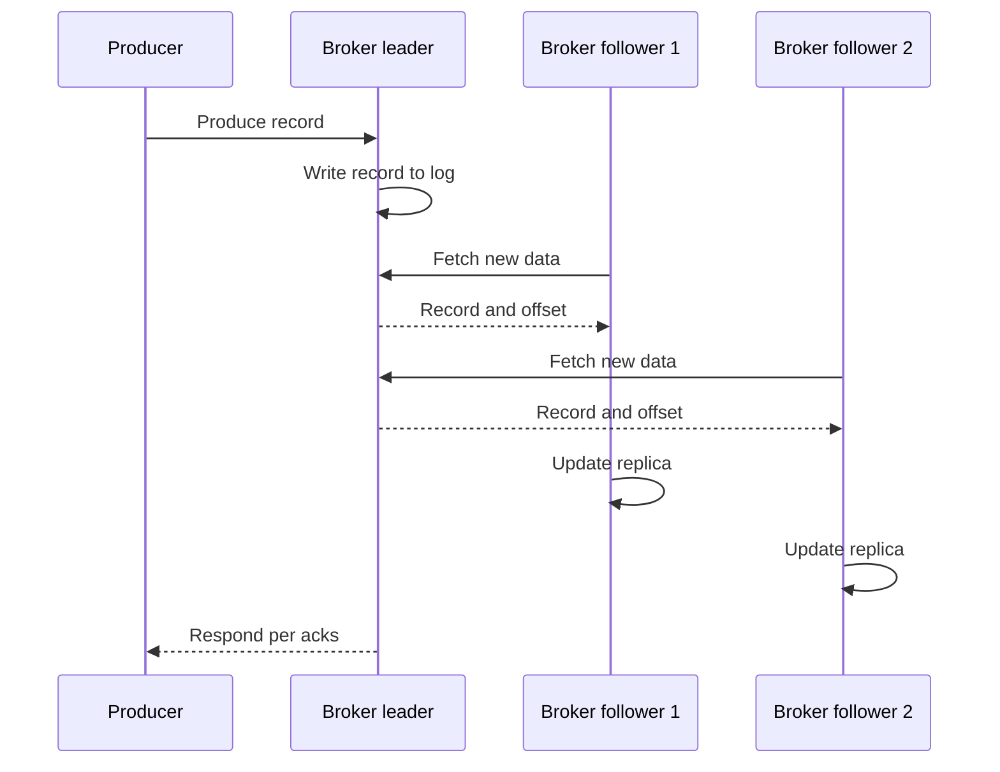

# Replication Factor and Broker Requirements in Kafka

The replication factor determines the number of copies of each partition that Kafka maintains across brokers. This setting directly affects fault tolerance, availability when a broker fails, storage consumption, and network traffic across the Kafka cluster.

When designing a topic, you should select the replication factor alongside `min.insync.replicas` and producer `acks`. These three configurations work together to define when Kafka acknowledges a write and how safe the data is if one or more brokers fail.

## 1. What Is a Partition Replica?

Each partition of a topic has one replica on a broker elected as the **leader**. The remaining replicas are **followers**. Producers send records to the leader; regular consumers also read from the leader. Followers actively fetch data from the leader to keep their copies up to date.

Example of an `orders` topic with three partitions and a replication factor of three:

```text
Topic orders (replication factor = 3)

Broker 1              Broker 2              Broker 3
---------             ---------             ---------
P0: Leader            P0: Follower          P0: Follower
P1: Follower          P1: Leader            P1: Follower
P2: Follower          P2: Follower          P2: Leader
```

The diagram illustrates the distribution. In practice, Kafka assigns leaders and followers based on cluster metadata, partition count, active brokers, and rack awareness configuration.

The replication factor includes the leader. Therefore:

- `replication.factor = 1`: each partition has only one copy, with no backup followers.
- `replication.factor = 2`: each partition has a leader and one follower on another broker.
- `replication.factor = 3`: each partition has a leader and two followers on different brokers.

Replicas of the same partition are placed on different brokers. A cluster needs at least as many brokers as the replication factor to create enough replicas for a partition. To maintain operation during broker maintenance or failure, a cluster typically needs additional brokers and replica placement across independent failure domains.

## 2. Leader, Follower, and Data Synchronization

The leader is the entry point for writes to a partition. Followers send fetch requests to retrieve new records from the leader and update their local logs. Kafka tracks the synchronization state of replicas to determine which ones qualify for the active replica set.

Basic write flow:



Followers do not receive records directly from the producer in the normal write path; they follow the leader to replicate data. Thus, replication is not a mechanism where the producer sends the same record individually to every broker.

## 3. ISR and the Meaning of In-Sync Replicas

ISR stands for *In-Sync Replicas*: the set of replicas Kafka considers caught up with the leader according to the cluster's synchronization criteria. The ISR includes the leader and eligible followers. A follower that lags behind for too long can be removed from the ISR; once it catches up, it can be added back.

Example of a partition with a replication factor of three:

```text
Initially:
  Leader: Broker 1
  ISR:    Broker 1, Broker 2, Broker 3

Broker 3 lags and leaves ISR:
  Leader: Broker 1
  ISR:    Broker 1, Broker 2

Broker 3 catches up:
  Leader: Broker 1
  ISR:    Broker 1, Broker 2, Broker 3
```

The ISR can change per partition and over time. Replication factor is the configured number of replicas for the partition; ISR is the number of replicas currently meeting the synchronization condition. These two numbers do not necessarily match.

Do not think of followers in the ISR as copies guaranteed to have identical bytes at every exact instant with the leader. ISR is a synchronization state managed by Kafka based on replication progress and time thresholds, not a continuous byte-by-byte equality check.

## 4. Coordinating Replication Factor, acks, and min.insync.replicas

Replication factor, producer `acks`, and `min.insync.replicas` serve different roles:

| Configuration | Where Set | Role |
|---|---|---|
| Replication factor | When creating a topic or reassigning replicas | Number of copies of each partition |
| `acks` | Producer | Acknowledgement level the producer requires after sending a record |
| `min.insync.replicas` | Broker or topic configuration | Minimum ISR count to accept writes when the producer uses `acks=all` |

### Producer acks

- `acks=0`: the producer does not wait for broker acknowledgement. Latency can be low, but the producer does not know whether the broker received and stored the record.
- `acks=1`: the leader acknowledges after writing the record to its local log. Followers may not have replicated it yet when the producer receives the response.
- `acks=all` (or `-1`): the leader waits for current ISR replicas to acknowledge per the replication protocol before returning a result. This is the typical choice when data durability is prioritized.

`acks=all` does not mean waiting for every replica configured in the replication factor, including replicas currently outside the ISR. If the ISR shrinks to a single replica, the producer may only receive acknowledgement from the leader, unless `min.insync.replicas` requires more.

### min.insync.replicas

`min.insync.replicas` sets the minimum ISR threshold for write requests using `acks=all`. If the ISR count is below this threshold, the broker rejects the write instead of accepting a write with weaker protection than the policy requires.

Common example configuration for an important topic:

```text
replication.factor = 3
min.insync.replicas = 2
producer acks = all
```

When all three replicas are in the ISR, the producer writes with `acks=all` and receives acknowledgement once the ISR replicas satisfy the requirement. If one replica leaves the ISR, the remaining two still meet the threshold of two so writes can continue. If only one replica remains in the ISR, the broker rejects writes; the producer may receive errors such as `NotEnoughReplicasException` or `NotEnoughReplicasAfterAppendException` depending on when the failure occurs.

This policy trades continuous write availability for data durability. When insufficient ISR replicas remain, the application must handle transient errors with bounded retries, backoff, and cluster health monitoring. Do not lower the threshold automatically just to make errors disappear, as doing so changes the data durability guarantee.

## 5. Example Fault Tolerance with RF=3 and min ISR=2

Suppose a partition has three replicas on three different brokers, all three are in the ISR, the producer uses `acks=all`, and the topic requires `min.insync.replicas=2`.

| Cluster State | ISR Count | Write with acks=all? | Explanation |
|---|---:|---|---|
| Three brokers healthy | 3 | Yes | Sufficient synchronized replicas |
| One broker fails or replica leaves ISR | 2 | Yes | Still meets minimum threshold |
| Only one replica left in ISR | 1 | No | Below `min.insync.replicas=2` |

With this configuration, a single broker failure can be tolerated while continuing writes, provided the two remaining replicas stay in the ISR and the partition has a valid leader. When only one ISR remains, Kafka prefers rejecting writes to avoid acknowledging data at a lower replication level than policy permits.

Read availability also depends on leader election. If the leader fails and an ISR follower can be elected as the new leader, the partition can resume operation after election and metadata propagation. If no eligible replica remains to become leader, the partition becomes temporarily unavailable.

Do not interpret RF=3 as a guarantee of surviving any three failures. Three replicas can only tolerate certain failure patterns depending on broker placement, racks, ISR, leader election, and write acknowledgement configuration.

## 6. Leader Election and Unclean Leader Election

When a partition's leader goes down, Kafka needs to elect another replica as leader. Selecting a leader from the ISR preserves consistency because those replicas have kept up with the previous leader per Kafka's managed criteria.

If no replica remains in the ISR to take over as leader, the partition may have no leader and pause reads/writes. Kafka offers an *unclean leader election* option allowing an out-of-ISR replica to be elected in certain situations. This can restore availability faster, but the elected replica may lack records already acknowledged by the previous leader; those records can be lost from the partition history.

For critical business data, keep `unclean.leader.election.enable=false` unless there is an explicit operational decision accepting potential data loss to prioritize service recovery. This is a broker setting, not a producer property.

Distinguishing the two cases:

- **Clean leader election:** elects a leader from the ISR, prioritizing preservation of synchronously replicated data.
- **Unclean leader election:** may elect an out-of-ISR replica when no ISR candidate exists, trading potential record loss for partition recovery.

## 7. Choosing Replication Factor by System Requirements

There is no optimal replication factor for every topic. Consider data value, fault tolerance needs, infrastructure cost, and the ability to maintain ISR.

| Replication Factor | When to Consider | Trade-off |
|---:|---|---|
| 1 | Local, experimental environments, or easily reproducible data | No backup copy when a broker fails |
| 2 | Small systems with limited brokers and explicit trade-offs | Little headroom if one replica fails; choose min ISR carefully |
| 3 | Many production workloads needing single-broker fault tolerance | Higher storage usage and replication traffic |
| 4 or more | Special failure-domain or storage policy requirements | Significantly increases cost; needs specific justification and load measurements |

For typical production systems, RF=3 is a common starting point when there are at least three brokers and replicas can be spread across separate failure domains. However, it must be paired with `min.insync.replicas`, producer `acks=all`, rack awareness, and ISR monitoring. Simply raising the replication factor without tuning those settings is not enough to achieve the desired durability policy.

### Policy Selection Examples

**Critical audit or transaction topics:** you might choose RF=3, `min.insync.replicas=2`, producer `acks=all`, with appropriate retry backoff and idempotence. When ISR drops below two, the producer must receive an error so the application can retain or retry the work per policy.

**Temporary reproducible data topics:** you might choose a lower RF to save cost, provided you verify that losing data does not impact business operations and another data source exists to rebuild it.

**Single-broker development environments:** RF=1 fits a single broker. When using internal topics such as consumer offsets or transaction state, adjust their replication factors to match a single-broker setup; production defaults may require more brokers.

## 8. Broker Count and Placement Requirements

A replication factor is only meaningful when the cluster has enough independent brokers to host the replicas. If a topic has RF=3, each partition needs three distinct brokers. Creating an RF=3 topic on a two-broker cluster will fail because enough replicas cannot be allocated.

When sizing a cluster, consider:

1. **Broker count:** must at least equal the replication factor; leave extra capacity for maintenance and load balancing.
2. **Disk space:** total log storage grows roughly proportionally to the replication factor, plus headroom for retention, compaction, and growth.
3. **Network:** followers continuously fetch data from leaders; raising replication factor increases internal inter-broker traffic.
4. **CPU and I/O:** leaders handle producer/consumer traffic and replication; followers also need resources to receive, write, and serve reads if elected leader.
5. **Leader balance:** leader counts should be reasonably balanced across brokers to avoid overloading a single broker with write traffic.
6. **Failure domains:** replicas should sit in independent racks, zones, or failure domains if infrastructure supports it.

Do not size broker count solely by total disk capacity. A broker may have plenty of free disk yet be saturated on network or disk I/O; when that happens, followers lag, ISR shrinks, and producers may be blocked by `min.insync.replicas`.

### Rack Awareness

If a cluster spans multiple racks or availability zones, configure the broker property `broker.rack` so Kafka knows which failure domain each broker belongs to. When rack awareness is configured properly, Kafka attempts to spread replicas of the same partition across different racks.

Example:

```text
Rack A: Broker 1, Broker 2
Rack B: Broker 3, Broker 4
Rack C: Broker 5, Broker 6

Partition orders-0:
  Leader   -> Broker 1 (Rack A)
  Follower -> Broker 3 (Rack B)
  Follower -> Broker 5 (Rack C)
```

With three racks, RF=3 can place one replica on each rack. If all brokers sit in the same rack, a replication factor of three still does not protect against an outage taking down the entire rack. Rack awareness must align with physical topology, network latency, and platform operational policies.

## 9. Configuring Replication When Creating a Topic

You can create a topic via Kafka CLI and specify partitions together with replication factor:

```bash
kafka-topics.sh \
  --bootstrap-server broker-1:9092 \
  --create \
  --topic orders \
  --partitions 6 \
  --replication-factor 3
```

This command requires the cluster to have at least three eligible brokers to distribute replicas. `--partitions` sets the logical partition count; `--replication-factor` sets the number of copies per partition. These two properties address two different needs: parallelism and fault tolerance.

In Spring Kafka, you can declare a `NewTopic` bean so `KafkaAdmin` creates the topic when the application starts:

```java
@Configuration
public class TopicConfiguration {

    @Bean
    public NewTopic ordersTopic() {
        return TopicBuilder.name("orders")
                .partitions(6)
                .replicas(3)
                .build();
    }
}
```

This snippet illustrates declaring a new topic. `KafkaAdmin` needs connectivity to the Kafka cluster and permission to create topics. If the topic already exists, declaring the bean is not a general-purpose way to change the replication factor; changing replica assignment requires a dedicated reassignment procedure.

## 10. Configuring min.insync.replicas and Producer acks

`min.insync.replicas` can be set at the broker level as a default or overridden at the topic level. For the `orders` topic, you can set a threshold of two:

```bash
kafka-configs.sh \
  --bootstrap-server broker-1:9092 \
  --entity-type topics \
  --entity-name orders \
  --alter \
  --add-config min.insync.replicas=2
```

On the Spring Boot producer side, you can require `acks=all`:

```yaml
spring:
  kafka:
    producer:
      acks: all
      properties:
        enable.idempotence: true
```

`enable.idempotence` helps the producer avoid creating duplicate records due to retries within the scope of Kafka's idempotent producer mechanism. It does not replace replication factor or `min.insync.replicas`, nor does it automatically guarantee transactions with an external database outside Kafka.

An example policy:

```text
Topic orders:
  replication.factor = 3
  min.insync.replicas = 2

Producer:
  acks = all
  enable.idempotence = true
```

Verify that the producer is actually sending with `acks=all`. If a producer uses `acks=1`, the `min.insync.replicas` threshold does not provide the same write guarantee as `acks=all`.

## 11. Internal Topics Also Need Replication

Kafka uses internal topics for cluster functionality, such as the topic storing consumer group offsets and the topic storing transaction state. These topics have their own replication factors configured on the broker.

Some important broker properties:

| Property | Meaning |
|---|---|
| `default.replication.factor` | Default replication factor for auto-created topics when not explicitly specified |
| `min.insync.replicas` | Default ISR threshold for accepting produces with `acks=all`, overridable per topic |
| `unclean.leader.election.enable` | Allows or forbids electing a leader outside the ISR |
| `offsets.topic.replication.factor` | Replication factor for the internal topic storing consumer offsets |
| `transaction.state.log.replication.factor` | Replication factor for the internal topic storing transaction state |
| `transaction.state.log.min.isr` | ISR threshold for the transaction state log |
| `broker.rack` | Rack/failure domain label of the broker |

Example configuring some values in a broker configuration file:

```properties
default.replication.factor=3
min.insync.replicas=2
unclean.leader.election.enable=false
offsets.topic.replication.factor=3
transaction.state.log.replication.factor=3
transaction.state.log.min.isr=2
broker.rack=zone-a
```

This is an example for a production cluster with multiple brokers and racks. In a local single-broker environment, internal topic replication factors must match the number of available brokers; otherwise, brokers may fail to create internal topics and consumer groups or transactions will not start properly.

Do not copy production configuration verbatim onto a small cluster. Check broker count, internal topic creation capability, and fault-tolerance goals for each environment.

## 12. Changing Replication Factor and Reassignment

Increasing the replication factor for an existing topic changes replica placement, not merely a configuration number. Kafka must create new replicas, copy data, and bring the replicas into an appropriate state. This can put significant load on the network, disks, and brokers.

High-level procedure:

1. Inspect current replication, leaders, and ISRs of the partitions.
2. Identify target brokers and racks for replica placement.
3. Generate a reassignment plan for each partition.
4. Execute the reassignment with throttling suited to bandwidth and cluster load.
5. Monitor replication progress, ISRs, and broker health.
6. Verify the new replication factor and leader distribution upon completion.

Kafka provides `kafka-reassign-partitions.sh` to generate, execute, and verify reassignment plans. Test in a staging environment first and batch changes if the cluster has many partitions. Do not run bulk reassignments without assessing network bandwidth, disk throughput, and resilience if another broker fails mid-operation.

Decreasing the replication factor also requires reassignment to remove replicas. This reduces redundancy; evaluate durability policies and min ISR before executing.

## 13. Monitoring Replication and Broker Health

In operations, monitor partition and replica states rather than merely checking whether broker processes are running.

Describe a topic:

```bash
kafka-topics.sh \
  --bootstrap-server broker-1:9092 \
  --describe \
  --topic orders
```

The output shows the leader, replica assignment, and ISR for each partition. Example:

```text
Topic: orders  Partition: 0  Leader: 1  Replicas: 1,2,3  Isr: 1,2,3
Topic: orders  Partition: 1  Leader: 2  Replicas: 2,3,1  Isr: 2,3
```

Partition 1 has three assigned replicas, but only two are currently in the ISR. This signals a need to inspect the remaining follower: is its broker slow, disconnected, out of disk I/O, or experiencing network issues?

Metrics to monitor:

- Number of under-replicated partitions.
- Number of under-min-ISR partitions or partitions lacking sufficient ISR per policy.
- Number of offline partitions and partitions without a leader.
- Replica lag and follower fetch rates.
- Disk usage, disk I/O, network throughput, and request latency per broker.
- Leader election counts and recovery duration after incidents.
- Leader distribution across brokers to spot overloaded brokers.

A follower leaving the ISR does not necessarily mean data loss, though it reduces the number of copies meeting synchronization requirements. If multiple followers leave the ISR together, producers may face write rejections due to `min.insync.replicas`.

## 14. Replication Does Not Replace Backups

Replication protects service continuity when some brokers or replicas fail. It is not an independent backup for every failure scenario.

If a producer accidentally emits wrong events, an application publishes bad data, or a valid record carries incorrect business values, Kafka replicates that exact record to all followers. If a topic is deleted or retention expires data, replication does not restore records removed from the log. Operational mistakes or software bugs can be reflected across every replica.

For data requiring long-term retention or point-in-time recovery, establish backup/export policies, object storage archiving, rebuild capabilities from canonical data sources, and dedicated disaster recovery procedures. Replication addresses availability and durability within the cluster; backups address broader data recovery needs.

## 15. Common Design Mistakes

**Choosing RF larger than broker count:** Kafka cannot allocate enough replicas for each partition. Topic creation fails or configuration cannot be satisfied.

**Placing all replicas in one failure domain:** the cluster can lose all copies if a single rack or zone fails. Configure rack awareness and inspect actual assignments.

**Using `acks=1` while expecting min ISR protection like acks all:** `min.insync.replicas` applies to produces with `acks=all`; producer acknowledgements must match the policy.

**RF=3 with min ISR=1 for critical topics:** when followers leave the ISR, a lone leader can still accept writes under `acks=all`, weakening the durability guarantee.

**Setting min ISR equal to replication factor without accounting for fault tolerance:** as soon as one follower leaves the ISR, producers can no longer write. This may be intentional for specialized workloads, but reduces write availability during maintenance or failures.

**Enabling unclean leader election to avoid offline partitions:** may elect a replica missing data and lose previously acknowledged records.

**Confusing replication factor with partition count:** adding replicas does not create more logical partitions and does not increase consumer group parallelism.

**Treating replication as backup:** deletions, corrupted data, and retention expiration still affect all replicas.

**Increasing RF without monitoring replication load:** follower fetches can saturate network and disk, causing further ISR drops.

## 16. Replication Design Checklist

Before creating a production topic, clarify:

- Can the data be rebuilt, or what level of broker fault tolerance does it require?
- Does the replication factor match the broker count and failure domains?
- Are replicas of the same partition distributed across independent racks/zones?
- Does the producer use `acks=all` when high data durability is required?
- Does `min.insync.replicas` reflect the minimum number of copies the business accepts?
- Does `unclean.leader.election.enable` align with consistency vs. availability priorities?
- Do internal topic replication factors match the broker count in each environment?
- Does the cluster have enough disk, network, CPU, and I/O for storage plus replication traffic?
- Are metrics in place for ISR, under-replicated/offline partitions, and leader distribution?
- Are reassignment, broker maintenance, and backup/restore procedures tested and verified?

The replication factor is merely the number of assigned copies. Real data protection comes from how Kafka maintains ISR, how producers request acknowledgements, how brokers enforce minimum write thresholds, and how the cluster distributes replicas across failure domains. Designing these factors properly keeps topics operating in a controlled manner when brokers fail.
