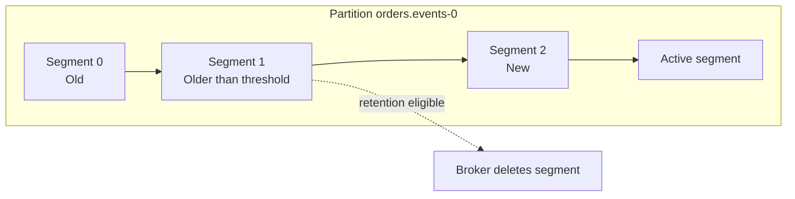

# Configuring Retention for Topics

Kafka stores records in partition logs so consumers can read by offset and replay data when needed. Data is not deleted immediately after a consumer finishes reading it. Brokers retain records according to the topic's storage policy, then delete old log segments or compact logs depending on configuration.

**Retention** is the policy that determines how long or up to what storage limit Kafka keeps data in a topic. Proper configuration balances three needs: how long consumers can tolerate downtime, data replay capability, and cluster storage capacity. If retention is too short, slow consumers may miss the chance to read older records; if retention is too long, disk usage and operational cost increase.

In Spring Kafka, retention is typically configured at the topic level via Kafka topic configuration. You can set configurations when creating a topic with `TopicBuilder`, or modify an existing topic using the Kafka Admin API or the `kafka-configs` tool.

## 1. How Does Retention Work?

A topic consists of multiple partitions; each partition is a log divided into **segments**. Kafka writes new records to the active segment. When a segment reaches a size or time threshold, the broker closes the current segment and opens a new one. Older segments can become eligible for deletion when retention policies permit.



Kafka retention operates on **log segments**, not per-record timers. When an older segment becomes eligible, Kafka can delete the entire segment. Thus, a record that has passed `retention.ms` is not necessarily deleted at that exact instant: its segment must be closed and the broker must run its retention check cycle. Actual deletion timing can lag behind the configured threshold.

Several consequences to remember:

- A consumer reading a record does not cause that record to be deleted immediately.
- A consumer not yet having read a record does not stop the broker from deleting it once retention conditions are met.
- Each consumer group tracks its own offsets, but groups do not act as a mechanism to shield data from retention.
- Retention applies to partition logs; a topic with multiple partitions has separate segments and deletion times per partition.

## 2. Two Commonly Used Retention Limits

For topics using the deletion policy (`cleanup.policy=delete`), the two common settings are `retention.ms` and `retention.bytes`.

| Configuration | Meaning | Scope |
| --- | --- | --- |
| `retention.ms` | Maximum time Kafka keeps a log segment before older segments become eligible for deletion | Based on segment/record age |
| `retention.bytes` | Log size limit before Kafka deletes old segments to free storage | Calculated per individual partition |

### 2.1. `retention.ms`: Retaining Data by Time

`retention.ms` expresses duration in milliseconds. For example, to retain data for roughly three days:

```properties
retention.ms=259200000
```

The value is calculated as follows:

\[
3 \times 24 \times 60 \times 60 \times 1000 = 259200000\text{ ms}
\]

Some reference values:

| Desired Duration | `retention.ms` |
| --- | ---: |
| 1 day | `86400000` |
| 3 days | `259200000` |
| 7 days | `604800000` |
| 30 days | `2592000000` |

`retention.ms=-1` disables the time-based retention limit. This does not mean the topic can never lose data: if `retention.bytes` is still bounded, size limits can still trigger deletion of older segments; topics can also be deleted or reconfigured by administrators.

Kafka can stamp records with `CreateTime` (timestamp sent by the producer) or `LogAppendTime` (assigned by the broker upon append). Record age calculation depends on which timestamp type is in use. With `CreateTime`, skewed producer clocks or improper application timestamps can make a record's computed age differ from when the broker actually received it.

### 2.2. `retention.bytes`: Retaining Data by Size

`retention.bytes` sets a log size limit **per partition**, not a total size across the entire topic. Example:

```properties
retention.bytes=5368709120
```

That value equals 5 GiB for a single partition (5 × 1024³ bytes). If the topic has six partitions, the logical log capacity under this limit is approximately:

\[
6 \times 5\text{ GiB} = 30\text{ GiB}
\]

With a replication factor of 3, total replica storage across brokers can be around 90 GiB, before accounting for indexes, metadata, segments not yet eligible for deletion, and operational headroom.

`retention.bytes=-1` disables the size limit in topic config. If only `retention.ms` is set, data remains bounded by time; if only `retention.bytes` is set, data remains bounded by size.

### 2.3. When Both Limits Are Set

If a topic has both `retention.ms` and `retention.bytes`, Kafka can delete old segments whenever either retention condition is met. Think of this as a "whichever comes first" threshold: data may be deleted sooner than expected if a partition grows rapidly in size.

For example, a topic configured to retain at most three days and at most 5 GiB per partition:

- At low traffic, the time limit may be reached first; old segments are deleted when eligible.
- During traffic spikes, a partition may hit 5 GiB before three days pass; old segments are deleted to bring the log close to the size limit.

Because deletion happens at the segment level, actual disk usage can exceed the limit temporarily, especially while the active segment remains open. Do not treat `retention.bytes` as a byte-exact hard cap.

## 3. Distinguishing Retention from Cleanup Policy

`cleanup.policy` determines how Kafka cleans up logs. The two main values are `delete` and `compact`:

| `cleanup.policy` | How It Works | Use Case |
| --- | --- | --- |
| `delete` | Deletes old segments based on time or size retention thresholds | Event logs, audit events, data needing replay within a defined window |
| `compact` | Compacts logs by key, retaining the latest value per key during compaction runs | Topics storing the latest state per entity, such as configs or profiles |
| `compact,delete` | Combines key-based compaction with segment deletion by retention | When you need both latest state per key and a bound on log age/size |

With `delete`, Kafka keeps record history until old segments become eligible for deletion. With `compact`, Kafka runs a background log cleaner asynchronously to remove older versions of the same key. Compaction does not mean every key immediately has only one record; the log may still hold uncompacted segments and recent data.

### 3.1. Tombstones and `delete.retention.ms`

In a compacted topic, a record with a key and a `null` value is called a **tombstone**. A tombstone signifies deletion of the key's current value. Kafka retains tombstones for a period of time so consumers have a chance to read and apply the deletion before compaction removes the tombstone.

`delete.retention.ms` controls how long tombstones are kept in a compacted log. This setting differs from `retention.ms`:

- `retention.ms` is the age threshold for deleting segments under the `delete` cleanup policy.
- `delete.retention.ms` is how long tombstones remain in a compacted log so consumers can observe deletions.

If consumers need to rebuild state from a compacted topic, ensure consumers can read data within the window while tombstones still exist, or establish an appropriate snapshot/rebuild strategy.

### 3.2. Choosing a Policy by Data Type

For an `orders.events` topic containing events like `OrderCreated`, `OrderPaid`, and `OrderCancelled`, history usually needs to be kept for a period so consumers can replay it, making `delete` a straightforward choice. For a `customer.current-state` topic needing only the latest state per `customerId`, `compact` may be a better fit.

Do not enable `compact` just to "save disk space" on an event log. Compaction can discard intermediate versions for the same key, whereas auditing or replay workflows may require full history. Conversely, do not use short retention on a compacted topic if consumers need enough time to observe tombstones and rebuild state.

## 4. Topic-Level Retention and Broker Defaults

Kafka has broker-level defaults such as `log.retention.ms`, `log.retention.bytes`, `log.cleanup.policy`, `log.segment.bytes`, and `log.retention.check.interval.ms`. A topic can override certain settings via topic config. If a topic sets no override, it typically inherits the corresponding broker default.

This means two topics on the same cluster can have different retention policies:

| Topic | Purpose | Example Retention |
| --- | --- | --- |
| `orders.events` | Business events needing replay | 7 days |
| `payments.audit` | Reconciliation data needing longer storage | 90 days |
| `telemetry.raw` | High-volume observability data | 24 hours and size limit |
| `customer.current-state` | Latest state by key | `compact` |

The values in the table are design examples, not mandatory Kafka defaults. Check the actual broker and topic configuration before concluding how long data is retained.

## 5. Inspecting and Updating Retention with Kafka CLI

`kafka-configs.sh` lets you inspect and modify the topic config of an existing topic. Example inspecting `orders.events`:

```bash
kafka-configs.sh \
  --bootstrap-server localhost:9092 \
  --entity-type topics \
  --entity-name orders.events \
  --describe
```

Setting three-day retention, a 5 GiB limit per partition, and `delete` cleanup policy:

```bash
kafka-configs.sh \
  --bootstrap-server localhost:9092 \
  --entity-type topics \
  --entity-name orders.events \
  --alter \
  --add-config 'cleanup.policy=delete,retention.ms=259200000,retention.bytes=5368709120'
```

After making changes, run `--describe` again to verify the configuration was saved. Topic config changes are usually applied dynamically by brokers; however, actual segment deletion still depends on closed segments and retention check cycles.

To remove a topic override and fall back to the broker default, delete the topic-specific config:

```bash
kafka-configs.sh \
  --bootstrap-server localhost:9092 \
  --entity-type topics \
  --entity-name orders.events \
  --alter \
  --delete-config retention.bytes
```

Deleting an override does not make the effective limit infinite; the broker falls back to its corresponding default value. Re-check the effective configuration and verify the admin account has `ALTER_CONFIGS` permission.

## 6. Declaring Retention at Topic Creation with Spring Kafka

Spring Kafka lets you declare topics as `NewTopic` beans. You can set retention at topic creation time using `TopicBuilder.configs(...)`:

```java
package com.example.messaging.config;

import java.time.Duration;
import java.util.Map;
import org.apache.kafka.clients.admin.NewTopic;
import org.apache.kafka.common.config.TopicConfig;
import org.springframework.context.annotation.Bean;
import org.springframework.context.annotation.Configuration;
import org.springframework.kafka.config.TopicBuilder;

@Configuration
public class TopicConfiguration {

    @Bean
    NewTopic ordersTopic() {
        return TopicBuilder.name("orders.events")
                .partitions(6)
                .replicas(3)
                .configs(Map.of(
                        TopicConfig.CLEANUP_POLICY_CONFIG,
                        TopicConfig.CLEANUP_POLICY_DELETE,
                        TopicConfig.RETENTION_MS_CONFIG,
                        Long.toString(Duration.ofDays(3).toMillis()),
                        TopicConfig.RETENTION_BYTES_CONFIG,
                        Long.toString(5L * 1024 * 1024 * 1024)
                ))
                .build();
    }
}
```

In this example:

- The topic has six partitions for parallel processing capacity.
- The replication factor is three, so the cluster must have enough eligible brokers.
- `retention.ms` sets a three-day duration.
- `retention.bytes` sets a 5 GiB limit per partition.
- `cleanup.policy=delete` instructs Kafka to delete old segments per retention thresholds.

A `NewTopic` bean primarily describes configuration when the topic is created. If the topic already exists, do not assume re-declaring the bean updates all existing topic configs. Use the Kafka Admin API or `kafka-configs --alter` to modify an existing topic's config, then describe to verify.

In production, topics are often provisioned by a separate infrastructure workflow. Agree clearly on who owns topic creation and config changes; avoid letting multiple applications arbitrarily alter retention on the same topic.

## 7. Calculating Retention Based on Actual Needs

Do not pick retention simply because a number like seven days feels familiar. Determine how long the system must tolerate consumer downtime and how much time is needed to replay data.

Questions to answer:

1. What is the maximum duration consumers might be down due to deployment, maintenance, or incidents?
2. After restarting, how long do consumers need to drain the backlog?
3. How many days of data do operations teams need to replay for investigation or recovery?
4. Are there audit or regulatory requirements governing retention duration?
5. What are the topic's average and peak write rates? What is the average record size after compression?
6. How many partitions and what replication factor does the topic have?

### 7.1. Estimating Storage Capacity

Estimate logical log size before multiplying by replication:

\[
\text{Logical capacity} \approx
\text{Average write rate} \times \text{Retention duration}
\]

Approximate cluster storage can be estimated as:

\[
\text{Cluster capacity} \approx
\text{Logical capacity} \times \text{Replication factor}
\]

For example, a topic receiving an average of 2 MiB/s and retaining data for three days:

\[
2 \times 60 \times 60 \times 24 \times 3
= 518400\text{ MiB} \approx 506.25\text{ GiB}
\]

With a replication factor of three, replica storage is roughly 1.48 TiB. This is an initial estimate; actual disk consumption also depends on compression, indexes, segment size, data skew across partitions, segments awaiting deletion, and headroom needed by brokers.

If using `retention.bytes`, remember the limit applies per partition. For example, six partitions × 5 GiB per partition gives a logical log limit of roughly 30 GiB; with a replication factor of three, replica storage is around 90 GiB. If data distribution is skewed, hot partitions may hit the limit earlier than others.

### 7.2. Choosing Duration Based on Recovery Capacity

A practical calculation is:

\[
\text{Minimum retention} \geq
\text{Maximum downtime} +
\text{Backlog catch-up time} +
\text{Safety buffer}
\]

For instance, a consumer could be down for one day, need one more day to drain the backlog after recovery, and require a one-day buffer. Three-day retention is an initial minimum baseline to evaluate, not a guarantee covering every incident. Verify using peak traffic and real processing capacity.

If post-recovery consumer speed only matches producer speed, the consumer will never catch up on the backlog while producers keep writing. Therefore, retention planning must go hand in hand with having processing capacity above the write rate during recovery.

## 8. Impact of Retention on Consumers and Offsets

Kafka does not hold records until every consumer group finishes reading them. Suppose a topic keeps data for three days, while `billing-service` is stopped for four days. When the service restarts, old segments may already be deleted. The group's committed offset may fall behind the current log start offset.

When a consumer requests an offset that no longer exists, Kafka may return an offset out-of-range error. The client applies `auto.offset.reset` if configuration permits:

- `earliest`: jumps to the earliest offset still available in the partition. Data already deleted by retention cannot be read back this way.
- `latest`: jumps to the end of the log, skipping unread deleted data.
- `none`: does not reset the offset automatically; the client raises an error for explicit handling by the application or operator.

Thus, `auto.offset.reset=earliest` is not a mechanism to recover deleted records. It only selects a starting point among remaining data. If history longer than retention must be recoverable, keep an archive or another source of truth.

### 8.1. Topic Retention Differs from Consumer Offset Retention

Topic records and a group's committed offsets are two distinct kinds of data:

| Data | Managed By | Related Configurations |
| --- | --- | --- |
| Records in topic partitions | Topic log cleanup | `retention.ms`, `retention.bytes`, `cleanup.policy` |
| Consumer group committed offsets | Internal topic `__consumer_offsets` and group coordinator | `offsets.retention.minutes` and group activity state |

Do not confuse `offsets.retention.minutes` with `retention.ms`. Increasing offset retention does not keep topic records longer; increasing topic retention does not mean an inactive group's offsets are kept forever. When a group stays inactive, offset metadata can expire per broker policy.

## 9. Segment Settings and Actual Deletion Timing

Several broker/topic settings influence the granularity of retention:

| Configuration | Effect |
| --- | --- |
| `segment.bytes` | Maximum size before a log segment is rolled |
| `segment.ms` | Maximum time before a segment is rolled by age |
| `log.retention.check.interval.ms` | Interval at which the broker checks for segments eligible for deletion |

For example, if a topic has `retention.ms` of one hour, yet segments only roll after one day and traffic is low, records may sit inside the active segment for longer than an hour. Only after the segment closes and the next retention check runs can the segment be deleted. Therefore, retention is segment-based cleanup rather than an exact per-record TTL.

Do not arbitrarily set `segment.ms` too low to force rapid deletion. Overly small segments create excessive files, indexes, and management work, increasing broker overhead. Choose segment size/time according to throughput, record size, retention requirements, and operational capacity.

## 10. Verifying Retention in Practice

A safe checklist for a running topic:

1. Describe topic config to see active overrides.
2. Check broker defaults if the topic has no override.
3. Confirm whether the cleanup policy is `delete`, `compact`, or combined.
4. Calculate retention by both time and size; verify per-partition byte limits.
5. Check lag for critical consumer groups and how long backlogs can persist.
6. Apply config changes within an appropriate maintenance window and monitor log start offsets, partition sizes, and consumer lag afterward.
7. Confirm the system still satisfies replay and audit requirements.

Do not experiment with retention by sharply reducing time limits on a production topic. Once segments become eligible, old data can be deleted and cannot be recovered from Kafka. Use a dedicated test topic with synthetic data to observe behavior.

## 11. Common Mistakes When Configuring Retention

| Symptom | Common Cause | Resolution |
| --- | --- | --- |
| Data disappears earlier than expected | Low `retention.bytes` causes partitions to hit the size limit before `retention.ms` | Check both thresholds and per-partition write rates |
| Expired records still remain on disk | Segment not yet closed or broker has not run the next retention check cycle | Check `segment.ms`, `segment.bytes`, and retention check interval |
| Consumer cannot read older offsets | Segments holding those records were deleted by retention | Check log start offset, `auto.offset.reset`, and alternative replay sources |
| Compacted topic still holds multiple records per key | Compaction runs asynchronously; segments not yet compacted | Check `cleanup.policy`, log cleaner status, and key design |
| Tombstones disappear before consumers process them | `delete.retention.ms` is shorter than potential consumer downtime | Increase tombstone retention or design snapshot/rebuild |
| New topic lacks expected retention | Topic inherited broker defaults, or `NewTopic` bean did not alter an existing topic | Describe config; alter topic config explicitly and read back |
| Group offsets expire even though records remain | Group offset retention policy differs from topic retention | Check `offsets.retention.minutes` and manage group lifecycle |

## 12. Self-Check

1. How do `retention.ms` and `retention.bytes` differ? Does `retention.bytes` apply per topic or per partition?
2. When both time and size are configured, what happens if a partition hits the byte limit before the time expires?
3. Why can records still exist after passing `retention.ms`?
4. How does `cleanup.policy=compact` differ from `cleanup.policy=delete`?
5. Is `delete.retention.ms` a general retention period for all records?
6. If a consumer is stopped longer than retention, can `auto.offset.reset=earliest` recover deleted records?
7. Why must topic retention and consumer group offset retention be monitored separately?

When designing retention, treat it as a commitment on replay window and storage capacity for each topic. Coordinate `retention.ms`, `retention.bytes`, cleanup policy, segment settings, replication factor, and consumer backlog-processing capacity so messaging flows remain both recoverable and operationally stable.
