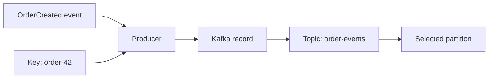
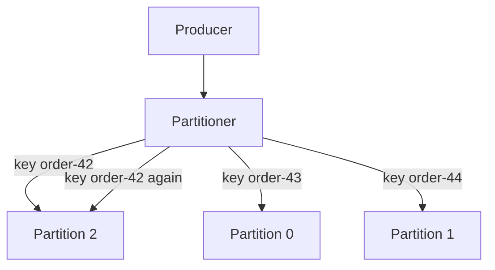

# Sending Records with a Key

When sending a record to Kafka, a producer can pass both a **key** and a **value**. The value holds the business event; the key helps Kafka determine which entity or data stream the record belongs to and is typically used to select the partition. Choosing the right key ensures related events are stored in the same partition, preserves ordering within that entity's scope, and supports data handling patterns such as log compaction.

With Spring Kafka, sending a keyed record is very straightforward:

```java
kafkaTemplate.send("order-events", orderId, event);
```

What needs careful design is whether `orderId` is actually the right key, how the key is serialized, and how partitioning affects both ordering and scalability.

## 1. What is a key in a Kafka record?

A Kafka record has the following main components:

- **Topic**: the logical data stream to which the record is sent.
- **Partition**: the specific log containing the record.
- **Key**: a value identifying or grouping the record, which may be left empty.
- **Value**: the payload, typically an event or business data.
- **Timestamp and headers**: additional metadata for the record.

The key does not have to appear inside the payload. For example, an `OrderCreated` event might contain `orderId`, `customerId`, and `amount`, while the record's key is also `orderId`. In that case, Kafka can route all events for the same order to the same partition.



Example of a record:

| Component | Value |
|---|---|
| Topic | `order-events` |
| Key | `order-42` |
| Value | `OrderCreated(orderId=order-42, amount=250000)` |
| Partition | E.g. P2 |
| Offset | Position assigned by the broker in P2 |

The key is routing metadata of the record, not an arbitrary header. Headers usually carry supplementary information such as correlation ID, event type, or trace ID; headers do not determine the partition under the default mechanism.

## 2. Choosing a key by business entity

A good key usually represents the entity that the system needs to process in order. Ask: *Which events must not be processed out of order? What object do they belong to?*

Examples:

| Event stream | Usually suitable key | Reason |
|---|---|---|
| Order lifecycle | `orderId` | Events for the same order go to the same partition |
| Account balance | `accountId` | Changes for one account preserve order |
| User activity | `userId` | Can be processed sequentially per user |
| IoT device state | `deviceId` | Messages from the same device are grouped together |
| Per-transaction audit log | `transactionId` | Events in the same transaction share the same routing key |

If you need to preserve the order of state changes for an order, using `orderId` generally makes more sense than using `customerId`. A single customer can place many independent orders; choosing `customerId` would funnel all of those orders into one partition and could create an unnecessary hot spot.

Do not use a new random value for every event if the goal is to group events of the same entity. For example, a per-event UUID gives events of the same order different keys, so they may land in different partitions.

Keys should have a stable format, be consistent across application versions, and have a deterministic serializer. Values like `order-42`, `account-1001`, or stringified UUIDs are easy-to-observe choices. Avoid changing key normalization rules across producer versions without a compatibility plan.

## 3. How does Kafka select a partition based on the key?

When sending a record, the producer can specify a partition explicitly. If no partition is specified, the producer's partitioner selects a partition.

With the default partitioner and a non-`null` key, Kafka uses a hash of the serialized byte array to determine the partition. This can be summarized broadly as:

`partition = positiveHash(serializedKey) % partitionCount`

This formula illustrates the concept; the exact algorithm depends on the Kafka client's partitioner. The key point is that **the key is serialized before the partitioner uses it**.

Given the same topic, same key bytes, same partitioner, and same partition count, records with the same key will be routed to the same partition.

### Example with a three-partition topic

Suppose topic `order-events` has P0, P1, and P2. Different keys are mapped to partitions by hash:



The diagram only illustrates the mapping outcome. The specific partition for a key must be determined from the partitioner and the actual topic configuration; it cannot be deduced from the key name alone.

### When there is no key

If the key is `null` and the producer does not specify a partition, modern default partitioners typically use sticky partitioning to accumulate records into one partition during a send interval/batch, and then switch to another partition. This helps leverage batching and throughput.

Therefore, do not rely on the assumption that keyless records will strictly alternate record-by-record across all partitions.

Distinguish between:

- `null` key: the record has no key.
- Empty string key `""`: still a non-null key; it is serialized into a byte array and participates in partition selection.
- `null` value: a null payload. On a compacted topic, a record with a key and a null value is commonly used as a tombstone to mark the key for deletion.

## 4. Sending keyed records with KafkaTemplate

Spring Kafka provides `KafkaTemplate` to send records. In Spring Kafka 3.x, the `send(...)` methods return `CompletableFuture<SendResult<K, V>>`, enabling applications to handle results asynchronously.

Suppose an event is represented as a Java record:

```java
import java.math.BigDecimal;
import java.time.Instant;

public record OrderCreated(
    String orderId,
    String customerId,
    BigDecimal amount,
    Instant occurredAt
) {
}
```

The publisher can use `orderId` as the key:

```java
@Service
public class OrderEventPublisher {

    private static final String TOPIC = "order-events";

    private final KafkaTemplate<String, OrderCreated> kafkaTemplate;

    public OrderEventPublisher(
            KafkaTemplate<String, OrderCreated> kafkaTemplate) {
        this.kafkaTemplate = kafkaTemplate;
    }

    public CompletableFuture<SendResult<String, OrderCreated>> publish(
            OrderCreated event) {

        return kafkaTemplate.send(
            TOPIC,
            event.orderId(),
            event
        );
    }
}
```

In the call above:

- `TOPIC` is the target topic.
- `event.orderId()` is the key.
- `event` is the value.
- The Kafka client serializes the key and value separately using the configured serializers.

You should validate the key before sending. If `orderId` is null or blank due to an event creation bug, the record could be distributed unexpectedly or fail business rules. You can validate right at the publisher boundary:

```java
public CompletableFuture<SendResult<String, OrderCreated>> publish(
        OrderCreated event) {

    if (event.orderId() == null || event.orderId().isBlank()) {
        throw new IllegalArgumentException("orderId must not be blank");
    }

    return kafkaTemplate.send(TOPIC, event.orderId(), event);
}
```

### Tracking the send result

Sending a record is an asynchronous operation. The future completes when the Kafka client receives a success or failure result according to the producer configuration:

```java
public CompletableFuture<SendResult<String, OrderCreated>> publish(
        OrderCreated event) {

    return kafkaTemplate
        .send(TOPIC, event.orderId(), event)
        .whenComplete((result, exception) -> {
            if (exception != null) {
                log.error("Cannot publish order event", exception);
                return;
            }

            RecordMetadata metadata = result.getRecordMetadata();
            log.debug(
                "Published order event to partition {}, offset {}",
                metadata.partition(),
                metadata.offset()
            );
        });
}
```

For this example to compile, the class needs a logger, such as Lombok's `@Slf4j`, and imports for `RecordMetadata`, `CompletableFuture`, and `SendResult`. Do not block synchronously with `.get()` on a request-handling thread without a clear reason; synchronous waiting can increase latency and tie up threads.

When the future fails, handle it according to application policy: return an error to the caller, retry at the appropriate layer, or route to a recovery flow. Do not ignore exceptions just because `send` returns a future.

> **Version difference:** Spring Kafka 3.x uses `CompletableFuture`. In older Spring Kafka versions, the send API may return `ListenableFuture`; use the future type matching the version managed by Spring Boot.

## 5. Configuring serializers for key and value

The key and value are serialized independently. If the key is a String, use `StringSerializer`; if the value is an event object, you can use `JsonSerializer`.

Spring Boot configuration example:

```yaml
spring:
  kafka:
    bootstrap-servers: localhost:9092

    producer:
      key-serializer: org.apache.kafka.common.serialization.StringSerializer
      value-serializer: org.springframework.kafka.support.serializer.JsonSerializer
      acks: all
```

The generic types of `KafkaTemplate` should match the key and value types:

```java
KafkaTemplate<String, OrderCreated>
```

Do not declare `KafkaTemplate<Object, Object>` if the application only sends String keys and JSON events, because concrete types allow better compile-time checking.

If the key is a UUID, you can use a dedicated serializer or normalize it to a string:

```java
String key = orderId.toString();
kafkaTemplate.send("order-events", key, event);
```

What matters is that the consumer decodes the key accordingly. If the producer uses `StringSerializer`, the consumer should use `StringDeserializer`. If the producer uses a custom binary serializer, the consumer must use a compatible deserializer.

## 6. Using ProducerRecord when metadata control is needed

When you need to add headers, a timestamp, or specify a concrete partition, you can build a `ProducerRecord` instead of using the simple `KafkaTemplate` overload.

```java
ProducerRecord<String, OrderCreated> record =
    new ProducerRecord<>(
        "order-events",
        event.orderId(),
        event
    );

record.headers().add(
    "event-type",
    "OrderCreated".getBytes(StandardCharsets.UTF_8)
);

kafkaTemplate.send(record);
```

The key is still `event.orderId()`. The `event-type` header adds information about the event type; it does not replace the key.

If you truly need to specify a partition, you can use the constructor that takes a partition:

```java
ProducerRecord<String, OrderCreated> record =
    new ProducerRecord<>(
        "order-events",
        2,
        event.orderId(),
        event
    );

kafkaTemplate.send(record);
```

In this example, the record is sent to partition 2 if that partition exists. When a partition is specified explicitly, the partitioner does not choose a partition for the producer. Only do this when the application has specific partitioning requirements; hard-coding partition numbers makes topology changes harder to operate in application code.

## 7. Keys and event processing order

Kafka guarantees record ordering within the scope of a single partition. Thus, when events for the same entity are sent with the same key and routed to the same partition, consumers can read them in the order stored in the partition.

Order lifecycle example:

| Business sequence | Event | Key | Partition |
|---|---|---|---|
| 1 | `OrderCreated` | `order-42` | P2 |
| 2 | `OrderPaid` | `order-42` | P2 |
| 3 | `OrderPacked` | `order-42` | P2 |
| 4 | `OrderShipped` | `order-42` | P2 |

These events can be processed in partition order. Other orders may reside on P0 or P1 and be processed in parallel.

A key does not create a global order for the topic. If two records are in two different partitions, Kafka does not promise that consumers will observe them in the same chronological order.

It is also important to distinguish between the order written to Kafka and the order of business completion:

- A producer with multiple threads sending the same key can produce an order based on when the broker receives requests, not necessarily when business events occurred.
- A consumer that processes asynchronously or offloads work to a thread pool may complete side effects out of order even if records were polled in order.
- Application-level retries or error handling can cause a later event to complete before an earlier one.

If strict ordering per aggregate is required, designate a single place responsible for serializing that aggregate's events, keep consumer-side processing sequential, and use a business sequence/version to detect out-of-order events. A key is a condition that enables partition affinity; it does not by itself provide exactly-once or idempotency.

## 8. Impact of partition count

A key is mapped to a partition based on the partition count. If you increase the topic's partition count, the key mapping can change. Old records for `order-42` remain in the old partition, while new records with the same key may be sent to a different partition.

This can cause two consumers to process events for the same entity in parallel and break ordering assumptions across the topic's history.

Before increasing the partition count, evaluate:

- Is ordering by key required across the entire lifecycle of the data?
- Can consumers process the same aggregate in parallel from different partitions?
- Can a new versioned topic be created and data migrated in a planned way?
- Is a custom partitioner with a stable partitioning rule needed?

If ordering by key is a hard requirement, treat partition count and partitioner as part of the data contract. Do not change them arbitrarily in operations.

## 9. Keys in log compaction

For topics with cleanup policy `compact`, Kafka uses the key to retain the latest state per key across compaction runs. Hence, the key also serves as the identifier of an entity in a changelog or state topic.

Example:

| Key | Value | Meaning |
|---|---|---|
| `account-7` | `{"balance":100}` | Account state |
| `account-7` | `{"balance":80}` | Newer state |
| `account-7` | `null` | Tombstone, marks key for deletion |

A tombstone is a record with a key and a null value. It differs from a record without a key. For compacted topics, tombstones are retained for a configured duration before they can be removed by the compaction process.

If you want to use compaction, the key must accurately identify the entity and remain consistent across updates. Do not use a random per-event key because Kafka cannot group versions of the same entity under the same key.

## 10. How do consumers receive the key?

Consumers can accept the full `ConsumerRecord<K, V>` to read key, value, partition, offset, timestamp, and headers.

Listener example:

```java
import java.util.Objects;

@Component
public class OrderEventListener {

    @KafkaListener(
        topics = "order-events",
        groupId = "billing-service"
    )
    public void onOrderEvent(
            ConsumerRecord<String, OrderCreated> record) {

        String orderId = record.key();
        OrderCreated event = record.value();

        if (event == null || !Objects.equals(orderId, event.orderId())) {
            throw new IllegalStateException(
                "Record key does not match event orderId"
            );
        }

        // Business logic for orderId.
    }
}
```

Consumer configuration must use matching deserializers:

```yaml
spring:
  kafka:
    consumer:
      key-deserializer: org.apache.kafka.common.serialization.StringDeserializer
      value-deserializer: org.springframework.kafka.support.serializer.JsonDeserializer
      properties:
        spring.json.trusted.packages: com.example.messaging.event
```

In this example, `StringDeserializer` restores the key to a String, and `JsonDeserializer` converts the JSON payload into `OrderCreated` according to the application's type mapping/default type configuration. Make sure the JSON configuration matches the actual event type and only trusts the necessary packages.

Within a consumer group, each partition is assigned to at most one consumer member at a time. This supports sequential processing per partition. However, if the listener itself dispatches work to an asynchronous executor, the application must protect side-effect ordering itself.

## 11. Testing sending records with a key

An integration test with Embedded Kafka can verify that the key is written properly into the record. When reading the record from a test consumer, assert both the key and the value:

```java
kafkaTemplate.send("order-events", "order-42", event)
    .get(10, TimeUnit.SECONDS);

ConsumerRecords<String, OrderCreated> records =
    consumer.poll(Duration.ofSeconds(10));

ConsumerRecord<String, OrderCreated> record =
    records.records("order-events").iterator().next();

assertThat(record.key()).isEqualTo("order-42");
assertThat(record.value().orderId()).isEqualTo("order-42");
```

If you need to verify partitioning, send multiple records with the same key to a multi-partition topic and check that they have the same `record.partition()`. Do not hard-code a specific partition for a key in tests unless the test is verifying a custom partitioner or a specific partition contract.

A partition affinity test can follow this logic:

1. Send multiple records with key `order-42`.
2. Wait for the futures to complete.
3. Retrieve the partition from `SendResult.getRecordMetadata().partition()`.
4. Assert all records with the same key received the same partition.
5. Send a different key and observe distribution, without asserting that two different keys must necessarily land in two different partitions.

This check verifies partitioner behavior under the current test configuration. If you change the partition count or use a custom partitioner, the results need to be re-evaluated.

## 12. Common mistakes when sending keyed records

| Symptom | Possible cause | Resolution |
|---|---|---|
| Consumer receives a null key | Producer did not pass a key or serializer/key mapping is wrong | Check the `send(topic, key, value)` overload and key serializer |
| Same entity appears in multiple partitions | Unstable key, producers using different partitioners, or partition count changed | Standardize the key and align partitioner/topology |
| Events of the same key processed out of order | Asynchronous consumer processing, retries, or multiple competing sources | Serialize processing per aggregate and use event versions |
| One partition has abnormally high load | A hot key or skewed key distribution | Re-evaluate the key by business unit and load distribution |
| Key serialization error | Key serializer does not support the actual data type | Configure matching serializer and align with consumer |
| Record goes to an unexpected partition | Producer specified a partition explicitly or has a custom partitioner | Inspect `ProducerRecord`, `partitioner.class`, and metadata |

Do not use keys to hold passwords, tokens, or secrets. Keys are stored in the Kafka log and may appear in administrative tools, application logs, or observability systems. If a key contains personal data, consider using a normalized technical identifier or encryption according to data protection requirements.

## 13. Checklist before choosing a key for a topic

- Which aggregate or entity does the key represent?
- Which events need to maintain order relative to one another?
- Is the key stable across events and producer versions?
- Do producer and consumer have compatible serializers/deserializers?
- Does any producer specify partitions explicitly or use a custom partitioner?
- Might the partition count change over the topic's lifecycle?
- Could a single key become a hot partition?
- Does the consumer process asynchronously in a way that could reorder side effects?
- If the topic is compacted, does the key identify state properly?
- Does the key contain unnecessary sensitive information?

## 14. Key takeaways

- `key` and `value` are two separate parts of a Kafka record.
- Keys are commonly used to select a partition; the partitioner uses the serialized bytes of the key.
- Same key, same partitioner, and same partition count usually map to the same partition.
- Kafka only guarantees ordering within a single partition, not across the entire topic.
- `KafkaTemplate.send(topic, key, value)` is the standard way to send keyed records in Spring Kafka.
- Keys must be serialized and deserialized consistently across producer and consumer.
- Increasing partition count can change the partition chosen for a key and affect ordering.
- A key does not replace idempotency, transactions, or business-level ordering controls.

When choosing a key by the aggregate that needs ordering, the producer can distribute load in parallel across partitions while keeping related events on the same log. This is an important foundation for building scalable and controllable event flows with Spring Kafka.

