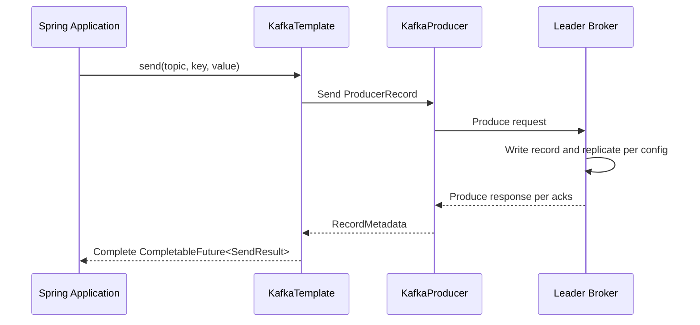

# Handling RecordMetadata in Spring Kafka

When sending a record with `KafkaTemplate`, the producer can receive a result containing metadata returned by the Kafka broker. Spring Kafka wraps this result in `SendResult<K,V>`, while Kafka's `RecordMetadata` provides specific details about where and when the record was written to the topic.

Metadata helps the application confirm that the record was accepted by the broker under the `acks` policy, write logs for traceability, measure data sizes, and support post-send business processing. It is important to understand the limits of metadata: it describes the producer-side send result in Kafka, and does not prove that a consumer has read or processed the event.

## 1. Where do SendResult and RecordMetadata fit in the send flow?

`KafkaTemplate.send(...)` sends data asynchronously. When the producer receives the result per the acknowledgement configuration, Spring Kafka completes the future with a `SendResult<K,V>`. This result contains the sent `ProducerRecord` and the `RecordMetadata` provided by the Kafka client.



Key types:

| Type | Library | Role |
|---|---|---|
| `ProducerRecord<K,V>` | Kafka client | The record sent by the producer, containing topic, optional partition, timestamp, key, value, and headers |
| `RecordMetadata` | Kafka client | Metadata about the record after a successful send, containing topic, partition, offset, timestamp, and serialized sizes |
| `SendResult<K,V>` | Spring Kafka | The send result of `KafkaTemplate`, containing the producer record and record metadata |
| `CompletableFuture<SendResult<K,V>>` | Java | Represents the send result that will complete in the future |

In Spring Kafka 3.x, `KafkaTemplate.send(...)` methods return `CompletableFuture<SendResult<K,V>>`. In Spring Kafka 2.x, the send API typically uses `ListenableFuture`; when upgrading, update callback registration to match the version.

## 2. Important fields of RecordMetadata

`RecordMetadata` belongs to the `org.apache.kafka.clients.producer` package. Commonly used methods include:

| Method | Meaning |
|---|---|
| `topic()` | Name of the topic containing the record |
| `partition()` | Actual partition to which the producer wrote the record |
| `offset()` | Offset of this specific record within that partition |
| `timestamp()` | Timestamp recorded by Kafka for the record |
| `timestampType()` | Timestamp type, e.g., producer-created time or broker-appended time |
| `serializedKeySize()` | Key size after serialization, in bytes |
| `serializedValueSize()` | Value size after serialization, in bytes |
| `hasOffset()` | Indicates whether the metadata has a valid offset |
| `hasTimestamp()` | Indicates whether the metadata has a valid timestamp |

For example, the send result might report that the record is in `orders`, partition `2`, offset `1057`. Offset `1057` identifies that record's position within partition `2`; it is not a topic-wide global sequence number.

### Actual topic and partition

`topic()` tells you which topic the broker wrote the record to. `partition()` tells you the actual partition after the producer applied its routing rules. If the application sent the record with only topic and key, the partitioner decided the partition. If a partition was specified in `ProducerRecord`, the metadata reflects that partition upon a successful send.

Reading the partition from metadata is especially useful when the producer does not specify a partition explicitly. The application can use the result to verify key routing, detect abnormal data skew, or record the record's coordinates to aid troubleshooting.

### Record offset

`offset()` is the position of the newly sent record within a partition. An offset only has meaning together with its topic and partition:

```text
topic=orders, partition=2, offset=1057
```

To identify a record in the log, store all three of these values. Two different partitions can both have offset `1057`, yet those are two different records.

The offset from `RecordMetadata` must also be distinguished from the offset committed by a consumer group. Metadata returns the offset of the newly written record; when a consumer processes that record successfully, the commit usually records the next position to read. For instance, if a record has offset `1057`, the next committed position is typically `1058`.

Do not use offsets for absolute ordering across partitions. Kafka preserves order within each partition; records in partition `0` and partition `2` have no global ordering relationship based solely on offset.

### Timestamp

`timestamp()` returns the timestamp Kafka recorded for the record. This value is governed by `message.timestamp.type`:

- `CreateTime`: uses the timestamp sent by the producer with the record, if any.
- `LogAppendTime`: the broker records the time the record was appended to the log.

Therefore, the timestamp in metadata is not always the business time when the event was created. If the application needs the business time, store an `occurredAt` or `createdAt` field in the payload or headers per an agreed schema. Kafka timestamps are useful for observing write time and analyzing latency, provided you understand which timestamp type is active.

`hasTimestamp()` lets you check whether the timestamp is valid before using it. Do not assume every record carries a business-meaningful timestamp.

### Key and value sizes

`serializedKeySize()` and `serializedValueSize()` report the size after the serializer converts data into bytes. These metrics help observe record size close to what the producer feeds into the Kafka protocol.

If the key or value is `null`, Kafka may return a size of `-1` for the corresponding field. Thus, when aggregating metrics, treat negative values as having no payload rather than adding them directly to byte totals.

The serialized size is not the Java object size on the heap, nor is it necessarily equal to the final disk usage after Kafka batches or compresses records. Do not use these two fields as a substitute for measuring actual storage consumption.

## 3. Retrieving metadata from KafkaTemplate

Simple example with Spring Kafka 3.x:

```java
import java.util.concurrent.CompletableFuture;

import org.apache.kafka.clients.producer.RecordMetadata;
import org.springframework.kafka.core.KafkaTemplate;
import org.springframework.kafka.support.SendResult;
import org.springframework.stereotype.Service;

@Service
public class OrderPublisher {

    private final KafkaTemplate<String, OrderCreated> kafkaTemplate;

    public OrderPublisher(
            KafkaTemplate<String, OrderCreated> kafkaTemplate) {
        this.kafkaTemplate = kafkaTemplate;
    }

    public CompletableFuture<SendResult<String, OrderCreated>> publish(
            OrderCreated event) {

        return kafkaTemplate.send("orders", event.orderId(), event);
    }

    public void publishAndLog(OrderCreated event) {
        kafkaTemplate.send("orders", event.orderId(), event)
                .whenComplete((result, exception) -> {
                    if (exception != null) {
                        // Record send failure; there is no successful RecordMetadata.
                        return;
                    }

                    RecordMetadata metadata = result.getRecordMetadata();
                    // Can log topic, partition, offset, and timestamp.
                });
    }
}
```

`SendResult.getRecordMetadata()` returns the Kafka metadata. `SendResult.getProducerRecord()` lets you inspect the record the application sent, such as key, value, or headers. When logging, record only the necessary fields; avoid logging the full payload if it contains sensitive data.

You can return the future to the caller layer so that layer decides how to handle the outcome. This is useful when a workflow needs to await send confirmation, aggregate multiple results, or propagate errors back to a calling API. If you only need logging and metrics, registering the callback right in the publisher is usually sufficient.

## 4. Handling asynchronously with CompletableFuture

`KafkaTemplate.send(...)` does not wait for the broker to finish on the calling line. It returns a future so the application can continue other work while the Kafka producer sends the record.

Several ways to handle the future:

```java
CompletableFuture<SendResult<String, OrderCreated>> future =
        kafkaTemplate.send("orders", event.orderId(), event);

future.thenAccept(result -> {
    RecordMetadata metadata = result.getRecordMetadata();
    // Handle successful result.
});

future.exceptionally(exception -> {
    // Record send error.
    return null;
});
```

`thenAccept` runs only when the future completes successfully. `exceptionally` handles the error branch and must return a value matching the future's result type. If you want to handle both success and failure in one place, use `whenComplete`:

```java
future.whenComplete((result, exception) -> {
    if (exception != null) {
        // Send failed.
        return;
    }

    RecordMetadata metadata = result.getRecordMetadata();
    // Send succeeded.
});
```

### Avoiding blocking the producer's completion thread

Callbacks may execute on the thread that completes the send operation. Do not perform slow work such as synchronous HTTP calls, long database queries, or waiting on another future inside that callback. Doing so can slow down producer callback processing.

If you need to perform time-consuming follow-up work, offload to an appropriate executor using `thenAcceptAsync`, `whenCompleteAsync`, or an internal queue:

```java
future.whenCompleteAsync((result, exception) -> {
    if (exception != null) {
        // Hand off error details to a dedicated processing thread.
        return;
    }

    RecordMetadata metadata = result.getRecordMetadata();
    // Record metrics or update state on a dedicated executor.
}, publisherExecutor);
```

The executor needs appropriate thread and queue bounds. If callbacks produce tasks faster than they are processed, the queue can grow unboundedly and exhaust resources. Measure callback latency, queue depth, and error rates.

## 5. Synchronous sending when an immediate result is genuinely needed

You can call `get()` on the future to wait for the send result. This is straightforward in certain business flows or tests, but it blocks the current thread until the future completes or times out.

```java
import java.util.concurrent.ExecutionException;
import java.util.concurrent.TimeUnit;
import java.util.concurrent.TimeoutException;

import org.apache.kafka.clients.producer.RecordMetadata;
import org.springframework.kafka.support.SendResult;

public RecordMetadata publishSynchronously(OrderCreated event) {
    try {
        SendResult<String, OrderCreated> result = kafkaTemplate
                .send("orders", event.orderId(), event)
                .get(10, TimeUnit.SECONDS);

        return result.getRecordMetadata();
    }
    catch (InterruptedException exception) {
        Thread.currentThread().interrupt();
        throw new IllegalStateException("Interrupted while sending order event", exception);
    }
    catch (ExecutionException | TimeoutException exception) {
        throw new IllegalStateException("Could not confirm order event send", exception);
    }
}
```

A timeout in `get(10, TimeUnit.SECONDS)` only means the calling thread stopped waiting after that deadline. It does not prove the broker did not write the record, and it does not automatically cancel the producer's send operation. If you immediately resend after a timeout, the application could create a duplicate business record.

When timeouts or network errors leave the outcome uncertain, use a stable `eventId` and idempotency mechanisms on the consumer or business layer. Do not treat every timeout as definitive proof that the record never reached the broker.

## 6. Metadata depends on acks

When the future completes and what the acknowledgement means depend on the producer's `acks` setting:

| `acks` | Meaning of a successful response |
|---|---|
| `0` | Producer does not wait for broker acknowledgement; metadata cannot be relied upon to prove the broker stored the record |
| `1` | Leader acknowledges after writing the record to its local log; followers may not have replicated it yet |
| `all` or `-1` | Leader waits for replicas in the ISR to meet Kafka's acknowledgement conditions before responding |

With `acks=all`, `min.insync.replicas` determines the minimum ISR count the broker requires for a write. If the ISR falls below the threshold, the broker rejects the write. Therefore, a successfully completed future only has meaning within the scope of the active acknowledgement configuration.

Metadata is not a receipt that every replica in the replication factor has synchronized if some replicas are outside the ISR. Nor is it proof that a consumer has received the record, because producer and consumer are two separate processing pipelines.

If using `acks=0`, some metadata fields such as offset may be invalid; check `hasOffset()` and `hasTimestamp()` before using them. For applications requiring confirmation of record position and data durability, `acks=all` is usually chosen together with an appropriate replication factor and `min.insync.replicas`.

## 7. Handling send errors and retries

If the future completes with an exception, the application has no successful `SendResult` from which to read `RecordMetadata`. Record the error, classify the cause, and decide on retries according to policy.

Common error categories:

| Error category | Example | Resolution |
|---|---|---|
| Connectivity | Broker unreachable, network timeout | Check broker/network; use bounded retries with backoff |
| Replication acknowledgement | Insufficient ISR per `min.insync.replicas` | Monitor broker and ISR health; retry once the cluster recovers |
| Serialization | Serializer cannot convert key/value | Fix schema or data; do not retry invalid payloads infinitely |
| Authorization | Producer lacks write permission on topic | Check ACLs and client identity |
| Size | Record or request exceeds limit | Check payload size and producer/broker/topic limits |

The Kafka producer has an internal retry mechanism. When idempotence is enabled and configuration is compatible, the producer can handle retries due to network errors while avoiding duplicates within the scope of the producer's idempotent protocol. However, if the application receives a final failure and calls `send()` again as a new operation, that is a new send and can still create business duplicates.

Example of a callback logging errors with an event ID:

```java
kafkaTemplate.send("orders", event.orderId(), event)
        .whenComplete((result, exception) -> {
            if (exception != null) {
                log.error("Kafka send failed: eventId={}", event.eventId(), exception);
                return;
            }

            RecordMetadata metadata = result.getRecordMetadata();
            log.info(
                    "Kafka send succeeded: eventId={}, topic={}, partition={}, offset={}",
                    event.eventId(),
                    metadata.topic(),
                    metadata.partition(),
                    metadata.offset());
        });
```

Do not retry serialization or authorization errors as if they were transient network glitches. For transient errors, use exponential backoff, cap the retry attempts, and use a mechanism to persist unsent work if business requirements do not allow losing events. The Outbox pattern is an option when events must be published durably alongside database changes.

## 8. Metadata when specifying partition or timestamp

The producer can specify a partition and timestamp in `ProducerRecord` or a `KafkaTemplate` overload:

```java
kafkaTemplate.send(
        "orders",
        2,
        event.createdAt().toEpochMilli(),
        event.orderId(),
        event);
```

In this example, the application requests sending to partition `2` and provides a timestamp. If the send succeeds, `RecordMetadata.partition()` tells you the partition the broker wrote to; `timestamp()` tells you the timestamp Kafka recorded per topic/broker configuration.

Specifying a partition explicitly makes the application responsible for load distribution and correctness when the topic's partition count changes. In most cases, use a key and let the partitioner choose the partition to keep records with the same key in the same stream per producer rules.

A timestamp supplied with the record can also be replaced by the broker with the append time if the topic/broker uses `LogAppendTime`. If the timestamp serves business logic, store it separately in the payload to avoid depending on Kafka's timestamp policy.

## 9. Metadata in Kafka transactions

When a producer sends records inside a Kafka transaction, the send future can complete after the broker has received the record within the transaction. However, the transaction is not guaranteed to have committed at that moment.

For consumers configured with `isolation.level=read_committed`, records only become visible after the transaction commits successfully. If the transaction aborts, the records never become committed data consumable by `read_committed` consumers.

Therefore:

- `RecordMetadata` indicates where the record was written during the send.
- A successful `send()` result does not by itself prove the transaction committed.
- Only the transaction commit result determines whether the transaction was accepted or aborted.
- If transaction commit fails or its state is uncertain, the application must handle it using the transaction API and idempotency design.

Do not use a successful send callback as the sole signal to announce that a transactional business workflow has completed. If the workflow depends on the transaction, publish completion status only after the transaction commits successfully.

## 10. Logging and observing the producer

Metadata is a valuable source of information for observing producer activity. A success log should typically include:

- `eventId` or correlation ID to link to business logic.
- Actual topic and partition.
- Record offset.
- Timestamp recorded by Kafka.
- Duration from calling `send()` to future completion.
- Serialized key/value sizes if payload analysis is needed.

Structured logging example:

```java
private void logSendSuccess(String eventId, RecordMetadata metadata) {
    log.info(
            "Kafka record published: eventId={}, topic={}, partition={}, offset={}, timestamp={}, keyBytes={}, valueBytes={}",
            eventId,
            metadata.topic(),
            metadata.partition(),
            metadata.offset(),
            metadata.timestamp(),
            metadata.serializedKeySize(),
            metadata.serializedValueSize());
}
```

Do not use offset or event ID as high-cardinality metric labels. Those values belong in logs or traces; metrics should use bounded labels such as topic, producer client, and send outcome.

Useful metrics include send success/failure counts, send latency, retry rate, request latency, record size, and error rate by topic. If one partition receives the vast majority of records, metadata can help identify key skew or hot partitions when combined with per-partition statistics.

## 11. Using metadata to trace records

When investigating an event, the triplet `topic`, `partition`, and `offset` provides exact coordinates to locate the record. You can cross-reference them with consumer logs, Kafka admin tools, or a program reading the topic by partition/offset.

Example producer log output:

```text
eventId=evt-8f21
topic=orders
partition=2
offset=1057
timestamp=1760000000000
```

A consumer receiving a record with the same topic, partition, and offset can correlate with that send. Consumer logs should also record the event ID to trace end-to-end when records are forwarded to other topics or processed across multiple services.

Do not assume an event appears in only one topic across the entire system. Business retries, outbox relays, retry topics, or dead-letter topics can create new records in other topics with new partitions/offsets. A stable `eventId` helps identify the same business event across re-publishes.

## 12. Testing send results

With integration tests using a real broker, you can send an event and inspect the returned metadata:

```java
@Test
void shouldReturnRecordMetadataAfterPublishing() throws Exception {
    OrderCreated event = new OrderCreated("order-42", "event-1001");

    SendResult<String, OrderCreated> result = kafkaTemplate
            .send("orders", event.orderId(), event)
            .get(10, TimeUnit.SECONDS);

    RecordMetadata metadata = result.getRecordMetadata();

    assertThat(metadata.topic()).isEqualTo("orders");
    assertThat(metadata.partition()).isGreaterThanOrEqualTo(0);
    assertThat(metadata.offset()).isGreaterThanOrEqualTo(0);
    assertThat(metadata.hasOffset()).isTrue();
}
```

For reliable tests, the topic must be pre-created or managed by the test broker; serializers and deserializers must be compatible. If the topic has multiple partitions and the producer uses a key, assert that records with the same key land in the same partition instead of hard-coding a specific partition.

Testcontainers Kafka or `@EmbeddedKafka` can be used to test broker interaction in integration tests, depending on your Spring Kafka version and project test infrastructure. Do not use a mocked `KafkaTemplate` to assert actual offsets or partitions, because those values are determined by the Kafka broker/partitioner.

In unit tests, you can mock `SendResult` and `RecordMetadata` to test success/error callback handling. Unit tests verify application logic; integration tests verify real metadata returned by Kafka.

## 13. Common misconceptions

**Treating offset as a topic-wide sequence number:** offsets only have meaning within a single partition. Always store topic and partition together with the offset.

**Treating future completion as consumer processing completion:** the producer future reflects the send result per `acks`; the consumer may not have read the record yet.

**Treating metadata as proof that every replica wrote the record:** acknowledgement semantics depend on `acks` and the ISR; `acks=all` does not mean every configured replica, including out-of-ISR replicas, has synchronized.

**Treating the timestamp as the business time:** the timestamp can be CreateTime or LogAppendTime. Store business timestamps inside the payload if that semantic must be preserved.

**Treating a timeout as a guaranteed send failure:** the producer may have written the record while the response was delayed or lost. Resending at the application layer can create duplicates.

**Blocking threads with `get()` in request-handling paths:** this increases latency and can tie up server threads while the broker is slow. Prefer async if the business flow allows it.

**Running heavy logic inside callbacks:** callbacks can occupy the producer's completion thread and reduce throughput. Move heavy work to a separate executor.

**Using offset as a metric label:** every record creates a new value, causing very high cardinality. Put offsets in logs or traces.

**Assuming `acks=0` produces reliable metadata:** there is no broker acknowledgement, so offsets may be invalid and do not prove the record was stored.

## 14. Checklist for using RecordMetadata

Before using metadata in a business workflow, determine:

- Which Spring Kafka version the producer uses and whether the API returns `CompletableFuture` or `ListenableFuture`?
- Is waiting for the send result required, or can it be handled asynchronously?
- What acknowledgement level does the current `acks` setting provide?
- Are future exceptions and timeouts checked?
- On successful sends, does the application record `topic`, `partition`, and `offset` for traceability?
- Are `hasOffset()` and `hasTimestamp()` checked before relying on those values?
- Does the Kafka timestamp carry the intended meaning, or is a business timestamp needed in the payload?
- Do callbacks avoid blocking producer threads and use a bounded executor for heavy work?
- Could application-layer retries create duplicates; do events have stable IDs and idempotent handlers?
- If using transactions, is completion status only published after the transaction commits?
- Do metrics bound cardinality and do logs avoid sensitive data?

`RecordMetadata` tells the application where Kafka placed the record and what details the broker recorded after the send. Combining metadata with `SendResult`, proper future handling, and an `acks` policy enables the producer to observe publish outcomes, trace events, and respond appropriately on both send success and failure.
