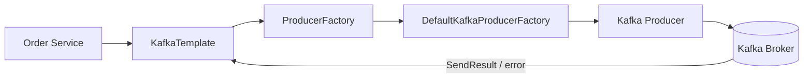

# Configuring DefaultKafkaProducerFactory

In Spring Kafka, `KafkaTemplate` is the API that the business layer typically uses to send records. Underneath the template sits a `ProducerFactory`, which is responsible for creating and managing Kafka producers. `DefaultKafkaProducerFactory` is the standard implementation provided by Spring Kafka: it receives producer configuration, creates Kafka `Producer` instances when needed, and manages the lifecycle of those producers.

Understanding how to configure the factory helps control broker addresses, serializers, send acknowledgements, retries, idempotence, batching, compression, and transactions. This is essential for a Spring Kafka application to publish events reliably under increased load or transient broker failures.

## 1. Position of DefaultKafkaProducerFactory in the send flow

A basic send flow has the following components:

1. The business service creates an event, such as `OrderCreated`.
2. The service calls `KafkaTemplate.send(...)` with the topic, key, and value.
3. `KafkaTemplate` obtains a producer from `ProducerFactory`.
4. The producer serializers convert the key/value to bytes and send the record to the broker.
5. The broker acknowledges according to the `acks` setting; the send result returns metadata such as topic, partition, and offset.



`ProducerFactory` is the abstraction that decouples `KafkaTemplate` from how producers are created. `DefaultKafkaProducerFactory` implements this abstraction using the Kafka Producer API. As a result, the application can configure the factory once and inject `KafkaTemplate` into multiple services.

| Component | Responsibility |
| --- | --- |
| `ProducerConfig` | Collection of Kafka producer configuration keys and values |
| `DefaultKafkaProducerFactory` | Creates, reuses, and closes producers according to the factory lifecycle |
| `ProducerFactory` | Spring Kafka interface that abstracts producer creation |
| `KafkaTemplate` | API for sending records, executing callbacks, and supporting other Kafka operations |
| `KafkaProducer` | Kafka client performing serialization, partitioning, batching, and sending requests to brokers |

## 2. When should you configure a factory explicitly?

When using Spring Boot with `spring-kafka`, Boot can auto-configure `ProducerFactory` and `KafkaTemplate` based on `spring.kafka.*` properties. In typical cases, declaring settings in `application.yml` is sufficient.

You create an explicit `DefaultKafkaProducerFactory` bean when you need to:

- Use a dedicated configuration set for one publishing stream, such as a topic or event type with a different serializer.
- Create multiple producer factories with different `client.id`, security, or throughput settings.
- Configure serializers in Java or supply custom serializers.
- Enable Kafka transactions with a dedicated transaction ID prefix.
- Manage producer configuration dynamically or control the producer lifecycle explicitly.

When defining a `ProducerFactory` bean, remember that Boot may back off from its corresponding auto-configuration. If the application needs multiple factories, give beans clear names and use `@Qualifier` when injecting to avoid picking the wrong factory.

## 3. Configuring the producer with application.yml

First, declare shared values in `src/main/resources/application.yml`:

```yaml
spring:
  kafka:
    bootstrap-servers: ${KAFKA_BOOTSTRAP_SERVERS:localhost:9092}
    producer:
      acks: all
      key-serializer: org.apache.kafka.common.serialization.StringSerializer
      value-serializer: org.springframework.kafka.support.serializer.JsonSerializer
      properties:
        enable.idempotence: true
        compression.type: lz4
        linger.ms: 5
        batch.size: 32768
        delivery.timeout.ms: 120000

app:
  kafka:
    topic:
      orders: orders.events
```

Properties under `spring.kafka.producer` are bound by Spring Boot into the Kafka producer configuration. When using default auto-configuration, Boot creates the factory and template based on these values.

| Property | Meaning |
| --- | --- |
| `bootstrap-servers` | Address of one or more brokers for the client to establish initial connections and fetch cluster metadata |
| `acks: all` | Producer waits for acknowledgement from in-sync replicas according to the Kafka protocol |
| `key-serializer` | Converts Java keys into bytes; for example, using `StringSerializer` |
| `value-serializer` | Converts event objects to JSON using `JsonSerializer` |
| `enable.idempotence: true` | Enables producer idempotence to prevent duplicate writes from retries within Kafka's supported guarantees |
| `compression.type: lz4` | Compresses record batches before sending |
| `linger.ms: 5` | Allows the producer up to this extra wait time to accumulate records into a batch when appropriate |
| `batch.size: 32768` | Target batch size in bytes per partition |
| `delivery.timeout.ms: 120000` | Overall time limit for the broker to acknowledge a successful send or for the producer to report failure |

The values above are starting examples and should be tuned by measuring actual throughput, latency, and record sizes. Increasing `linger.ms` can improve batching but also increases wait latency; compression reduces network bandwidth and storage footprint at the cost of CPU.

## 4. Creating DefaultKafkaProducerFactory with Java config

When you want to create the factory programmatically, you can build a Kafka configuration map and pass it to the `DefaultKafkaProducerFactory` constructor.

Note: the `application.yml` example above illustrates configuration when using Boot auto-configuration. A manually created Java map does not automatically inherit all `spring.kafka.producer.*` properties; in a custom bean, explicitly put every required property into the map or bind `KafkaProperties` and convert deliberately. The example below declares the key producer settings explicitly to show how the factory is constructed.

### 4.1. Declaring the factory and KafkaTemplate

The example below uses `String` as the key and `OrderCreated` as the value:

```java
package com.example.messaging.config;

import java.util.HashMap;
import java.util.Map;
import org.apache.kafka.clients.producer.ProducerConfig;
import org.apache.kafka.common.serialization.StringSerializer;
import org.springframework.beans.factory.annotation.Value;
import org.springframework.context.annotation.Bean;
import org.springframework.context.annotation.Configuration;
import org.springframework.kafka.core.DefaultKafkaProducerFactory;
import org.springframework.kafka.core.KafkaTemplate;
import org.springframework.kafka.core.ProducerFactory;
import org.springframework.kafka.support.serializer.JsonSerializer;
import com.example.messaging.event.OrderCreated;

@Configuration
public class KafkaProducerConfiguration {

    @Bean
    public ProducerFactory<String, OrderCreated> orderProducerFactory(
            @Value("${spring.kafka.bootstrap-servers}") String bootstrapServers
    ) {
        Map<String, Object> properties = new HashMap<>();
        properties.put(ProducerConfig.BOOTSTRAP_SERVERS_CONFIG, bootstrapServers);
        properties.put(ProducerConfig.KEY_SERIALIZER_CLASS_CONFIG, StringSerializer.class);
        properties.put(ProducerConfig.VALUE_SERIALIZER_CLASS_CONFIG, JsonSerializer.class);
        properties.put(ProducerConfig.ACKS_CONFIG, "all");
        properties.put(ProducerConfig.ENABLE_IDEMPOTENCE_CONFIG, true);
        properties.put(ProducerConfig.RETRIES_CONFIG, Integer.MAX_VALUE);
        properties.put(ProducerConfig.MAX_IN_FLIGHT_REQUESTS_PER_CONNECTION, 5);
        properties.put(ProducerConfig.COMPRESSION_TYPE_CONFIG, "lz4");
        properties.put(ProducerConfig.LINGER_MS_CONFIG, 5);
        properties.put(ProducerConfig.BATCH_SIZE_CONFIG, 32 * 1024);
        properties.put(ProducerConfig.DELIVERY_TIMEOUT_MS_CONFIG, 120_000);

        return new DefaultKafkaProducerFactory<>(properties);
    }

    @Bean
    public KafkaTemplate<String, OrderCreated> orderKafkaTemplate(
            ProducerFactory<String, OrderCreated> orderProducerFactory
    ) {
        return new KafkaTemplate<>(orderProducerFactory);
    }
}
```

In this example, the factory is declared with the `ProducerFactory<String, OrderCreated>` interface type so other components depend on the abstraction. The concrete instance created is `DefaultKafkaProducerFactory`. `KafkaTemplate` receives that factory via its constructor and uses it whenever sending records.

The constants in `ProducerConfig` help avoid typos in property names. Serializer values are specified by class, allowing the Kafka producer to instantiate the serializers from configuration. If you want to use a custom serializer, ensure the class has an appropriate constructor or provide a serializer instance/supplier according to the Spring Kafka version's API.

### 4.2. Avoiding duplicate configuration and ambiguous beans

There are two common approaches:

- Let Spring Boot create the factory from `application.yml` and only inject `KafkaTemplate`.
- Manually create `DefaultKafkaProducerFactory` via Java config as shown above.

Do not simultaneously define multiple `ProducerFactory` beans of the same type without clear names and qualifiers. When two factories are needed, you can name them `orderProducerFactory` and `auditProducerFactory`, then inject the right bean:

```java
import org.springframework.beans.factory.annotation.Qualifier;

@Bean
KafkaTemplate<String, OrderCreated> orderKafkaTemplate(
        @Qualifier("orderProducerFactory")
        ProducerFactory<String, OrderCreated> producerFactory
) {
    return new KafkaTemplate<>(producerFactory);
}
```

If you declare your own factory, verify which factory each `KafkaTemplate` bean is built from. Declaring `KafkaTemplate` explicitly prevents services from accidentally picking a default producer factory different from the one you configured.

## 5. Understanding important ProducerConfig groups

`DefaultKafkaProducerFactory` does not decide sending policy on its own. It forwards the configuration map to the Kafka producer client. Values in the map therefore carry the same meaning as standard Kafka producer configuration.

### 5.1. Broker and client identity

| Property | Purpose |
| --- | --- |
| `bootstrap.servers` | Starting point to connect and fetch broker/partition metadata |
| `client.id` | Client identifier for observing logs, metrics, and requests on the broker |
| `security.protocol` | Selects the connection protocol, such as `SASL_SSL` or `SSL` |
| `sasl.mechanism` | SASL mechanism if the cluster requires SASL authentication |
| `ssl.truststore.location` | Path to the truststore if TLS is configured with a truststore |

Do not place usernames, passwords, or private keys directly in source code. Put credentials in a secret manager or securely managed environment variables. Nor is `bootstrap.servers` the only address the producer will use permanently; after receiving metadata, the client connects to the leader broker of each target partition.

### 5.2. Serializers and data contracts

The producer must serialize keys and values into bytes before sending. The two main properties are:

- `key.serializer`: serializer for keys, such as `StringSerializer`.
- `value.serializer`: serializer for payloads, such as `JsonSerializer`, an Avro serializer, or a Protobuf serializer.

Serializers must match the types sent by `KafkaTemplate<K,V>`. For example, `KafkaTemplate<String, OrderCreated>` needs serializers capable of handling a `String` key and an `OrderCreated` value. If `StringSerializer` is configured for a value object, the producer will fail with a serialization error on send.

With `JsonSerializer`, Spring Kafka can add type information to Kafka headers. This is convenient when producer and consumer share compatible types. For independent services, design explicit schemas and type mappings; avoid coupling to internal Java class names or permitting deserialization of unnecessary packages.

### 5.3. Acknowledgements, retries, and idempotence

| Property | Role | Notes |
| --- | --- | --- |
| `acks` | Acknowledgement level requested by the producer | `0`, `1`, or `all` |
| `enable.idempotence` | Prevents duplicate records from producer retries within supported bounds | Must be compatible with `acks`, retries, and in-flight request limits |
| `retries` | Number of retry attempts for retriable errors | Usually paired with `delivery.timeout.ms` to bound total send duration |
| `delivery.timeout.ms` | Maximum time for a send to succeed or fail | Includes request wait time and retries |
| `max.in.flight.requests.per.connection` | Number of unacknowledged requests per connection | When idempotence is enabled, Kafka requires a value within the client's supported limit |

For a common safe configuration, set `acks=all` and `enable.idempotence=true`. An idempotent producer uses a producer ID and sequence numbers so the broker can recognize retries of the same record. This prevents duplicates caused by producer network retries, but does not eliminate duplicate events caused by the application calling `send()` twice or by consumer reprocessing.

Do not arbitrarily set `retries=0` if resilience against transient errors is required. Also avoid setting `delivery.timeout.ms` too low so that the producer errors out before retries have a chance to complete. In modern Kafka clients, several defaults already support idempotence; declaring them explicitly makes configuration intent easier to audit.

### 5.4. Batching, buffers, and compression

The producer groups records per partition into batches to reduce the number of requests sent to brokers. Key properties:

- `batch.size`: target batch size per partition.
- `linger.ms`: extra wait time to gather records into a batch when send rates are low.
- `buffer.memory`: memory allocated by the producer for records waiting to be sent.
- `compression.type`: batch compression codec such as `none`, `gzip`, `snappy`, `lz4`, or `zstd` depending on client version.

Increasing `batch.size` or `linger.ms` can improve throughput at higher volumes, but can increase latency and memory usage. Compression reduces network I/O and storage size at the expense of CPU for compression/decompression. Benchmark with payload sizes, partition counts, and send rates close to production.

## 6. Creating an event and sending with KafkaTemplate

Suppose the application has an event:

```java
package com.example.messaging.event;

import java.math.BigDecimal;
import java.time.Instant;

public record OrderCreated(
        String eventId,
        String orderId,
        BigDecimal total,
        Instant occurredAt
) {}
```

The publishing service uses the `KafkaTemplate` configured from the factory:

```java
package com.example.messaging.producer;

import com.example.messaging.event.OrderCreated;
import java.util.concurrent.CompletableFuture;
import org.springframework.beans.factory.annotation.Value;
import org.springframework.kafka.core.KafkaTemplate;
import org.springframework.kafka.support.SendResult;
import org.springframework.stereotype.Service;

@Service
public class OrderEventPublisher {

    private final KafkaTemplate<String, OrderCreated> kafkaTemplate;
    private final String topicName;

    public OrderEventPublisher(
            KafkaTemplate<String, OrderCreated> kafkaTemplate,
            @Value("${app.kafka.topic.orders}") String topicName
    ) {
        this.kafkaTemplate = kafkaTemplate;
        this.topicName = topicName;
    }

    public CompletableFuture<SendResult<String, OrderCreated>> publish(
            OrderCreated event
    ) {
        return kafkaTemplate.send(topicName, event.orderId(), event);
    }
}
```

`send(topic, key, value)` returns `CompletableFuture<SendResult<K,V>>` in Spring Kafka 3.x. The application can attach a callback to log the outcome:

```java
publisher.publish(event).whenComplete((result, error) -> {
    if (error != null) {
        log.error("Failed to send event {}", event.eventId(), error);
        return;
    }

    var metadata = result.getRecordMetadata();
    log.info("Sent topic={}, partition={}, offset={}",
            metadata.topic(), metadata.partition(), metadata.offset());
});
```

Do not ignore `error` in the callback. If a record fails to send, the application needs to decide whether to record the error, retry at the business layer, or return an error to the caller. Sending asynchronously does not mean a record can be considered successful immediately after calling `send()`.

## 7. Producer lifecycle managed by the factory

An important aspect of `DefaultKafkaProducerFactory` is how it reuses producers.

### 7.1. Default shared producer

With the default non-transactional configuration, the factory usually manages a single shared producer and reuses it across sends. Kafka `Producer` is thread-safe, so multiple threads can share it through `KafkaTemplate`.

When `KafkaTemplate` finishes an operation, the producer is returned to the factory through a lifecycle-managing wrapper mechanism. Closing the wrapper does not immediately close the underlying physical Kafka producer; the factory retains the producer for reuse. When the Spring context closes, the factory is destroyed and the physical producer is closed.

This means you should not create `new KafkaProducer` per request or call `close()` on a factory-managed producer. Let Spring manage the factory and template beans alongside the application context lifecycle.

### 7.2. Transactional producers and caching

When transactions are enabled, the factory needs to manage producers with distinct `transactional.id` values. You can configure a transaction ID prefix:

```java
// Replace the orderProducerFactory bean in section 4.1 with this transactional version.
@Bean
public ProducerFactory<String, OrderCreated> orderProducerFactory(
        @Value("${spring.kafka.bootstrap-servers}") String bootstrapServers,
        @Value("${app.kafka.transaction-id-prefix}") String transactionIdPrefix
) {
    Map<String, Object> properties = new HashMap<>();
    properties.put(ProducerConfig.BOOTSTRAP_SERVERS_CONFIG, bootstrapServers);
    properties.put(ProducerConfig.KEY_SERIALIZER_CLASS_CONFIG, StringSerializer.class);
    properties.put(ProducerConfig.VALUE_SERIALIZER_CLASS_CONFIG, JsonSerializer.class);
    properties.put(ProducerConfig.ACKS_CONFIG, "all");
    properties.put(ProducerConfig.ENABLE_IDEMPOTENCE_CONFIG, true);

    DefaultKafkaProducerFactory<String, OrderCreated> factory =
            new DefaultKafkaProducerFactory<>(properties);
    factory.setTransactionIdPrefix(transactionIdPrefix);
    return factory;
}
```

Declare `app.kafka.transaction-id-prefix` in the environment configuration, such as `orders-tx-local-` when running a single local instance. In production, the prefix must produce unique transactional IDs across concurrently running application instances; an instance identifier supplied by the deployment platform is commonly appended. Kafka transactions also require brokers to be configured with an appropriate transaction state log.

```yaml
app:
  kafka:
    transaction-id-prefix: ${KAFKA_TX_ID_PREFIX:orders-tx-local-}
```

Once the factory is configured with a transaction ID prefix, producers can participate in transactions via `KafkaTemplate` and the transaction manager. Example using `executeInTransaction`:

```java
kafkaTemplate.executeInTransaction(operations -> {
    operations.send("orders.events", event.orderId(), event);
    operations.send("orders.audit", event.orderId(), event);
    return null;
});
```

Both records inside the callback are sent within the same Kafka transaction. If the callback completes normally, the transaction is committed; if an exception occurs, the transaction is aborted. This is a Kafka-only transaction. If the callback also updates an external database, the Kafka transaction does not automatically make the database and Kafka a single atomic transaction.

### 7.3. Closing the factory and resetting producers

The factory manages physical producers and closes them when the factory is destroyed. Several administrative APIs are available when needed:

- `reset()`: closes current producers and clears them from the cache; new producers will be created on the next use.
- `updateConfigs(Map<String, Object>)`: updates the configuration used for producers created subsequently.
- `removeConfig(String)`: removes a configuration entry from the factory's map.

Updating configs should not be treated as hot-reloading settings inside an already running producer. If a full configuration reload is required, understand when the current producer is closed and recreated; `reset()` can disrupt in-flight sends. Perform these operations only under controlled administrative procedures.

## 8. Multiple ProducerFactory beans in one application

An application may send multiple kinds of data with different requirements. For instance, business events might require `acks=all` and JSON, while telemetry metrics might need a different serializer or `client.id`. You can declare multiple factories and templates, provided beans are clearly separated.

```java
import java.util.HashMap;
import java.util.Map;
import org.apache.kafka.clients.producer.ProducerConfig;
import org.apache.kafka.common.serialization.StringSerializer;
import org.springframework.beans.factory.annotation.Qualifier;
import org.springframework.beans.factory.annotation.Value;
import org.springframework.context.annotation.Bean;
import org.springframework.context.annotation.Configuration;
import org.springframework.kafka.core.DefaultKafkaProducerFactory;
import org.springframework.kafka.core.KafkaTemplate;
import org.springframework.kafka.core.ProducerFactory;

@Configuration
public class MultipleProducerConfiguration {

    @Bean("auditProducerFactory")
    ProducerFactory<String, String> auditProducerFactory(
            @Value("${spring.kafka.bootstrap-servers}") String bootstrapServers
    ) {
        Map<String, Object> properties = new HashMap<>();
        properties.put(ProducerConfig.BOOTSTRAP_SERVERS_CONFIG, bootstrapServers);
        properties.put(ProducerConfig.KEY_SERIALIZER_CLASS_CONFIG, StringSerializer.class);
        properties.put(ProducerConfig.VALUE_SERIALIZER_CLASS_CONFIG, StringSerializer.class);
        properties.put(ProducerConfig.ACKS_CONFIG, "all");
        properties.put(ProducerConfig.CLIENT_ID_CONFIG, "audit-publisher");
        return new DefaultKafkaProducerFactory<>(properties);
    }

    @Bean("auditKafkaTemplate")
    KafkaTemplate<String, String> auditKafkaTemplate(
            @Qualifier("auditProducerFactory")
            ProducerFactory<String, String> producerFactory
    ) {
        return new KafkaTemplate<>(producerFactory);
    }
}
```

When multiple factories exist, do not rely on Spring autowiring by generic type alone if beans share similar types. Use bean names and `@Qualifier` to make explicit which template sends through which factory. Each factory has its own producer lifecycle and configuration.

## 9. Security when configuring the producer

In production environments, producers typically must authenticate to Kafka. You can add properties such as `security.protocol`, `sasl.mechanism`, `sasl.jaas.config`, or SSL truststore/keystore settings depending on the infrastructure.

Example SASL/SSL configuration using an environment variable:

```yaml
spring:
  kafka:
    properties:
      security.protocol: SASL_SSL
      sasl.mechanism: PLAIN
      sasl.jaas.config: ${KAFKA_SASL_JAAS_CONFIG}
```

If using a custom `DefaultKafkaProducerFactory` with a manually built map, you must include the security properties in that map as well. Settings in `spring.kafka.properties.*` do not automatically flow into a custom Java map unless your code binds or copies them. This is a common pitfall where Boot auto-configuration works but a custom factory fails authentication.

Do not hardcode credentials directly in `application.yml` committed to source control. Use secret injection, restrict producer permissions per topic, and verify certificates/hostnames according to cluster security policy.

## 10. Testing ProducerFactory configuration

You can verify producer factory configuration using integration tests with embedded Kafka. The goal is to confirm the bean is created, the template sends records, and the broker receives the expected key/value. Example send-level test:

```java
import static org.assertj.core.api.Assertions.assertThat;

import com.example.messaging.event.OrderCreated;
import java.math.BigDecimal;
import java.time.Instant;
import java.util.concurrent.TimeUnit;
import org.junit.jupiter.api.Test;
import org.springframework.beans.factory.annotation.Autowired;
import org.springframework.boot.test.context.SpringBootTest;
import org.springframework.kafka.core.KafkaTemplate;
import org.springframework.kafka.test.context.EmbeddedKafka;

@SpringBootTest
@EmbeddedKafka(
        partitions = 3,
        topics = "orders.events",
        bootstrapServersProperty = "spring.kafka.bootstrap-servers"
)
class OrderProducerIntegrationTest {

    @Autowired
    KafkaTemplate<String, OrderCreated> kafkaTemplate;

    @Test
    void sendsOrderCreatedRecord() throws Exception {
        OrderCreated event = new OrderCreated(
                "evt-1001",
                "ORD-1001",
                new BigDecimal("125000.00"),
                Instant.parse("2026-11-17T02:00:00Z")
        );

        var result = kafkaTemplate.send("orders.events", event.orderId(), event)
                .get(10, TimeUnit.SECONDS);

        assertThat(result.getRecordMetadata().topic()).isEqualTo("orders.events");
        assertThat(result.getRecordMetadata().partition()).isBetween(0, 2);
    }
}
```

This test verifies the send path and broker metadata. To verify end-to-end serialization/deserialization, create a test consumer with `JsonDeserializer` and a dedicated group ID, then assert the key and event value. If the project creates topics via `NewTopic` beans, make sure the embedded broker has enough partitions and replication settings compatible with the test setup; an embedded broker typically runs a single broker and cannot create topics with a replication factor greater than the broker count.

In addition to integration tests, check startup logs to confirm the effective producer configuration, send representative test payloads, watch for serialization errors, and monitor producer metrics such as record-send-rate, record-error-rate, request-latency, and buffer-available-bytes.

## 11. Common errors when configuring DefaultKafkaProducerFactory

| Symptom | Possible cause | What to check |
| --- | --- | --- |
| Unable to create `KafkaTemplate` | No matching `ProducerFactory` or multiple ambiguous beans | Check bean types, bean names, and `@Qualifier` |
| Producer cannot connect to broker | Wrong `bootstrap.servers` or unreachable advertised listeners | Check broker addresses from the runtime environment |
| Serialization error | Key/value serializer does not match template generics | Verify `KafkaTemplate<K,V>` and serializer classes |
| Record sent but callback receives exception | Broker rejection, timeout, missing ACL, or network issue | Check root exception, broker logs, security, and delivery timeout |
| Custom factory ignores Boot settings | Manually built Java map lacks needed `spring.kafka.*` properties | Bind/copy required settings into the custom map |
| More threads do not increase throughput | Factory uses a shared producer; bottleneck may be broker, partition, network, or serializer | Measure producer and broker metrics before adding factories |
| Transaction ID fenced | Duplicate prefix/transactional ID across instances or stale active producer | Ensure unique prefix/IDs and manage instance lifecycles |
| Producer buffer exhausted | Slow broker, buffer too small, or producer sending faster than transmission capacity | Monitor buffer-available-bytes, request latency, and backpressure |

## 12. Checklist for configuring a new producer

When adding a producer to a Spring Kafka application, proceed in order:

1. Determine the key/value types and the event contract to send.
2. Choose corresponding serializers; verify how consumers deserialize and manage schemas.
3. Identify brokers, security protocol, credentials, and topic write permissions.
4. Choose `acks`, idempotence, and retries according to data durability requirements.
5. Choose batching, compression, and buffering based on real load; do not tune by guesswork alone.
6. Create `DefaultKafkaProducerFactory` when custom configuration is required; for standard setups, prefer Boot auto-configuration.
7. Build `KafkaTemplate` from the right factory and inject it explicitly into services.
8. Verify asynchronous results, log metadata, and handle send failures.
9. Test against a broker and observe metrics before production deployment.

`DefaultKafkaProducerFactory` is where producer configuration meets the Kafka producer lifecycle. When the factory is configured properly and `KafkaTemplate` uses the right factory, the application gains a clear control point for serializers, durability, performance, security, and transactions. Those decisions should be grounded in the event stream's requirements and actual operational metrics.

## 13. Self-check

1. How do `ProducerFactory` and `KafkaTemplate` differ in responsibility?
2. When can Spring Boot auto-create `DefaultKafkaProducerFactory`, and when should you declare a factory explicitly?
3. Why must serializers in the factory match the key/value types of `KafkaTemplate`?
4. How do `acks=all` and `enable.idempotence=true` support delivery reliability? Which types of duplicates do they not prevent?
5. How do `linger.ms`, `batch.size`, and `compression.type` affect throughput, latency, and CPU?
6. Why can the default shared producer serve multiple threads?
7. When defining multiple `ProducerFactory` beans, why are bean names and `@Qualifier` needed?
8. What role does `transactionIdPrefix` play and why must it be unique across instances?
9. If configuration changes while the application is running, why must you consider existing producers and the `reset()` operation?
