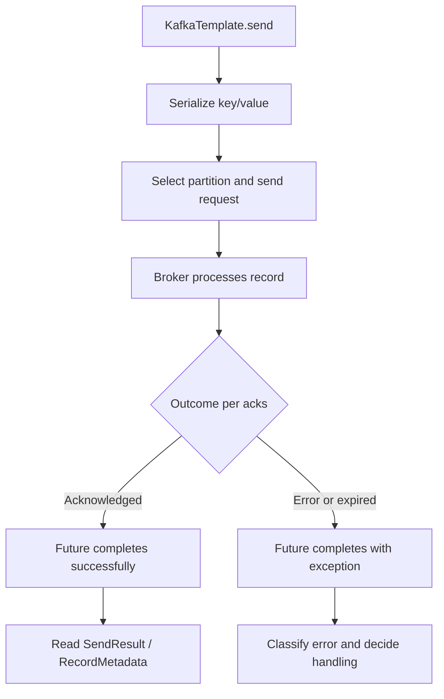

# Handling Success and Failure Results

When calling `KafkaTemplate.send(...)`, the application does not immediately know whether Kafka accepted the record. Spring Kafka sends records asynchronously and returns a future so the application can observe the outcome. On success, the future yields a `SendResult` containing record metadata; on failure, the future completes with an exception.

Properly handling send outcomes helps the application verify records reached Kafka, catch configuration or broker errors, respond appropriately to callers, and avoid creating duplicate records on retry. Keep in mind that **successfully sending to the broker does not mean the consumer has finished processing the business logic**.

## 1. Lifecycle of a send operation

Given a call:

```java
CompletableFuture<SendResult<String, OrderCreated>> future =
    kafkaTemplate.send("order-events", orderId, event);
```

High-level execution flow:

1. Spring Kafka passes the record to the Kafka producer.
2. The producer serializes key and value, determines the partition, and adds the record to a send batch.
3. The Kafka client sends the request to the partition's leader broker.
4. The broker processes the record and responds according to the `acks` configuration.
5. The future completes normally with `SendResult`, or completes exceptionally with an error.



The `send` call is asynchronous with respect to waiting for broker acknowledgement, though it is not guaranteed to be strictly non-blocking. The Kafka client may block waiting for metadata or buffer space up to configured limits such as `max.block.ms`. Therefore, still configure reasonable timeouts and avoid calling the producer from threads with strict latency budgets without evaluating the impact.

In Spring Kafka 3.x, `KafkaTemplate.send(...)` returns `CompletableFuture<SendResult<K, V>>`. Older Spring Kafka versions may use `ListenableFuture`; verify the API against your project's actual version.

## 2. Success outcome: SendResult and RecordMetadata

When the broker acknowledges the send per producer configuration, the future returns `SendResult<K, V>`. This object provides access to the original record and the metadata returned by Kafka.

Commonly used properties on `RecordMetadata`:

| Property | Meaning |
|---|---|
| `topic()` | Topic that received the record |
| `partition()` | Partition storing the record |
| `offset()` | Record position within the partition |
| `timestamp()` | Record timestamp per topic/broker configuration |
| `serializedKeySize()` | Key size after serialization |
| `serializedValueSize()` | Value size after serialization |

Example result handling:

```java
kafkaTemplate.send("order-events", event.orderId(), event)
    .whenComplete((result, exception) -> {
        if (exception != null) {
            log.error("Publish order event failed", exception);
            return;
        }

        RecordMetadata metadata = result.getRecordMetadata();

        log.info(
            "Published event: topic={}, partition={}, offset={}",
            metadata.topic(),
            metadata.partition(),
            metadata.offset()
        );
    });
```

A successful outcome indicates the producer received acknowledgement according to the configured `acks`. For instance:

- `acks=0`: the producer does not wait for broker acknowledgement; this outcome cannot be treated as proof the broker persisted the record.
- `acks=1`: the leader acknowledges after writing the record to its own log.
- `acks=all`: the leader waits for in-sync replicas (ISR) to acknowledge per Kafka rules and `min.insync.replicas`.

Thus, the operational meaning of "send succeeded" depends on `acks`. For critical business data, consider `acks=all`, appropriate replication, and `min.insync.replicas` configuration.

Even with `acks=all`, this result does not prove a consumer has read, deserialized, or completed business processing. Those are separate stages that must be observed and verified on the consumer side.

## 3. Asynchronous handling with CompletableFuture

### Using whenComplete to observe both branches

`whenComplete` receives the result and exception when the future completes. It is well suited for logging, metrics, or updating observability state:

```java
CompletableFuture<SendResult<String, OrderCreated>> future =
    kafkaTemplate.send("order-events", event.orderId(), event);

future.whenComplete((result, exception) -> {
    if (exception != null) {
        log.error("Cannot publish order event", exception);
        return;
    }

    RecordMetadata metadata = result.getRecordMetadata();
    log.debug(
        "Kafka accepted order event at {}-{}-{}",
        metadata.topic(),
        metadata.partition(),
        metadata.offset()
    );
});
```

`whenComplete` returns a new future. If the callback only observes and throws no exception, the original outcome is preserved. If the callback throws an exception, the dependent future can complete exceptionally; keep callbacks short, reliable, and free of fragile logic.

### Chaining the next step with thenApply

When you need to transform the send result into another value, use `thenApply`:

```java
CompletableFuture<String> locationFuture =
    kafkaTemplate.send("order-events", event.orderId(), event)
        .thenApply(result -> {
            RecordMetadata metadata = result.getRecordMetadata();

            return metadata.topic()
                + "-" + metadata.partition()
                + "-" + metadata.offset();
        });
```

If sending fails, the function in `thenApply` does not execute; the error propagates down to the resulting future.

### Using exceptionally when a recovery path exists

`exceptionally` converts an error into a fallback value:

```java
CompletableFuture<SendResult<String, OrderCreated>> recovered =
    kafkaTemplate.send("order-events", event.orderId(), event)
        .exceptionally(exception -> {
            log.error("Publish failed", exception);
            return null;
        });
```

This example is only appropriate if the method contract permits returning `null` and the caller knows how to handle it. In critical business flows, returning `null` can mask dropped events. Usually it is better to let the error propagate or map it into a result type that explicitly represents a failed state.

### Using handle to normalize both branches

`handle` receives both the result and exception, producing a new result:

```java
CompletableFuture<PublishOutcome> outcomeFuture =
    kafkaTemplate.send("order-events", event.orderId(), event)
        .handle((result, exception) -> {
            if (exception != null) {
                return PublishOutcome.failed(exception);
            }

            RecordMetadata metadata = result.getRecordMetadata();
            return PublishOutcome.sent(
                metadata.topic(),
                metadata.partition(),
                metadata.offset()
            );
        });
```

`PublishOutcome` is an application-defined type, such as a sealed interface or record with status fields. This works well when callers prefer an explicit business outcome rather than handling exceptional futures directly.

Do not use `exceptionally` or `handle` to turn all errors into fake "successes." If the system accepts a fallback such as writing to an outbox or internal queue, that fallback state must be explicitly represented and paired with follow-up processing.

## 4. Encapsulating result handling in a publisher

Outcome-observation logic can live in a shared publisher so services do not repeat callback wiring and metadata logging everywhere.

```java
@Service
@Slf4j
public class OrderEventPublisher {

    private static final String TOPIC = "order-events";

    private final KafkaTemplate<String, OrderCreated> kafkaTemplate;

    public OrderEventPublisher(
            KafkaTemplate<String, OrderCreated> kafkaTemplate) {
        this.kafkaTemplate = kafkaTemplate;
    }

    public CompletableFuture<SendResult<String, OrderCreated>> publish(
            OrderCreated event) {

        try {
            return kafkaTemplate
                .send(TOPIC, event.orderId(), event)
                .whenComplete((result, exception) -> {
                    if (exception != null) {
                        log.error(
                            "Cannot publish order event, orderId={}",
                            event.orderId(),
                            exception
                        );
                        return;
                    }

                    RecordMetadata metadata = result.getRecordMetadata();
                    log.info(
                        "Order event published: orderId={}, partition={}, offset={}",
                        event.orderId(),
                        metadata.partition(),
                        metadata.offset()
                    );
                });
        } catch (RuntimeException exception) {
            // Handle error occurring immediately during send call.
            log.error(
                "Cannot start publishing order event, orderId={}",
                event.orderId(),
                exception
            );
            throw exception;
        }
    }
}
```

The example uses Lombok's `@Slf4j`; if the project does not use Lombok, declare a logger using your existing logging setup. The `try/catch` block wraps the call to catch errors raised immediately while initiating the send. Errors occurring afterward are handled in the future callback.

Avoid heavy work inside callbacks, such as external HTTP calls, slow database queries, or waiting on another future. Callbacks may run on the producer's completion thread; heavy processing can stall other callbacks. If follow-up work is needed, offload it to a managed executor or coordinate it in the application layer with explicit concurrency bounds.

## 5. Waiting synchronously when truly necessary

Some flows must know the send result before proceeding, such as command-line tools, migrations, or an integration test step. You can use `get(timeout, unit)`:

```java
try {
    SendResult<String, OrderCreated> result =
        kafkaTemplate
            .send("order-events", event.orderId(), event)
            .get(10, TimeUnit.SECONDS);

    RecordMetadata metadata = result.getRecordMetadata();

    log.info(
        "Published to partition={}, offset={}",
        metadata.partition(),
        metadata.offset()
    );

} catch (InterruptedException exception) {
    Thread.currentThread().interrupt();
    throw new IllegalStateException(
        "Interrupted while waiting for Kafka acknowledgement",
        exception
    );

} catch (ExecutionException exception) {
    throw new IllegalStateException(
        "Kafka send failed",
        exception.getCause()
    );

} catch (TimeoutException exception) {
    throw new IllegalStateException(
        "Timed out while waiting for Kafka send result",
        exception
    );
}
```

Distinguish the three cases:

- `InterruptedException`: the waiting thread was interrupted. Restore the interrupt flag with `Thread.currentThread().interrupt()` and propagate or terminate per policy.
- `ExecutionException`: the future completed with an error. Inspect `getCause()` to classify the root cause.
- `TimeoutException`: the wait time of the `get` call expired. It does not prove the record was not sent and does not automatically cancel the ongoing send.

You can use `join()` instead of `get()`, though `join` throws `CompletionException` rather than checked exceptions and provides no built-in timeout. Do not call `join()` on request threads or listener threads just to turn an async operation synchronous without assessing latency and throughput impact.

### Future timeout vs. producer timeout

Distinguish application-side waiting timeouts from Kafka producer timeouts:

- `future.get(10, SECONDS)` bounds how long the caller waits.
- `request.timeout.ms` bounds how long the client waits for a broker request response.
- `delivery.timeout.ms` bounds total time the producer spends attempting to send a record, including retry waits.
- `max.block.ms` bounds how long producer calls can block waiting for metadata or buffer space in certain situations.

If `get` times out, the underlying future can still complete later. Do not immediately resend the same event as if the first attempt definitely never reached Kafka.

## 6. Classifying Kafka send errors

Not all errors should be retried the same way. Classify them by recoverability and outcome certainty.

| Error category | Examples | Handling approach |
|---|---|---|
| Serialization | `SerializationException`, mismatched data type | Fix schema/serializer; do not retry as-is |
| Configuration or authorization | `InvalidTopicException`, `TopicAuthorizationException`, `ClusterAuthorizationException` | Fix topic, ACLs, or security configuration |
| Record size | `RecordTooLargeException` | Reduce payload or adjust limits on producer/broker/topic appropriately |
| Transient broker | Leader not ready, insufficient replicas, network glitch | Let the producer retry per config; monitor timeouts |
| Timeout | `org.apache.kafka.common.errors.TimeoutException` from Kafka client or `java.util.concurrent.TimeoutException` from `future.get(timeout, unit)` | Check broker, network, metadata, and possibility that the record was written |
| Producer state | `ProducerFencedException`, sequence error | Check transactional ID, producer lifecycle, and idempotence config |

Specific exception classes may be wrapped inside other exceptions. When handling futures, inspect the root cause rather than checking only the outermost class.

Example common unwrapping helper:

```java
private Throwable unwrap(Throwable exception) {
    Throwable current = exception;

    while ((current instanceof CompletionException
            || current instanceof ExecutionException)
            && current.getCause() != null) {
        current = current.getCause();
    }

    return current;
}
```

This helper handles standard Java future wrappers. For Spring Kafka or Kafka client exceptions, inspect the cause chain and failed record details if available.

### Errors can occur immediately or after sending

Some errors are detected right while building/sending the record, such as unserializable data or the producer failing to fetch metadata within the wait limit. Other errors appear only after the request was sent, when the broker responds or retries expire.

Therefore, a publisher should have two layers of handling:

1. `try/catch` around `KafkaTemplate.send` to catch synchronous failures.
2. Callback/future handlers to process asynchronous outcomes.

Do not wrap only the callback while ignoring synchronous exceptions; nor should you assume `send` returning a future guarantees the record was queued on the broker.

## 7. Retries: Kafka client retries vs. application retries

The Kafka producer has internal retry logic for errors deemed retriable. The producer can resend requests within the budget allowed by `delivery.timeout.ms`. With idempotence enabled, Kafka can recognize retries within the same producer session to avoid duplicate writes caused by internal retries.

Example Spring Boot configuration:

```yaml
spring:
  kafka:
    producer:
      acks: all
      retries: 2147483647
      properties:
        enable.idempotence: true
        request.timeout.ms: 30000
        delivery.timeout.ms: 120000
```

Values are illustrative examples only. Choose timeouts based on SLAs, network latency, broker recovery times, and system request limits. `delivery.timeout.ms` must be configured consistently with `request.timeout.ms` and `linger.ms`. Idempotence requires `acks=all`, retries greater than 0, and `max.in.flight.requests.per.connection` no greater than 5. Modern Kafka clients typically select compatible defaults when idempotence is enabled; if overriding manually, verify settings against your client version.

**Producer internal retries** differ from **application retries that call `send` again**:

- Internal retries reuse the same producer state and sequence numbers to support idempotence.
- An application calling `send` again generally creates a new record from the producer's perspective. If the first attempt was written by the broker but the acknowledgement was lost, the second send can create a duplicate record.
- Idempotence is not a business-level deduplication mechanism across application restarts or independent producer instances.

If application-layer retries are needed, use a stable event ID and design idempotent consumers. When event emission must remain consistent with database updates, consider Transactional Outbox: write business changes and the outbox event in the same database transaction, then have a publisher forward outbox rows to Kafka and mark them published via a recoverable workflow.

Never retry indefinitely at the application layer without backoff, retry limits, monitoring, and a stop policy. A configuration or serialization error will not resolve itself through repeated retries.

## 8. Timeouts and uncertain outcomes

One of the trickiest scenarios is when the producer times out without knowing for sure whether the broker wrote the record. For example:

1. The producer sends a record to the broker.
2. The broker writes the record successfully.
3. The response is lost on the network or the producer does not receive it before timing out.
4. The future completes with a timeout error.
5. The application resends the record assuming the first attempt failed.

In this scenario, Kafka may now store both the first record and the resend if the application-triggered retry is not deduplicated.

Therefore, when encountering a timeout:

- Do not conclude the record definitely does not exist.
- Log the event ID or business key for investigation.
- Let internal producer retries operate within `delivery.timeout.ms` before surfacing errors to the application.
- If the application must resend, use an idempotency key and consumer-side deduplication.
- If event emission must align tightly with database state, consider the Outbox pattern.

Kafka keys handle routing and per-partition ordering; keys do not prevent duplicate records.

## 9. Logging and metrics for send outcomes

Logs should answer three questions: which event was sent, where was it sent, and if it failed, what caused it?

Useful details typically include:

- Event ID or correlation ID.
- Topic and key (masked/encoded if sensitive).
- Partition and offset on success.
- Exception class and cause on failure.
- Elapsed time from `send` call to future completion.

Example success log:

```text
Published eventId=evt-1001 topic=order-events partition=2 offset=815
```

Example failure log:

```text
Publish failed eventId=evt-1001 topic=order-events cause=TimeoutException
```

Do not log full payloads or credentials if they contain personal data, tokens, or secrets. Choose appropriate log levels to avoid log flooding at high throughput.

Monitor aggregate metrics as well:

| Metric | Purpose |
|---|---|
| Successful record send count | Measure producer throughput |
| Failed record send count | Detect delivery failures |
| Send latency | Detect slow brokers or network |
| Retry and error rate | Detect cluster instability |
| Timeout count | Spot uncertain send outcomes |
| Buffer exhaustion / wait time | Detect when producer cannot keep up with load |

You can use Kafka client metrics and Micrometer/Actuator depending on system setup. Avoid high-cardinality metric tags such as event IDs or record keys; those belong in logs or traces.

## 10. Testing success and failure branches

A publisher needs tests for both paths. Unit tests can mock `KafkaTemplate` to verify response logic without a broker.

### Testing the success branch

```java
import java.math.BigDecimal;
import java.time.Instant;
import java.util.concurrent.CompletableFuture;

import org.apache.kafka.clients.producer.RecordMetadata;
import org.apache.kafka.common.KafkaException;
import org.junit.jupiter.api.Test;
import org.junit.jupiter.api.extension.ExtendWith;
import org.mockito.InjectMocks;
import org.mockito.Mock;
import org.mockito.junit.jupiter.MockitoExtension;
import org.springframework.kafka.core.KafkaTemplate;
import org.springframework.kafka.support.SendResult;

import static org.assertj.core.api.Assertions.assertThat;
import static org.assertj.core.api.Assertions.assertThatThrownBy;
import static org.mockito.Mockito.mock;
import static org.mockito.Mockito.when;

@ExtendWith(MockitoExtension.class)
class OrderEventPublisherTest {

    @Mock
    private KafkaTemplate<String, OrderCreated> kafkaTemplate;

    @InjectMocks
    private OrderEventPublisher publisher;

    @Test
    void returnsSuccessfulSendResult() {
        OrderCreated event = new OrderCreated(
            "order-42", "customer-9", new BigDecimal("10.00"), Instant.now()
        );
        SendResult<String, OrderCreated> sendResult =
            mock(SendResult.class);
        RecordMetadata metadata = mock(RecordMetadata.class);
        when(sendResult.getRecordMetadata()).thenReturn(metadata);
        when(metadata.topic()).thenReturn("order-events");
        when(metadata.partition()).thenReturn(0);
        when(metadata.offset()).thenReturn(10L);

        CompletableFuture<SendResult<String, OrderCreated>> completed =
            CompletableFuture.completedFuture(sendResult);

        when(kafkaTemplate.send("order-events", "order-42", event))
            .thenReturn(completed);

        CompletableFuture<SendResult<String, OrderCreated>> result =
            publisher.publish(event);

        assertThat(result.isDone()).isTrue();
        assertThat(result.join()).isSameAs(sendResult);
    }

    @Test
    void exposesSendFailure() {
        OrderCreated event = new OrderCreated(
            "order-42", "customer-9", new BigDecimal("10.00"), Instant.now()
        );

        CompletableFuture<SendResult<String, OrderCreated>> failed =
            new CompletableFuture<>();
        failed.completeExceptionally(
            new KafkaException("Broker is unavailable")
        );

        when(kafkaTemplate.send("order-events", "order-42", event))
            .thenReturn(failed);

        assertThatThrownBy(() -> publisher.publish(event).join())
            .hasCauseInstanceOf(KafkaException.class);
    }
}
```

In the success test, metadata is mocked because the publisher reads partition and offset in its callback. The failure test completes the future exceptionally and verifies that the error still propagates to the caller after the callback runs. Both tests share the `OrderCreated`, `kafkaTemplate`, and `publisher` fixtures; you can add log/metric assertions with a logging test utility if that is a contract you need to enforce.

### Integration testing with Embedded Kafka

Unit tests do not verify that a broker actually receives the record. Integration tests with Embedded Kafka can verify:

1. Sending a record via `KafkaTemplate`.
2. Waiting for the future to complete within a finite timeout.
3. Inspecting topic, partition, and offset from `SendResult`.
4. Reading the record with a consumer and comparing key/value.
5. Testing serializer/deserializer configuration and behavior when a topic or broker is unavailable if reproducibly testable.

Do not use fixed `Thread.sleep()` calls to wait for records. Use bounded polling, Awaitility, or an appropriate synchronization primitive.

## 11. Common issues

| Symptom | Possible cause | Resolution |
|---|---|---|
| `send` returns a future but no success log appears | Future not yet completed or callback attached improperly | Observe the future, set timeouts, and check callbacks |
| Future completes exceptionally | Broker, ACL, topic, serialization, or timeout issue | Unwrap the cause and classify the error |
| `get` times out yet the record still appears | Broker wrote the record but acknowledgement arrived late or was lost | Treat as uncertain outcome; avoid blind resends |
| Resending creates duplicate records | Application-layer retry after timeout | Use event IDs, idempotent consumers, or Outbox |
| Producer sends slowly | Slow broker, batch/buffer sizing, metadata, or network | Inspect send latency, buffer metrics, and client metrics |
| Success logged yet consumer has not seen event | Success only confirms per `acks`; consumer may lag or read wrong group/topic | Check topic, partition, consumer group, and offsets |
| Callback slows down producer | Callback performs I/O or heavy logic | Offload work to a separate executor |
| Serialization error | Object type does not match serializer | Check generic types and serializer settings |

## 12. Implementation checklist

Before putting a publisher into production, confirm:

- Futures returned by `KafkaTemplate.send` are observed and exceptions are never ignored.
- Success paths record topic, partition, and offset when tracing is needed.
- Error paths classify root causes and do not retry permanent errors.
- `acks`, idempotence, retries, and timeouts match data durability requirements.
- Caller timeouts are not mistaken for proof that a record was never sent.
- Application-layer retries carry event IDs and deduplication mechanisms.
- Callbacks do not perform heavy work or block producer threads.
- Logs exclude sensitive payloads and credentials.
- Metrics track send latency, error rate, and timeouts.
- Integration tests verify the producer sends real records to a broker.

## 13. Key takeaways

- `KafkaTemplate.send` returns a future to track asynchronous send results.
- Success yields `SendResult`; `RecordMetadata` reveals topic, partition, offset, and timestamp.
- The meaning of a success acknowledgement depends on `acks`; it does not prove a consumer processed the event.
- `whenComplete`, `thenApply`, `exceptionally`, and `handle` serve different future-handling needs.
- `get(timeout)` can throw `TimeoutException`; a wait timeout does not prove the broker did not write the record.
- Internal Kafka producer retries differ from the application calling `send` again.
- Idempotent producers prevent duplicates from internal retries; event IDs and consumer idempotency handle business-level duplicates.
- Observe success, failure, latency, and timeouts to operate producers reliably.

A well-built publisher does more than send records: it makes send outcomes explicit, keeps failures observable, and gives the business layer enough information to continue, retry, or recover safely.

