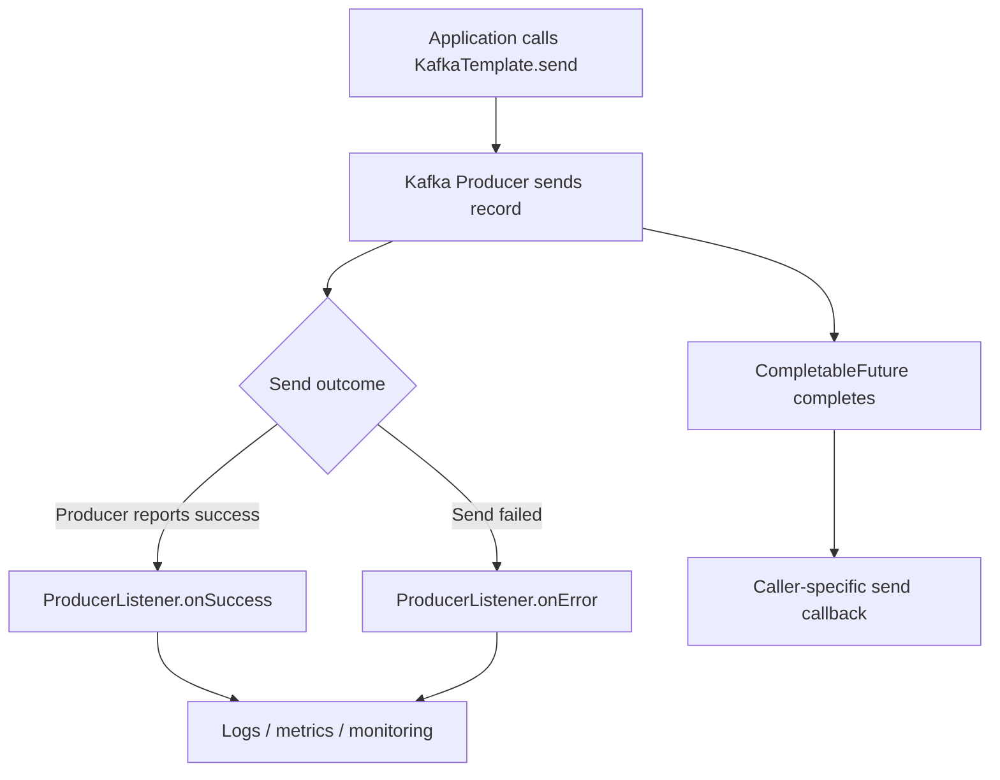

# Customizing ProducerListener

`KafkaTemplate.send(...)` returns a `CompletableFuture<SendResult<K, V>>` so callers can track the result of each individual send. When you need a centralized observation point for all records sent through a template, Spring Kafka provides **`ProducerListener<K, V>`**.

`ProducerListener` receives callbacks when the producer completes a send successfully or with an error. Applications can use these callbacks to log, update metrics, collect metadata, or emit signals to monitoring systems. Because the listener is attached to `KafkaTemplate`, the same policy applies across many `send` call sites without repeating callbacks in every business method.

## 1. How does ProducerListener work?

`ProducerListener<K, V>` is a Spring Kafka interface with two main callbacks:

| Callback | When invoked | Data received |
|---|---|---|
| `onSuccess(record, metadata)` | The producer completes a send successfully per configured acknowledgement (`acks`). | The actual sent record and `RecordMetadata` such as topic, partition, offset, and timestamp. |
| `onError(record, metadata, exception)` | The send ends with an error. | The failed record, metadata (which may be incomplete or `null`), and the exception. |

Methods in the modern interface provide empty default implementations. You only override the callbacks your application cares about. By default, Spring Kafka configures `LoggingProducerListener`, which logs errors and does nothing on success.

The flow can be visualized as follows:



`ProducerListener` is a template-wide shared callback. `CompletableFuture` is the per-call outcome of `send`. Both observe the same send operation but serve different needs.

## 2. Writing a custom ProducerListener

The example below records topic, key, partition, and offset on success; on failure, the listener logs the exception and partition if metadata is available.

```java
import org.apache.kafka.clients.producer.ProducerRecord;
import org.apache.kafka.clients.producer.RecordMetadata;
import org.slf4j.Logger;
import org.slf4j.LoggerFactory;
import org.springframework.kafka.support.ProducerListener;
import org.springframework.stereotype.Component;

@Component
public class KafkaSendObserver implements ProducerListener<Object, Object> {

    private static final Logger log =
            LoggerFactory.getLogger(KafkaSendObserver.class);

    @Override
    public void onSuccess(
            ProducerRecord<Object, Object> record,
            RecordMetadata metadata) {

        log.debug(
                "Kafka send succeeded: topic={}, partition={}, offset={}, key={}",
                metadata.topic(),
                metadata.partition(),
                metadata.offset(),
                record.key()
        );
    }

    @Override
    public void onError(
            ProducerRecord<Object, Object> record,
            RecordMetadata metadata,
            Exception exception) {

        Integer partition = metadata == null ? null : metadata.partition();

        log.error(
                "Kafka send failed: topic={}, partition={}, key={}",
                record.topic(),
                partition,
                record.key(),
                exception
        );
    }
}
```

In this example:

- `onSuccess` is called when the producer completes a send successfully per `acks`. With `acks=1` or `acks=all`, the broker sends the corresponding acknowledgement; with `acks=0`, the producer does not wait for broker acknowledgement. `RecordMetadata` shows the metadata the producer received for the send.
- `onError` receives the failed record along with the exception. On error, `metadata` may be `null` or only partially populated, so check for null before accessing it.
- The listener uses generics `Object, Object` so it can observe diverse key/value types on a Spring Boot auto-configured `KafkaTemplate`.
- Success is logged at `debug` level to avoid excessive log volume in high-throughput systems. Do not log full payloads if payloads may contain sensitive data or be very large.

## 3. Registering the listener in Spring Boot

When using Spring Boot Kafka auto-configuration, you can register a custom `ProducerListener` bean. Auto-configuration wires this bean into the auto-configured `KafkaTemplate`. If no custom bean is present, Spring Boot supplies the default `LoggingProducerListener`.

For example, `KafkaSendObserver` above is annotated with `@Component`, so Spring registers it as a bean automatically. There is no need to manually create another `KafkaTemplate` just to attach the listener. Ensure the application has a single matching `ProducerListener` bean or specify `@Primary`/`@Qualifier` when intentionally configuring multiple listeners.

In a Spring Boot application with the default `KafkaTemplate`, you can use it directly:

```java
import org.springframework.kafka.core.KafkaTemplate;
import org.springframework.stereotype.Service;

@Service
public class OrderPublisher {

    private final KafkaTemplate<String, OrderCreatedEvent> kafkaTemplate;

    public OrderPublisher(KafkaTemplate<String, OrderCreatedEvent> kafkaTemplate) {
        this.kafkaTemplate = kafkaTemplate;
    }

    public void publish(String orderId, OrderCreatedEvent event) {
        kafkaTemplate.send("orders.events", orderId, event);
    }
}
```

In real applications, you can inject the template with narrowed generic types matching your producer factory, such as `KafkaTemplate<String, OrderCreatedEvent>`. Generic types do not change how the listener receives callbacks; the listener bean used by Boot auto-configuration can be declared as `ProducerListener<Object, Object>` to observe various record types.

## 4. Attaching a listener when creating KafkaTemplate manually

If the application does not use Spring Boot auto-configuration or defines multiple `KafkaTemplate` beans manually, attach the listener directly via `setProducerListener(...)`:

```java
import org.springframework.context.annotation.Bean;
import org.springframework.context.annotation.Configuration;
import org.springframework.kafka.core.KafkaTemplate;
import org.springframework.kafka.core.ProducerFactory;
import org.springframework.kafka.support.ProducerListener;

@Configuration
public class OrderKafkaConfiguration {

    @Bean
    KafkaTemplate<String, OrderCreatedEvent> orderKafkaTemplate(
            ProducerFactory<String, OrderCreatedEvent> producerFactory,
            ProducerListener<String, OrderCreatedEvent> orderProducerListener) {

        KafkaTemplate<String, OrderCreatedEvent> template =
                new KafkaTemplate<>(producerFactory);

        template.setProducerListener(orderProducerListener);
        return template;
    }
}
```

In this case, `orderProducerListener` is a bean of type `ProducerListener<String, OrderCreatedEvent>`. The template uses only the listener attached to it. If the application has multiple templates, each can have its own listener or share one compatible with its generic types.

Do not simultaneously replace Spring Boot's `ProducerListener` bean and define a custom `KafkaTemplate` without checking auto-configuration conditions. Once you declare a `KafkaTemplate` bean manually, Boot typically backs off from creating the default template; you must attach the listener to your template yourself.

## 5. How do ProducerListener and CompletableFuture differ?

Both mechanisms receive send outcomes, but they have different scopes:

| Criterion | `ProducerListener` | `CompletableFuture<SendResult<K, V>>` |
|---|---|---|
| Scope | Shared across sends through the configured template. | Specific to each `send` invocation. |
| Registration | Attached to `KafkaTemplate` or registered as a bean for auto-configuration. | Calling `whenComplete`, `thenApply`, or `exceptionally` on the returned future. |
| Best suited for | Centralized logging, metrics, monitoring, and cross-cutting observation. | Caller-specific business logic, combining results, or returning status to callers. |
| Result data | Record, metadata, and exception. | `SendResult` or the exception completing the future. |

Example combining the future with a listener:

```java
kafkaTemplate.send("orders.events", event.orderId(), event)
        .whenComplete((result, exception) -> {
            if (exception != null) {
                // Handle outcome for this specific business flow.
                notifyPublishFailure(event.orderId(), exception);
                return;
            }

            // Handle success outcome specifically for this send.
            notifyPublishAccepted(event.orderId(), result.getRecordMetadata());
        });
```

When both mechanisms are configured, a single send can trigger `ProducerListener` and complete the future. Avoid placing the same business action in both places, as that can emit notifications or record state twice.

## 6. Do's and don'ts inside callbacks

`ProducerListener` acts as a stateless delegate for Kafka producer callbacks. Callbacks typically execute on the producer's callback/I/O thread, so keep processing brief and avoid blocking the send thread.

Do:

- Log contextual details such as topic, key, partition, offset, and exception.
- Increment counters or record timers using a thread-safe metrics library.
- Attach correlation/trace information to logs for tracing send flows.
- Offload auxiliary work to a dedicated executor/queue if longer processing is truly needed, with bounded load and a queue-full policy.

Avoid:

- Making HTTP calls, database queries, or waiting on slow I/O directly inside the callback.
- Calling `get()` to wait on another future or performing synchronous `flush()`/`close()` inside the callback.
- Holding non-thread-safe mutable state in a singleton listener.
- Immediately resending records inside `onError` without a retry policy, idempotency, and attempt limits.
- Using the callback as the sole place to persist critical business audit records. The process could stop after broker acknowledgement but before the callback finishes external side effects.

If retries are needed, configure Kafka producer retries and `delivery.timeout.ms` for retriable errors. `ProducerListener` only observes the final outcome of a send attempt; it does not replace producer retries and does not decide whether the broker writes a record.

## 7. Handling metadata and errors safely

On success, `RecordMetadata` contains topic, partition, offset, and timestamp. These values can correlate producer logs with consumer logs.

On failure, metadata may be incomplete. If a partition was not yet resolved, metadata may contain `UNKNOWN_PARTITION`; the offset is not a valid position of a persisted record. Never assume `metadata` is always non-null in `onError`.

Some errors can happen synchronously before the Kafka producer callback is invoked, such as errors while preparing a send or when the producer is already closed. Always handle the future returned by `KafkaTemplate.send(...)` or catch synchronous exceptions at the call site. Do not treat `ProducerListener` as the sole mechanism for catching all `send` errors.

Additionally, an error callback does not prove the broker definitely did not write the record during timeouts or connection drops. When the producer receives no acknowledgement, the outcome may be ambiguous on the application side. Designing idempotent consumers and using stable event IDs makes resending safe.

### Signature differences across versions

Examples in this lesson use `onError(ProducerRecord, RecordMetadata, Exception)`, introduced in Spring Kafka 2.6.2. Older versions have different callback signatures, such as `onError(ProducerRecord, Exception)` or overloads taking individual topic/partition/key/value fields. Some older APIs also included `isInterestedInSuccess()`; with the modern interface, simply override `onSuccess(...)` if you want success callbacks. The return type of `KafkaTemplate.send` also changed across versions: Spring Kafka 3.x and above return `CompletableFuture`, whereas 2.x returned `ListenableFuture`. Verify the Javadoc for the exact Spring Kafka version used by your project before copying signatures or future types.

## 8. Testing ProducerListener

Test both success and error callbacks. For integration tests using a real broker or Embedded Kafka, use `CountDownLatch` to await callbacks instead of `Thread.sleep`:

```java
import java.util.concurrent.CountDownLatch;
import java.util.concurrent.TimeUnit;

import org.apache.kafka.clients.producer.ProducerRecord;
import org.apache.kafka.clients.producer.RecordMetadata;
import org.springframework.kafka.core.KafkaTemplate;
import org.springframework.kafka.support.ProducerListener;

import static org.assertj.core.api.Assertions.assertThat;

CountDownLatch successLatch = new CountDownLatch(1);

ProducerListener<Object, Object> listener = new ProducerListener<>() {
    @Override
    public void onSuccess(
            ProducerRecord<Object, Object> record,
            RecordMetadata metadata) {
        successLatch.countDown();
    }
};

// producerFactory is the ProducerFactory provided by the test fixture.
KafkaTemplate<Object, Object> template = new KafkaTemplate<>(producerFactory);
template.setProducerListener(listener);
template.send("test-topic", "O100", "payload");

// Wait for the success callback; do not use Thread.sleep.
assertThat(successLatch.await(10, TimeUnit.SECONDS)).isTrue();
```

This snippet illustrates waiting for the callback; in a complete test, configure the listener on `KafkaTemplate` before sending, initialize the latch per test, and close broker resources afterward. For the failure branch, configure a broker/topic or producer to trigger a controlled failure and assert the exception and record passed to `onError`.

Points to verify:

1. The listener is attached to the exact `KafkaTemplate` used by the publisher.
2. Successful sends trigger `onSuccess` and metadata contains valid topic/partition/offset.
3. Failed sends trigger `onError` with the expected exception; tests do not assume metadata always has all fields populated.
4. Callbacks do not stall producer threads or fail due to shared mutable state.
5. The `send` future is still checked to confirm behavior required by the caller.

## 9. Key takeaways

- `ProducerListener<K, V>` is a centralized callback for `KafkaTemplate` send outcomes.
- `onSuccess` is invoked when the producer reports a successful send per `acks`; the broker guarantee depends on that setting. `onError` receives the failed record, nullable metadata, and the exception.
- Spring Kafka defaults to `LoggingProducerListener`, which logs errors and ignores successes.
- With Spring Boot, register a `ProducerListener` bean to replace the default; with manually created templates, call `setProducerListener(...)`.
- Use the listener for logging/metrics/monitoring; use `CompletableFuture` for per-send business handling.
- Keep callbacks brief, thread-safe, and free of blocking I/O.
- Always handle the future or exceptions at the `send` call site; callbacks do not replace retries, idempotence, or business error handling.

When customizing `ProducerListener`, treat it as a shared observation point for send results. Keep callbacks lightweight, capture enough metadata to investigate incidents, and let the caller of `send` own specific business outcomes.

## References

- [Spring for Apache Kafka — Sending Messages](https://docs.spring.io/spring-kafka/reference/kafka/sending-messages.html)
- [Spring Boot — KafkaAutoConfiguration API](https://docs.spring.io/spring-boot/api/java/org/springframework/boot/autoconfigure/kafka/KafkaAutoConfiguration.html)
- [Spring Kafka — ProducerListener API](https://docs.spring.io/spring-kafka/api/org/springframework/kafka/support/ProducerListener.html)
