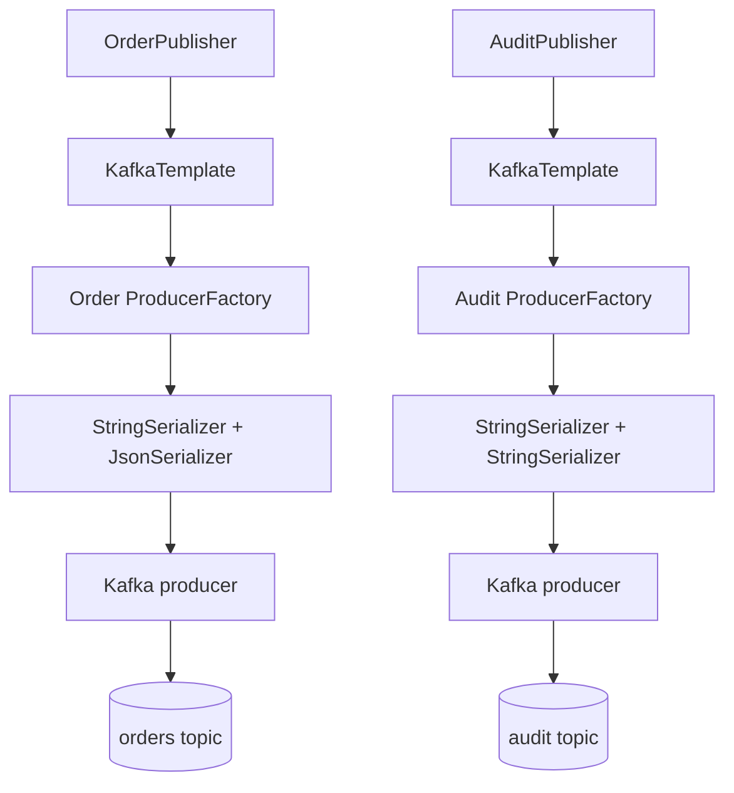

# Creating Multiple KafkaTemplates by Data Type

In a Spring Kafka application, producers may send several kinds of payloads: JSON events like `OrderCreatedEvent`, plain text strings like audit messages, or byte arrays like data encoded in a custom format. Each data type may require a different serializer and producer configuration. Spring Kafka lets you declare multiple `ProducerFactory` and `KafkaTemplate<K, V>` beans so the application sends each data type with the right configuration.

In the `SPRING_KAFKA_MESSAGING` module, `KafkaTemplate` is the producer-side record-sending API, while consumers typically receive records via `@KafkaListener`. When creating multiple templates, the goal is to make key/value types and serialization boundaries explicit while keeping producer configuration consistent and manageable.

## 1. Why are multiple `KafkaTemplate` beans needed?

`KafkaTemplate<K, V>` is parameterized by key type `K` and value type `V`. The template uses a `ProducerFactory<K, V>` to create Kafka producers; the factory supplies the corresponding serializers and connection settings.

An application may have distinct sending flows:

| Payload type | Key | Value | Typical serializers |
|---|---|---|---|
| Order event | `String` | `OrderCreatedEvent` | `StringSerializer` + `JsonSerializer` |
| Audit message | `String` | `String` | `StringSerializer` + `StringSerializer` |
| Binary event | `String` | `byte[]` | `StringSerializer` + `ByteArraySerializer` |
| Avro/Protobuf event | `String` or other key type | Generated record type | Matching serializer or Schema Registry serializer |

When payload types require different serializers, declaring separate templates/factories enables compile-time type checking at call sites and avoids mismatched serializer configurations. For instance, `KafkaTemplate<String, OrderCreatedEvent>` makes clear that the template accepts string keys and order event values.

It is unnecessary to create one template per topic or per DTO. If multiple topics share the same key/value types, serializers, and producer settings, a single template can send to multiple topics. Only split templates when data types, serializers, transaction settings, security identities, or other significant producer configurations differ.

## 2. Relationship between `KafkaTemplate` and `ProducerFactory`

`KafkaTemplate` does not decide on its own how objects are converted to bytes. It uses `ProducerFactory` to obtain a Kafka producer configured with serializers, bootstrap servers, retries, idempotence, security, and other properties.



Each `ProducerFactory` typically manages or creates producers with its own configuration. Consequently, adding more factories can mean more producer pools, broker connections, and resources to manage. Avoid creating unnecessary factories solely to name a template per topic.

## 3. Declaring multiple `ProducerFactory` and `KafkaTemplate` beans

The example below creates two bean pairs:

- `orderProducerFactory` and `orderKafkaTemplate` using JSON for `OrderCreatedEvent`.
- `auditProducerFactory` and `auditKafkaTemplate` using strings for audit messages.

```java
import java.util.HashMap;
import java.util.Map;

import org.apache.kafka.clients.producer.ProducerConfig;
import org.apache.kafka.common.serialization.StringSerializer;
import org.springframework.beans.factory.annotation.Qualifier;
import org.springframework.beans.factory.annotation.Value;
import org.springframework.context.annotation.Bean;
import org.springframework.context.annotation.Configuration;
import org.springframework.kafka.core.DefaultKafkaProducerFactory;
import org.springframework.kafka.core.KafkaTemplate;
import org.springframework.kafka.core.ProducerFactory;
import org.springframework.kafka.support.serializer.JsonSerializer;

@Configuration
public class TypedKafkaProducerConfiguration {

    private Map<String, Object> baseProducerProperties(String bootstrapServers) {
        Map<String, Object> properties = new HashMap<>();
        properties.put(
                ProducerConfig.BOOTSTRAP_SERVERS_CONFIG,
                bootstrapServers
        );
        properties.put(ProducerConfig.ACKS_CONFIG, "all");
        properties.put(ProducerConfig.ENABLE_IDEMPOTENCE_CONFIG, true);
        return properties;
    }

    @Bean("orderProducerFactory")
    public ProducerFactory<String, OrderCreatedEvent> orderProducerFactory(
            @Value("${spring.kafka.bootstrap-servers}") String bootstrapServers) {

        return new DefaultKafkaProducerFactory<>(
                baseProducerProperties(bootstrapServers),
                new StringSerializer(),
                new JsonSerializer<>()
        );
    }

    @Bean("orderKafkaTemplate")
    public KafkaTemplate<String, OrderCreatedEvent> orderKafkaTemplate(
            @Qualifier("orderProducerFactory")
            ProducerFactory<String, OrderCreatedEvent> orderProducerFactory) {

        return new KafkaTemplate<>(orderProducerFactory);
    }

    @Bean("auditProducerFactory")
    public ProducerFactory<String, String> auditProducerFactory(
            @Value("${spring.kafka.bootstrap-servers}") String bootstrapServers) {

        return new DefaultKafkaProducerFactory<>(
                baseProducerProperties(bootstrapServers),
                new StringSerializer(),
                new StringSerializer()
        );
    }

    @Bean("auditKafkaTemplate")
    public KafkaTemplate<String, String> auditKafkaTemplate(
            @Qualifier("auditProducerFactory")
            ProducerFactory<String, String> auditProducerFactory) {

        return new KafkaTemplate<>(auditProducerFactory);
    }
}
```

`OrderCreatedEvent` is an application event DTO, for example:

```java
import java.math.BigDecimal;
import java.time.Instant;

public record OrderCreatedEvent(
        String eventId,
        String orderId,
        BigDecimal total,
        Instant occurredAt
) {}
```

This configuration snippet shares bootstrap servers, `acks=all`, and idempotence, while each factory has its own value serializer. In production, include shared settings such as SASL/SSL, timeouts, compression, retries, and metrics in the base configuration appropriate for the environment. Do not copy a minimal local configuration to production while omitting authentication or security policies.

In the example, both `@Bean` methods accept `ProducerFactory` using `@Qualifier` with the exact bean name. This clarifies which factory is bound to each template, which is especially helpful when an application has multiple factories implementing the same interface or using complex generic types.

## 4. Injecting the right template with `@Qualifier`

When the Spring context has multiple beans of the same raw type `KafkaTemplate`, use `@Qualifier` to specify which template to inject. Generic types can help Spring narrow candidates, but qualifiers name the dependency explicitly and prevent confusion when configuration changes.

```java
import org.springframework.beans.factory.annotation.Qualifier;
import org.springframework.kafka.core.KafkaTemplate;
import org.springframework.stereotype.Service;

@Service
public class OrderPublisher {

    private final KafkaTemplate<String, OrderCreatedEvent> kafkaTemplate;

    public OrderPublisher(
            @Qualifier("orderKafkaTemplate")
            KafkaTemplate<String, OrderCreatedEvent> kafkaTemplate) {
        this.kafkaTemplate = kafkaTemplate;
    }

    public void publish(OrderCreatedEvent event) {
        kafkaTemplate.send("orders.created", event.orderId(), event);
    }
}
```

```java
import org.springframework.beans.factory.annotation.Qualifier;
import org.springframework.kafka.core.KafkaTemplate;
import org.springframework.stereotype.Service;

@Service
public class AuditPublisher {

    private final KafkaTemplate<String, String> kafkaTemplate;

    public AuditPublisher(
            @Qualifier("auditKafkaTemplate")
            KafkaTemplate<String, String> kafkaTemplate) {
        this.kafkaTemplate = kafkaTemplate;
    }

    public void publish(String messageId, String message) {
        kafkaTemplate.send("audit.events", messageId, message);
    }
}
```

`@Qualifier` accepts the bean name declared in configuration. If you omit the qualifier when multiple matching candidates exist, Spring may fail to resolve a unique bean and throw `NoUniqueBeanDefinitionException`. You can use `@Primary` to pick a default bean, though with multiple purpose-built templates, qualifiers are usually clearer and safer.

## 5. Creating a template for `byte[]` or other formats

If the application sends payloads already encoded as byte arrays, you can add a factory using `ByteArraySerializer`:

```java
import org.apache.kafka.common.serialization.ByteArraySerializer;
import org.apache.kafka.common.serialization.StringSerializer;
import org.springframework.beans.factory.annotation.Qualifier;
import org.springframework.beans.factory.annotation.Value;
import org.springframework.context.annotation.Bean;
import org.springframework.kafka.core.DefaultKafkaProducerFactory;
import org.springframework.kafka.core.KafkaTemplate;
import org.springframework.kafka.core.ProducerFactory;

@Bean("binaryProducerFactory")
public ProducerFactory<String, byte[]> binaryProducerFactory(
        @Value("${spring.kafka.bootstrap-servers}") String bootstrapServers) {

    return new DefaultKafkaProducerFactory<>(
            baseProducerProperties(bootstrapServers),
            new StringSerializer(),
            new ByteArraySerializer()
    );
}

@Bean("binaryKafkaTemplate")
public KafkaTemplate<String, byte[]> binaryKafkaTemplate(
        @Qualifier("binaryProducerFactory")
        ProducerFactory<String, byte[]> producerFactory) {

    return new KafkaTemplate<>(producerFactory);
}
```

This snippet belongs inside the same `@Configuration` class containing the `baseProducerProperties(...)` helper from the earlier example. In a real application, place the beans in an appropriate configuration class and use `@Qualifier` at the producer factory injection point too.

For Avro or Protobuf, the value serializer can be provided by Schema Registry or the corresponding library. The template is still parameterized with the Java type of the generated record, while the serializer converts that type to the wire format. Consumers need the corresponding deserializer and schema compatibility configuration.

## 6. Spring Boot configuration and auto-configuration

Spring Boot can auto-configure a default `ProducerFactory` and `KafkaTemplate` from `spring.kafka.*`. When there is only a single simple sending flow, take advantage of the default configuration instead of manually declaring beans.

Example base configuration:

```yaml
spring:
  kafka:
    bootstrap-servers: ${KAFKA_BOOTSTRAP_SERVERS:localhost:9092}
    producer:
      acks: all
      properties:
        enable.idempotence: true
```

When you declare custom `KafkaTemplate` or `ProducerFactory` beans, Spring Boot's auto-configuration conditions may stop creating the default beans. Understand which beans are auto-configured and which are manually declared; do not assume a default `kafkaTemplate` will still exist alongside custom templates.

A common strategy:

1. Keep Boot's default configuration for the common path if there is one primary serializer.
2. When multiple serializer types are needed, declare separate factories/templates with clear bean names.
3. Reuse the same base settings for bootstrap, security, `acks`, and retries if producers share the same policy.
4. Only create a separate configuration when a stream truly needs differences such as serializer, transaction ID prefix, security principal, or producer tuning.

If you want each custom factory to inherit all of Boot's `spring.kafka.producer.*` properties, use the `KafkaProperties` API matching your Spring Boot version to build the property map. Property-building method signatures vary across some Boot versions, so check your actual dependency before copying code.

## 7. Do multiple templates require multiple producer connections?

A `KafkaTemplate` uses the `ProducerFactory` injected into it. If two templates share the same factory, they share that factory's producer creation policy and serializers. Adding another `KafkaTemplate` wrapper does not automatically create an independent serializer set or producer pool.

Conversely, two separate `ProducerFactory` beans can create separate producer pools. That is necessary when serializers or producer settings differ, but it also increases producers, socket connections, buffers, and broker/client resources. Therefore:

- Use one template for multiple topics if key/value types and configuration are the same.
- Use multiple templates when data types or serializers clearly differ.
- Share a factory when streams can share serializers and producer settings.
- Split factories when isolation is required for security, transactions, serializers, or tuning.
- Never create a new template per request or per record.

If multiple value types are all serialized as JSON and can share a contract strategy, you can consider `KafkaTemplate<String, Object>` or `DelegatingByTypeSerializer`. That approach is more flexible, though it relaxes compile-time type strictness at call sites and requires clear type-header/schema conventions. Use it only when practical flexibility outweighs tighter type checking and schema compatibility overhead.

## 8. Serializers, type headers, and matching consumers

Each template must use serializers compatible with its value type:

| Template | Value serializer | Typical consumer deserializer |
|---|---|---|
| `orderKafkaTemplate` | `JsonSerializer<OrderCreatedEvent>` | `JsonDeserializer<OrderCreatedEvent>` |
| `auditKafkaTemplate` | `StringSerializer` | `StringDeserializer` |
| `binaryKafkaTemplate` | `ByteArraySerializer` | `ByteArrayDeserializer` |
| Avro template | Avro serializer | Matching Avro deserializer |

When using `JsonSerializer`, agree on how consumers determine the payload type. Spring Kafka's JSON serializer can write type information into headers; consumers can use that information or configure a default type. When producer and consumer belong to independent services, avoid relying blindly on Java class names or internal packages. You can disable type headers and configure target types on the consumer, or use a schema registry to manage versioned schemas.

Do not confuse `KafkaTemplate`'s generic types with the wire schema. Generic types only describe Java types within the application; serializers dictate the bytes written to Kafka. If serializer and deserializer are incompatible, the producer may send successfully while the consumer fails during deserialization.

## 9. Transactions and per-template configuration

If one producer flow requires Kafka transactions, transaction capability must be configured on the corresponding `ProducerFactory`, typically via a transaction ID prefix on `DefaultKafkaProducerFactory`. Only templates backed by that factory participate in Spring Kafka's transaction mechanism.

Do not enable transactions for every template just because one flow in the application needs them. A transaction-enabled factory and a non-transactional factory can be kept separate to make policy explicit. Ensure transaction ID prefixes are unique across application instances per deployment rules, and use the right `KafkaTransactionManager`/transaction configuration when integrating with listeners or databases. Kafka transactions do not automatically create atomic transactions with external databases outside Kafka.

## 10. Testing multiple KafkaTemplates

Tests should verify both bean wiring and serialization behavior:

- **Context test:** the Spring context initializes all factories/templates and qualifiers inject the expected beans.
- **Publisher unit test:** mock the corresponding template and verify the right topic, key, and payload are sent.
- **Serialization test:** check that JSON, string, or byte-array serializers produce the expected payload.
- **Integration test:** use Embedded Kafka or Testcontainers to send/receive each payload type via the right topic and deserializer.
- **Configuration test:** verify critical producer settings such as `acks`, idempotence, security, and transaction prefix per factory.

When multiple templates exist, common bugs are injecting the wrong bean or using another stream's serializer. Context tests with qualifiers catch wiring mistakes early; integration tests verify real data on Kafka.

## 11. Common mistakes

- **Omitting qualifiers:** multiple `KafkaTemplate` beans prevent Spring from resolving which bean to inject.
- **Declaring multiple templates sharing an incompatible factory:** a JSON template receives values requiring a string serializer or vice versa.
- **Creating too many producer factories:** increases producer pools and connections unnecessarily.
- **Assuming Boot still creates a default template:** custom beans may prevent auto-configuration conditions from matching.
- **Changing generic types without changing serializers:** generics do not automatically turn objects into JSON, strings, or byte arrays.
- **Producer and consumer disagreeing on type headers/schemas:** the producer sends successfully but the consumer fails to deserialize.
- **Using `@Primary` carelessly:** the default bean may be injected into a flow requiring a different serializer; use purpose-specific qualifiers.
- **Creating one template per topic despite identical configuration:** increases configuration and resources without clear benefit.
- **Omitting security settings on manual factories:** manually constructed factories must receive full SASL/SSL and environment-specific settings.

## 12. Checklist before declaring multiple `KafkaTemplate` beans

- [ ] Identify key/value types and serializers for each sending stream.
- [ ] Split `ProducerFactory` only when serializers or producer settings genuinely differ.
- [ ] Give beans meaningful names such as `orderKafkaTemplate` and `auditKafkaTemplate`.
- [ ] Use `@Qualifier` when injecting templates/factories to avoid ambiguity.
- [ ] Configure compatible serializers and deserializers between producer and consumer.
- [ ] Check the impact on Spring Boot auto-configuration when declaring custom beans.
- [ ] Reuse base configuration for bootstrap, security, `acks`, and retries where appropriate.
- [ ] Isolate a transaction-enabled factory if only one flow requires transactions.
- [ ] Avoid creating templates/factories per topic or per request without configuration differences.
- [ ] Provide context tests and integration tests for each payload type.

Creating multiple `KafkaTemplate` beans by data type lets producers make key/value contracts explicit and apply the right serializer per stream. By naming beans clearly, injecting with qualifiers, and splitting producer factories only when justified, a Spring Kafka application remains maintainable, testable, and scalable without proliferating redundant configs or producer pools.
