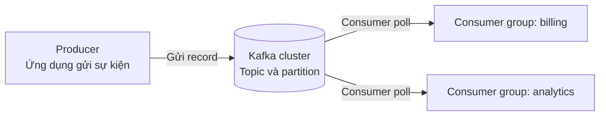
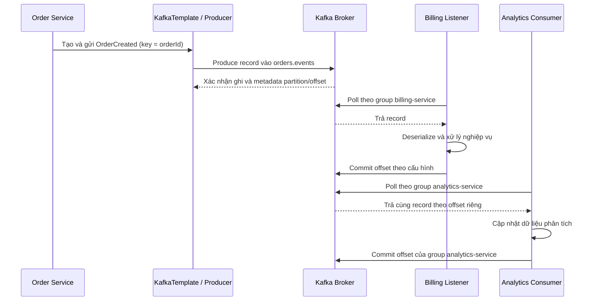

# Vai trò của producer, consumer và broker

Trong một hệ thống dùng Apache Kafka, các ứng dụng thường cần trao đổi sự kiện mà không phải gọi trực tiếp nhau. Ví dụ, khi dịch vụ đơn hàng tạo một đơn hàng mới, dịch vụ thanh toán cần biết để xử lý thanh toán, còn dịch vụ phân tích cần nhận dữ liệu để cập nhật báo cáo. Nếu dịch vụ đơn hàng phải gọi lần lượt từng dịch vụ, nó sẽ phụ thuộc vào trạng thái và tốc độ phản hồi của tất cả các bên nhận.

Kafka giải quyết bài toán này bằng một luồng sự kiện được lưu trữ trong cluster. Ứng dụng gửi sự kiện đóng vai trò **producer**; ứng dụng đọc sự kiện đóng vai trò **consumer**; các máy chủ Kafka nhận, lưu trữ và cung cấp sự kiện cho client được gọi là **broker**. Ba vai trò này phối hợp với nhau nhưng có trách nhiệm riêng. Hiểu rõ ranh giới đó giúp thiết kế luồng messaging dễ mở rộng, dễ khôi phục khi lỗi và dễ vận hành bằng Spring Kafka.

## 1. Bức tranh tổng thể

Producer ghi record vào một topic trong Kafka. Broker tiếp nhận record, lưu nó vào partition tương ứng và duy trì bản sao theo cấu hình replication. Consumer chủ động lấy record từ broker, xử lý nghiệp vụ rồi cập nhật tiến độ đọc bằng offset.



Trong sơ đồ, hai consumer group cùng đọc một topic. Nhóm `billing` xử lý nghiệp vụ thanh toán; nhóm `analytics` cập nhật dữ liệu phân tích. Mỗi nhóm có tiến độ đọc độc lập, vì vậy việc nhóm thanh toán đã đọc một record không làm record đó biến mất khỏi nhóm phân tích.

Một record Kafka thường có các thành phần sau:

| Thành phần | Ý nghĩa |
| --- | --- |
| Topic | Tên luồng logic chứa các record cùng loại hoặc cùng mục đích |
| Partition | Phần của topic được tổ chức thành một log có thứ tự riêng |
| Offset | Vị trí của record trong một partition |
| Key | Giá trị giúp định tuyến record vào partition; thường dùng để gom các sự kiện liên quan |
| Value | Nội dung chính của sự kiện, chẳng hạn JSON mô tả đơn hàng |
| Headers | Metadata dạng key-value, có thể chứa event type, trace ID hoặc phiên bản schema |
| Timestamp | Thời điểm gắn với record theo cấu hình timestamp của producer hoặc broker |

Topic là khái niệm logic; partition là đơn vị lưu trữ và đọc có thứ tự. Offset chỉ có ý nghĩa trong phạm vi một partition, không phải số thứ tự toàn cục của cả topic hay toàn cluster.

## 2. Producer: tạo và gửi sự kiện

**Producer là client tạo record và gửi record đến Kafka.** Producer thường nằm trong một ứng dụng nghiệp vụ, chẳng hạn Order Service, Payment Service hoặc một tiến trình nhập dữ liệu. Producer quyết định sự kiện nào cần phát ra, nội dung của sự kiện và cách định tuyến sự kiện đó.

### 2.1. Trách nhiệm của producer

- **Tạo sự kiện đúng thời điểm:** sau khi một thay đổi nghiệp vụ có ý nghĩa xảy ra, ứng dụng tạo event như `OrderCreated`, `PaymentSucceeded` hoặc `InventoryReserved`. Tên và ý nghĩa event nên mô tả điều đã xảy ra, thay vì chỉ mô tả một lời gọi hàm nội bộ.
- **Xác định hợp đồng dữ liệu:** producer thống nhất cấu trúc payload, tên field, kiểu dữ liệu và phiên bản schema với các consumer. Một thay đổi phá vỡ tương thích có thể khiến consumer cũ không đọc được record mới.
- **Tuần tự hóa dữ liệu:** chuyển object trong ứng dụng thành byte để truyền qua Kafka. Ví dụ thường gặp là JSON, Avro hoặc Protobuf. Producer serializer phải tương thích với consumer deserializer.
- **Chọn key và partition:** key giúp các record liên quan được đưa vào cùng partition theo partitioner. Với partitioner mặc định, key khác `null` thường được băm để chọn partition. Vì vậy, dùng `orderId` làm key thường giúp các sự kiện của cùng một đơn hàng đi cùng partition và giữ thứ tự tương đối của chúng.
- **Gửi và xử lý kết quả gửi:** gửi record, theo dõi lỗi, retry theo chính sách phù hợp và ghi nhận metadata như topic, partition, offset khi cần quan sát luồng dữ liệu.

Producer không gửi trực tiếp đến một consumer cụ thể. Producer gửi record đến Kafka; broker lưu record và các consumer tự đọc theo tiến độ của chúng. Producer cũng không thể kết luận rằng nghiệp vụ ở consumer đã hoàn tất chỉ từ việc broker xác nhận record đã được ghi.

### 2.2. Key quyết định cách phân phối record

Giả sử Order Service phát ra ba sự kiện:

| Event | Key | Ý nghĩa |
| --- | --- | --- |
| `OrderCreated` | `ORD-100` | Đơn hàng được tạo |
| `OrderPaid` | `ORD-100` | Đơn hàng đã thanh toán |
| `OrderCancelled` | `ORD-200` | Đơn hàng khác bị hủy |

Khi dùng `orderId` làm key, các sự kiện có key `ORD-100` thường được định tuyến vào cùng partition. Kafka duy trì thứ tự record trong từng partition, nên consumer có thể đọc `OrderCreated` trước `OrderPaid` nếu producer gửi chúng theo thứ tự đó vào cùng partition.

Nếu không có key, producer vẫn có thể gửi record; partitioner sẽ phân phối record theo chiến lược dành cho key rỗng. Tuy nhiên, ứng dụng không nên dựa vào đó để giữ thứ tự cho một thực thể nghiệp vụ cụ thể.

Thứ tự chỉ được bảo đảm trong một partition. Kafka không cung cấp thứ tự tổng thể giữa nhiều partition. Nếu tăng số partition hoặc thay đổi partitioner, cùng một key có thể được ánh xạ sang partition khác; cần tính đến điều này khi thiết kế yêu cầu thứ tự dài hạn.

### 2.3. Producer nhận được xác nhận gì?

Lệnh gửi record thường diễn ra bất đồng bộ. Kết quả gửi cho biết Kafka có xác nhận việc ghi theo cấu hình producer hay không. Một số cấu hình quan trọng:

- `acks=0`: producer không chờ broker xác nhận; độ trễ thấp nhưng khó biết record có được ghi hay không.
- `acks=1`: leader partition xác nhận sau khi ghi record vào log của nó. Nếu leader gặp sự cố trước khi bản sao khác nhận record, record có thể bị mất.
- `acks=all`: producer chờ các replica đang nằm trong tập ISR (in-sync replicas) xác nhận theo giao thức Kafka. Kết hợp với `min.insync.replicas` phù hợp, cấu hình này tăng độ bền dữ liệu.

Retry giúp xử lý lỗi tạm thời, nhưng retry cũng cần được thiết kế cùng idempotence và cách xử lý ở consumer. Idempotent producer giúp tránh tạo nhiều bản ghi Kafka do retry trong phạm vi cơ chế và phiên producer được Kafka hỗ trợ. Điều đó không tự động bảo đảm một tác động nghiệp vụ bên ngoài Kafka chỉ xảy ra đúng một lần.

## 3. Broker: tiếp nhận, lưu trữ và phục vụ record

**Broker là một tiến trình máy chủ Kafka nhận request từ producer và consumer, quản lý các partition mà nó lưu trữ, đồng thời tham gia điều phối cluster.** Một Kafka cluster thường có nhiều broker. Mỗi broker có thể lưu nhiều partition hoặc replica của nhiều topic khác nhau.

### 3.1. Broker lưu record trong partition log

Khi nhận record, broker định tuyến request đến leader của partition đích. Leader append record vào log và cấp offset cho record đó. Các record trong một partition được đọc theo thứ tự offset tăng dần.

Ví dụ, partition `orders.events-0` có thể chứa:

| Partition | Offset | Key | Event |
| --- | ---: | --- | --- |
| `orders.events-0` | 0 | `ORD-100` | `OrderCreated` |
| `orders.events-0` | 1 | `ORD-100` | `OrderPaid` |
| `orders.events-0` | 2 | `ORD-200` | `OrderCreated` |

Offset `1` chỉ xác định record thứ hai trong partition `orders.events-0`. Một partition khác cũng có thể có offset `1`, nhưng đó là record khác.

### 3.2. Broker phối hợp replication

Partition có thể có nhiều replica trên các broker khác nhau. Một replica giữ vai trò **leader**; các replica còn lại là **follower** và sao chép dữ liệu từ leader. Trong hoạt động thông thường, producer ghi vào leader và consumer đọc từ leader. Nếu broker đang giữ leader gặp sự cố, Kafka có thể bầu một replica đủ điều kiện trong ISR làm leader mới.

Replication tăng khả năng chịu lỗi, nhưng không có nghĩa mọi cấu hình đều an toàn như nhau. Số replica, `min.insync.replicas`, `acks`, trạng thái ISR và cách triển khai cluster cùng quyết định mức độ bảo vệ dữ liệu. Chỉ tăng replication factor mà không cấu hình producer và mức ISR phù hợp chưa đủ để đạt độ bền mong muốn.

### 3.3. Broker giữ dữ liệu theo retention

Kafka lưu record trong log và quản lý vòng đời dữ liệu theo chính sách retention, chẳng hạn theo thời gian hoặc dung lượng. Record không tự biến mất chỉ vì một consumer đã đọc nó. Mỗi consumer group có offset riêng để theo dõi tiến độ; nhiều group có thể đọc cùng một record trong thời gian record còn được giữ.

Với topic cấu hình log compaction, Kafka có thể giữ lại giá trị mới nhất theo key sau quá trình compact. Compaction khác với việc xóa record ngay sau khi consumer xử lý. Khi record đã hết hạn hoặc bị compact, consumer không thể mặc nhiên giả định rằng mọi lịch sử cũ vẫn còn để replay.

### 3.4. Broker không xử lý nghiệp vụ thay consumer

Broker chịu trách nhiệm về lưu trữ, truyền dữ liệu, replication, metadata và một phần điều phối consumer group. Broker không biết một đơn hàng có hợp lệ hay không, không gọi cơ sở dữ liệu nghiệp vụ của ứng dụng và không thực hiện logic thanh toán. Những công việc đó thuộc về consumer hoặc dịch vụ nghiệp vụ nhận sự kiện.

Broker cũng tham gia điều phối consumer group, bao gồm việc hỗ trợ xác định consumer nào nhận partition nào. Khi thành viên group thay đổi hoặc số partition thay đổi, Kafka có thể thực hiện rebalance để phân phối lại partition.

## 4. Consumer: đọc và xử lý sự kiện

**Consumer là client lấy record từ Kafka và thực hiện công việc ở phía nhận.** Consumer có thể là một microservice, một ứng dụng xử lý dữ liệu hoặc một job chạy định kỳ. Consumer quyết định đọc từ đâu, xử lý record ra sao và khi nào ghi nhận tiến độ.

### 4.1. Consumer chủ động poll dữ liệu

Kafka sử dụng mô hình pull: consumer gửi request `poll` để lấy các record mới từ broker. Broker không chủ động gọi callback của ứng dụng mỗi khi có record mới. Trong Spring Kafka, listener container quản lý vòng lặp poll ở phía dưới; lập trình viên thường chỉ cần khai báo phương thức bằng `@KafkaListener`.

Consumer thực hiện các công việc chính:

1. Đăng ký topic và tham gia một consumer group.
2. Poll record từ các partition được gán.
3. Deserialize key/value và kiểm tra dữ liệu đầu vào.
4. Thực hiện nghiệp vụ, ví dụ ghi nhận thanh toán hoặc cập nhật kho.
5. Ghi nhận offset đã xử lý theo cơ chế commit đang cấu hình.
6. Áp dụng retry, xử lý lỗi hoặc chuyển record lỗi sang dead-letter topic theo chính sách của ứng dụng.

Consumer không xóa record khỏi Kafka sau khi đọc. Nó cập nhật offset của group để Kafka biết group đã đọc đến đâu.

### 4.2. Offset là tiến độ riêng của từng consumer group

Offset là vị trí record trong partition. Kafka lưu tiến độ đã commit theo cặp consumer group và partition. Vì vậy, cùng một partition có thể được nhóm `billing` đọc đến offset `120`, trong khi nhóm `analytics` mới đọc đến offset `95`.

Khi consumer khởi động lại, nó thường tiếp tục từ offset đã commit của group. `auto.offset.reset` chỉ được dùng khi group chưa có offset hợp lệ cho partition, chẳng hạn lần đầu chạy hoặc offset cũ đã nằm ngoài phạm vi log còn giữ; nó không có nghĩa là consumer luôn đọc lại từ đầu mỗi lần khởi động. Giá trị `earliest` yêu cầu bắt đầu từ record sớm nhất còn có thể đọc, còn `latest` bắt đầu từ record mới ở cuối log.

Thời điểm commit rất quan trọng:

- Nếu commit offset trước khi xử lý nghiệp vụ thành công, ứng dụng có thể bỏ qua record khi bị lỗi sau commit.
- Nếu xử lý nghiệp vụ xong nhưng chưa commit mà consumer gặp sự cố, record có thể được đọc và xử lý lại sau khi khởi động hoặc rebalance.

Vì vậy, nhiều hệ thống chọn xử lý theo hướng **at-least-once**: chấp nhận khả năng một record được giao lại và làm cho thao tác nghiệp vụ có tính idempotent. Ví dụ, dùng `eventId` có unique constraint để không ghi nhận hai lần cùng một sự kiện thanh toán. Cấu hình commit, retry và transaction cần được chọn theo yêu cầu dữ liệu cụ thể.

### 4.3. Consumer group và khả năng mở rộng

Consumer group là tập các consumer cùng chia sẻ công việc đọc một topic. Trong một group, tại một thời điểm, mỗi partition được gán cho tối đa một consumer. Điều này cho phép các consumer trong group xử lý song song mà vẫn giữ thứ tự đọc trong từng partition.

Giả sử topic có 4 partition:

| Số consumer trong group | Cách phân phối minh họa | Hệ quả |
| ---: | --- | --- |
| 1 | Một consumer nhận cả 4 partition | Có thể đọc tất cả partition nhưng xử lý tuần tự theo từng partition |
| 2 | Mỗi consumer nhận 2 partition | Tăng khả năng đọc song song |
| 4 | Mỗi consumer nhận 1 partition | Có thể sử dụng hết mức song song theo partition |
| 6 | 4 consumer nhận partition, 2 consumer không có partition | Hai consumer dư không làm tăng mức song song của topic này |

Số partition giới hạn số consumer có thể hoạt động song song trong cùng một group đối với topic đó. Thêm consumer vượt quá số partition không tự làm tăng throughput. Ngược lại, tăng partition cần cân nhắc tải broker, thứ tự theo key và chiến lược phân phối dữ liệu.

Hai consumer group khác nhau có thể cùng đọc toàn bộ topic. Đây là cách một event phục vụ nhiều mục đích mà producer không cần biết danh sách consumer. Mỗi group có offset riêng, nên tốc độ hoặc lỗi của group này không trực tiếp làm thay đổi tiến độ của group kia.

## 5. Producer, broker và consumer trong Spring Kafka

Spring Kafka cung cấp các thành phần giúp ứng dụng Java làm việc với Kafka mà không phải tự quản lý toàn bộ giao thức client. Hai thành phần thường gặp nhất là `KafkaTemplate` ở phía gửi và `@KafkaListener` ở phía nhận.

### 5.1. Cấu hình kết nối và serializer

Ví dụ dưới đây dùng chuỗi cho cả key và value để tập trung vào luồng gửi nhận. Trong ứng dụng thực tế, value thường là JSON hoặc một định dạng có schema; khi đó cần cấu hình serializer/deserializer tương ứng và quản lý tương thích schema.

```yaml
spring:
  kafka:
    bootstrap-servers: localhost:9092
    producer:
      key-serializer: org.apache.kafka.common.serialization.StringSerializer
      value-serializer: org.apache.kafka.common.serialization.StringSerializer
      acks: all
    consumer:
      group-id: billing-service
      key-deserializer: org.apache.kafka.common.serialization.StringDeserializer
      value-deserializer: org.apache.kafka.common.serialization.StringDeserializer
      auto-offset-reset: earliest
```

`bootstrap-servers` là địa chỉ một hoặc một số broker dùng để khởi đầu kết nối và lấy metadata cluster. Client không bị cố định vào một broker duy nhất: sau khi nhận metadata, Kafka client kết nối đến broker đang giữ leader của partition cần thao tác.

Trong ví dụ, `acks: all` yêu cầu producer chờ xác nhận từ các replica đang đồng bộ theo cơ chế Kafka. Mức bảo vệ thực tế còn phụ thuộc vào cấu hình replication và `min.insync.replicas` ở broker/topic. `auto-offset-reset: earliest` chỉ ảnh hưởng group chưa có offset hợp lệ; group đã có offset sẽ tiếp tục từ tiến độ đã commit.

### 5.2. Gửi sự kiện bằng KafkaTemplate

Giả sử ứng dụng có event `OrderCreated` và muốn dùng `orderId` làm key:

```java
public record OrderCreated(
        String eventId,
        String orderId,
        BigDecimal total
) {}
```

Producer chuyển event thành JSON rồi gửi bằng `KafkaTemplate`. Ví dụ dùng Spring Kafka 3.x, trong đó `send` trả về `CompletableFuture`. Các đoạn mã lược bỏ import và phần khai báo logger `log` để tập trung vào luồng xử lý; khi đưa vào project cần bổ sung chúng theo cấu trúc ứng dụng:

```java
@Service
public class OrderEventPublisher {

    private final KafkaTemplate<String, String> kafkaTemplate;
    private final ObjectMapper objectMapper;

    public OrderEventPublisher(
            KafkaTemplate<String, String> kafkaTemplate,
            ObjectMapper objectMapper
    ) {
        this.kafkaTemplate = kafkaTemplate;
        this.objectMapper = objectMapper;
    }

    public void publish(OrderCreated event) throws JsonProcessingException {
        String payload = objectMapper.writeValueAsString(event);

        kafkaTemplate.send("orders.events", event.orderId(), payload)
                .whenComplete((result, error) -> {
                    if (error != null) {
                        // Ghi log/metric và chuyển lỗi vào cơ chế xử lý phù hợp.
                        log.error("Không gửi được event {}", event.eventId(), error);
                        return;
                    }

                    RecordMetadata metadata = result.getRecordMetadata();
                    log.info(
                            "Đã gửi event {} đến topic={}, partition={}, offset={}",
                            event.eventId(),
                            metadata.topic(),
                            metadata.partition(),
                            metadata.offset()
                    );
                });
    }
}
```

Trong ví dụ, `orders.events` là topic, `event.orderId()` là key và chuỗi JSON là value. KafkaTemplate dùng producer factory để tạo Kafka producer và thực hiện serialization theo cấu hình. Việc `send` trả về future cho phép ứng dụng quan sát kết quả gửi mà không cần chặn luồng gọi để chờ broker phản hồi.

Khi future hoàn tất thành công, metadata cho biết record đã được ghi vào partition nào và offset nào theo xác nhận của Kafka. Đây là xác nhận ở tầng messaging; nó không chứng minh `Billing Service` đã đọc hoặc xử lý event.

### 5.3. Nhận sự kiện bằng @KafkaListener

Ở phía nhận, Spring Kafka tạo và quản lý listener container. Container sử dụng Kafka consumer để poll record, sau đó gọi phương thức được đánh dấu `@KafkaListener`:

```java
@Component
public class BillingEventListener {

    private final ObjectMapper objectMapper;
    private final BillingService billingService;

    public BillingEventListener(
            ObjectMapper objectMapper,
            BillingService billingService
    ) {
        this.objectMapper = objectMapper;
        this.billingService = billingService;
    }

    @KafkaListener(topics = "orders.events")
    public void onOrderCreated(String payload) throws JsonProcessingException {
        OrderCreated event = objectMapper.readValue(payload, OrderCreated.class);
        billingService.handleOrderCreated(event);
    }
}
```

Listener dùng group ID `billing-service` từ cấu hình consumer. Khi listener xử lý xong, listener container quản lý việc ghi nhận offset theo `AckMode` và cấu hình commit đang dùng. Nếu nghiệp vụ cần xác nhận thủ công, có thể cấu hình manual acknowledgment; khi đó phương thức listener nhận thêm `Acknowledgment` và chỉ gọi `acknowledge()` sau khi hoàn tất công việc tương ứng. Cần hiểu rõ retry và commit semantics trước khi thay đổi chế độ ack.

Một group khác, ví dụ `analytics-service`, có thể đăng ký cùng topic để xử lý thống kê. Group này có offset độc lập và không cần Order Service gửi thêm một bản event riêng.

### 5.4. Luồng chạy hoàn chỉnh

Với ví dụ đơn hàng, luồng dữ liệu diễn ra như sau:

1. Order Service lưu đơn hàng và tạo event `OrderCreated` với `eventId`, `orderId` và dữ liệu cần thiết.
2. `OrderEventPublisher` tuần tự hóa event, gửi record đến topic `orders.events` bằng `KafkaTemplate`, dùng `orderId` làm key.
3. Kafka định tuyến record vào partition phù hợp. Broker leader append record vào log, cấp offset và phối hợp replication.
4. Producer nhận kết quả gửi theo cấu hình `acks`. Kết quả này cho biết trạng thái ghi ở Kafka.
5. Listener container của Billing Service poll record từ partition được gán cho group `billing-service`.
6. Phương thức `onOrderCreated` deserialize payload và gọi nghiệp vụ thanh toán.
7. Khi xử lý đạt điều kiện commit, listener container ghi nhận offset của group. Nếu consumer lỗi trước khi commit, record có thể được giao lại.
8. Analytics Service đọc record bằng group riêng, xử lý dữ liệu phân tích và commit offset độc lập.



## 6. Ranh giới trách nhiệm và những hiểu nhầm thường gặp

| Thành phần | Chịu trách nhiệm | Không chịu trách nhiệm |
| --- | --- | --- |
| Producer | Tạo event, định dạng dữ liệu, chọn key, gửi record và theo dõi xác nhận gửi | Không bảo đảm consumer đã hoàn tất nghiệp vụ |
| Broker | Nhận request, lưu record, cấp offset, replication, cung cấp dữ liệu và hỗ trợ điều phối group | Không thực hiện logic nghiệp vụ của ứng dụng |
| Consumer | Poll record, deserialize, xử lý nghiệp vụ, quản lý offset, retry và lỗi xử lý | Không quyết định record đã hết retention hoặc xóa record khỏi topic chỉ vì đã đọc |

Một số nhầm lẫn cần tránh:

- **“Producer gửi message đến consumer.”** Thực tế producer gửi record đến Kafka. Consumer tự poll dữ liệu từ broker.
- **“Consumer đọc xong thì message bị xóa.”** Offset của group thay đổi; record vẫn được giữ theo retention/compaction và có thể được group khác đọc.
- **“Một topic chỉ có một consumer.”** Nhiều group có thể đọc cùng topic. Các consumer trong cùng group chia nhau partition.
- **“Tăng số consumer luôn tăng throughput.”** Mức song song trong một group bị giới hạn bởi số partition và khả năng xử lý của broker, mạng, consumer, cơ sở dữ liệu đích.
- **“Broker xác nhận là nghiệp vụ đã thành công.”** Broker chỉ xác nhận việc ghi record theo cấu hình. Consumer có thể chưa đọc, đang retry hoặc đã thất bại khi xử lý.
- **“Kafka bảo đảm mọi thứ exactly-once.”** Kafka có các cơ chế idempotent producer và transaction, nhưng tác động lên hệ thống ngoài Kafka vẫn cần thiết kế giao dịch hoặc idempotency phù hợp.

## 7. Cách chọn thiết kế cho một luồng sự kiện

Khi thiết kế luồng messaging, hãy bắt đầu từ yêu cầu nghiệp vụ rồi phân chia trách nhiệm:

1. **Xác định event và hợp đồng dữ liệu.** Nêu rõ sự kiện nào được phát ra, ý nghĩa của từng field, định danh duy nhất `eventId` và cách thay đổi schema mà không phá vỡ consumer hiện tại.
2. **Chọn key theo thực thể cần giữ thứ tự.** Nếu các sự kiện của một đơn hàng cần được xử lý theo thứ tự, dùng `orderId` làm key và bảo đảm các event đó được gửi vào cùng topic/partition theo chiến lược nhất quán.
3. **Chọn số partition theo throughput và mức song song.** Ước lượng tốc độ ghi/đọc, kích thước record, số consumer cần chạy đồng thời và khả năng của broker. Số partition ảnh hưởng đến phân phối tải và thứ tự theo key.
4. **Chọn replication và xác nhận gửi.** Cân nhắc replication factor, `min.insync.replicas` và `acks` theo yêu cầu độ bền dữ liệu, độ sẵn sàng và độ trễ.
5. **Chọn consumer group theo mục đích xử lý.** Mỗi ứng dụng nghiệp vụ độc lập thường có group riêng. Các instance của cùng một ứng dụng chia sẻ group để mở rộng xử lý.
6. **Xác định cách commit và xử lý trùng.** Chọn auto/manual acknowledgment, retry, dead-letter topic và cơ chế idempotency phù hợp với hậu quả nếu record được giao lại.
7. **Theo dõi cả ba phía.** Producer cần theo dõi send failure và latency; broker cần theo dõi dung lượng, replication và trạng thái partition; consumer cần theo dõi lag, lỗi xử lý, retry và thời gian xử lý record.

Trong hệ thống cần phát event sau khi cập nhật cơ sở dữ liệu, còn có một vấn đề quan trọng: giao dịch ghi database và gửi Kafka thường không tự động nguyên tử với nhau. Nếu ứng dụng commit database nhưng gửi Kafka thất bại, trạng thái nghiệp vụ và luồng event có thể lệch nhau. Transactional outbox là một mẫu thiết kế phổ biến: ứng dụng ghi thay đổi nghiệp vụ và bản ghi outbox trong cùng transaction database, sau đó một tiến trình khác phát bản ghi outbox sang Kafka. Mẫu này giúp quản lý nhất quán giữa database và messaging; nó vẫn cần xử lý việc phát lặp và consumer idempotent.

## 8. Tự kiểm tra

1. Producer nhận được xác nhận `acks=all` thì có thể kết luận Billing Service đã xử lý đơn hàng chưa? Vì sao?
2. Vì sao hai consumer group có thể đọc cùng một record mà không làm mất dữ liệu của nhau?
3. Nếu topic có 3 partition nhưng một consumer group chạy 5 consumer, điều gì xảy ra với hai consumer còn lại?
4. Vì sao nên dùng `orderId` làm key khi cần giữ thứ tự các sự kiện của cùng một đơn hàng?
5. Nếu consumer xử lý thành công nhưng gặp sự cố trước khi commit offset, ứng dụng cần chuẩn bị điều gì để tránh tác động nghiệp vụ bị lặp?

Nếu trả lời được các câu hỏi này, có thể phân biệt được ba vai trò cốt lõi: producer tạo và gửi record, broker lưu trữ và phục vụ record, consumer đọc và xử lý record. Spring Kafka giúp ánh xạ các vai trò đó vào `KafkaTemplate`, Kafka listener container và `@KafkaListener`; còn độ tin cậy của toàn luồng phụ thuộc vào cách thiết kế key, partition, replication, offset, retry và nghiệp vụ idempotent.
