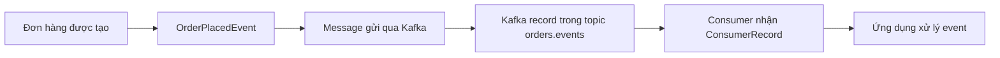

# Sự khác nhau giữa event, message và record

Khi xây dựng hệ thống messaging, ba từ **event**, **message** và **record** thường xuất hiện cạnh nhau. Trong tài liệu Kafka, đôi khi chúng còn được dùng thay thế cho nhau. Tuy nhiên, mỗi từ mô tả một góc nhìn khác nhau:

- **Event** mô tả một sự việc đã xảy ra và có ý nghĩa đối với nghiệp vụ.
- **Message** là đơn vị thông tin được gửi từ thành phần này sang thành phần khác.
- **Record** là đơn vị dữ liệu mà Kafka ghi vào topic và chuyển cho consumer đọc.

Một event có thể được đóng gói thành message rồi được Kafka lưu dưới dạng record. Hiểu đúng ba khái niệm giúp thiết kế payload, metadata, topic và consumer rõ ràng hơn, đồng thời tránh nhầm dữ liệu nghiệp vụ với thông tin vận chuyển.

## 1. Event: sự kiện nghiệp vụ đã xảy ra

Event là một sự thật về điều đã xảy ra trong hệ thống. Tên event thường dùng thì quá khứ, chẳng hạn `OrderPlaced`, `PaymentAuthorized` hoặc `InventoryReserved`. Event trả lời câu hỏi **“Điều gì đã xảy ra?”**, không phải **“Hệ thống cần làm gì tiếp theo?”**.

Ví dụ, khi khách hàng đặt hàng thành công, hệ thống có thể phát sinh event `OrderPlaced`. Event này có thể chứa:

- `eventId`: mã định danh duy nhất của lần phát sinh event.
- `orderId`: đơn hàng liên quan.
- `occurredAt`: thời điểm nghiệp vụ xảy ra.
- `total`: tổng giá trị đơn hàng tại thời điểm đó.

Trong Java, có thể biểu diễn payload của event bằng một `record`:

```java
import java.math.BigDecimal;
import java.time.Instant;

public record OrderPlacedEvent(
        String eventId,
        String orderId,
        Instant occurredAt,
        BigDecimal total
) {}
```

Đây là dữ liệu mô tả một sự kiện đã xảy ra. Consumer có thể dùng nó để cập nhật báo cáo, gửi thông báo hoặc bắt đầu một quy trình xử lý khác. Mỗi consumer quyết định hành động phù hợp với trách nhiệm của mình.

### Domain event và integration event

Trong ứng dụng phân lớp hoặc theo Domain-Driven Design, cần phân biệt hai cách dùng phổ biến:

- **Domain event** biểu diễn một sự kiện có ý nghĩa bên trong miền nghiệp vụ. Nó thường được tạo ra từ quá trình xử lý domain model và có thể chỉ phục vụ các thành phần trong cùng ứng dụng.
- **Integration event** là hợp đồng sự kiện được công bố để hệ thống hoặc service khác có thể tiêu thụ. Nó cần ổn định, có schema và chỉ chứa thông tin được phép chia sẻ.

Một domain event có thể được ánh xạ sang integration event trước khi gửi ra Kafka. Không nên mặc định mọi object nội bộ đều là hợp đồng tích hợp phù hợp cho consumer bên ngoài.

Event thường được xem là bất biến sau khi phát hành: nếu thông tin nghiệp vụ đã xảy ra thay đổi theo một sự kiện mới, hãy phát hành event mới thay vì sửa ý nghĩa của event cũ. Điều này giúp consumer có thể phát lại lịch sử và giải thích được trạng thái hệ thống.

## 2. Message: đơn vị thông tin được truyền tải

Message là đơn vị dữ liệu được một thành phần gửi cho thành phần khác qua một cơ chế giao tiếp. Message tập trung vào **việc truyền tải**: ai gửi, gửi đến đâu, nội dung là gì và consumer cần thông tin nào để xử lý.

Message có thể mang một event, nhưng không phải message nào cũng là event. Tùy mục đích giao tiếp, message có thể là:

| Loại nội dung | Ý nghĩa | Ví dụ |
|---|---|---|
| Event | Thông báo sự việc đã xảy ra | `OrderPlaced` |
| Command | Yêu cầu một thành phần thực hiện hành động | `ReserveInventory` |
| Query hoặc request | Yêu cầu cung cấp thông tin | `GetOrderStatus` |
| Reply hoặc response | Kết quả trả lời một request | `OrderStatusFound` |

Ví dụ, `OrderPlaced` là event vì đơn hàng đã được tạo. `ReserveInventory` là command vì nó yêu cầu kho giữ hàng. Cả hai đều có thể được truyền dưới dạng message qua Kafka, nhưng ý nghĩa và cách consumer xử lý chúng khác nhau.

Một message thường có hai phần về mặt khái niệm:

1. **Payload**: nội dung chính, chẳng hạn dữ liệu của `OrderPlacedEvent`.
2. **Metadata hoặc envelope**: thông tin hỗ trợ định tuyến, nhận diện, tương quan và xử lý, chẳng hạn loại message, phiên bản schema, correlation ID hoặc trace ID.

Metadata có thể nằm trong header của giao thức, trong một envelope bao quanh payload hoặc trong chính payload. Chọn một quy ước nhất quán để producer và consumer hiểu cùng một hợp đồng. Không nên lặp cùng một thông tin ở nhiều nơi nếu chưa xác định rõ nguồn nào là chuẩn.

## 3. Record: đơn vị dữ liệu của Kafka

Trong Kafka, dữ liệu được ghi vào topic dưới dạng các **record**. Một record là đơn vị mà producer gửi vào và broker lưu trong partition log. Khi đọc dữ liệu, consumer nhận được record cùng metadata vị trí của nó trong Kafka.

Ở mức khái niệm, một Kafka record có các thành phần chính:

| Thành phần | Vai trò |
|---|---|
| `key` | Khóa dùng để định tuyến/phân vùng và xác định nhóm record có liên quan; có thể để trống. |
| `value` | Payload chính của record; thường là event hoặc message đã được serialize. |
| `headers` | Các cặp key/value dạng byte để mang metadata bổ sung. |
| `timestamp` | Mốc thời gian gắn với record theo cấu hình timestamp của Kafka. |
| `topic` và `partition` | Nơi record được lưu trong Kafka. |
| `offset` | Vị trí của record trong log của một partition. |

`topic`, `partition` và `offset` là thông tin vị trí mà consumer quan sát được. Producer tạo `ProducerRecord` trước khi broker ghi dữ liệu nên chưa biết offset cuối cùng. Sau khi record được ghi, consumer nhận `ConsumerRecord` có topic, partition và offset tương ứng. Offset chỉ có ý nghĩa trong phạm vi một partition; vì vậy, khi cần định vị một record, hãy kết hợp topic, partition và offset.

Trong Kafka API, `ProducerRecord<K, V>` biểu diễn record phía producer. `ConsumerRecord<K, V>` biểu diễn record phía consumer và cung cấp cả key, value, headers lẫn metadata như partition và offset.

## 4. Quan hệ giữa ba khái niệm trong Spring Kafka

Hãy xem luồng đơn hàng sau:



`OrderPlacedEvent` là event ở góc nhìn nghiệp vụ. Producer đóng gói event vào một message để truyền đi. Khi gửi qua Kafka, message được biểu diễn bằng một Kafka record trong topic `orders.events`. Consumer đọc record đó và lấy payload để xử lý event.

Ví dụ producer dùng `KafkaTemplate` và `ProducerRecord`:

```java
import java.nio.charset.StandardCharsets;
import org.apache.kafka.clients.producer.ProducerRecord;
import org.springframework.kafka.core.KafkaTemplate;

public class OrderEventPublisher {

    private final KafkaTemplate<String, OrderPlacedEvent> kafkaTemplate;

    public OrderEventPublisher(
            KafkaTemplate<String, OrderPlacedEvent> kafkaTemplate) {
        this.kafkaTemplate = kafkaTemplate;
    }

    public void publish(OrderPlacedEvent event) {
        ProducerRecord<String, OrderPlacedEvent> kafkaRecord =
                new ProducerRecord<>("orders.events", event.orderId(), event);

        kafkaRecord.headers().add(
                "event-type",
                "OrderPlaced".getBytes(StandardCharsets.UTF_8)
        );

        kafkaTemplate.send(kafkaRecord);
    }
}
```

Trong ví dụ này:

- `event` là dữ liệu nghiệp vụ.
- `ProducerRecord` là đối tượng Kafka dùng để tạo record gửi đi.
- `event.orderId()` được dùng làm key. Với partitioner mặc định và key không null, các record có cùng key thường được định tuyến vào cùng partition, nhờ đó Kafka giữ thứ tự của chúng trong partition đó.
- Header `event-type` là metadata giúp consumer nhận biết loại event. Header Kafka có giá trị dạng byte, vì vậy producer và consumer cần thống nhất cách mã hóa.
- `KafkaTemplate.send(...)` gửi record bất đồng bộ; ứng dụng thực tế nên xử lý kết quả gửi và lỗi theo chính sách của producer.

Để ví dụ hoạt động, `KafkaTemplate` cần được cấu hình key serializer và value serializer phù hợp với kiểu dữ liệu, chẳng hạn JSON serializer cho `OrderPlacedEvent`. Consumer cũng cần deserializer tương ứng.

Phía consumer có thể nhận toàn bộ `ConsumerRecord` khi cần metadata Kafka:

```java
import org.apache.kafka.clients.consumer.ConsumerRecord;
import org.springframework.kafka.annotation.KafkaListener;
import org.springframework.stereotype.Component;

@Component
public class OrderEventListener {

    @KafkaListener(topics = "orders.events", groupId = "billing-service")
    public void onOrderPlaced(
            ConsumerRecord<String, OrderPlacedEvent> kafkaRecord) {

        OrderPlacedEvent event = kafkaRecord.value();

        System.out.printf(
                "Nhận orderId=%s từ topic=%s, partition=%d, offset=%d%n",
                event.orderId(),
                kafkaRecord.topic(),
                kafkaRecord.partition(),
                kafkaRecord.offset()
        );

        // Thực hiện xử lý nghiệp vụ dựa trên event.
    }
}
```

Nếu listener chỉ cần payload, Spring Kafka có thể chuyển đổi và truyền trực tiếp đối tượng event theo cấu hình converter/deserializer:

```java
@KafkaListener(topics = "orders.events", groupId = "notification-service")
public void onOrderPlaced(OrderPlacedEvent event) {
    // Gửi thông báo dựa trên dữ liệu event.
}
```

Chọn tham số `ConsumerRecord` khi cần kiểm tra key, headers, topic, partition hoặc offset. Chọn payload trực tiếp khi logic chỉ quan tâm dữ liệu nghiệp vụ và cấu hình chuyển đổi đã phù hợp.

## 5. Những điểm dễ nhầm lẫn

### Message và Kafka record có phải một không?

Trong giao tiếp hằng ngày, nhiều tài liệu Kafka gọi một record là message và ngược lại. Cách gọi này có thể chấp nhận được khi ngữ cảnh đã rõ. Tuy nhiên, `record` nhấn mạnh đơn vị lưu trữ và vị trí trong Kafka; `message` nhấn mạnh nội dung được truyền giữa các thành phần. Một message cũng có thể đi qua HTTP, RabbitMQ hoặc một hệ thống khác mà không trở thành Kafka record.

### Một event có luôn tương ứng với đúng một record không?

Không nhất thiết. Một event có thể được gửi đến nhiều topic hoặc được phát lại, tạo ra nhiều record vật lý mang cùng ý nghĩa nghiệp vụ. Ngược lại, một record có thể mang command hoặc response thay vì event. Vì thế, không nên dùng offset làm mã định danh nghiệp vụ của event.

Nếu cần nhận diện một event qua nhiều lần gửi hoặc nhiều luồng xử lý, hãy có `eventId` ổn định trong hợp đồng dữ liệu. Offset chỉ định vị record trong một partition cụ thể; nó không thay thế `eventId`.

### Key có phải là event ID không?

Không bắt buộc. Key chủ yếu phục vụ partitioning và có thể giúp gom các record cùng thực thể vào một partition. Ví dụ `orderId` phù hợp khi muốn các thay đổi của cùng một đơn hàng được xử lý theo thứ tự trong một partition. `eventId` lại định danh một lần phát sinh event. Hai giá trị có thể khác nhau và phục vụ hai mục đích khác nhau.

### Offset có nằm trong payload không?

Thông thường không. Offset là metadata vị trí do Kafka quản lý, consumer đọc được qua `ConsumerRecord`. Không nên đưa offset vào payload như thể đó là thuộc tính nghiệp vụ ổn định, vì cùng một event khi được gửi lại có thể nhận offset khác.

### Java `record` có phải Kafka record không?

Không. `record` trong Java là một dạng khai báo kiểu dữ liệu, thường dùng cho lớp dữ liệu bất biến với constructor, accessor, `equals`, `hashCode` và `toString` được sinh tự động. Kafka record là đơn vị dữ liệu trong topic. Ví dụ `OrderPlacedEvent` khai báo bằng Java `record` có thể được dùng làm `value` của một Kafka record; hai cách dùng từ `record` này thuộc hai khái niệm khác nhau.

## 6. Cách chọn thuật ngữ khi thiết kế hệ thống

Khi thảo luận về nghiệp vụ, hãy gọi tên sự việc là **event**: `OrderPlaced`, `PaymentFailed`. Khi nói về hợp đồng và việc gửi nhận giữa service, hãy dùng **message** hoặc **integration event message**. Khi nói về API Kafka, dữ liệu trong topic, key, partition và offset, hãy dùng **record**.

| Câu hỏi cần trả lời | Khái niệm nên dùng |
|---|---|
| Chuyện gì đã xảy ra trong nghiệp vụ? | Event |
| Thành phần này gửi thông tin gì cho thành phần kia? | Message |
| Kafka lưu và consumer đọc đơn vị dữ liệu nào? | Record |
| Dữ liệu nghiệp vụ của Kafka record nằm ở đâu? | Value/payload |
| Làm sao định vị một record đã được ghi? | Topic + partition + offset |
| Làm sao nhận diện cùng một event qua các lần gửi? | Event ID trong hợp đồng |

Khi đặt tên topic và schema, nên thể hiện rõ mục đích. Topic `orders.events` gợi ý rằng nó chứa các sự kiện đơn hàng; event type `OrderPlaced` nói rõ loại sự việc; key `orderId` hỗ trợ định tuyến theo đơn hàng. Những quy ước này giúp producer, consumer và người vận hành hiểu dữ liệu đang trao đổi.

## 7. Ghi nhớ

- **Event** là sự thật nghiệp vụ đã xảy ra.
- **Message** là đơn vị thông tin được truyền tải; nó có thể mang event, command hoặc response.
- **Kafka record** là đơn vị dữ liệu được ghi vào topic, gồm key, value, headers và timestamp; consumer còn quan sát được topic, partition và offset.
- Một event có thể được biểu diễn bởi nhiều record qua các lần gửi hoặc luồng khác nhau. `eventId` và offset giải quyết hai bài toán khác nhau.
- Trong Spring Kafka, `KafkaTemplate` gửi record; `@KafkaListener` có thể nhận payload hoặc `ConsumerRecord` tùy nhu cầu xử lý.

Khi đọc hoặc thiết kế một luồng Kafka, hãy tự hỏi ba điều: **nghiệp vụ nào đã xảy ra, thông tin nào đang được truyền đi, và Kafka đang lưu record đó ở đâu?** Trả lời được ba câu hỏi này sẽ giúp phân định rõ trách nhiệm của domain model, message contract và Kafka API.
