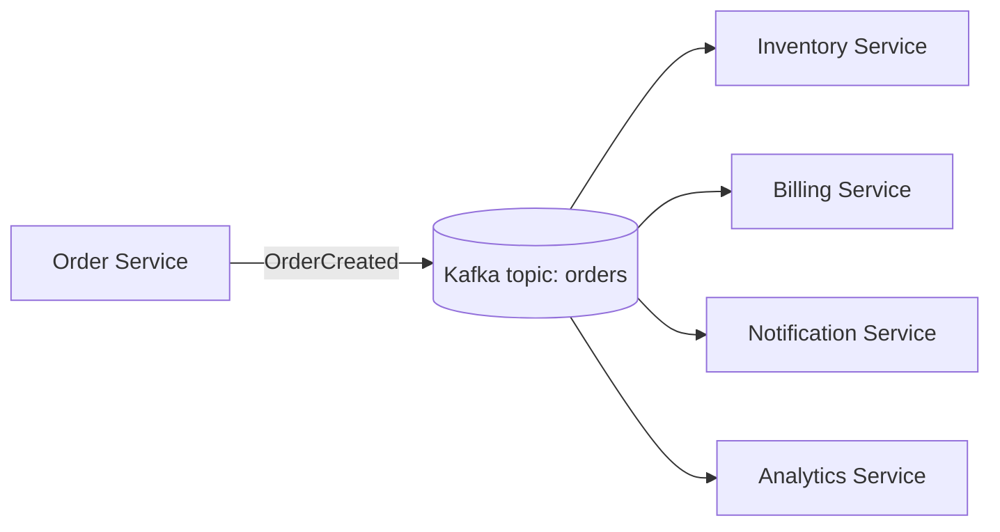

# Khi nào nên dùng Kafka và khi nào không nên dùng

Kafka là một nền tảng phân tán để ghi, lưu giữ và phân phối luồng sự kiện. Kafka đặc biệt phù hợp khi nhiều hệ thống cần trao đổi dữ liệu bất đồng bộ, cần xử lý lượng sự kiện lớn, cần đọc lại dữ liệu đã phát sinh hoặc cần để nhiều nhóm ứng dụng độc lập khai thác cùng một luồng dữ liệu.

Tuy nhiên, Kafka không phải lựa chọn mặc định cho mọi thao tác chạy nền hay mọi giao tiếp giữa các service. Kafka mang theo chi phí vận hành, thiết kế partition, quản lý schema, theo dõi consumer lag và xử lý lỗi. Nếu bài toán chỉ cần một lời gọi đồng bộ hoặc một hàng đợi công việc đơn giản, một giải pháp nhẹ hơn thường dễ xây dựng và vận hành hơn.

Bài học này giúp xác định đúng bài toán trước khi chọn Kafka, phân biệt trường hợp Kafka phát huy lợi thế với trường hợp nó làm hệ thống phức tạp thêm, và đưa ra một quy trình quyết định có thể áp dụng khi thiết kế ứng dụng Spring Kafka.

## 1. Kafka giải quyết loại vấn đề nào?

Hãy hình dung một ứng dụng thương mại điện tử. Khi khách hàng đặt hàng, hệ thống cần ghi nhận đơn hàng, trừ tồn kho, thu tiền, gửi email, cập nhật dữ liệu phân tích và thông báo cho hệ thống giao vận. Nếu service đặt hàng gọi tuần tự tất cả service còn lại, thời gian phản hồi sẽ phụ thuộc vào tổng thời gian của các hệ thống đó. Một service chậm hoặc tạm ngừng có thể làm thao tác đặt hàng thất bại dù đơn hàng đã được ghi nhận.

Kafka cho phép service đặt hàng công bố một sự kiện như `OrderCreated`. Các hệ thống quan tâm đăng ký nhận sự kiện theo cách độc lập:



Order Service không cần biết có bao nhiêu consumer đang xử lý sự kiện. Inventory, Billing, Notification và Analytics có thể triển khai, mở rộng hoặc khôi phục độc lập. Nếu Analytics tạm dừng, các consumer khác vẫn có thể tiếp tục; khi Analytics hoạt động trở lại, nó có thể đọc những record còn trong thời hạn lưu giữ.

Lợi ích cốt lõi của Kafka đến từ một số đặc tính kết hợp với nhau:

- **Tách rời thời gian hoạt động:** producer có thể ghi sự kiện khi consumer đang chậm hoặc tạm ngừng, miễn là Kafka còn khả dụng và có đủ dung lượng.
- **Lưu giữ và đọc lại:** record được giữ theo chính sách retention. Consumer có thể tiếp tục từ offset đã lưu hoặc đọc lại một khoảng dữ liệu để khôi phục hay xây dựng lại trạng thái.
- **Nhiều consumer độc lập:** mỗi consumer group có offset riêng. Nhiều nhóm có thể đọc cùng một topic với mục đích khác nhau mà không phải tranh nhau lấy một bản tin duy nhất.
- **Mở rộng theo partition:** topic được chia thành partition để tăng khả năng ghi và đọc song song. Trong một partition, thứ tự record được bảo toàn.
- **Luồng dữ liệu liên tục:** Kafka phù hợp với xử lý sự kiện, tích hợp hệ thống, thu thập telemetry và pipeline dữ liệu cần hoạt động liên tục.

Các đặc tính này có giá trị khi bài toán thực sự cần chúng. Chúng cũng tạo ra những quyết định thiết kế và vận hành mà một ứng dụng nhỏ có thể không cần gánh chịu.

## 2. Những trường hợp Kafka thường là lựa chọn phù hợp

### 2.1. Nhiều service cần phản ứng với cùng một sự kiện

Đây là một trong những trường hợp sử dụng điển hình. Một sự kiện nghiệp vụ được phát ra một lần, sau đó nhiều hệ thống độc lập cùng quan tâm.

Ví dụ, `OrderCreated` có thể được sử dụng bởi:

- Inventory Service để giữ hoặc trừ tồn kho.
- Billing Service để khởi tạo quy trình thanh toán.
- Notification Service để gửi xác nhận cho khách hàng.
- Analytics Service để cập nhật chỉ số kinh doanh.
- Shipping Service để chuẩn bị quy trình giao hàng.

Mỗi service dùng một consumer group riêng nếu cần nhận và xử lý mọi sự kiện. Kafka lưu luồng sự kiện để các nhóm tiêu thụ độc lập. Khi cần thêm Fraud Detection Service, ta có thể tạo một consumer group mới mà không buộc Order Service phải biết về service đó.

Mô hình này đặc biệt hữu ích khi số lượng bên nhận có thể tăng theo thời gian và các bên có vòng đời triển khai khác nhau.

### 2.2. Lưu lượng sự kiện lớn hoặc tăng đột biến

Kafka được thiết kế để ghi và đọc lượng record lớn theo mô hình log phân tán. Partition cho phép chia tải giữa các broker và consumer. Producer có thể gom record thành batch; consumer có thể đọc theo lô để giảm chi phí xử lý từng thông điệp.

Ví dụ phù hợp gồm:

- Sự kiện click, page view và hành vi người dùng từ nhiều máy chủ.
- Log ứng dụng, log truy cập và dữ liệu giám sát.
- Sự kiện giao dịch từ nhiều chi nhánh hoặc nhiều dịch vụ.
- Dữ liệu cảm biến IoT được gửi liên tục.
- Cập nhật trạng thái từ một hệ thống có nhiều nguồn phát.

Kafka cũng giúp hấp thụ những đợt tăng tải ngắn hạn. Producer có thể tiếp tục ghi trong khi consumer xử lý chậm hơn, trong giới hạn dung lượng, retention và cấu hình của cụm. Consumer sẽ tích lũy lag rồi xử lý bù khi có năng lực.

Điều này không có nghĩa Kafka tạo ra năng lực xử lý vô hạn. Nếu tốc độ phát sinh luôn cao hơn tốc độ tiêu thụ, lag sẽ tăng liên tục. Cần đo throughput, kích thước record, số partition, tốc độ consumer và thời gian lưu giữ để xác định cụm có đủ khả năng hay không.

### 2.3. Cần đọc lại dữ liệu để khôi phục hoặc xử lý lại

Trong một hàng đợi truyền thống, thông điệp thường được loại khỏi hàng đợi sau khi xử lý thành công. Với Kafka, record tiếp tục tồn tại theo retention; consumer quản lý vị trí đọc bằng offset.

Khả năng đọc lại hữu ích khi:

- Một consumer có lỗi logic và cần chạy lại dữ liệu sau khi đã sửa.
- Cần xây dựng lại read model hoặc projection từ sự kiện đã lưu.
- Một nhóm phân tích mới cần đọc dữ liệu lịch sử còn trong retention.
- Cần điều tra một sự cố bằng cách xem lại chuỗi sự kiện.
- Cần triển khai consumer mới và bắt đầu từ earliest hoặc từ một offset/timestamp phù hợp.

Ví dụ, Analytics Service có thể được triển khai lại với logic tính doanh thu mới. Nó có thể đọc lại topic đơn hàng để tạo báo cáo theo quy tắc mới, trong khi Billing Service vẫn tiếp tục xử lý theo offset của group riêng.

Phải phân biệt **đọc lại** với **khôi phục dữ liệu vĩnh viễn**. Record có thể bị xóa theo retention hoặc compaction policy; Kafka không thay thế chiến lược backup và lưu trữ dài hạn. Consumer đọc lại cũng có thể thực hiện side effect lần nữa, vì vậy xử lý idempotent vẫn rất quan trọng.

### 2.4. Cần xử lý dữ liệu song song nhưng vẫn giữ thứ tự theo khóa

Kafka bảo toàn thứ tự record trong phạm vi một partition. Nếu producer gửi record với cùng một key, partitioner thông thường sẽ đưa các record có key đó vào cùng partition. Nhờ vậy, các sự kiện của một thực thể có thể được xử lý theo thứ tự trong partition đó.

Ví dụ, với các sự kiện tài khoản có key là `accountId`, các cập nhật của cùng một tài khoản có thể đi vào cùng partition. Những tài khoản khác nhau có thể được xử lý song song bởi nhiều consumer trong cùng group.

```java
public void publish(AccountEvent event) {
    kafkaTemplate.send(
        "account-events",
        event.accountId(),
        event
    );
}
```

Key ở đây là `accountId`. Nó giúp định tuyến các sự kiện của cùng tài khoản tới cùng partition theo partitioner đang sử dụng. Khi chọn key, cần cân nhắc phân bố tải: một key quá nóng có thể làm một partition trở thành nút thắt.

Kafka không bảo đảm một thứ tự toàn cục giữa tất cả partition. Nếu nghiệp vụ đòi hỏi mọi sự kiện của mọi khách hàng phải theo một thứ tự duy nhất, việc dùng một partition có thể làm giảm khả năng song song và giới hạn throughput. Trước tiên cần xác định chính xác phạm vi thứ tự mà nghiệp vụ yêu cầu.

### 2.5. Xây dựng pipeline sự kiện và tích hợp dữ liệu

Kafka phù hợp làm lớp trung chuyển giữa các hệ thống tạo dữ liệu và các hệ thống xử lý dữ liệu. Nguồn có thể là ứng dụng nghiệp vụ, cơ sở dữ liệu thông qua CDC, hệ thống log hoặc thiết bị IoT. Đích có thể là service nghiệp vụ, kho dữ liệu, hệ thống tìm kiếm hoặc nền tảng xử lý stream.

Ví dụ, một hệ thống có thể phát sự kiện thay đổi đơn hàng vào Kafka; một consumer cập nhật Elasticsearch để tìm kiếm, một consumer khác cập nhật data warehouse, và một consumer nữa gửi thông báo. Các bên nhận không phải truy vấn trực tiếp cơ sở dữ liệu giao dịch của nhau.

Kafka đặc biệt có ích khi luồng dữ liệu cần được chia sẻ cho nhiều hệ thống và cần tách biệt tốc độ triển khai của nguồn với tốc độ xử lý của từng đích.

## 3. Những trường hợp không nên chọn Kafka làm giải pháp đầu tiên

### 3.1. Người dùng cần kết quả ngay trong cùng một request

Nếu một API cần trả lời câu hỏi “Tên người dùng này có tồn tại không?” hoặc “Thanh toán có được chấp nhận không?”, HTTP hoặc gRPC thường phù hợp hơn. Caller cần kết quả của thao tác để quyết định bước tiếp theo.

Kafka là giao tiếp bất đồng bộ. Producer gửi record thành công chỉ cho biết broker đã nhận record theo mức xác nhận cấu hình; điều đó không đồng nghĩa consumer đã hoàn tất nghiệp vụ. Nếu caller phải chờ consumer, nhận kết quả, xử lý timeout và tương quan request/response, hệ thống có thể trở nên phức tạp hơn một lời gọi đồng bộ.

Có thể kết hợp HTTP và Kafka: API xác thực và ghi nhận yêu cầu, trả về mã tiếp nhận; quy trình dài được xử lý qua Kafka, sau đó client tra cứu trạng thái hoặc nhận callback. Nhưng nếu thao tác đơn giản và cần kết quả ngay, hãy bắt đầu bằng giao tiếp đồng bộ.

### 3.2. Chỉ cần một hàng đợi công việc đơn giản

Một tác vụ như gửi một email, tạo thumbnail hoặc chạy một công việc nền có thể chỉ cần một queue với cơ chế nhận, xác nhận, retry và đưa thông điệp lỗi vào dead-letter queue. Các message thường được xử lý rồi loại khỏi queue.

Các hệ thống hàng đợi như RabbitMQ hoặc dịch vụ queue được quản lý có thể phù hợp hơn nếu bài toán cần routing linh hoạt, acknowledgement theo từng message, lịch giao lại, độ ưu tiên hoặc mô hình work queue quen thuộc. Kafka vẫn có thể phân phối công việc qua consumer group, nhưng record không tự biến mất sau khi consumer xử lý; offset và retention được quản lý theo cách khác.

Hãy chọn theo semantics cần có: queue công việc, routing, retry delay và xác nhận từng message có thể là yêu cầu quan trọng hơn khả năng replay một event log.

### 3.3. Lưu lượng nhỏ và kiến trúc hiện tại còn đơn giản

Nếu một ứng dụng nội bộ chỉ phát vài sự kiện mỗi phút, có một consumer và không cần replay, triển khai Kafka có thể tạo thêm nhiều việc:

- Cấp phát và giám sát broker hoặc trả phí cho dịch vụ Kafka được quản lý.
- Quản lý topic, partition, retention, ACL và cấu hình producer/consumer.
- Theo dõi consumer lag, rebalance, lỗi serialization và dung lượng lưu trữ.
- Thiết kế retry, dead-letter, idempotency và quy trình xử lý sự cố.
- Quản lý schema và tương thích giữa producer với consumer.

Một bảng công việc trong cơ sở dữ liệu, cơ chế background job hoặc một queue được quản lý có thể đáp ứng tốt hơn. Khi số lượng hệ thống, throughput hoặc yêu cầu replay tăng lên, có thể đánh giá lại bằng dữ liệu thực tế.

### 3.4. Nghiệp vụ cần tính nhất quán tức thời giữa nhiều thao tác

Giả sử một service cập nhật đơn hàng trong database rồi gửi sự kiện `OrderPaid` lên Kafka. Nếu database commit thành công nhưng gửi Kafka thất bại, các service khác không nhận được sự kiện. Nếu gửi Kafka trước rồi database rollback, consumer có thể nhận một sự kiện cho thay đổi chưa tồn tại.

Kafka transaction hỗ trợ giao dịch trong phạm vi Kafka, chẳng hạn ghi nhiều record và commit offset theo semantics phù hợp. Nó không tự tạo một giao dịch ACID bao trùm Kafka và một cơ sở dữ liệu quan hệ độc lập.

Với bài toán cần phát sự kiện nhất quán cùng thay đổi database, thường cần xem xét **Transactional Outbox**: ghi dữ liệu nghiệp vụ và bản ghi outbox trong cùng transaction của database; một tiến trình khác chuyển bản ghi outbox sang Kafka. CDC có thể được dùng để đọc outbox. Consumer vẫn nên idempotent vì việc phát lại có thể xảy ra.

Nếu yêu cầu thực chất là một giao dịch đồng bộ, có ràng buộc nhất quán tức thời và chưa có thiết kế xử lý phân tán rõ ràng, không nên thêm Kafka chỉ để thay thế một transaction database.

### 3.5. Cần thứ tự toàn cục hoặc xử lý một thực thể duy nhất

Kafka chỉ bảo toàn thứ tự trong từng partition. Muốn có một thứ tự toàn cục thường phải dồn dữ liệu vào một partition hoặc thiết kế một cơ chế điều phối khác. Điều này có thể giới hạn khả năng song song và tạo điểm nghẽn.

Nếu ứng dụng chỉ cần một worker tuần tự xử lý một lượng công việc nhỏ, một hàng đợi đơn giản hoặc một tiến trình nền có thể dễ hiểu hơn. Nếu chỉ cần thứ tự theo từng đơn hàng, tài khoản hay thiết bị, hãy dùng key và partition để giữ thứ tự trong phạm vi thực thể đó.

### 3.6. Muốn dùng Kafka như cơ sở dữ liệu chính hoặc kho lưu trữ vô thời hạn

Kafka là log sự kiện, không phải cơ sở dữ liệu đa mục đích thay cho hệ quản trị quan hệ hoặc NoSQL. Kafka không cung cấp trực tiếp mô hình truy vấn tùy ý, join, constraint và transaction nghiệp vụ giống database.

Log compaction có thể giữ lại record mới nhất theo key trong một số trường hợp, nhưng không biến Kafka thành một database đầy đủ. Ứng dụng cần tra cứu theo nhiều điều kiện, cập nhật bản ghi, ràng buộc dữ liệu và quản lý quan hệ vẫn nên dùng database phù hợp. Kafka có thể truyền các thay đổi để đồng bộ những read model hoặc hệ thống lưu trữ khác.

## 4. Kafka, HTTP/gRPC và message queue khác nhau ở đâu?

Không có một công nghệ thắng trong mọi tình huống. Hãy bắt đầu từ cách hai bên cần tương tác và semantics của dữ liệu.

| Tiêu chí | Kafka | HTTP/gRPC | Message queue truyền thống |
|---|---|---|---|
| Kiểu giao tiếp thường gặp | Event streaming bất đồng bộ | Request/response | Phân phối công việc hoặc message bất đồng bộ |
| Ai khởi tạo tương tác | Producer công bố record | Client gọi server | Producer gửi message vào queue/exchange |
| Nhiều bên nhận độc lập | Có, qua nhiều consumer group | Thường cần gọi từng API hoặc thêm cơ chế fan-out | Tùy queue, exchange và cấu hình subscription |
| Đọc lại dữ liệu | Có, trong giới hạn retention và offset | Không phải chức năng mặc định | Thường phụ thuộc broker và cơ chế lưu message |
| Thứ tự | Trong một partition | Theo từng request/luồng do ứng dụng quản lý | Tùy queue, số consumer và cấu hình |
| Phù hợp với | Luồng sự kiện lớn, replay, nhiều consumer, pipeline dữ liệu | Truy vấn và thao tác cần kết quả trực tiếp | Work queue, routing, acknowledgement và retry theo message |
| Chi phí cần cân nhắc | Partition, retention, consumer lag, cluster | Ghép nối thời gian hoạt động, timeout, retry | Topology queue, routing, ack và chính sách message |

Một kiến trúc thực tế thường kết hợp các công nghệ. Ví dụ, API nhận yêu cầu qua HTTP, ghi đơn hàng vào database, phát `OrderCreated` qua Kafka, rồi một service khác gọi nhà cung cấp thanh toán bằng HTTP. Không cần ép mọi giao tiếp vào cùng một cơ chế.

## 5. Phân biệt event với command trước khi tạo topic

Một lý do thường gặp khiến Kafka bị dùng sai là đưa mọi yêu cầu vào topic rồi gọi chúng là event.

- **Event** mô tả điều đã xảy ra: `OrderCreated`, `PaymentCaptured`, `InventoryReserved`. Event thường được nhiều bên quan tâm và không yêu cầu một consumer cụ thể phải trả lời ngay.
- **Command** yêu cầu một bên thực hiện hành động: `ChargePayment`, `ReserveInventory`, `SendEmail`. Command có người nhận hoặc nơi xử lý dự kiến, và thường cần kết quả hoặc trạng thái hoàn thành.

Kafka có thể truyền cả event lẫn command, nhưng cách thiết kế khác nhau. Với event, nhiều consumer group có thể cùng phản ứng. Với command, cần xác định rõ ai chịu trách nhiệm xử lý, cách tránh xử lý trùng, cách trả kết quả và cách xử lý command hết hạn hoặc thất bại.

Đặt tên topic và schema theo ý nghĩa nghiệp vụ. `orders.created` diễn đạt sự kiện đơn hàng đã được tạo. `orders.create` nghe giống một yêu cầu tạo đơn hàng. Sự phân biệt này giúp consumer hiểu liệu nó đang quan sát sự thật đã xảy ra hay đang nhận một yêu cầu cần thực thi.

## 6. Ví dụ lựa chọn trong ứng dụng Spring Kafka

Giả sử Order Service đã lưu đơn hàng và cần thông báo cho các hệ thống quan tâm. Sau khi có thiết kế đảm bảo thay đổi database và sự kiện được phát nhất quán, producer có thể gửi event bằng `KafkaTemplate`:

```java
public record OrderCreatedEvent(
    String eventId,
    String orderId,
    BigDecimal total,
    Instant occurredAt
) {}

@Service
public class OrderEventPublisher {
    private final KafkaTemplate<String, OrderCreatedEvent> kafkaTemplate;

    public OrderEventPublisher(
            KafkaTemplate<String, OrderCreatedEvent> kafkaTemplate) {
        this.kafkaTemplate = kafkaTemplate;
    }

    public void publish(OrderCreatedEvent event) {
        kafkaTemplate.send("orders.created", event.orderId(), event);
    }
}
```

`orderId` được dùng làm key để những sự kiện cùng đơn hàng thường đi vào cùng partition. Cấu hình serializer phải thống nhất giữa producer và consumer; ví dụ này giả định ứng dụng đã cấu hình JSON serializer phù hợp cho record.

Billing Service có thể đăng ký một consumer độc lập:

```java
@Component
public class OrderCreatedListener {

    @KafkaListener(
        topics = "orders.created",
        groupId = "billing-service"
    )
    public void handle(OrderCreatedEvent event) {
        // Kiểm tra eventId và xử lý idempotent trước side effect.
        // Khởi tạo quy trình thanh toán cho orderId.
    }
}
```

Notification Service có thể dùng group `notification-service` để nhận cùng luồng sự kiện cho mục đích gửi thông báo. Hai group có offset độc lập. Nếu nhiều instance của Billing Service cùng thuộc `billing-service`, Kafka phân phối partition của group đó giữa các instance để xử lý song song.

Ví dụ trên minh họa cách công bố và tiêu thụ event; nó chưa phải toàn bộ cấu hình production. Một hệ thống thực tế còn cần cấu hình bootstrap server, serializer/deserializer, bảo mật, số partition, replication, consumer concurrency, error handler, retry/dead-letter, giám sát lag và chiến lược tương thích schema. Quan trọng hơn, handler cần xử lý được trường hợp một event được giao lại. Việc gửi record thành công không chứng minh toàn bộ nghiệp vụ phía Billing đã hoàn tất.

Nếu yêu cầu của Order Service là hỏi Billing “có chấp nhận thanh toán ngay lúc này không?” và phải trả lời khách hàng trong cùng request, một API đồng bộ có thể phù hợp hơn. Kafka phù hợp hơn khi Order Service công bố một sự kiện và Billing xử lý độc lập sau đó.

## 7. Bảng quyết định theo tình huống

| Tình huống | Hướng lựa chọn ban đầu | Lý do |
|---|---|---|
| Nhiều service cùng cần nhận `OrderCreated` | Kafka | Fan-out qua consumer group, các bên xử lý độc lập |
| Thu thập hàng triệu sự kiện telemetry và xử lý liên tục | Kafka | Throughput, partition và pipeline stream |
| Cần đọc lại sự kiện để dựng lại projection | Kafka | Offset và retention hỗ trợ replay |
| API cần trả kết quả kiểm tra trong vài trăm mili giây | HTTP/gRPC | Caller cần response trực tiếp |
| Gửi email nền cho một ứng dụng nhỏ | Background job hoặc queue đơn giản | Nhu cầu replay và streaming có thể không đủ bù chi phí Kafka |
| Công việc cần routing, priority, delayed retry theo message | Đánh giá message queue | Các semantics này thường là trọng tâm của queue |
| Một thao tác cập nhật database và phát event phải nhất quán | Database + Outbox/CDC + Kafka khi cần | Kafka transaction đơn lẻ không bao trùm database ngoài Kafka |
| Lưu dữ liệu nghiệp vụ để truy vấn tùy ý | Database | Kafka không phải hệ quản trị truy vấn đa mục đích |
| Mọi record phải theo một thứ tự toàn cục | Xem lại yêu cầu và kiến trúc | Nhiều partition không cung cấp thứ tự toàn cục |

Các hướng lựa chọn trong bảng là điểm bắt đầu để phân tích. Quyết định cuối cùng còn phụ thuộc throughput, độ trễ, độ bền dữ liệu, năng lực vận hành, ngân sách và công nghệ sẵn có của tổ chức.

## 8. Quy trình đánh giá trước khi đưa Kafka vào hệ thống

Trước khi tạo cluster hoặc thêm dependency Spring Kafka, hãy trả lời các câu hỏi sau:

1. **Dữ liệu là gì?** Đó là event mô tả điều đã xảy ra, command yêu cầu hành động, hay request cần response?
2. **Ai cần nhận dữ liệu?** Chỉ một worker hay nhiều hệ thống độc lập? Các bên có cần đọc cùng một record theo tiến độ riêng không?
3. **Có cần replay không?** Cần đọc lại trong bao lâu, để khôi phục, kiểm toán hay xây dựng projection mới?
4. **Lưu lượng và độ trễ ra sao?** Đo số record mỗi giây, kích thước record, burst, thời gian consumer được phép trễ và tốc độ xử lý thực tế.
5. **Phạm vi thứ tự là gì?** Toàn hệ thống hay chỉ theo `orderId`, `accountId` hoặc một khóa nghiệp vụ khác?
6. **Khi lỗi thì điều gì xảy ra?** Có retry không, retry có thể tạo side effect trùng không, khi nào đưa vào dead-letter, ai xử lý record lỗi?
7. **Ai vận hành Kafka?** Đã có cluster hoặc dịch vụ được quản lý, giám sát, cảnh báo, phân quyền và quy trình nâng cấp chưa?
8. **Tính nhất quán được bảo đảm thế nào?** Nếu database và Kafka cùng tham gia một luồng nghiệp vụ, cần thiết kế Outbox/CDC hoặc cơ chế phù hợp.
9. **Schema thay đổi ra sao?** Producer và consumer có thể được triển khai lệch thời điểm; cần quy tắc tương thích và quản lý phiên bản schema.

Nếu chưa trả lời được những câu hỏi cơ bản về người nhận, semantics và lỗi, chưa nên bắt đầu bằng việc tạo topic. Hãy mô tả luồng nghiệp vụ trước, sau đó mới chọn công nghệ.

## 9. Những ngộ nhận cần tránh

- **“Dùng Kafka thì không mất message.”** Độ bền phụ thuộc replication, acknowledgement, cấu hình broker, retention, lỗi vận hành và cách producer/consumer xử lý. Cần cấu hình và kiểm thử theo yêu cầu thực tế.
- **“Kafka bảo đảm xử lý đúng một lần cho toàn bộ nghiệp vụ.”** Exactly-once có phạm vi và điều kiện cụ thể, đặc biệt khi có database hoặc API bên ngoài. Idempotency và thiết kế side effect vẫn cần thiết.
- **“Một topic tương đương một queue.”** Topic là log partitioned. Consumer group, offset, retention và cách nhiều bên đọc khác với mô hình queue loại message sau acknowledgement.
- **“Thêm partition là luôn nhanh hơn.”** Partition tăng khả năng song song nhưng cũng ảnh hưởng thứ tự, phân bố key, tài nguyên broker, số consumer và chi phí rebalance.
- **“Producer gửi thành công nghĩa là nghiệp vụ đã xong.”** Nó chỉ phản ánh kết quả gửi theo acknowledgement đã cấu hình. Consumer có thể chưa đọc hoặc chưa hoàn tất xử lý.
- **“Kafka thay thế database.”** Kafka lưu và phân phối luồng record; ứng dụng vẫn cần nơi quản lý trạng thái nghiệp vụ và truy vấn phù hợp.

## 10. Kết luận lựa chọn

Nên cân nhắc Kafka khi hệ thống cần một luồng sự kiện bền vững, throughput cao, nhiều consumer độc lập, khả năng đọc lại hoặc pipeline dữ liệu liên tục. Kafka đặc biệt có giá trị khi các service cần tách rời thời gian hoạt động và tốc độ xử lý.

Không nên đưa Kafka vào chỉ vì muốn chạy một tác vụ nền, thay một lời gọi HTTP đơn giản hoặc vì kiến trúc “microservices thì phải có Kafka”. Với request/response, hãy ưu tiên HTTP/gRPC. Với work queue nhỏ, hãy cân nhắc background job hoặc message queue. Với dữ liệu nghiệp vụ cần truy vấn và transaction, hãy dùng database; nếu cần phát event nhất quán, đánh giá Outbox/CDC.

Quyết định tốt bắt đầu từ yêu cầu nghiệp vụ: ai cần dữ liệu, cần nhận khi nào, có cần đọc lại không, thứ tự cần bảo toàn ở phạm vi nào và hệ thống sẽ phục hồi ra sao khi lỗi. Khi các yêu cầu đó khớp với mô hình log phân tán của Kafka và tổ chức có khả năng vận hành nó, Spring Kafka với `KafkaTemplate` và `@KafkaListener` là một lựa chọn phù hợp.
